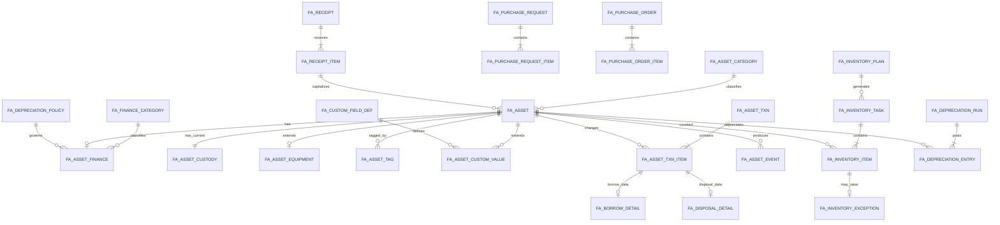

# 固定资产管理系统设计方案（不含 BPMN）

> 依据：`datae.ndm2`（Navicat Data Modeler 2.01，MySQL 5.7.42 模型）  
> 范围：固定资产主数据、采购验收、入库、领用、借还、调拨、盘点、折旧、维修保养、报废处置、审计与报表；明确排除开源 BPMN/工作流引擎及其审批配置。  
> 结论置信度：对表结构与结构性问题为高；对历史表中真实数据量、孤儿数据、重复数据和现行业务规则为未验证，因为当前目录只有 ER 模型，没有应用代码、迁移脚本和运行数据库。

## 1. 结论先行

现有模型覆盖了固定资产全生命周期，业务广度足够，但不适合直接作为新系统的物理模型照搬。建议保留它的业务分域和历史快照思想，重建一个“核心主数据 3NF + 单据事实快照 + 财务不可变台账”的模型。

关键判断如下：

1. `eam_asset` 是当前业务中心，但 133 个字段同时承载资产身份、当前保管、仓储、财务折旧、设备参数、维保、流程审批和自定义标签，已经形成宽表/上帝表。目标设计应拆为资产主表、当前保管、财务、设备扩展和动态扩展值。
2. 现有 `eam_*` 共 217 张表、4,596 个字段，全部有主键且均为 InnoDB/`utf8mb4_general_ci`；这是统一的基础规范。
3. 217 张 EAM 表中没有任何数据库外键，191 张没有二级索引，仅有 10 个唯一索引。54 张含 `business_code` 的表没有一张对它建立唯一索引；`eam_asset.asset_code` 也只是普通索引。这会把重复单号、孤儿明细、跨租户串数据和查询退化全部留给应用层。
4. 133 张 EAM 表有 `tenant_id`，但仅 5 张表的二级索引包含 `tenant_id`；租户隔离与常用查询模式不匹配。
5. 3,970/4,596（86.4%）字段允许为空，3,067 个字段使用 `varchar`，并有 163 个以 `status` 结尾的 `varchar` 字段，说明领域约束偏弱。
6. 模型里存在两套盘点（`eam_inventory_*` 与 `eam_stock_inventory_*`）、两套转移（`eam_asset_tranfer` 与 `eam_transfer`）、资产复制表、状态复制表、Demo/C1/客户定制表。它们应在迁移前判定权威来源，不能全部进入新核心库。
7. 当前 BPMN 耦合很深：52 张 `act_*`、24 张 `bpm_*`，另有 3 张 EAM 审批配置表；30 张 EAM 表含 `proc_id`，14 张表内嵌最近/下一审批人等快照字段。目标模型全部去除这些表和字段，只保留与资产业务本身有关的单据状态。

## 2. 现有设计中值得保留的部分

### 2.1 符合规范化思路的部分

- 品牌、厂商、供应商、资产分类、财务分类、仓库、库位、区域、位置均独立建表，避免在资产表中重复维护完整主数据。
- 采购申请/清单/验收、盘点计划/任务/明细、保养计划/任务/记录、维修申请/工单/验收、折旧方案/批次/明细已经形成较清楚的“主表—明细—执行记录”层次。
- 每张 EAM 表都有单列主键；绝大部分表包含创建、修改、逻辑删除、版本字段，具备审计和乐观锁基础。
- `eam_asset_depreciation_detail` 保存资产名称、分类、原值、残值、使用人/管理人等计算时快照。对财务台账而言，这是正确的有意反 3NF：历史凭证不能随主数据改名而改变。
- 巡检、保养、维修任务中保留计划和资产快照，也有利于重放历史事实。

### 2.2 当前反 3NF 中可保留的部分

反 3NF 不是问题本身；关键是字段必须有明确的权威来源、更新时间和一致性规则。以下类型可以保留：

- **单据/台账快照**：交易发生时的资产名称、分类、责任人、原值、位置和计算参数；写入后不可随主数据联动修改。
- **当前余额缓存**：累计折旧、账面净值、最近折旧期间；权威来源仍是折旧分录，缓存必须在同一数据库事务中更新并可重算。
- **树路径缓存**：分类和位置的 `hierarchy`/全路径名称；权威来源是父子关系，节点移动时统一重建。
- **报表读模型**：单独的视图或汇总表；不得与交易主表混用，也不得反向成为写入入口。

以下反 3NF 不建议保留：CSV ID（如 `part_ids`、下一审批人列表）、无约束的通用关联表、业务表中的名称与 ID 双写但没有快照语义、把设备/财务/审批/标签字段全部塞入资产主表。

## 3. 系统边界

### 3.1 纳入范围

- 资产分类、财务分类、品牌、厂商、供应商、组织、人员、仓库、位置等主数据引用。
- 实物固定资产和可选的软件资产。
- 采购申请、采购订单、到货验收、资产建卡和入库。
- 领用、退库、借用、归还、组织调拨、使用人/位置变更、报失、报废和处置。
- 盘点计划、任务、实盘结果、差异处理。
- 折旧政策、折旧批次、折旧分录和财务汇总。
- 维修、保养、巡检（作为可选扩展域）。
- 标签/RFID、附件、资产事件、操作审计、报表查询。

### 3.2 明确排除

- 所有 `act_*`、`bpm_*` 表。
- `eam_approve_configure`、`eam_approve_role`、`eam_role_approve`。
- `proc_id`、`change_instance_id`、`latest_approver_*`、`next_approver_*`、`approval_opinion` 等流程字段。
- BPMN 表单、流程定义、任务、催办、候选人、审批附件和流程统计。
- `*_copy*`、`*_demo*`、C1/客户定制中间表未经业务确认不得迁入核心模型。
- 通用耗材库存不与固定资产混表。若确有耗材需求，另设 `inv_item`、`inv_stock_balance`、`inv_stock_txn` 子系统；固定资产默认“一卡一物、数量为 1”。

没有 BPMN 后，单据只使用业务状态：`DRAFT`（草稿）、`POSTED`（已过账）、`CANCELLED`（作废）、`REVERSED`（已冲销）。只有具备相应角色权限的用户能执行 `POSTED`，但系统不保存审批链。

## 4. 推荐领域模型



## 5. 目标表设计

### 5.1 主数据与资产核心

| 表 | 作用 | 关键约束 |
|---|---|---|
| `fa_asset_category` | 资产分类树 | `UK(tenant_id, category_code)`；父分类外键；保存路径缓存 |
| `fa_finance_category` | 会计分类、默认寿命和折旧策略 | `UK(tenant_id, category_code)` |
| `fa_brand` | 品牌 | `UK(tenant_id, brand_code)`；可关联厂商 |
| `fa_manufacturer` | 生产厂商 | `UK(tenant_id, manufacturer_code)` |
| `fa_supplier` | 供应商 | `UK(tenant_id, supplier_code)` |
| `fa_warehouse` | 仓库 | `UK(tenant_id, warehouse_code)` |
| `fa_location` | 统一区域、库位、办公位置和机柜位置树 | `UK(tenant_id, location_code)`；`parent_id` 自关联；`location_type` 区分类型 |
| `fa_asset` | 资产身份、分类及三个正交状态 | `UK(tenant_id, asset_code)`；序列号可选唯一；不保存审批字段 |
| `fa_asset_custody` | 每项资产唯一的当前保管/使用/位置状态 | `PK/FK(asset_id)`；组织、用户、仓库、位置外键 |
| `fa_asset_finance` | 每项资产的财务属性和可重算余额 | `PK/FK(asset_id)`；金额非负；残值率 0～1 |
| `fa_asset_equipment` | 设备/IT 专属属性 | `PK/FK(asset_id)`；机柜、U 位、IP 等不污染主表 |
| `fa_asset_tag` | 条码、二维码、RFID | `UK(tenant_id, tag_type, tag_value)`；同一资产同类标签可限唯一 |
| `fa_custom_field_def` | 非核心扩展字段定义 | `UK(tenant_id, field_code)`；限定数据类型和适用分类 |
| `fa_asset_custom_value` | 扩展字段值 | `UK(asset_id, field_id)`；按类型只允许一个 `value_*` 非空 |

`fa_asset` 推荐核心字段：

- 标识：`id`、`tenant_id`、`asset_code`、`asset_name`、`category_id`、`model`、`serial_no`、`unit`。
- 来源：`brand_id`、`manufacturer_id`、`supplier_id`、`acquisition_source`、`purchase_date`、`capitalization_date`。
- 状态：`lifecycle_status`、`usage_status`、`accounting_status`。不要把所有组合压成一个含义模糊的 `asset_status`。
- 管理：`owner_org_id`、`manager_user_id`、`version`、`created_at/by`、`updated_at/by`、`deleted_at/by`。

三个状态维度建议如下：

- `lifecycle_status`：`ACTIVE`、`LOST`、`SCRAPPED`、`DISPOSED`。
- `usage_status`：`IN_STOCK`、`IN_USE`、`BORROWED`、`UNDER_REPAIR`、`IDLE`。
- `accounting_status`：`NOT_CAPITALIZED`、`DEPRECIATING`、`FULLY_DEPRECIATED`、`DEPRECIATION_STOPPED`。

### 5.2 资产生命周期单据

现有领用、借用、归还、调拨、退库、报废等表拥有大量重复字段，同时通过 `selected_code -> eam_asset_selected_data` 间接关联资产。建议改为统一单据头与明确明细：

| 表 | 作用 | 关键字段/约束 |
|---|---|---|
| `fa_asset_txn` | 生命周期单据头 | `txn_no`、`txn_type`、`status`、`business_date`、`operator_id`、`reason`、`idempotency_key`、`reversed_txn_id`；`UK(tenant_id, txn_no)` |
| `fa_asset_txn_item` | 单据资产明细 | `txn_id`、`asset_id`、变更前后状态/组织/人员/位置快照；`UK(txn_id, asset_id)` |
| `fa_borrow_detail` | 借用专属字段 | `txn_item_id`、借用人、应还时间、实还时间、归还单明细 ID |
| `fa_disposal_detail` | 报废/处置专属字段 | 处置方式、处置收入、购买方、处置日期、财务凭证号 |
| `fa_asset_operation_lock` | 防止同一资产被多个未完成单据并发占用 | `PK(asset_id)`、`txn_id`、`expires_at`；过账/取消时释放 |
| `fa_asset_event` | 不可变资产事件流 | 事件类型、单据和明细来源、前后快照、操作者、发生时间 |

交易规则：

1. 草稿不修改 `fa_asset` 或 `fa_asset_custody`。
2. 过账时锁定资产行并校验当前 `version`、状态和租户；写入单据明细、事件，再原子更新当前状态。
3. 已过账事实不做逻辑删除和直接修改；纠错必须建立反向交易并标记 `REVERSED`。
4. `idempotency_key` 防止接口重试造成重复领用/归还/调拨。
5. `fa_asset_event` 是审计事实，`fa_asset`/`fa_asset_custody` 是当前状态投影；两者可通过重放或对账校验一致性。

### 5.3 采购、验收与建卡

| 表 | 作用 | 关键约束 |
|---|---|---|
| `fa_purchase_request` / `_item` | 采购需求与明细 | 请求号唯一；数量、预算单价为正 |
| `fa_purchase_order` / `_item` | 采购订单与明细 | 订单号唯一；关联供应商和请求明细 |
| `fa_receipt` / `_item` | 到货验收 | 验收号唯一；实收数不可超过容差；关联订单明细 |
| `fa_capitalization` | 从验收行生成资产卡片的批次 | `UK(receipt_item_id, batch_no)`；记录成功/失败数量 |

采购行表示“买什么、多少、多少钱”；资产卡表示“具体哪一件”。验收 10 台设备应先形成一条验收行，再创建 10 个唯一资产编码，不能在 `eam_purchase_order` 一行中同时承担订单头、订单明细和资产映射职责。

### 5.4 盘点

只保留一套盘点模型：

| 表 | 作用 | 关键约束 |
|---|---|---|
| `fa_inventory_plan` | 周期性盘点模板 | 计划类型、周期、启停状态 |
| `fa_inventory_plan_category/org/location/warehouse` | 规范化盘点范围 | 各表均对计划与范围对象建立复合唯一约束和外键 |
| `fa_inventory_task` | 某次盘点实例 | 任务号唯一；开始/截止/完成时间 |
| `fa_inventory_assignee` | 负责人和执行人 | `UK(task_id, user_id, role_type)` |
| `fa_inventory_item` | 应盘与实盘快照 | `UK(task_id, asset_id)`；期望和实际状态/位置/责任人分列 |
| `fa_inventory_exception` | 盘盈、盘亏、位置不符、责任人不符 | 一项差异一个处理状态；关联后续资产交易 |

任务生成时固化盘点范围和应盘资产快照；之后资产发生移动也不能改变该任务的“应盘集合”。盘点差异不能直接改资产，而应生成调拨、报失或建卡交易，以保证审计闭环。

### 5.5 折旧与财务台账

| 表 | 作用 | 关键约束 |
|---|---|---|
| `fa_depreciation_policy` | 年限、残值率、折旧方法、首月规则 | 政策编码唯一；发布后版本化，不直接覆盖历史版本 |
| `fa_depreciation_run` | 某会计期间的一次计提 | `UK(tenant_id, company_id, accounting_period)`；状态 `CALCULATED/POSTED/REVERSED` |
| `fa_depreciation_entry` | 每项资产的不可变折旧分录 | `UK(run_id, asset_id)`；保存输入参数、期初/本期/期末金额和分类/责任人快照 |

金额统一用 `DECIMAL(18,2)`，比率用 `DECIMAL(9,6)` 并约定以 0～1 的小数存储。`fa_asset_finance.accumulated_depreciation` 和 `net_book_value` 是性能缓存；`fa_depreciation_entry` 才是可审计的权威事实。已过账分录不可覆盖，只能冲销。

### 5.6 维修、保养、巡检（可选扩展）

- 保养：`fa_maintenance_plan`、`fa_maintenance_task`、`fa_maintenance_item`、`fa_maintenance_record`。
- 维修：`fa_repair_request`、`fa_repair_order`、`fa_repair_action`、`fa_repair_part`、`fa_repair_acceptance`。
- 巡检：`fa_inspection_plan`、`fa_inspection_point`、`fa_inspection_task`、`fa_inspection_result`。

任务中可以保存资产名称、型号、位置等快照，但必须用 `snapshot_*` 命名或在字段注释中标明“任务生成时快照”，避免与主数据双写混淆。维修备件应关联独立耗材库存域，不直接增加固定资产数量。

## 6. 规范、约束与索引基线

### 6.1 通用字段

- 新系统建议使用 `BIGINT UNSIGNED` 主键；外部系统 ID 单独放 `external_id`。若迁移期间必须保留当前 `varchar(50)` ID，应通过临时映射表转换，不能混用两套主键语义。
- 所有业务表：`tenant_id NOT NULL`、`created_at/by`、`updated_at/by`、`version NOT NULL DEFAULT 0`。
- 主数据可使用 `deleted_at/by`；资产交易、盘点结果和财务分录不允许逻辑删除，只能作废/冲销。
- 时间统一存 UTC 的 `DATETIME(3)`，接口层按用户时区展示；会计日期另用 `DATE`/`CHAR(7)` 表示业务日和期间。
- 状态使用短代码和明确枚举，不使用 `yes/no`、`0/1`、任意字符串混搭。

### 6.2 必须建立的约束

- 每个 `_id` 都应有真实外键，或在架构文档中明确它是跨服务引用并提供异步一致性校验；不能默认“所有外键都由代码保证”。
- 多租户关键关系采用复合外键 `(tenant_id, ref_id)`，父表提供 `UK(tenant_id, id)`，防止跨租户引用。
- 编号类字段使用租户域内唯一约束：资产号、单据号、分类号、仓库号、位置号、标签值。
- 数量、金额、寿命、残值率、U 位范围等加入数据约束。若仍运行 MySQL 5.7，不应把 `CHECK` 当作有效防线，必须由应用校验和数据库回归测试共同兜底；新建系统优先升级到支持强约束的 MySQL 8.0。
- 所有明细表建立 `UK(header_id, asset_id/item_no)`；所有过账接口使用幂等键。

### 6.3 核心索引

- `fa_asset`: `UK(tenant_id, asset_code)`、`UK(tenant_id, serial_no)`（允许空）、`IDX(tenant_id, category_id)`、`IDX(tenant_id, lifecycle_status, usage_status)`、`IDX(tenant_id, owner_org_id)`、`IDX(tenant_id, manager_user_id)`。
- `fa_asset_custody`: `IDX(tenant_id, use_org_id, use_user_id)`、`IDX(tenant_id, warehouse_id, location_id)`。
- `fa_asset_txn`: `UK(tenant_id, txn_no)`、`UK(tenant_id, idempotency_key)`、`IDX(tenant_id, txn_type, status, business_date)`。
- `fa_asset_txn_item`: `UK(txn_id, asset_id)`、`IDX(asset_id, txn_id)`。
- `fa_inventory_item`: `UK(task_id, asset_id)`、`IDX(asset_id, task_id)`、`IDX(task_id, result_status)`。
- `fa_depreciation_entry`: `UK(run_id, asset_id)`、`IDX(asset_id, accounting_period)`。
- 任何外键列都必须有与访问路径匹配的索引；常规业务查询的首列应包含 `tenant_id`。

## 7. 权限、安全与审计（无审批）

- 复用平台租户、组织、用户和 RBAC，不在 EAM 域复制账户、组织和人员主数据。
- 数据权限至少支持：租户、所属公司、管理组织、使用组织、仓库和资产管理员范围。
- 角色建议：资产管理员、仓库管理员、部门资产员、财务人员、盘点员、审计只读、系统管理员。
- “查看”“编辑草稿”“过账”“冲销”“执行折旧”“处理盘点差异”分成独立权限点。
- 所有过账、冲销、金额变更、责任人/位置变更均写不可变审计事件，记录操作者、来源 IP/终端、请求 ID、前后值和关联单据。
- 附件只保存文件对象 ID；文件服务负责哈希、大小、MIME、病毒扫描和访问控制。敏感采购合同与财务凭证需单独授权。

## 8. 现有表到目标模型的映射

| 当前表/表组 | 目标处理 |
|---|---|
| `eam_asset` | 拆分到 `fa_asset`、`fa_asset_custody`、`fa_asset_finance`、`fa_asset_equipment`；去除流程字段和模糊标签字段 |
| `eam_category*`、`eam_brand`、`eam_manufacturer`、`eam_supplier` | 清洗编码重复后迁入对应主数据表 |
| `eam_warehouse`、`eam_warehouse_position`、`eam_position`、`eam_asset_region`、`eam_asset_rack*` | 统一到 `fa_warehouse` + `fa_location` 树，保留类型和父子关系 |
| `eam_asset_selected_data`、`eam_asset_item`、`eam_related_items` | 迁入明确的 `fa_asset_txn_item`/业务明细表，取消无外键的通用关联 |
| 领用、退库、借还、调拨、转移、报失、报废、处置表 | 迁入 `fa_asset_txn` + 明细 + 类型扩展表 |
| `eam_purchase_*` | 重建标准请求头/行、订单头/行、验收头/行和建卡批次 |
| `eam_inventory_*` 与 `eam_stock_inventory_*` | 先判定权威数据源，再合并为唯一盘点模型 |
| `eam_asset_depreciation_*` | 方案迁政策，操作迁计提批次，明细/历史迁不可变分录；保留业务快照 |
| `eam_repair_*`、`eam_maintain_*`、`eam_inspection_*` | 作为可选扩展域迁移；计划、任务、记录分层保留 |
| `eam_asset_copy1/2/_0401`、`eam_asset_status_copy1`、Demo/C1/客户定制表 | 隔离审计，不自动迁移；确认无权威数据后归档 |
| 52 张 `act_*`、24 张 `bpm_*`、3 张 EAM 审批配置表 | 不进入目标库；业务表中的流程字段不迁移 |

## 9. 安全迁移路线

### 阶段 0：只读盘点

对真实数据库统计行数、更新时间、重复资产编码/单据号、孤儿明细、跨租户引用、空租户、状态分布和两套盘点/转移表的实际使用情况。当前 ER 文件不能回答这些问题。

### 阶段 1：建立新模型

使用 Flyway 或 Liquibase 创建全新的有序迁移；已执行的迁移不得重写。先创建表和非唯一索引，暂不在脏数据上直接加外键/唯一约束。

### 阶段 2：主数据和资产回填

先迁分类、组织引用、品牌、厂商、供应商、仓库位置，再拆分迁移资产。使用临时 `legacy_id_map(source_table, legacy_id, target_type, target_id)` 保留可追溯映射。每批回填都输出源数、目标数、拒绝数和原因。

### 阶段 3：历史事实迁移

按采购 → 入库/建卡 → 生命周期交易 → 盘点 → 折旧 → 维修保养顺序迁移。流程实例和审批人不迁；如审计要求保留，可导出到只读归档库/文件，而不是继续污染业务模型。

### 阶段 4：校验并加约束

校验无孤儿、无跨租户引用、编码唯一、资产状态与最后交易一致、折旧分录可汇总回当前余额。清理不一致数据后再增加外键和唯一约束。

### 阶段 5：并行与切换

在有限窗口内通过双写或变更捕获同步新旧库；持续比较数量、金额汇总、资产状态和最近事件。先切读、再切写；旧表保持只读并保留可回退窗口。

### 阶段 6：归档与删除

只有在备份恢复演练、业务验收、财务对账和回退窗口结束后，才删除 BPMN、复制表和旧 EAM 表。删除必须是独立迁移，不能与建表/回填放在同一变更中。

## 10. 验收标准

- 新建、入库、领用、退库、借还、调拨、盘点差异、折旧、报废/处置均能形成“单据—明细—资产当前状态—不可变事件”的闭环。
- 同一租户资产号、单据号不可重复；同一资产不能被并发过账到两个互斥状态。
- 任意明细都能关联到合法主表和同租户资产，不存在孤儿/跨租户引用。
- 折旧分录汇总与资产财务余额完全一致；重复执行同一期间不会重复计提。
- 盘点任务的应盘集合在生成后不受后续资产移动影响，所有差异通过业务交易闭环。
- 所有关键查询命中租户前缀索引；使用真实规模数据执行 `EXPLAIN` 和慢查询验证。
- 全库没有 `act_*`、`bpm_*`、EAM 审批配置表或审批人快照字段；没有任何业务功能依赖流程引擎。
- 完成新库安装、旧库升级、重复执行、失败原子性、备份恢复、切换回退和应用启动兼容测试。

## 11. 可复核的模型证据

可使用以下只读命令复核本方案中的结构统计：

```bash
rtk jq '{modelVersion, defaultSchema, server:.server}' datae.ndm2
rtk jq '[.server.schemas[].tables[]? | select(.name|startswith("eam_"))] | length' datae.ndm2
rtk jq '[.server.schemas[].tables[]? | select((.name|startswith("act_")) or (.name|startswith("bpm_")))] | length' datae.ndm2
rtk jq '[.server.schemas[].tables[]? | select(.name|startswith("eam_")) | .foreignKeys | length] | add' datae.ndm2
rtk jq '[.server.schemas[].tables[]? | select(.name|startswith("eam_")) | .indexes | length] | add' datae.ndm2
```

模型中的关键位置：`act_ge_bytearray` 从第 32 行附近开始，`bpm_catalog` 在第 30,911 行附近，`eam_asset` 在第 79,048 行附近，折旧明细在第 105,301 行附近，通用资产选择表在第 128,901 行附近，两套盘点核心分别在第 178,009 和 208,199 行附近。
