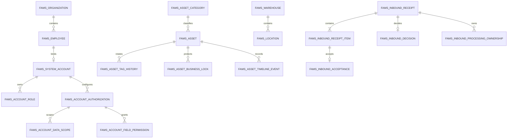

# D6-02C 领域与数据设计

> 状态：`REVIEW_PENDING` · 版本：V1.1 · 日期：2026-09-14
> 权威业务输入：PRD V1.5；权威接口输入：`contracts/fams-core-v1.yaml`。  
> 本文是 **设计目标，不是已执行迁移**。当前没有产品表、产品 Flyway 迁移或业务运行证据。

## 1. 范围与不变量

本文冻结 D6-04～D6-07 编码前所需的首批领域与数据边界：系统账号、组织人员、基础资料、
编号与参数、资产建卡/台账/标签、日常入库、审计、幂等、业务锁和站内待办。批量导入、
期初发布、其他生命周期业务、外部消息投递、报表导出与产品实现不在 D6-02C 内。

全局不变量如下：

1. 系统服务单一企业，不引入租户列、租户路由或跨企业共享模型。
2. 内部主键使用 MySQL signed `BIGINT AUTO_INCREMENT`；API 中所有主键均为十进制字符串，
   避免 JavaScript 整数精度丢失。
3. 资产编码在全企业唯一且永久不复用。取消、失败或废号都保留事实，不回拨流水。
4. 业务事件时刻统一保存 UTC `DATETIME(3)`，Java 使用 `Instant`，API 使用 UTC `Z`；
   业务日期使用 `DATE` / `LocalDate`。服务端“当前时间”只能来自可注入 `Clock`。
5. 资产生命周期、异常状态、建卡阶段、当前保管、入库单状态、资产业务锁和库管处理权
   分别建模，不能用一个状态字段代替其他事实。
6. 管理员决定和库管执行分离；批准不等于验收入库，系统管理员也不自动取得任一业务权。
7. 所有业务写入都是单数据库短事务。等待人工操作时不保持数据库事务，不引入 Saga。
8. 所有写操作记录实际账号、实际使用角色、请求标识、前后版本和结构化审计事件。
9. 二维码只是不可猜测的定位凭证，不是授权凭证；解析后仍重验当前身份与数据范围。
10. 正式业务数据只做逻辑终止或状态归档。本文不设计业务事实的物理删除入口。

## 2. 聚合与关系

聚合写边界：

- 账号聚合：`fams_system_account`、角色、会话失效纪元和安全事件。
- 资产聚合：`fams_asset`、当前标签、附件元数据、时间线及活动业务锁。
- 入库聚合：入库单、明细、唯一决定、批准范围、整单处理权和逐项验收。
- 基础资料各自为独立聚合；资产或单据只保存稳定 ID 与提交时必要快照。
- 审计、幂等和站内待办是同一业务事务内的控制记录，不是异步成功的替代品。

## 3. 公共列与数据库约定

除纯关联表外，业务表统一包含：

| 列 | 类型 | 规则 |
|---|---|---|
| `id` | `BIGINT AUTO_INCREMENT` | signed、仅内部使用，API 转十进制字符串 |
| `version` | `BIGINT NOT NULL DEFAULT 0` | 乐观锁；成功写入后加 1 |
| `created_at` / `updated_at` | `DATETIME(3)` | UTC；由应用显式写入 |
| `created_by` / `updated_by` | `BIGINT` | 实际系统账号；系统任务使用预留主体 |
| `status` | `VARCHAR(40)` | 受 `CHECK` 约束的稳定英文代码 |

命名与字符规则：

- 数据库、连接和文本列统一 `utf8mb4`；比较型编码另存大写规范化列并使用确定性排序规则。
- 金额不在本设计范围。未来如出现费用，只能使用 `DECIMAL`，不得使用浮点数。
- JSON 只用于版本化参数、筛选条件或不可参与关系约束的快照；主键、状态和外键不得藏在 JSON。
- 外键用于防止悬空引用，但“停用记录仍可被历史读取”不通过级联删除实现。
- 代码唯一索引基于规范化值；显示值保留用户输入的合法大小写。

## 4. 身份、组织与基础资料

### 4.1 身份与组织表

| 表 | 关键列 | 约束与索引 |
|---|---|---|
| `fams_organization` | `code_normalized`、`name`、`parent_id`、`status`、`remark` | `uk_org_code`；`idx_org_parent_status(parent_id,status)`；根节点 `parent_id IS NULL`；循环由锁定父链后的服务校验阻断 |
| `fams_employee` | `employee_no_normalized`、`name`、`organization_id`、`mobile_ciphertext`、`mobile_lookup_hash`、`status` | 工号唯一；手机号密文保存、HMAC 摘要等值查找；`idx_employee_org_status`；停用不删除历史身份 |
| `fams_system_account` | `employee_id`、`username_normalized`、`password_hash`、`status`、`initial_password_required`、`failed_attempts`、`locked_until`、`auth_epoch` | 员工和用户名各自唯一；停用、锁定、改密、角色变化更新 `auth_epoch` 使旧会话失效 |
| `fams_account_role` | `account_id`、`role_code`、`granted_at`、`granted_by` | `uk_account_role(account_id,role_code)`；角色代码与 OpenAPI `Role` 一致 |
| `fams_account_authorization` | `account_id`、`role_code`、`generation_no`、`authorization_status`、`predecessor_authorization_id`、`superseded_at`、`current_guard`、`changed_by`、`change_reason` | `uk_account_authorization_generation(account_id,role_code,generation_no)`；`uk_account_current_authorization(account_id,role_code,current_guard)`；API `version` 映射 `generation_no`；固定角色动作不可编辑 |
| `fams_account_data_scope` | `authorization_id`、`scope_type` | `uk_account_scope_type(authorization_id,scope_type)`；属于一个不可变授权代次；代码限定为 `DataScopeType`；指定范围明细由下列关联表承接 |
| `fams_account_scope_organization` | `data_scope_id`、`organization_id`、`organization_version_at_grant` | `uk_account_scope_org(data_scope_id,organization_id)`；仅用于 `SPECIFIED_ORGANIZATIONS`，保留授予时版本并在每次读取时重验当前状态 |
| `fams_account_scope_warehouse` | `data_scope_id`、`warehouse_id`、`warehouse_version_at_grant` | `uk_account_scope_warehouse(data_scope_id,warehouse_id)`；仅用于 `SPECIFIED_WAREHOUSES`，停用仓库立即不再贡献有效范围 |
| `fams_account_field_permission` | `authorization_id`、`permission_code`、`granted_at` | `uk_account_field_permission(authorization_id,permission_code)`；属于一个不可变授权代次；代码限定为 `SensitiveFieldPermission`；记录可见不推导字段权限 |
| `fams_security_event` | `account_id`、`event_type`、`request_id`、`occurred_at`、`detail_json` | `idx_security_account_time`、`idx_security_request`；详情不得写明文密码或完整 Cookie |

授权配置按账号与已授予角色成对保存，并以不可变授权代次承载子项。`current_guard` 是
`CASE WHEN superseded_at IS NULL THEN 1 ELSE NULL END` 的持久生成列；MySQL 唯一索引允许历史行拥有多个
`NULL`，但一个账号角色只能有一个最新代次。写入先锁定最新代次并比较 `generation_no`：从未配置时只接受
`If-Match-Version: 0`，否则必须匹配最新代次，包括最新状态为 `REVOKED` 的情况。

替换时先给旧代次填写 `superseded_at`，再以新的 authorization_id 和递增 `generation_no` 插入 `ACTIVE`
代次及完整子项；撤销时同样结束旧代次，再插入无子项的 `REVOKED` 代次。父代次除结束标记外不改写，
既有范围和字段子行永不覆盖或删除。授权的“授予 → 替换 → 撤销 → 重新授予”依次形成 1、2、3、4 代；
第 4 代使用新的 authorization_id，因此可合法重新插入与第 1 或第 2 代相同的 scope/permission 唯一键，
同时保留所有旧代次。每次写入还增加 `fams_system_account.auth_epoch`、使旧会话失效并记录审计。

角色撤销、账号/员工停用立即使整组配置无效；组织或仓库停用时对应指定范围立即停止贡献访问，但历史授予
事实不物理删除。固定的资产管理员全部已提交申请和库管全部已批准申请能力独立求并集，不能被一般范围
误过滤，也不能借一般范围扩大动作权限。

员工停用与账号停用在一个事务内更新；资产责任清理通过异常清单和后续正式业务完成，不能因此延迟访问撤销。

### 4.2 主数据表

| 表 | 关键列 | 约束与索引 |
|---|---|---|
| `fams_asset_category` | `code_normalized`、`name`、`parent_id`、`suggested_unit`、`numbering_prefix`、`extension_template_json`、`status` | 分类编码唯一；父链不能循环；停用父级不能新增启用子级 |
| `fams_manufacturer` | `code_normalized`、`name`、`status` | 厂商编码唯一；被引用后只允许停用 |
| `fams_brand` | `code_normalized`、`name`、`default_manufacturer_id`、`status` | 品牌编码唯一；默认厂商必须为当前启用版本 |
| `fams_warehouse` | `code_normalized`、`name`、`status`、`remark` | 仓库编码唯一；有活动资产或未结引用时不得停用 |
| `fams_location` | `warehouse_id`、`code_normalized`、`name`、`parent_id`、`location_type`、`status` | `uk_location_code`；父子必须属于同一仓库；有当前资产、启用子级或未结业务时不得停用 |

树结构先用邻接表。创建或移动节点时以稳定顺序锁定节点及目标父链，校验不存在循环后写入；
查询树可在服务层组装。没有实际规模证据前不增加闭包表或路径冗余列。

### 4.3 编号、参数与配置异常

| 表 | 关键列 | 约束与索引 |
|---|---|---|
| `fams_numbering_rule` | `target_type`、`mode`、`fixed_prefix`、`date_part`、`sequence_width`、`category_prefix_required`、`status` | 每个目标仅一个启用规则；资产可选企业或分类前缀模式，入库单只允许企业模式 |
| `fams_numbering_sequence` | `rule_id`、`bucket_key`、`next_value`、`version` | `uk_numbering_bucket(rule_id,bucket_key)`；以行锁原子分配号段 |
| `fams_numbering_allocation` | `rule_id`、`target_type`、`allocated_code`、`allocation_status`、`request_id`、`resource_id` | `uk_allocated_code(target_type,allocated_code)`；状态为 `RESERVED/ISSUED/GAP`；失败号保留 `GAP` 永不回收 |
| `fams_business_parameter_version` | `effective_from`、`timezone_id`、`work_calendar_json`、各时限、`status`、`changed_from_id` | `effective_from` 唯一；创建后不可原位修改；同一时刻最多一个 `ACTIVE` |
| `fams_configuration_anomaly` | `anomaly_type`、`status`、`first_seen_at`、`last_seen_at`、`resolved_at`、`detail_json` | 一个异常类型只保留一个未解决项；人员角色、短信或微信配置恢复后关闭而不删除 |

参数按单据创建时的有效版本生成快照，之后参数变更不重写既有单据时限。企业时区默认
`Asia/Shanghai`，但存储的业务时刻始终为 UTC。

## 5. 资产卡、台账与标签

### 5.1 资产主表

`fams_asset` 是当前资产事实，不把计划入库目标、正式保管、开放业务摘要或附件塞入同一 JSON。
以下列定义直接作为 D6-06 产品迁移输入；未标 `NULL` 的列不得保存空值。

| 列 | MySQL 类型 | 空值、来源与约束 |
|---|---|---|
| `id` | `BIGINT NOT NULL AUTO_INCREMENT` | signed 主键；API 输出十进制字符串 |
| `asset_code` | `VARCHAR(128) NOT NULL` | 服务端编号；全企业永久唯一，取消后也不复用 |
| `name` | `VARCHAR(256) NOT NULL` | 建草稿唯一必填业务字段；去除首尾空白后至少 1 字符 |
| `category_id` | `BIGINT NULL` | FK `fams_asset_category.id`；提交入库前必须非空且启用 |
| `model` | `VARCHAR(128) NULL` | OpenAPI `model` |
| `unit` | `VARCHAR(32) NULL` | 提交入库前必须非空 |
| `owning_organization_id` | `BIGINT NULL` | FK `fams_organization.id`；提交入库前必须非空且启用 |
| `planned_inbound_warehouse_id` | `BIGINT NULL` | FK `fams_warehouse.id`；草稿可空，提交前必须与计划位置同时有效 |
| `planned_inbound_location_id` | `BIGINT NULL` | FK `fams_location.id`；草稿可空，且必须属于计划仓库 |
| `brand_id` | `BIGINT NULL` | FK `fams_brand.id`；可空，非空时写入前重验当前版本和状态 |
| `manufacturer_id` | `BIGINT NULL` | FK `fams_manufacturer.id`；可空，非空时写入前重验当前版本和状态 |
| `serial_number` | `VARCHAR(128) NULL` | 显示值；空字符串规范化为 `NULL` |
| `serial_number_normalized` | `VARCHAR(128) NULL` | 非空时全企业唯一；不从客户端单独接收 |
| `acquisition_date` | `DATE NULL` | OpenAPI `acquisitionDate`，按业务日期原样保存 |
| `warranty_expiry_date` | `DATE NULL` | OpenAPI `warrantyExpiryDate`，不得做时区换日 |
| `service_provider` | `VARCHAR(256) NULL` | OpenAPI `serviceProvider` |
| `service_contact` | `VARCHAR(128) NULL` | OpenAPI `serviceContact` |
| `service_phone_ciphertext` | `VARBINARY(512) NULL` | 加密保存；只有 `ASSET_SERVICE_PHONE` 授权时解密输出 |
| `source_text` | `VARCHAR(128) NULL` | OpenAPI `source`，与复制来源主键分离 |
| `notes` | `VARCHAR(2000) NULL` | OpenAPI `notes` |
| `extension_values_json` | `JSON NULL` | 只保存通过分类模板校验的扩展值，不保存主键或状态 |
| `lifecycle_status` | `VARCHAR(40) NOT NULL` | `AssetLifecycle`；新卡固定 `WAITING_INBOUND` |
| `exception_status` | `VARCHAR(40) NOT NULL` | `AssetException`；新卡固定 `NORMAL` |
| `card_stage` | `VARCHAR(40) NOT NULL` | `DRAFT/PENDING_INBOUND/ACTIVE/CANCELLED` |
| `custody_type` | `VARCHAR(20) NULL` | `STORAGE/PERSONAL/SHARED`；正式入库前必须为 `NULL` |
| `storage_warehouse_id` | `BIGINT NULL` | 仅 `STORAGE` 使用；FK `fams_warehouse.id` |
| `current_location_id` | `BIGINT NULL` | 正式保管位置；FK `fams_location.id`，不是计划位置 |
| `using_organization_id` | `BIGINT NULL` | 仅 `PERSONAL/SHARED` 使用；FK `fams_organization.id` |
| `responsible_employee_id` | `BIGINT NULL` | 仅 `PERSONAL` 使用；FK `fams_employee.id` |
| `department_responsible_employee_id` | `BIGINT NULL` | 仅 `SHARED` 使用；FK `fams_employee.id` |
| `created_business_date` | `DATE NOT NULL` | 建卡时按冻结企业时区从服务端 `Clock` 取得 |
| `inbound_business_date` | `DATE NULL` | 成功验收入库时写入；正式入库前为 `NULL` |
| `last_inventory_business_date` | `DATE NULL` | 最近一次有效盘点业务日期；D6-06 只读映射，后续盘点更新 |
| `parameter_version_id` | `BIGINT NOT NULL` | FK `fams_business_parameter_version.id`；建卡后不改写 |
| `creator_account_id` | `BIGINT NOT NULL` | FK `fams_system_account.id`；草稿创建关系的稳定主体 |
| `creator_username_snapshot` | `VARCHAR(128) NOT NULL` | 建卡时账号名快照；账号改名不重写历史显示 |
| `source_asset_id` | `BIGINT NULL` | 复制建卡来源；FK 本表；只作追溯，不继承状态或保管 |
| `cancelled_at` | `DATETIME(3) NULL` | 卡片取消事实；UTC，未取消为 `NULL` |
| `cancellation_reason` | `VARCHAR(500) NULL` | 取消时必填，其他阶段为 `NULL` |
| `version` | `BIGINT NOT NULL DEFAULT 0` | 所有资产写入使用 `WHERE id=? AND version=?` |
| `created_at` / `updated_at` | `DATETIME(3) NOT NULL` | UTC；应用显式写入，精度到毫秒 |
| `created_by` / `updated_by` | `BIGINT NOT NULL` | 实际账号；与历史显示快照分开 |

计划入库目标与正式保管列物理分离：`planned_inbound_*` 只表达待入库意图；验收事务把已批准目标写入
`storage_warehouse_id/current_location_id`，但不把二者改名或复用。草稿和 `PENDING_INBOUND` 的全部正式
保管列必须为 `NULL`。同一行 `CHECK` 固定三种保管组合：`STORAGE` 只允许仓库+位置；`PERSONAL` 只允许
使用组织+个人责任人+位置；`SHARED` 只允许使用组织+部门责任人+位置。跨表“位置属于仓库”和引用启用状态
在短事务内锁定并校验。

<!-- ASSET_API_MAPPING_BEGIN -->

OpenAPI `Asset` 到事实来源的完整映射：

| API 字段 | 事实来源 |
|---|---|
| `id`、`assetCode`、`name`、`model`、`unit`、`serialNumber` | `fams_asset.id/asset_code/name/model/unit/serial_number` |
| `category`、`brand`、`manufacturer`、`organization` | 对应 `*_id` 加当前主数据行 `version`；停用历史仍可读，写入仍要求当前启用版本 |
| `plannedInboundWarehouse`、`plannedInboundLocation` | `planned_inbound_*_id` 加当前仓库/位置版本；绝不从正式保管列反推 |
| `acquisitionDate`、`warrantyExpiryDate` | `acquisition_date/warranty_expiry_date` |
| `serviceProvider`、`serviceContact`、`servicePhone` | 前两项直接映射；电话经字段授权后从 `service_phone_ciphertext` 解密 |
| `source`、`notes`、`extensionValues` | `source_text/notes/extension_values_json` |
| `attachments` | 当前有效 `fams_asset_attachment` 行的 `id/version`；内容下载另行鉴权 |
| `lifecycle`、`exception`、`cardStage`、`version` | 三个状态列与乐观锁版本 |
| `createdBusinessDate`、`createdAt`、`parameterVersionId` | `created_business_date/created_at/parameter_version_id` |
| `creator` | `creator_account_id` 与 `creator_username_snapshot`，不依赖账号当前名称 |
| `usageMode` | `custody_type` 为 `PERSONAL/SHARED` 时同值；`STORAGE` 或无正式保管时省略 |
| `currentCustody` | 六个正式保管列；引用版本从当前主数据行读取，按互斥组合生成一个分支 |
| `openBusinessSummary` | 当前活动业务锁、未结单据与处理权的只读聚合；不在资产行冗余保存 |
| `inboundBusinessDate`、`lastInventoryBusinessDate` | 两个 `DATE` 列直接输出，不做 UTC 换日 |

<!-- ASSET_API_MAPPING_END -->

索引：

- `uk_asset_code(asset_code)`；取消卡仍保留，因此编码不能复用。
- `uk_asset_serial(serial_number_normalized)`；MySQL 唯一索引允许多个 `NULL`，空字符串先规范化为 `NULL`。
- `idx_asset_ledger(category_id,lifecycle_status,exception_status,id)`。
- `idx_asset_custody(using_organization_id,responsible_employee_id,department_responsible_employee_id,id)`。
- `idx_asset_location(storage_warehouse_id,current_location_id,id)`、
  `idx_asset_inbound_date(inbound_business_date,id)`、
  `idx_asset_inventory(last_inventory_business_date,id)`。

资产卡普通编辑不得改变生命周期、异常状态、正式保管或责任列，这些字段只由正式业务动作更新。
主数据 `version` 不重复存进资产当前行；响应需要版本时读取当前引用行。只有入库单等历史事实保存
提交/决定/验收时的不可变版本快照。

### 5.2 资产附属表

| 表 | 关键列 | 约束与索引 |
|---|---|---|
| `fams_asset_attachment` | `asset_id`、`object_key`、`media_type`、`size_bytes`、`checksum_sha256`、`visibility_code` | 只保存对象元数据；附件内容不进数据库；访问时重验当前权限 |
| `fams_asset_tag` | `asset_id`、`token_ciphertext`、`token_hash`、`tag_version`、`issued_at`、`rotated_at` | 每资产一条当前标签；`token_hash` 全局唯一；随机 32 字节经 base64url 无填充后为 43 字符 |
| `fams_asset_tag_history` | `asset_id`、`token_hash`、`valid_from`、`invalidated_at`、`reason` | 旧标识只保存摘要并永远失效；`idx_tag_history_asset_time` |
| `fams_asset_tag_print_job` | `requester_account_id`、`job_status`、`template_version`、`error_code`、`completed_at` | 单张和批量打印统一可查询任务；终态仍可恢复查询 |
| `fams_asset_tag_print_item` | `print_job_id`、`asset_id`、`asset_version`、`tag_version`、`item_status` | `uk_print_job_asset`；打印快照与任务绑定，不在重试中换标签 |
| `fams_asset_saved_filter` | `owner_account_id`、`name_normalized`、`criteria_json`、`version` | 个人所有；`uk_saved_filter_owner_name`；只存符合 `AssetFilterCriteria` 的值，不存 SQL；每次执行重验当前权限 |
| `fams_asset_timeline_event` | `asset_id`、`event_type`、`business_type`、`business_id`、`occurred_at`、`summary_json` | `idx_asset_timeline(asset_id,occurred_at DESC,id DESC)`；历史倒序稳定分页 |

重新打印复用当前标签；只有“换标”才在一个事务中生成新随机标识、归档旧摘要并增加标签版本。
`resolveAssetAccessToken` 只通过摘要定位资产，之后按当前会话、角色、数据范围及字段权限裁剪响应。
不存在、旧标识和无权访问不得形成可枚举差异。

### 5.3 活动业务锁

`fams_asset_business_lock` 保存持久业务互斥，而不是数据库长事务：

| 列 | MySQL 类型 | 空值、来源与约束 |
|---|---|---|
| `id` | `BIGINT NOT NULL AUTO_INCREMENT` | 锁事实主键 |
| `asset_id` | `BIGINT NOT NULL` | FK 资产 |
| `business_type` | `VARCHAR(40) NOT NULL` | 首批为 `INBOUND`，后续使用稳定业务类型代码 |
| `business_id` | `BIGINT NOT NULL` | 入库单或后续业务聚合 ID |
| `business_item_id` | `BIGINT NOT NULL` | 取得锁的具体明细 ID；首批 FK 入库明细 |
| `lock_version` | `BIGINT NOT NULL DEFAULT 0` | 活动锁的乐观版本 |
| `acquired_at` | `DATETIME(3) NOT NULL` | 取得锁的 UTC 时刻 |
| `released_at` | `DATETIME(3) NULL` | 超时、重启或登出不能自动填写 |
| `release_reason` | `VARCHAR(500) NULL` | 释放时必填：完成、驳回、合法取消或受控修复 |
| `active_guard` | `TINYINT GENERATED ALWAYS AS (CASE WHEN released_at IS NULL THEN 1 ELSE NULL END) STORED` | 活动唯一哨兵 |

唯一索引 `uk_asset_active_lock(asset_id, active_guard)` 利用 MySQL 允许多个 `NULL` 的规则保留历史，
同时保证每项资产最多一条活动锁。取得锁、单据状态更新、待办和审计必须在同一事务；发现孤立锁时
只允许依据业务终态受审计修复，不能按时间直接删除。

## 6. 日常入库

### 6.1 表设计

#### 6.1.1 入库单头与冻结参数

`fams_inbound_receipt`：

| 列 | MySQL 类型 | 空值、来源与约束 |
|---|---|---|
| `id` | `BIGINT NOT NULL AUTO_INCREMENT` | signed 主键 |
| `receipt_no` | `VARCHAR(128) NOT NULL` | 服务端永久编号；`uk_inbound_receipt_no`，永不复用 |
| `creator_account_id` | `BIGINT NOT NULL` | FK `fams_system_account.id`；创建关系在全阶段保留 |
| `creator_username_snapshot` | `VARCHAR(128) NOT NULL` | 创建时账号名快照，不随账号改名变化 |
| `receipt_status` | `VARCHAR(40) NOT NULL` | `InboundReceiptStatus` 的七个稳定代码 |
| `business_date` | `DATE NOT NULL` | 客户端业务日期，经企业日历规则校验但不做时区换日 |
| `parameter_version_id` | `BIGINT NOT NULL` | FK 参数版本；建草稿后不改写 |
| `timezone_snapshot` | `VARCHAR(64) NOT NULL` | 创建时参数时区快照 |
| `admin_decision_deadline_workdays` | `TINYINT UNSIGNED NOT NULL` | `1..30`；创建时冻结 |
| `warehouse_claim_deadline_workdays` | `TINYINT UNSIGNED NOT NULL` | `1..30`；创建时冻结 |
| `warehouse_first_execution_deadline_workdays` | `TINYINT UNSIGNED NOT NULL` | `1..30`；创建时冻结 |
| `submitted_at` | `DATETIME(3) NULL` | 首次成功提交 UTC 时刻；驳回/取消后仍保留 |
| `admin_decision_due_at` | `DATETIME(3) NULL` | 提交成功时由冻结日历计算；草稿为 `NULL` |
| `warehouse_claim_due_at` | `DATETIME(3) NULL` | 批准成功时计算；未批准为 `NULL` |
| `warehouse_first_execution_due_at` | `DATETIME(3) NULL` | 认领成功时计算；未认领为 `NULL` |
| `notes` | `VARCHAR(2000) NULL` | OpenAPI `notes` |
| `cancelled_at` | `DATETIME(3) NULL` | 创建者取消成功的 UTC 时刻 |
| `cancellation_reason` | `VARCHAR(500) NULL` | `CANCELLED` 时非空；其他状态为 `NULL` |
| `completed_at` | `DATETIME(3) NULL` | 最后一项验收提交时写入；仅 `COMPLETED` 非空 |
| `version` | `BIGINT NOT NULL DEFAULT 0` | 草稿更新、提交、决定、认领、逐项验收均递增 |
| `created_at` / `updated_at` | `DATETIME(3) NOT NULL` | UTC 毫秒精度 |
| `created_by` / `updated_by` | `BIGINT NOT NULL` | 实际操作账号 |

`parameter_version_id/business_date/timezone_snapshot/三个工作日时限` 共同组成
`InboundReceiptSnapshot`，无需另存可漂移 JSON。日期截止时刻落在独立 UTC 列，重启时不重算。

#### 6.1.2 明细与目标快照

`fams_inbound_receipt_item`：

| 列 | MySQL 类型 | 空值、来源与约束 |
|---|---|---|
| `id` | `BIGINT NOT NULL AUTO_INCREMENT` | 明细主键 |
| `receipt_id` | `BIGINT NOT NULL` | FK 单头；`ON DELETE RESTRICT` |
| `asset_id` | `BIGINT NOT NULL` | FK 资产；`uk_inbound_receipt_asset(receipt_id,asset_id)` |
| `asset_version_snapshot` | `BIGINT NOT NULL` | 草稿编辑时刷新，提交成功后冻结的资产版本 |
| `asset_code_snapshot` | `VARCHAR(128) NOT NULL` | 服务端读取并冻结的资产编码 |
| `asset_name_snapshot` | `VARCHAR(256) NOT NULL` | 服务端读取并冻结的资产名称 |
| `target_warehouse_id` | `BIGINT NOT NULL` | FK 仓库；落库前已解析默认值/逐项覆盖 |
| `warehouse_version_snapshot` | `BIGINT NOT NULL` | 草稿编辑时刷新，提交后冻结 |
| `warehouse_code_snapshot` | `VARCHAR(64) NOT NULL` | 目标仓库不可变编码快照 |
| `warehouse_name_snapshot` | `VARCHAR(128) NOT NULL` | 目标仓库不可变名称快照 |
| `target_location_id` | `BIGINT NOT NULL` | FK 位置；必须属于目标仓库 |
| `location_version_snapshot` | `BIGINT NOT NULL` | 草稿编辑时刷新，提交后冻结 |
| `location_code_snapshot` | `VARCHAR(64) NOT NULL` | 目标位置不可变编码快照 |
| `location_name_snapshot` | `VARCHAR(128) NOT NULL` | 目标位置不可变名称快照 |
| `execution_status` | `VARCHAR(20) NOT NULL` | `PENDING/ACCEPTED`；每项验收成功时单向迁移 |
| `version` | `BIGINT NOT NULL DEFAULT 0` | 草稿替换或验收时递增 |
| `created_at` / `updated_at` | `DATETIME(3) NOT NULL` | UTC |

解析默认目标后，每个持久明细始终拥有显式仓库和位置。资产、仓库、位置的 ID、版本、编码和名称在
草稿修改时作为一个组合刷新；提交后不可变。后续主数据改名或停用不改写历史快照，验收仍另外重验
批准范围和当前启用版本。

#### 6.1.3 唯一决定与批准范围

| 表/列 | MySQL 类型 | 空值、来源与约束 |
|---|---|---|
| `fams_inbound_decision.id` | `BIGINT NOT NULL AUTO_INCREMENT` | 决定主键 |
| `receipt_id` | `BIGINT NOT NULL` | FK 单头；`uk_inbound_effective_decision(receipt_id)` |
| `decision_result` | `VARCHAR(20) NOT NULL` | `APPROVED/REJECTED` |
| `comment_text` | `VARCHAR(1000) NULL` | 驳回时至少 1 字符；批准备注可空 |
| `decided_by_account_id` | `BIGINT NOT NULL` | 实际资产管理员账号 |
| `decided_by_username_snapshot` | `VARCHAR(128) NOT NULL` | 决定时名称快照 |
| `decided_role` | `VARCHAR(40) NOT NULL` | 固定 `ASSET_ADMIN`，记录实际使用角色 |
| `receipt_version_before` | `BIGINT NOT NULL` | 赢得竞争前的单据版本，也是批准范围版本 |
| `decided_at` | `DATETIME(3) NOT NULL` | 唯一决定提交的 UTC 时刻 |
| `fams_inbound_approval_scope_item.id` | `BIGINT NOT NULL AUTO_INCREMENT` | 范围项主键 |
| `decision_id` / `receipt_item_id` | `BIGINT NOT NULL` | FK；`uk_inbound_scope_item(decision_id,receipt_item_id)` |
| `approved_asset_id` / `approved_asset_version` | `BIGINT NOT NULL` | 批准时资产身份与版本 |
| `approved_warehouse_id` / `approved_warehouse_version` | `BIGINT NOT NULL` | 批准时目标仓库身份与版本 |
| `approved_location_id` / `approved_location_version` | `BIGINT NOT NULL` | 批准时目标位置身份与版本 |

决定和范围项均为插入后不可变事实。驳回也保存完整范围，以便竞争失败方和创建者读取实际结果；
批准范围不能由认领或验收改写。

#### 6.1.4 处理权与逐项验收

`fams_inbound_processing_ownership`：

| 列 | MySQL 类型 | 空值、来源与约束 |
|---|---|---|
| `id` | `BIGINT NOT NULL AUTO_INCREMENT` | 处理权主键 |
| `receipt_id` | `BIGINT NOT NULL` | FK 单头 |
| `processor_account_id` | `BIGINT NOT NULL` | 当前/历史处理库管账号 |
| `processor_username_snapshot` | `VARCHAR(128) NOT NULL` | 认领时名称快照 |
| `ownership_version` | `BIGINT NOT NULL DEFAULT 0` | 验收和受控转派的并发令牌 |
| `acquired_at` | `DATETIME(3) NOT NULL` | 认领提交时刻 |
| `archived_at` | `DATETIME(3) NULL` | 终态或受控转派时归档；不按超时自动填写 |
| `archive_reason` | `VARCHAR(500) NULL` | 归档时必填 |
| `active_guard` | `TINYINT GENERATED ALWAYS AS (CASE WHEN archived_at IS NULL THEN 1 ELSE NULL END) STORED` | `uk_inbound_active_owner(receipt_id,active_guard)` 保证整单一个当前处理人 |

`fams_inbound_acceptance`：

| 列 | MySQL 类型 | 空值、来源与约束 |
|---|---|---|
| `id` | `BIGINT NOT NULL AUTO_INCREMENT` | 验收主键 |
| `receipt_item_id` | `BIGINT NOT NULL` | FK 明细；`uk_inbound_item_acceptance(receipt_item_id)` |
| `asset_id` / `ownership_id` | `BIGINT NOT NULL` | FK 资产与实际处理权 |
| `accepted_by_account_id` | `BIGINT NOT NULL` | 当前处理库管账号 |
| `accepted_by_username_snapshot` | `VARCHAR(128) NOT NULL` | 验收时名称快照 |
| `accepted_at` | `DATETIME(3) NOT NULL` | 事务提交的 UTC 时刻 |
| `business_date` | `DATE NOT NULL` | 单据冻结业务日期 |
| `receipt_version_before` | `BIGINT NOT NULL` | 本次验收前单据版本 |
| `asset_version_before` / `asset_version_after` | `BIGINT NOT NULL` | 资产条件更新前后版本 |
| `lock_version` | `BIGINT NOT NULL` | 被释放的活动业务锁版本 |
| `observed_asset_code` | `VARCHAR(128) NOT NULL` | 现场输入；必须与资产永久编码一致 |
| `storage_warehouse_id` / `storage_location_id` | `BIGINT NOT NULL` | 本次正式保管目标 |
| `warehouse_version_at_acceptance` / `location_version_at_acceptance` | `BIGINT NOT NULL` | 验收时当前引用版本，供历史 `storageCustody` 输出 |
| `notes` | `VARCHAR(1000) NULL` | 验收备注 |
| `audit_event_id` | `BIGINT NOT NULL` | FK 同事务审计事件；唯一 |

验收记录插入后不可变；当前资产保管由同一事务写入 `fams_asset`。最后一项成功时才写单头
`completed_at` 并归档处理权，之前成功的验收事实不被后续失败事务回滚。

<!-- INBOUND_API_MAPPING_BEGIN -->

OpenAPI 入库读模型到事实来源的完整映射：

| Schema / API 字段 | 事实来源 |
|---|---|
| `InboundReceipt`: `id`、`receiptNumber`、`status`、`businessDate`、`version`、`notes` | 单头 `id/receipt_no/receipt_status/business_date/version/notes` |
| `createdBy`、`createdAt`、`submittedAt` | 创建账号 ID/名称快照及单头时刻列 |
| `adminDecisionDueAt`、`warehouseClaimDueAt`、`warehouseFirstExecutionDueAt` | 三个持久 UTC 截止时刻；不在读取时重算 |
| `parameterVersionId`、`snapshot`、`items` | 单头冻结参数列与按 `receipt_id` 稳定排序的明细 |
| `decision`、`currentProcessor` | 唯一决定行与最新处理权行；终态处理权仍带归档时刻 |
| `cancelledAt`、`cancellationReason`、`completedAt` | 单头取消/完成事实列 |
| `InboundReceiptSnapshot`: `parameterVersionId`、`businessDate`、`timezone` | 单头参数 ID、业务日期与时区快照 |
| `adminDecisionDeadlineWorkdays`、`warehouseClaimDeadlineWorkdays`、`warehouseFirstExecutionDeadlineWorkdays` | 单头三个冻结工作日数 |
| `InboundReceiptItem`: `id`、`executionStatus`、`asset`、`targetWarehouse`、`targetLocation` | 明细主键、执行状态及三组 ID/版本快照 |
| `assetSnapshot`、`warehouseSnapshot`、`locationSnapshot` | 明细的不可变编码/名称快照列 |
| `businessLock`、`acceptance` | 以单据明细关联活动/历史锁和唯一验收行；不存在时省略 |
| `InboundAssetSnapshot`: `assetCode`、`assetName` | `asset_code_snapshot/asset_name_snapshot` |
| `InboundCatalogSnapshot`: `code`、`name` | 仓库或位置 `*_code_snapshot/*_name_snapshot` |
| `InboundAssetBusinessLock`: `assetId`、`businessType`、`businessId`、`businessItemId`、`lockVersion`、`acquiredAt` | `fams_asset_business_lock` 的同名语义列；`businessType` 从稳定代码输出 |
| `InboundDecision`: `id`、`result`、`decidedReceiptVersion`、`decidedBy`、`decidedAt`、`comment` | 决定行及决定人名称快照；`comment_text` 同时承接批准备注或驳回原因 |
| `scope` | 决定版本加全部 `fams_inbound_approval_scope_item` 行 |
| `InboundApprovalScope`: `receiptVersion`、`items` | `receipt_version_before` 与按明细 ID 排序的批准范围项 |
| `InboundProcessingOwnership`: `processor`、`claimedAt`、`ownershipVersion`、`archivedAt` | 处理权账号/名称快照、取得时刻、版本与归档时刻 |
| `InboundAcceptanceRecord`: `id`、`receiptItemId`、`assetId`、`acceptedBy`、`acceptedAt`、`businessDate` | 验收行及验收人名称快照 |
| `receiptVersionBefore`、`assetVersionBefore`、`assetVersionAfter`、`lockVersion` | 验收行保存的四个竞争版本 |
| `observedAssetCode`、`storageCustody`、`notes` | 现场编码、验收目标 ID/版本组成的 `STORAGE` 保管快照及备注 |
| `InboundAcceptedAsset`: `id`、`assetCode`、`lifecycle`、`exception`、`cardStage`、`version`、`currentCustody`、`inboundBusinessDate` | 验收事务提交后的 `fams_asset` 当前行；只输出最小结果 |
| `InboundAcceptanceResult`: `receipt`、`item`、`asset` | 同一提交结果中的最新单头、已验收明细与最小资产投影 |

<!-- INBOUND_API_MAPPING_END -->

关系和索引补充：`idx_inbound_pool(receipt_status,updated_at,id)` 支撑共享池；
`idx_inbound_creator(creator_account_id,updated_at,id)` 支撑创建者全阶段恢复；
`idx_inbound_item_asset(asset_id,receipt_id)` 支撑活动锁和重复引用检查。所有外键使用 `ON DELETE RESTRICT`，
业务终态不级联删除单头、明细、决定、范围、处理权或验收事实。

### 6.2 状态迁移

| 当前状态 | 动作 | 下一状态 | 同一事务内的事实 |
|---|---|---|---|
| `DRAFT` | 创建人保存 | `DRAFT` | 单头/明细版本、目标当前有效性、审计 |
| `DRAFT` | 创建人提交 | `PENDING_ADMIN_DECISION` | 重验资料完整性与引用版本，为全部资产取得业务锁，生成管理员共享待办 |
| `DRAFT` | 创建人取消 | `CANCELLED` | 记录原因；未取得资产锁 |
| `PENDING_ADMIN_DECISION` | 管理员批准 | `WAITING_WAREHOUSE_CLAIM` | 唯一决定、批准范围、关闭管理员待办、生成一条去重库管池待办 |
| `PENDING_ADMIN_DECISION` | 管理员驳回 | `REJECTED` | 唯一决定、原因、释放全部资产锁、关闭待办 |
| `PENDING_ADMIN_DECISION` | 创建人竞争取消 | `CANCELLED` | 以单据版本和唯一决定竞争；释放锁；败者读取已生效结果 |
| `WAITING_WAREHOUSE_CLAIM` | 库管认领 | `WAREHOUSE_PROCESSING` | 原子创建唯一活动处理权；其他库管保持只读 |
| `WAREHOUSE_PROCESSING` | 当前处理人逐项验收 | 原状态或 `COMPLETED` | 重验批准范围、实物编码、资产/目标/单据/处理权版本；更新资产为 `ACTIVE/IN_STOCK`，释放该资产锁 |
| 任一终态 | 再次写入 | 不变 | 返回稳定冲突或既有结果，不改历史 |

最后一项验收成功时，同一事务把单据置为 `COMPLETED`、归档处理权并关闭执行待办。任一校验或写入失败，
本次验收的资产、明细、单头、锁、待办、审计和幂等结果全部回滚；已经在更早事务成功验收的其他明细
不被重做或回滚。

## 7. 控制记录

### 7.1 幂等

`fams_idempotency_record`：

| 列 | 规则 |
|---|---|
| `actor_account_id`、`operation_id`、`idempotency_key` | 唯一键 `uk_idempotency_actor_operation_key` |
| `payload_sha256` | 对规范化请求体和关键路径参数计算；不得包含 Cookie 等秘密 |
| `result_status` | `SUCCEEDED` 或已稳定生效的业务拒绝；未提交事务不留下伪成功 |
| `http_status`、`response_body_json`、`resource_type`、`resource_id` | 与业务事实同事务保存，供响应未知后重放 |
| `created_at`、`completed_at`、`expires_at` | 清理只能在业务要求的重试窗口后进行，不能改变资源事实 |

请求先重验当前会话和权限，再按唯一键串行化。同键同载荷返回已保存结果；同键不同载荷返回幂等冲突。
业务写入与成功响应快照在同一事务提交，因此客户端遇到 **response unknown** 时使用原
`Idempotency-Key` 重试，可区分“已提交但响应丢失”和“事务未提交”。

### 7.2 审计与待办

| 表 | 关键列与规则 |
|---|---|
| `fams_audit_event` | `request_id`、`actor_account_id`、`actor_role`、`action`、`resource_type/id`、`before_version`、`after_version`、`occurred_at`、脱敏 `detail_json`；`request_id` 和资源时间均建索引 |
| `fams_todo` | `pool_type`、`assignee_account_id`、`business_type/id`、`todo_type`、`todo_status`、`opened_at`、`closed_at`；共享池用业务键去重，不为每名管理员或库管复制可执行事实 |

共享待办是单一池事实加角色查询，不是多条可分别完成的审批任务。外部通知属于后续 D6-24；其失败不能
回滚已提交业务，也不能删除站内待办。

## 8. 事务、锁顺序与并发

统一锁顺序为：幂等键 → 单据 → 明细（ID 升序）→ 资产（ID 升序）→ 活动业务锁 → 处理权 →
待办/审计。需要多个资产时必须排序后加锁，避免客户端顺序造成死锁。

| 场景 | 并发裁决 |
|---|---|
| 两名管理员决定 | 对 `fams_inbound_receipt.version` 比较并插入唯一 `fams_inbound_decision`；只有一个提交，败者读取实际决定 |
| 管理员决定与创建人取消 | 同一单据版本竞争；只有一个状态迁移生效，败者返回实际终态 |
| 多名库管认领 | `uk_inbound_active_owner` 加单据版本共同裁决；只有一条活动处理权 |
| 重复提交同一资产 | `uk_asset_active_lock` 阻断第二业务；整单提交任一锁失败则全部回滚 |
| 两次资产编辑 | `If-Match-Version` 映射到 `WHERE version=?`；过期写返回当前版本冲突 |
| 标签换标与打印 | 锁定资产和当前标签版本；换标后旧任务不静默改用新标识 |

数据库死锁或连接中断不转译为业务成功。可安全重试的数据库异常由服务端以有限次数、带抖动重试；
超过上限返回稳定错误并依赖原幂等键继续，不能生成新业务请求规避不确定性。

## 9. Flyway、兼容与恢复

### 9.1 迁移隔离

未来产品迁移唯一位置为：

`backend/src/main/resources/db/migration/product`

D6-02B 的 `backend/src/main/resources/db/migration/runtime_compatibility` 只属于技术探针。
产品 profile 必须显式只加载 `db/migration/product`，不得扫描或重命名 `runtime_compatibility`，也不得把
探针表升级为产品表。

迁移策略是 **forward-only**：

- 已在任何共享环境执行的版本脚本不可编辑、删除或重排；修复只能新增更高版本迁移。
- 先扩展再切换再收缩；跨版本发布期间，新旧应用都必须能读取扩展后的 schema。
- 大表回填拆成可观测、可重入的小批次，不在启动迁移里执行不可控全表业务计算。
- 删除列、收紧非空、重建唯一索引前必须有使用扫描、备份与恢复演练证据。
- 每个迁移在空库升级和上一发布版本升级两条路径验证；校验 Flyway checksum 和最终 schema。

首批建议版本边界为身份/主数据、资产/控制记录、日常入库三组，但具体 `Vxxx` 编号由首次产品迁移任务
在读取当前迁移历史后分配。本文不预占真实版本号。

### 9.2 失败与恢复矩阵

| 失败点 | 可观察结果 | 恢复入口 |
|---|---|---|
| Flyway 校验或迁移失败 | 产品应用启动失败且不接流量；不得忽略 checksum 或自动 repair | 保留数据库与日志，修正新迁移或从已验证备份恢复；新增前向迁移后再启动 |
| 业务事务任一步失败 | 该次事务的业务、锁、待办、审计、幂等成功结果均不提交 | 修正输入后重试；若响应未知则先用原幂等键查询/重试 |
| 提交成功但响应丢失 | 业务事实和幂等结果都存在 | 客户端以原 `Idempotency-Key` 重试或查询资源，不创建新键猜测 |
| 应用进程重启 | 活动资产锁、库管处理权、单据状态和站内待办仍在数据库 | 从持久事实恢复列表；不按进程内存或超时自动释放 |
| 处理人停用 | 会话立即失效，活动处理权保留且冻结写入 | 管理员在后续受控转派能力中核对事实并转派；D6-02C 不伪造自动转派 |
| 孤立锁或状态失配 | 异常项进入配置/运行修复清单，不冒充可用库存 | 按单据终态和审计证据执行受控修复，保留修复前后记录 |
| 生成或验证中断 | 仅存在可删除的 `backend/target`、`packages/api-types/target` | 清理明确拥有的生成目录后从契约重新生成；生成物不入库 |

恢复不依赖 down migration。数据库回退只允许恢复到与应用版本匹配、经过验证的备份，再通过
forward-only 迁移前进；任何恢复结果都要核对资产编码、活动锁、唯一决定、处理权、待办和审计数量。

## 10. 后续实现验证清单

- D6-04：账号停用/锁定/改密/角色变化使现有会话失效；CSRF 和安全日志有运行证据。
- D6-05：树循环、停用引用、编号废号、参数生效版本与配置异常均有事务级负例。
- D6-06：资产编码/序列号并发唯一、保管字段不可直改、标签重打/换标和个人筛选权限有数据库验证。
- D6-07：管理员竞争决定、取消竞争、整单资产锁、多库管认领、逐项验收、原键恢复均在真实 MySQL 验证。
- D6-24：站内事实与外部通知解耦；外部失败不丢业务或站内待办。
- 第七阶段 QA：迁移升级/失败恢复、并发压力、备份恢复、安全和全链路验收另行执行。

在上述任务产生运行证据前，本文只能证明设计可定位、可生成和可审查，不能证明数据库、业务 API、
权限或恢复机制已经实现。
