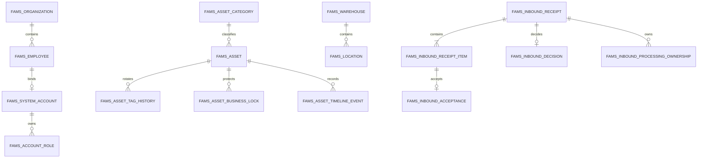

# D6-02C 领域与数据设计

> 状态：`REVIEW_PENDING` · 版本：V1.0 · 日期：2026-09-14  
> 权威业务输入：PRD V1.5；权威接口输入：`contracts/fams-core-v1.yaml`。  
> 本文是 **设计目标，不是已执行迁移**。当前没有产品表、产品 Flyway 迁移或业务运行证据。

## 1. 范围与不变量

本文冻结 D6-04～D6-07 编码前所需的首批领域与数据边界：系统账号、组织人员、基础资料、
编号与参数、资产建卡/台账/标签、日常入库、审计、幂等、业务锁和站内待办。批量导入、
期初发布、其他生命周期业务、外部消息投递、报表导出与产品实现不在 D6-02C 内。

全局不变量如下：

1. 系统服务单一企业，不引入租户列、租户路由或跨企业共享模型。
2. 内部主键使用 MySQL signed `BIGINT AUTO_INCREMENT`；API 中所有主键均为十进制字符串，
   避免 JavaScript 整数精度丢失。
3. 资产编码在全企业唯一且永久不复用。取消、失败或废号都保留事实，不回拨流水。
4. 业务事件时刻统一保存 UTC `DATETIME(3)`，Java 使用 `Instant`，API 使用 UTC `Z`；
   业务日期使用 `DATE` / `LocalDate`。服务端“当前时间”只能来自可注入 `Clock`。
5. 资产生命周期、异常状态、建卡阶段、当前保管、入库单状态、资产业务锁和库管处理权
   分别建模，不能用一个状态字段代替其他事实。
6. 管理员决定和库管执行分离；批准不等于验收入库，系统管理员也不自动取得任一业务权。
7. 所有业务写入都是单数据库短事务。等待人工操作时不保持数据库事务，不引入 Saga。
8. 所有写操作记录实际账号、实际使用角色、请求标识、前后版本和结构化审计事件。
9. 二维码只是不可猜测的定位凭证，不是授权凭证；解析后仍重验当前身份与数据范围。
10. 正式业务数据只做逻辑终止或状态归档。本文不设计业务事实的物理删除入口。

## 2. 聚合与关系

聚合写边界：

- 账号聚合：`fams_system_account`、角色、会话失效纪元和安全事件。
- 资产聚合：`fams_asset`、当前标签、附件元数据、时间线及活动业务锁。
- 入库聚合：入库单、明细、唯一决定、批准范围、整单处理权和逐项验收。
- 基础资料各自为独立聚合；资产或单据只保存稳定 ID 与提交时必要快照。
- 审计、幂等和站内待办是同一业务事务内的控制记录，不是异步成功的替代品。

## 3. 公共列与数据库约定

除纯关联表外，业务表统一包含：

| 列 | 类型 | 规则 |
|---|---|---|
| `id` | `BIGINT AUTO_INCREMENT` | signed、仅内部使用，API 转十进制字符串 |
| `version` | `BIGINT NOT NULL DEFAULT 0` | 乐观锁；成功写入后加 1 |
| `created_at` / `updated_at` | `DATETIME(3)` | UTC；由应用显式写入 |
| `created_by` / `updated_by` | `BIGINT` | 实际系统账号；系统任务使用预留主体 |
| `status` | `VARCHAR(40)` | 受 `CHECK` 约束的稳定英文代码 |

命名与字符规则：

- 数据库、连接和文本列统一 `utf8mb4`；比较型编码另存大写规范化列并使用确定性排序规则。
- 金额不在本设计范围。未来如出现费用，只能使用 `DECIMAL`，不得使用浮点数。
- JSON 只用于版本化参数、筛选条件或不可参与关系约束的快照；主键、状态和外键不得藏在 JSON。
- 外键用于防止悬空引用，但“停用记录仍可被历史读取”不通过级联删除实现。
- 代码唯一索引基于规范化值；显示值保留用户输入的合法大小写。

## 4. 身份、组织与基础资料

### 4.1 身份与组织表

| 表 | 关键列 | 约束与索引 |
|---|---|---|
| `fams_organization` | `code_normalized`、`name`、`parent_id`、`status`、`remark` | `uk_org_code`；`idx_org_parent_status(parent_id,status)`；根节点 `parent_id IS NULL`；循环由锁定父链后的服务校验阻断 |
| `fams_employee` | `employee_no_normalized`、`name`、`organization_id`、`mobile_ciphertext`、`mobile_lookup_hash`、`status` | 工号唯一；手机号密文保存、HMAC 摘要等值查找；`idx_employee_org_status`；停用不删除历史身份 |
| `fams_system_account` | `employee_id`、`username_normalized`、`password_hash`、`status`、`initial_password_required`、`failed_attempts`、`locked_until`、`auth_epoch` | 员工和用户名各自唯一；停用、锁定、改密、角色变化更新 `auth_epoch` 使旧会话失效 |
| `fams_account_role` | `account_id`、`role_code`、`granted_at`、`granted_by` | `uk_account_role(account_id,role_code)`；角色代码与 OpenAPI `Role` 一致 |
| `fams_security_event` | `account_id`、`event_type`、`request_id`、`occurred_at`、`detail_json` | `idx_security_account_time`、`idx_security_request`；详情不得写明文密码或完整 Cookie |

员工停用与账号停用在一个事务内更新；资产责任清理通过异常清单和后续正式业务完成，不能因此延迟访问撤销。

### 4.2 主数据表

| 表 | 关键列 | 约束与索引 |
|---|---|---|
| `fams_asset_category` | `code_normalized`、`name`、`parent_id`、`suggested_unit`、`numbering_prefix`、`extension_template_json`、`status` | 分类编码唯一；父链不能循环；停用父级不能新增启用子级 |
| `fams_manufacturer` | `code_normalized`、`name`、`status` | 厂商编码唯一；被引用后只允许停用 |
| `fams_brand` | `code_normalized`、`name`、`default_manufacturer_id`、`status` | 品牌编码唯一；默认厂商必须为当前启用版本 |
| `fams_warehouse` | `code_normalized`、`name`、`status`、`remark` | 仓库编码唯一；有活动资产或未结引用时不得停用 |
| `fams_location` | `warehouse_id`、`code_normalized`、`name`、`parent_id`、`location_type`、`status` | `uk_location_code`；父子必须属于同一仓库；有当前资产、启用子级或未结业务时不得停用 |

树结构先用邻接表。创建或移动节点时以稳定顺序锁定节点及目标父链，校验不存在循环后写入；
查询树可在服务层组装。没有实际规模证据前不增加闭包表或路径冗余列。

### 4.3 编号、参数与配置异常

| 表 | 关键列 | 约束与索引 |
|---|---|---|
| `fams_numbering_rule` | `target_type`、`mode`、`fixed_prefix`、`date_part`、`sequence_width`、`category_prefix_required`、`status` | 每个目标仅一个启用规则；资产可选企业或分类前缀模式，入库单只允许企业模式 |
| `fams_numbering_sequence` | `rule_id`、`bucket_key`、`next_value`、`version` | `uk_numbering_bucket(rule_id,bucket_key)`；以行锁原子分配号段 |
| `fams_numbering_allocation` | `rule_id`、`target_type`、`allocated_code`、`allocation_status`、`request_id`、`resource_id` | `uk_allocated_code(target_type,allocated_code)`；状态为 `RESERVED/ISSUED/GAP`；失败号保留 `GAP` 永不回收 |
| `fams_business_parameter_version` | `effective_from`、`timezone_id`、`work_calendar_json`、各时限、`status`、`changed_from_id` | `effective_from` 唯一；创建后不可原位修改；同一时刻最多一个 `ACTIVE` |
| `fams_configuration_anomaly` | `anomaly_type`、`status`、`first_seen_at`、`last_seen_at`、`resolved_at`、`detail_json` | 一个异常类型只保留一个未解决项；人员角色、短信或微信配置恢复后关闭而不删除 |

参数按单据创建时的有效版本生成快照，之后参数变更不重写既有单据时限。企业时区默认
`Asia/Shanghai`，但存储的业务时刻始终为 UTC。

## 5. 资产卡、台账与标签

### 5.1 资产主表

`fams_asset` 是当前资产快照，关键列如下：

| 列组 | 列与规则 |
|---|---|
| 身份 | `asset_code` 全企业唯一且非空；`serial_number_normalized` 可空、非空时唯一；`source_asset_id` 仅记录复制来源 |
| 基础资料 | `name`、`category_id`、`brand_id`、`manufacturer_id`、`specification`、`unit`、`extension_values_json` |
| 状态 | `card_stage`：`DRAFT/PENDING_INBOUND/ACTIVE/CANCELLED`；`lifecycle_status` 与 `exception_status` 使用 OpenAPI 枚举 |
| 归属与保管 | `owning_organization_id`、`usage_mode`、`using_organization_id`、`user_employee_id`、`shared_custodian_employee_id`、`warehouse_id`、`location_id` |
| 时间 | `inbound_date DATE`、`last_inventory_at DATETIME(3)`；事件时刻另写时间线 |
| 并发 | 公共 `version`；所有修改使用 `WHERE id=? AND version=?`，影响行数不是 1 即冲突 |

索引：

- `uk_asset_code(asset_code)`；取消卡仍保留，因此编码不能复用。
- `uk_asset_serial(serial_number_normalized)`；MySQL 唯一索引允许多个 `NULL`，空字符串先规范化为 `NULL`。
- `idx_asset_ledger(category_id,lifecycle_status,exception_status,id)`。
- `idx_asset_custody(using_organization_id,user_employee_id,shared_custodian_employee_id,id)`。
- `idx_asset_location(warehouse_id,location_id,id)`、`idx_asset_inbound_date(inbound_date,id)`、
  `idx_asset_inventory(last_inventory_at,id)`。

保管约束由状态迁移服务与事务内当前引用校验共同保证：`PERSONAL` 必须有使用组织、使用人和位置，
且公用责任人为空；`SHARED` 必须有使用组织、公用责任人和固定位置，且使用人为空。资产卡普通编辑
不得改变生命周期、异常状态、使用模式或保管责任，这些字段只由正式业务动作更新。

### 5.2 资产附属表

| 表 | 关键列 | 约束与索引 |
|---|---|---|
| `fams_asset_attachment` | `asset_id`、`object_key`、`media_type`、`size_bytes`、`checksum_sha256`、`visibility_code` | 只保存对象元数据；附件内容不进数据库；访问时重验当前权限 |
| `fams_asset_tag` | `asset_id`、`token_ciphertext`、`token_hash`、`tag_version`、`issued_at`、`rotated_at` | 每资产一条当前标签；`token_hash` 全局唯一；随机 32 字节经 base64url 无填充后为 43 字符 |
| `fams_asset_tag_history` | `asset_id`、`token_hash`、`valid_from`、`invalidated_at`、`reason` | 旧标识只保存摘要并永远失效；`idx_tag_history_asset_time` |
| `fams_asset_tag_print_job` | `requester_account_id`、`job_status`、`template_version`、`error_code`、`completed_at` | 单张和批量打印统一可查询任务；终态仍可恢复查询 |
| `fams_asset_tag_print_item` | `print_job_id`、`asset_id`、`asset_version`、`tag_version`、`item_status` | `uk_print_job_asset`；打印快照与任务绑定，不在重试中换标签 |
| `fams_asset_saved_filter` | `owner_account_id`、`name_normalized`、`criteria_json`、`version` | 个人所有；`uk_saved_filter_owner_name`；只存符合 `AssetFilterCriteria` 的值，不存 SQL；每次执行重验当前权限 |
| `fams_asset_timeline_event` | `asset_id`、`event_type`、`business_type`、`business_id`、`occurred_at`、`summary_json` | `idx_asset_timeline(asset_id,occurred_at DESC,id DESC)`；历史倒序稳定分页 |

重新打印复用当前标签；只有“换标”才在一个事务中生成新随机标识、归档旧摘要并增加标签版本。
`resolveAssetAccessToken` 只通过摘要定位资产，之后按当前会话、角色、数据范围及字段权限裁剪响应。
不存在、旧标识和无权访问不得形成可枚举差异。

### 5.3 活动业务锁

`fams_asset_business_lock` 保存持久业务互斥，而不是数据库长事务：

| 列 | 规则 |
|---|---|
| `asset_id` | 被锁资产 |
| `business_type` / `business_id` | 当前入库单或后续业务聚合 |
| `lock_version` | 活动锁的乐观版本 |
| `acquired_at` / `released_at` | UTC 时刻；超时或重启不能自动填写释放时间 |
| `release_reason` | 完成、驳回、合法取消或受控修复原因 |
| `active_guard` | `TINYINT GENERATED ALWAYS AS (CASE WHEN released_at IS NULL THEN 1 ELSE NULL END) STORED` |

唯一索引 `uk_asset_active_lock(asset_id, active_guard)` 利用 MySQL 允许多个 `NULL` 的规则保留历史，
同时保证每项资产最多一条活动锁。取得锁、单据状态更新、待办和审计必须在同一事务；发现孤立锁时
只允许依据业务终态受审计修复，不能按时间直接删除。

## 6. 日常入库

### 6.1 表设计

| 表 | 关键列 | 约束与索引 |
|---|---|---|
| `fams_inbound_receipt` | `receipt_no`、`creator_account_id`、`receipt_status`、`business_date`、`operator_employee_id`、`remark`、`parameter_version_id`、`version` | 单号唯一；草稿仅创建库管可写；`idx_inbound_pool(status,updated_at,id)` |
| `fams_inbound_receipt_item` | `receipt_id`、`asset_id`、`asset_version_snapshot`、`target_warehouse_id`、`warehouse_version_snapshot`、`target_location_id`、`location_version_snapshot`、`execution_status`、`version` | `uk_inbound_receipt_asset(receipt_id,asset_id)`；位置必须属于目标仓库 |
| `fams_inbound_decision` | `receipt_id`、`decision_result`、`reason`、`decided_by_account_id`、`decided_role`、`receipt_version_before`、`decided_at` | `uk_inbound_effective_decision(receipt_id)`；一个入库单只能有一个有效管理员决定 |
| `fams_inbound_approval_scope_item` | `decision_id`、`receipt_item_id`、`approved_asset_version`、`approved_warehouse_id`、`approved_location_id` | `uk_inbound_scope_item(decision_id,receipt_item_id)`；验收不得越过批准范围 |
| `fams_inbound_processing_ownership` | `receipt_id`、`processor_account_id`、`ownership_version`、`acquired_at`、`released_at`、`release_reason`、`active_guard` | `active_guard` 使用与资产锁相同的生成列；`uk_inbound_active_owner(receipt_id,active_guard)` 保证整单唯一处理人 |
| `fams_inbound_acceptance` | `receipt_item_id`、`ownership_id`、`observed_asset_code`、`accepted_by_account_id`、`accepted_at`、`asset_version_after`、`audit_event_id` | `uk_inbound_item_acceptance(receipt_item_id)`；每项最多一次有效验收 |

### 6.2 状态迁移

| 当前状态 | 动作 | 下一状态 | 同一事务内的事实 |
|---|---|---|---|
| `DRAFT` | 创建人保存 | `DRAFT` | 单头/明细版本、目标当前有效性、审计 |
| `DRAFT` | 创建人提交 | `PENDING_ADMIN_DECISION` | 重验资料完整性与引用版本，为全部资产取得业务锁，生成管理员共享待办 |
| `DRAFT` | 创建人取消 | `CANCELLED` | 记录原因；未取得资产锁 |
| `PENDING_ADMIN_DECISION` | 管理员批准 | `WAITING_WAREHOUSE_CLAIM` | 唯一决定、批准范围、关闭管理员待办、生成一条去重库管池待办 |
| `PENDING_ADMIN_DECISION` | 管理员驳回 | `REJECTED` | 唯一决定、原因、释放全部资产锁、关闭待办 |
| `PENDING_ADMIN_DECISION` | 创建人竞争取消 | `CANCELLED` | 以单据版本和唯一决定竞争；释放锁；败者读取已生效结果 |
| `WAITING_WAREHOUSE_CLAIM` | 库管认领 | `WAREHOUSE_PROCESSING` | 原子创建唯一活动处理权；其他库管保持只读 |
| `WAREHOUSE_PROCESSING` | 当前处理人逐项验收 | 原状态或 `COMPLETED` | 重验批准范围、实物编码、资产/目标/单据/处理权版本；更新资产为 `ACTIVE/IN_STOCK`，释放该资产锁 |
| 任一终态 | 再次写入 | 不变 | 返回稳定冲突或既有结果，不改历史 |

最后一项验收成功时，同一事务把单据置为 `COMPLETED`、归档处理权并关闭执行待办。任一校验或写入失败，
本次验收的资产、明细、单头、锁、待办、审计和幂等结果全部回滚；已经在更早事务成功验收的其他明细
不被重做或回滚。

## 7. 控制记录

### 7.1 幂等

`fams_idempotency_record`：

| 列 | 规则 |
|---|---|
| `actor_account_id`、`operation_id`、`idempotency_key` | 唯一键 `uk_idempotency_actor_operation_key` |
| `payload_sha256` | 对规范化请求体和关键路径参数计算；不得包含 Cookie 等秘密 |
| `result_status` | `SUCCEEDED` 或已稳定生效的业务拒绝；未提交事务不留下伪成功 |
| `http_status`、`response_body_json`、`resource_type`、`resource_id` | 与业务事实同事务保存，供响应未知后重放 |
| `created_at`、`completed_at`、`expires_at` | 清理只能在业务要求的重试窗口后进行，不能改变资源事实 |

请求先重验当前会话和权限，再按唯一键串行化。同键同载荷返回已保存结果；同键不同载荷返回幂等冲突。
业务写入与成功响应快照在同一事务提交，因此客户端遇到 **response unknown** 时使用原
`Idempotency-Key` 重试，可区分“已提交但响应丢失”和“事务未提交”。

### 7.2 审计与待办

| 表 | 关键列与规则 |
|---|---|
| `fams_audit_event` | `request_id`、`actor_account_id`、`actor_role`、`action`、`resource_type/id`、`before_version`、`after_version`、`occurred_at`、脱敏 `detail_json`；`request_id` 和资源时间均建索引 |
| `fams_todo` | `pool_type`、`assignee_account_id`、`business_type/id`、`todo_type`、`todo_status`、`opened_at`、`closed_at`；共享池用业务键去重，不为每名管理员或库管复制可执行事实 |

共享待办是单一池事实加角色查询，不是多条可分别完成的审批任务。外部通知属于后续 D6-24；其失败不能
回滚已提交业务，也不能删除站内待办。

## 8. 事务、锁顺序与并发

统一锁顺序为：幂等键 → 单据 → 明细（ID 升序）→ 资产（ID 升序）→ 活动业务锁 → 处理权 →
待办/审计。需要多个资产时必须排序后加锁，避免客户端顺序造成死锁。

| 场景 | 并发裁决 |
|---|---|
| 两名管理员决定 | 对 `fams_inbound_receipt.version` 比较并插入唯一 `fams_inbound_decision`；只有一个提交，败者读取实际决定 |
| 管理员决定与创建人取消 | 同一单据版本竞争；只有一个状态迁移生效，败者返回实际终态 |
| 多名库管认领 | `uk_inbound_active_owner` 加单据版本共同裁决；只有一条活动处理权 |
| 重复提交同一资产 | `uk_asset_active_lock` 阻断第二业务；整单提交任一锁失败则全部回滚 |
| 两次资产编辑 | `If-Match-Version` 映射到 `WHERE version=?`；过期写返回当前版本冲突 |
| 标签换标与打印 | 锁定资产和当前标签版本；换标后旧任务不静默改用新标识 |

数据库死锁或连接中断不转译为业务成功。可安全重试的数据库异常由服务端以有限次数、带抖动重试；
超过上限返回稳定错误并依赖原幂等键继续，不能生成新业务请求规避不确定性。

## 9. Flyway、兼容与恢复

### 9.1 迁移隔离

未来产品迁移唯一位置为：

`backend/src/main/resources/db/migration/product`

D6-02B 的 `backend/src/main/resources/db/migration/runtime_compatibility` 只属于技术探针。
产品 profile 必须显式只加载 `db/migration/product`，不得扫描或重命名 `runtime_compatibility`，也不得把
探针表升级为产品表。

迁移策略是 **forward-only**：

- 已在任何共享环境执行的版本脚本不可编辑、删除或重排；修复只能新增更高版本迁移。
- 先扩展再切换再收缩；跨版本发布期间，新旧应用都必须能读取扩展后的 schema。
- 大表回填拆成可观测、可重入的小批次，不在启动迁移里执行不可控全表业务计算。
- 删除列、收紧非空、重建唯一索引前必须有使用扫描、备份与恢复演练证据。
- 每个迁移在空库升级和上一发布版本升级两条路径验证；校验 Flyway checksum 和最终 schema。

首批建议版本边界为身份/主数据、资产/控制记录、日常入库三组，但具体 `Vxxx` 编号由首次产品迁移任务
在读取当前迁移历史后分配。本文不预占真实版本号。

### 9.2 失败与恢复矩阵

| 失败点 | 可观察结果 | 恢复入口 |
|---|---|---|
| Flyway 校验或迁移失败 | 产品应用启动失败且不接流量；不得忽略 checksum 或自动 repair | 保留数据库与日志，修正新迁移或从已验证备份恢复；新增前向迁移后再启动 |
| 业务事务任一步失败 | 该次事务的业务、锁、待办、审计、幂等成功结果均不提交 | 修正输入后重试；若响应未知则先用原幂等键查询/重试 |
| 提交成功但响应丢失 | 业务事实和幂等结果都存在 | 客户端以原 `Idempotency-Key` 重试或查询资源，不创建新键猜测 |
| 应用进程重启 | 活动资产锁、库管处理权、单据状态和站内待办仍在数据库 | 从持久事实恢复列表；不按进程内存或超时自动释放 |
| 处理人停用 | 会话立即失效，活动处理权保留且冻结写入 | 管理员在后续受控转派能力中核对事实并转派；D6-02C 不伪造自动转派 |
| 孤立锁或状态失配 | 异常项进入配置/运行修复清单，不冒充可用库存 | 按单据终态和审计证据执行受控修复，保留修复前后记录 |
| 生成或验证中断 | 仅存在可删除的 `backend/target`、`packages/api-types/target` | 清理明确拥有的生成目录后从契约重新生成；生成物不入库 |

恢复不依赖 down migration。数据库回退只允许恢复到与应用版本匹配、经过验证的备份，再通过
forward-only 迁移前进；任何恢复结果都要核对资产编码、活动锁、唯一决定、处理权、待办和审计数量。

## 10. 后续实现验证清单

- D6-04：账号停用/锁定/改密/角色变化使现有会话失效；CSRF 和安全日志有运行证据。
- D6-05：树循环、停用引用、编号废号、参数生效版本与配置异常均有事务级负例。
- D6-06：资产编码/序列号并发唯一、保管字段不可直改、标签重打/换标和个人筛选权限有数据库验证。
- D6-07：管理员竞争决定、取消竞争、整单资产锁、多库管认领、逐项验收、原键恢复均在真实 MySQL 验证。
- D6-24：站内事实与外部通知解耦；外部失败不丢业务或站内待办。
- 第七阶段 QA：迁移升级/失败恢复、并发压力、备份恢复、安全和全链路验收另行执行。

在上述任务产生运行证据前，本文只能证明设计可定位、可生成和可审查，不能证明数据库、业务 API、
权限或恢复机制已经实现。
