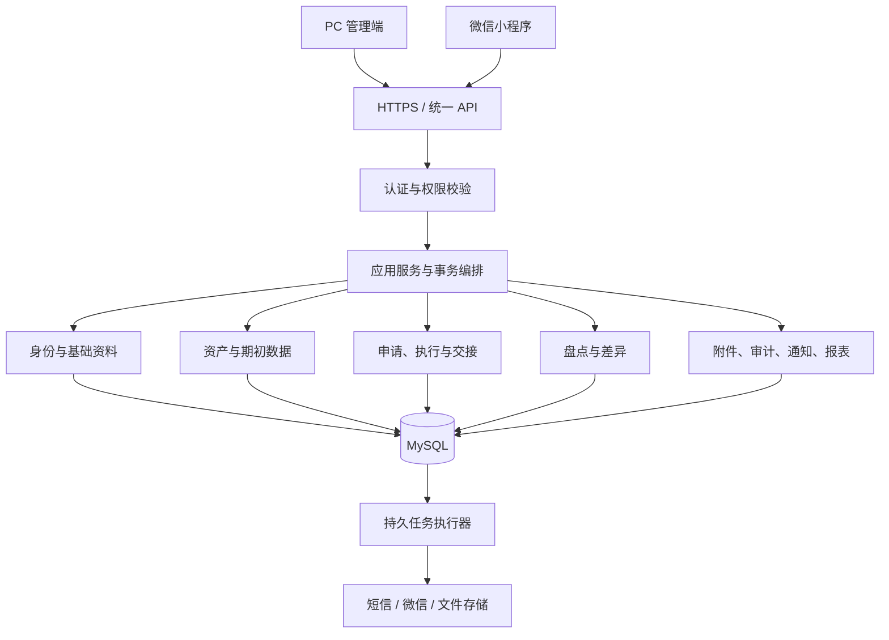

# FAMS 第六阶段：技术开发与实现计划

> 版本：V1.1 · 创建/更新：2026-09-15
> 文档状态：修订计划已确认并保存；确认依据为用户本轮“确认修订计划”。  
> 执行状态：`IN_PROGRESS`。D6-01A、D6-02A、D6-02B、D6-02C 当前为 `DEV_VERIFIED`，固定候选组合已冻结；D6-02C 用户本人关键独立技术复核及签署记录提交上的完整门禁已通过。D6-03A 本地统一检查的用户本人规格/质量复核已全项 `PASS`，状态仍为 `IN_REVIEW`，等待签署记录提交上的最终完整门禁；D6-01B 远端与 CI 尚未完成，产品业务实现尚未开始。
> 项目阶段唯一入口：[DESIGN-HANDOFF.md](../../../DESIGN-HANDOFF.md)。  
> 维护责任：AI 在每次任务变更和交接时更新；计划、范围及里程碑验收由用户确认。

**Goal：**以 PRD V1.5、IA D0.2 和 D0.4 为基线，交付可运行、可联调、可追溯并具备第七阶段 QA 输入的固定资产管理系统。

**Architecture：**Java 模块化单体，PC 与小程序共用业务 API。核心业务使用 MySQL 短事务，外部投递使用持久事件及后台任务。

**Tech Stack：**Java 21、Spring Boot 4.1、MyBatis 核心 3.5.x / MyBatis-Spring 4.x / MyBatis Spring Boot Starter 4.x、MySQL 8.4、Flyway、Vue 3 / TypeScript / Element Plus、微信原生 TypeScript、OpenAPI、GitHub Actions。后端运行兼容性与契约工具具体组合已由 D6-02B 冻结；尚未实施的 PC、小程序及质量工具仍按各自关口验证后冻结。

**执行方式：**整体计划确认并收到开发启动指令后，按本计划逐任务实施；默认在当前任务顺序执行，可使用 `superpowers:executing-plans` 工作流。未获明确授权不自动启用多代理并行开发。每个任务编码前须补齐任务卡、相关契约、数据设计和验证条件。

## 一、目标、基线与开工条件

### 1. 已确认决策

| 项目 | 会话中确认的决策 |
|---|---|
| 开发组织 | 用户主导、AI 实施；用户负责产品决策和验收 |
| 后端路线 | Java 优先，模块化单体 |
| PC 脚手架 | Vue 3 官方 create-vue、TypeScript、Element Plus |
| 小程序 | 微信原生 + TypeScript |
| 身份 | 一期系统账号；PC 和小程序对应同一员工身份 |
| 数据与基础组件 | MySQL 8.4、MyBatis、Flyway、数据库持久化任务；一期不引入 Redis、消息队列或注册中心 |
| 接口协作 | 契约先行，生成 Java 接口/模型及 TypeScript 类型 |
| 仓库与托管 | 当前 fams 目录转为单仓；GitHub 私有仓库 |
| 交付节奏 | 业务里程碑推进，不按未经验证的固定日期倒排 |
| 外部服务 | 当前云环境、小程序、短信和域名未准备；先定义适配接口，采购另设关口 |
| Git 提交 | 强制采用 type(scope): summary、正文及四个 Agent 元数据字段，详见 §四.4 |

上述逐项选择与整体计划确认分别记录。2026-09-12 用户已确认本轮修订计划；D6-01A 启动、修复/复核及本地验证已记录于 §六.3。执行顺序为：D6-01A 本地治理 → G0 / D6-02A 验证候选组合 → 完成首批契约 → 通过关口后进入 G1 业务编码；D6-01B 远端与 CI 另待实际权限。

### 2. 开发范围与权威基线

- [PRD V1.5](../specs/2026-09-03-fixed-asset-product-design.md)：业务规则和一期范围。
- [IA D0.2](../specs/2026-09-06-fixed-asset-ia-interaction-design.md)：F01～F10、PC P01～P26、小程序 M01～M14。
- [D0.4 设计交接](../designs/2026-09-06-fams-ui/HANDOFF-D0.4.md)：视觉、组件与交互状态。
- [第五阶段覆盖清单](../specs/2026-09-11-fams-usability-test-matrix.csv)：检查开发任务是否遗漏功能域；设计覆盖不是实现证据。

一期不增加采购、财务折旧、多租户、多级审批、BPMN、专业维修派工等能力。`datae.ndm2` 仅作业务参考，不直接转换为产品数据库。

全局硬约束：

1. 任意一名资产管理员作出一次决定；整单由唯一当前库管执行；必要时由实际接收人确认。
2. 资产生命周期、单据进度、实物去向、保管责任和业务锁分别建模；待交接不是资产生命周期状态。
3. 需求数量与具体资产分配分离，部分履行遵守 PRD 数量守恒。
4. 正式保管关系和状态只能经合法业务动作改变，不能通过资产编辑、扫码或盘点直接改写。
5. 业务记录和凭证保持追溯；完成、驳回、取消和转后续不被后续操作覆盖。
6. 不恢复已取消的大规模用户招募或 R0/R1/R2 原型验证方案。
7. 所有 shell 命令使用 `rtk` 前缀；不编造 Git、CI、真实服务或生产验收记录。

### 3. 第六阶段完成定义

交付：

1. 可重复构建、可部署到联调环境的后端、PC 和小程序。
2. 覆盖一期全部功能的接口、数据库、页面和业务链路。
3. 开发自检、契约检查、真实接口联调及关键业务回归证据。
4. 第七阶段 QA 所需版本、数据、验收矩阵、测试工具和已知问题清单。

第六阶段完成不等于正式 QA 通过，也不等于允许生产上线。性能、安全专项、完整验收和恢复演练在第七阶段正式执行；第六阶段同步实现能力并准备工具，不把质量问题全部延后处理。

### 4. 进度与变更管理

`DESIGN-HANDOFF.md` 继续作为唯一项目阶段入口；第六阶段已进入进行中并链接本计划。第六阶段任务明细以本计划 §四.5 的台账为准，不维护第二套相互竞争的进度。

业务变更先记录原规则、变更原因、影响页面/接口/数据/验收项，由用户确认后更新基线。开发发现设计缺口只重新打开对应条目，不重启已关闭的整个第五阶段。

## 二、技术架构、脚手架与数据设计

### 1. 技术基线

| 层面 | 方案 | 约束 |
|---|---|---|
| 后端运行时 | Java 21、Spring Boot 4.1 候选版本线、Maven Wrapper | 官方 Initializr 起步，验证后冻结补丁版本 |
| HTTP 与安全 | Spring MVC、Bean Validation、Spring Security | 统一认证、授权、参数校验及错误处理 |
| 数据访问 | MyBatis 核心 3.5.x、MyBatis-Spring 4.x、Starter 4.x、MySQL 8.4 InnoDB、Flyway | 三项 MyBatis 组件分别记录版本；SQL 可审查；数据库变更全部版本化 |
| 会话 | Spring Session JDBC | 会话持久化；停用、解绑后权限失效 |
| PC | create-vue、Vue 3、TypeScript、Vite、Vue Router、Pinia、Element Plus | 按 D0.4 适配，不直接套用其他后台模板 |
| 小程序 | 微信原生、TypeScript | 独立页面和运行时，复用接口类型 |
| 接口工具 | OpenAPI 3.0.4、OpenAPI Generator、契约校验及差异检查 | Java 接口/模型和 TypeScript 类型来自同一契约 |
| 后台任务 | 数据库任务表、持久事件表、受控工作线程 | 可重试、重启恢复、查询失败原因 |
| 文件 | 存储适配接口、隔离区、恶意文件扫描 | 本地可用文件系统；联调/生产存储单独配置 |
| 开发环境 | Docker Compose | MySQL、文件扫描等依赖可重复启动 |
| 自动检查 | GitHub Actions、JUnit、Testcontainers、Vitest、Playwright | 本地与 CI 使用同一检查入口 |
| 静态与架构检查 | Checkstyle、SpotBugs、ArchUnit、ESLint、TypeScript、JaCoCo（候选工具） | D6-03A 固定兼容版本、规则范围和覆盖率门槛，详见 §四.3 |
| 运行指标 | Spring Boot Actuator / Micrometer | D6-03A 建立受限指标入口；D6-08、D6-24 接入业务任务指标，不公开管理端点 |

规划时已核对的官方依据：

- [Spring Boot 系统要求](https://docs.spring.io/spring-boot/system-requirements.html)：与 Java 21 相容。
- [MyBatis Spring Boot Starter](https://mybatis.org/spring-boot-starter/mybatis-spring-boot-autoconfigure/)：MyBatis Starter 4 支持 Spring Boot 4.0+。
- [Vue TypeScript](https://vuejs.org/guide/typescript/overview)：create-vue 支持 TypeScript。
- [Spring Session JDBC](https://docs.spring.io/spring-session/reference/guides/boot-jdbc.html)：会话持久化方案。

这些是选型资料，不是本项目兼容性测试通过证明。已确认的是 Java 模块化单体、MyBatis、MySQL、Vue 和原生小程序等技术路线；D6-02A 已验证生成流水线，D6-02B 已用固定补丁版本、Node 24 LTS、包管理器、生成器、容器镜像及锁文件完成本地真实运行验证、独立复核和 reviewed implementation HEAD 全量复跑，具体组合已正式冻结。每次验证固定输入版本，不能边测试边隐式升级；尚未实施的客户端和质量工具仍须通过各自关口。

兼容性失败处理规则：

1. AI 保存最小失败样例、候选版本、命令、退出码和原始报告，区分生成器配置、依赖冲突、框架缺陷与业务代码错误。
2. 优先在已确认路线内修正配置或调整候选组件组合；每轮修复重跑同一组关口用例，不手改生成代码，不通过删除失败用例或放宽契约获得通过。
3. 连续两轮针对性修复仍未通过，或确认存在无法满足契约的缺陷时，立即提交重新选型记录：已尝试方案、替代组合、支持窗口、业务影响及成本。不得启动依赖该失败能力的任务；无依赖工作可继续。
4. Boot 4.0 可作为解决特定版本问题的候选，不能作为 Jackson 3 问题的通用出口；不预设某个旧版本为长期支持兜底。重新选型时核查当日官方支持政策，区分开源与商业支持，并通过同一套验证。
5. AI 负责调查与建议，用户决定已确认路线的变化；待决期间相关任务记 `BLOCKED`。版本冻结后的升级作为独立任务，不混入业务修改。

### 2. 系统结构



后端作为一个应用部署，业务模块通过内部服务接口协作。核心业务在同一数据库短事务内完成，不跨人工等待持有数据库事务，不引入分布式事务或 Saga。

### 3. 业务模块与边界

| 模块 | 职责 |
|---|---|
| 身份与基础资料 | 员工、组织、角色、数据范围、微信绑定、分类、仓库和位置 |
| 资产 | 建卡、编码、标签、当前保管快照、资产版本、业务锁 |
| 申请与执行 | 管理员决定、整单处理权、需求明细、分配、交出、接收、取消和转派 |
| 专项业务 | 借还、维修、返厂轮次、报失找回、报废处置和受控纠正 |
| 盘点 | 任务快照、分配版本、现场事件、差异复核、封存和迟到证据 |
| 期初与批量任务 | 导入预检、核验发布、承接记录、回滚、导出和标签任务 |
| 支撑能力 | 附件、审计、持久事件、站内通知、外部通道和报表 |

模块内采用 Controller、Service、Mapper 分层；Controller 不承载业务事务。HTTP DTO、业务模型和数据库实体分离。跨模块只调用内部服务接口，不直接调用其他模块 Mapper。

跨模块原子业务由应用服务统一编排；模块间禁止循环依赖，以架构测试检查。共享代码只承载通用技术能力，不把审批或资产状态规则塞入通用工具类。

### 4. 单仓组织

以下为开发启动后的目标目录，不表示当前已创建：

```text
fams/
├─ backend/                 Maven：生成契约模块 + Spring Boot 应用
├─ apps/
│  ├─ web/                  PC 管理端
│  └─ miniprogram/          微信原生小程序
├─ contracts/               OpenAPI、公共模型、错误码、请求响应示例
├─ packages/
│  └─ api-types/            生成的 TypeScript 类型
├─ infra/                   本地及联调环境配置
├─ scripts/                 构建、检查、数据准备、联调验证入口
├─ docs/                    现有设计资料与开发文档
├─ output/                  本地运行证据，默认不提交
└─ .github/                 PR 模板与 CI
```

D6-01 初始化 Git 前分类现有文件：正文、原型源码和必要设计规范进入版本控制；ZIP、大量导出图、运行日志、临时证据及可能敏感数据按清单排除或外置。保留当前文件，不删除既有证据。变更后的相对链接必须可用，不以排除文件制造无法复核的设计引用。

### 5. 核心数据约束

数据库详细设计先于对应业务编码完成，包含 ER 图、字段字典、唯一约束、索引、状态迁移和事务边界。

分别建模：

- 资产生命周期、异常状态、当前保管关系。
- 申请、需求明细、具体资产分配与实物交接。
- 管理员批准版本、库管处理权、资产业务锁。
- 借用责任、维修快照、返厂轮次、报废与处置。
- 盘点快照、原始事件、多项差异、封存报告。
- 期初批次、原始行、承接关系、后台任务及审计事件。

必须遵守：

1. 数据库 ID 对外统一字符串；资产编码独立管理，废号不复用。
2. 业务锁用持久记录和唯一约束；库管处理权持久保存于申请执行关系。
3. 页面关闭、超时或后台任务租约到期不得释放业务锁。
4. 审批、分配、交接和关联转换采用条件更新、版本校验及短事务。
5. 业务事实、资产更新、审计和待办事件同事务提交；外部消息事务外投递。
6. 已完成业务和履历不覆盖、不物理删除；纠错追加关联记录。
7. 数据库只通过 Flyway 变更，禁止修改已执行迁移或依赖 ORM 自动改表。
8. 期初批次先预检和暂存，再原子发布；承接关系失败不得暴露半成品。
9. 大批次发布验证事务耗时和恢复路径，不擅自改变 PRD 的批次原子语义。

标识设计规则：数据库主键与 API 字符串表示分别决定。D6-02C 优先评估数据库 `BIGINT` 主键、API 十进制字符串传输的简单方案，记录范围、索引及生成策略；不能由“字符串 ID”推导出必须采用 UUIDv7/ULID。离线事件使用客户端可生成的独立 UUID，并以服务端唯一约束去重。资产编码独立管理且废号不复用；二维码载荷须明确定位、换标和失效规则，扫码所得标识不授予业务权限。最终字段、约束和二维码规则在 D6-02C 设计记录中冻结，当前不视为数据库已经存在。

后台执行采用至少一次尝试的语义。业务与事件同事务持久化；工作线程使用条件领取、租约和执行代次防止过期执行者写回。消费者以业务键去重，重试次数、退避、失败待处理、人工重试权限及审计纳入任务契约。外部通道支持幂等键时传递稳定键；不支持时记录发送未知状态及对账路径，不能承诺端到端恰好一次。任务租约仅控制执行器，不改变库管处理权和资产锁。基础可靠性在 D6-08 验证，完整通知与恢复在 D6-24 收口。

## 三、接口契约、认证与联调规范

### 1. 契约先行流程

每个业务切片依次完成：

**PRD/页面映射 → 状态与权限梳理 → OpenAPI 变更 → 契约审查 → 生成类型 → 后端和页面实现 → 契约检查 → 真实联调。**

OpenAPI 是对外接口唯一来源。接口平台和文档站展示同一契约，不另写第二套字段定义。Java 生成接口与 DTO，Controller 实现生成接口；TypeScript 生成共享类型，双端分别封装请求。微信请求使用平台能力，不直接使用浏览器 fetch 客户端。

固定生成配置，禁止人工修改生成目录。D6-02 验证接口生成、Spring Boot 4 / Jackson 3 配置、编译和序列化。官方能力依据：[Spring Generator 配置](https://openapi-generator.tech/docs/generators/spring/)。

G1 业务编码前必须交付首批真实设计包（D6-02C）：D6-04 登录及权限、D6-06 建卡、D6-07 入库，以及这些流程依赖的 D6-05 基础资料。交付位置为 `contracts/` 和 `docs/development/`（开发启动后创建），包含完整 OpenAPI、请求/响应示例、ER 与字段/索引字典、枚举与状态转换、权限矩阵、错误码、事务/幂等边界及 PRD/页面/AC 映射。正常路径和拒绝路径共同审查；后续业务仍逐切片扩展契约，不要求 G0 一次设计完所有业务。

D6-02A 以这批流程的代表性模型建立“生成 → Java/TS 编译 → 实际 HTTP 请求/响应 → 契约断言”的检查入口。D6-02C 定稿后重跑检查。固定版本的生成器须实际支持所需 Boot 4/Jackson 3 配置；文档列有选项不能替代运行证明。通过标准：必测用例全部通过、重复生成无差异、生成目录无人为补丁。

JSON 断言以项目实际 HTTP 编解码配置为准：

- 校验日期、时间偏移、枚举、必填/缺失、`null`、空字符串、零值；错误输入必须返回约定错误响应，不只检查响应序列化。
- 金额保持十进制字符串，包含小数尾零等业务要求；超过 JavaScript 安全整数范围的 ID 在双端往返不丢精度。小数精度与舍入规则逐字段定义。
- 普通 JSON 对象按字段、类型和值比较，不把属性字母排序当业务契约；数组按契约校验顺序。签名、幂等摘要等需要稳定字节表示时另定规范化规则并覆盖字段换序用例。
- `ONE_BASED_MONTHS` 影响 `java.time.Month` 的数字表示，不意味着 ISO 日期月份会偏移；实际使用该表示时才增加专项断言。`FAIL_ON_NULL_FOR_PRIMITIVES` 属于输入反序列化检查。
- 不把 Jackson 裸库默认值直接当作 Spring Boot 实际接口行为；检查实际自动配置和定制配置，并将选定行为显式纳入契约用例。

依据：[JSON 对象与数组语义](https://datatracker.ietf.org/doc/html/rfc8259)、[Jackson Month 配置](https://raw.githubusercontent.com/FasterXML/jackson-databind/jackson-databind-3.0.0/src/main/java/tools/jackson/databind/cfg/DateTimeFeature.java)、[Spring Boot 日期默认配置](https://docs.spring.io/spring-boot/3.4/how-to/spring-mvc.html)。这些来源用于解释检查边界，不代表 FAMS 已通过检查。

### 2. 通用接口约定

| 项目 | 约定 |
|---|---|
| API 路径 | `/api/v1`；PC 与小程序共用业务接口 |
| JSON | camelCase；稳定英文枚举与中文文案分离 |
| 标识与数字 | ID 为字符串，数量为整数，维修费用为十进制字符串 |
| 时间 | 事件时刻内部使用 Instant，接口统一 UTC ISO 8601（Z）；业务日期使用 LocalDate / `YYYY-MM-DD` |
| 时区 | 企业默认 `Asia/Shanghai`；工作日按企业维护日历计算 |
| 分页 | page 从 1 开始，默认 20 条，最大 200 条 |
| 排序 | 字段白名单，加稳定 ID 排序保证分页确定性 |
| 成功响应 | 类型化结果；分页包含 items/page/pageSize/total |
| 错误响应 | 统一 code/message/requestId/fieldErrors，按需含受授权冲突详情 |
| HTTP 状态 | 400 参数错误、401 身份失效、403 无权、404 不可见或不存在、409 冲突、429 限流 |
| 批量结果 | 明确整批原子或逐项处理；逐项处理返回每项结果 |
| 未知结果 | 超时不显示成功；沿用原幂等键重试或查询回执 |
| 字段缺省 | 逐字段声明必填、可空和缺省值，不混用缺失、空字符串与 null |

每个写接口明确操作身份、作用对象、前置状态、批准范围、所需版本、事务范围、幂等规则、错误码、审计和消息副作用。

时间落地规则：业务日期不做时区换日；事件输入允许契约声明的有效偏移，统一归一为 Instant，输出 UTC，展示转换至 `Asia/Shanghai`。服务端业务当前时间通过可注入的 `Clock` 获取；数据库字段精度、UTC 存储和 JDBC 映射由 D6-02C 固定并测试往返。72 小时按绝对时长计算，不按工作日或三次自然日切换计算；不能用首次上传时间替代客户端首次持久化时间作为期限起点。

时间验收编号 T-02-01（日期与跨时区往返）、T-17-01（首次持久化、重启与重试不改期限）、T-18-01（截止前 1 毫秒、恰好截止、截止后）、T-18-02（权限失效、原回执、时间异常的裁决优先级）。D6-02C 冻结时间精度；D6-17/18 使用固定时钟、客户端时间源测试接口及校准证据，保留原始观察时间，覆盖设备时钟回拨与无法核实时不自动采信。

### 3. 业务动作与版本

不提供通用修改资产状态入口。以下为计划中的接口命名和行为基线，完整清单在对应任务编码前纳入 OpenAPI：

| 动作 | 接口 | 核心校验 |
|---|---|---|
| 管理员决定 | `POST /applications/{id}/decisions` | 管理员、待审批状态、申请版本 |
| 库管领取 | `POST /applications/{id}/claims` | 库管、已批准、申请版本、当前无人处理 |
| 实物分配 | `POST /applications/{id}/allocations` | 当前处理人、处理权版本、批准范围、资产可分配 |
| 记录交出 | `POST /allocations/{id}/handovers` | 当前处理人、分配版本、真实交出事实 |
| 实际接收 | `POST /allocations/{id}/receipts` | 实际目标人、接收凭证版本、资产版本 |
| 盘点上传 | `POST /inventory-tasks/{id}/events:batch` | 当前身份、参与关系、事件 ID、分配版本、期限 |
| 差异决定 | `POST /inventory-differences/{id}/decisions` | 管理员、任务及差异版本、证据、关联业务 |
| 后台任务 | `GET /jobs/{id}` | 当前身份、任务归属、结果访问权限 |

不同业务申请采用明确创建模型，不使用包含任意字段的巨大通用申请接口。接口清单按 F01～F10 建立，每项关联页面和 AC。

### 4. 幂等与并发

- 关键写操作携带 `Idempotency-Key`，绑定当前身份、操作与请求载荷摘要。
- 同键同载荷返回原结果；同键不同载荷返回冲突。
- 回放前重新验证当前身份和访问权，不恢复已撤销权限。
- 网络失败沿用原键；修改内容或明确新业务才生成新键。
- 审批竞争只产生一个有效决定；库管竞争只产生一个整单处理人。
- 旧页面提交返回当前结果及授权范围内的处理信息，不能覆盖。
- 业务失败整体回滚；冲突拒绝审计单独可靠保存，不能随失败事务消失。
- 任务执行租约可回收，业务处理权和资产锁不可据此回收。

### 5. 身份与权限

- PC 账号密码登录，首次登录修改初始密码；失败锁定并留安全日志。
- PC 采用安全 Cookie 会话并启用 CSRF 防护。
- 小程序以微信登录换取服务端会话；绑定必须完成企业登记手机号短信验证。
- 会话拟定为闲置 30 分钟、绝对有效期 8 小时；有效绑定的小程序可通过微信登录重新建立会话。
- 员工停用、解绑和角色变化在后续请求立即生效，不只等待会话过期。
- 每次校验角色、数据范围、业务关系、当前处理人及敏感字段。
- 前端使用服务端返回的可执行动作展示按钮；服务端仍独立校验每次操作。
- 系统管理员不自动取得审批、执行或敏感业务访问权。

D6-04 细化 Cookie 的 HttpOnly、Secure、SameSite、路径和 CSRF 传输约定，并验证登录后会话轮换、注销及密码变更的失效范围。D6-10 明确小程序通过 HTTPS 请求头传递服务端签发的不透明会话凭证，凭证关联同一员工和当前绑定；不将微信 code、session_key 当业务访问凭证。客户端缓存、到期、清理和错误处理纳入契约，服务端在会话建立与每次业务请求重新核验账号、绑定及权限版本。

认证验收 A-04-01：注销/停用后的旧会话拒绝；A-04-02：CSRF 缺失或错误时写操作拒绝；A-10-01：解绑/换绑后旧凭证及离线队列不能恢复权限；A-10-02：停用与微信重登并发时，即使生成了会话，后续业务请求也必须因当前身份失效而拒绝。真实微信、短信与真机证据由 D6-10B 承担。

短信限流、验证码有效期、错误次数与换绑规则直接遵守 PRD。会话等工程默认值随本计划整体确认生效，不冒充 PRD 原有要求。

### 6. 离线盘点与附件

离线盘点采用持久事件队列：

- 先持久化，再显示本地已记录；照片转为持续保存文件，不只保存临时路径。
- 保存事件 ID、账号/绑定、任务/分配版本、观察时间、首次持久化时间及时间校准依据。
- 队列按身份隔离，重启恢复；解绑、停用、账号切换按安全规则处理。
- 72 小时从首次持久化起算，重试、重启、封存不重置。
- 上传按 PRD-INV-006 顺序裁决：当前身份/绑定/安全参与关系 → 同 ID 同载荷原回执 → 时间有效性 → 截止期限 → 正常或迟到处理。达到截止时刻即过期，已成功接收的合法重试不因晚于期限而翻案。
- 回执区分接受、重复、冲突、迟到、拒绝；上传成功不等于计入完成数。
- 封存后证据只追加，不修改原报告和最近盘点日期。
- 存储失败、空间不足、时间异常、照片丢失有明确反馈。

附件执行 PRD 格式、数量和大小限制；进入隔离区后校验内容并扫描。扫描未通过或不可用时不开放下载。下载采用短时可验证授权，兑换和实际访问均检查当前权限，不使用永久公开链接。

## 四、协作规则、Git / CI 与开发里程碑

### 1. 责任分工

| 责任 | 负责人 |
|---|---|
| 需求解释、范围取舍、计划确认、里程碑验收 | 用户 |
| 技术方案、契约草案、任务拆解、实现、自检和交接 | AI |
| 企业账号、短信、域名、云资源办理 | 用户 |
| PR 合并及里程碑进入下一阶段的最终决定 | 用户 |
| 缺陷修复、回归与证据补齐 | AI |
| 关键权限、事务、迁移及恢复的独立技术复核 | D6-02C 由用户本人审阅，按复核单逐域给出结论；指定不等于通过 |
| 干净环境复跑与原始证据采集 | AI 建立入口，独立执行环境运行；与独立技术复核分别记录 |

默认在当前任务顺序实施，不自动启动多代理同时修改。后续获准并行时，先确定任务所有权、共享文件负责人；接口契约、公共模型和迁移编号不可无协调并行修改。

### 2. 单任务规范

每张任务卡包含任务 ID、目标、PRD/页面/AC、前置任务、S/M/L/XL、实施负责人、复核人、涉及目录、消费/新增接口、正向和拒绝路径、事务与权限、验证命令及预期结果、证据位置、数据影响、回滚方法、风险编号和已知限制。

每次交付一个可独立审查的功能边界：

**实现 → 对应检查 → 真实联调 → 自审 → 更新台账 → 小提交 → PR。**

业务规则、权限和事务必须有有意义的单元/集成测试；低风险视觉修改采用定向构建和页面核验，不为凑数量编写重复测试。编译、组件替身测试、真实联调、正式 QA 的结果分别报告。

### 3. 分支、评审与 CI

- `main` 加短期功能分支，不设长期并行开发分支。
- 分支例：`feat/D6-08-asset-import`、`fix/D6-15-receipt-conflict`。
- 提交按功能拆分，格式化、依赖升级、业务修改不混为大提交。
- PR 描述问题、结果、任务、验证证据、迁移及回滚影响。
- AI 自审不记为人工批准；未明确授权不自动合并。
- 检查绑定 PR 当前提交；有新提交后不能沿用旧提交的通过结论。
- D6-01 核实私有仓库保护能力及账户权限；不可配置时记录缺口，不宣称已经保护。
- CI 配置统一汇总必需检查 `required-ci`，检查失败阻止按计划合并。

`required-ci` 汇总以下结果：

1. PR 新增提交消息格式校验。
2. OpenAPI 语法、示例、兼容性检查。
3. 类型生成及生成结果一致性。
4. 后端测试、真实 MySQL 集成测试、迁移检查。
5. PC 类型检查、测试及构建。
6. 小程序类型及构建检查。
7. 依赖、密钥及产物检查。
8. 静态检查、模块边界检查和覆盖率规则。

D6-03A 固定候选工具及规则：Checkstyle 检查 Java 约定，SpotBugs 检查缺陷模式，ArchUnit 检查模块循环、跨模块 Mapper 访问及 Controller 事务边界，ESLint/TypeScript 检查双端代码，JaCoCo 产出行/分支覆盖率。已有依赖/密钥/契约差异检查也必须固定实际工具版本及失败等级；工具不兼容先记录和替换等价工具，不静默删除门禁。

配置规则时明确覆盖范围、生成代码排除依据、失败等级和覆盖率阈值，纳入 D6-03A 审查；当前不编造尚未校准的覆盖率百分比。权限、状态、事务、恢复及幂等的正向/拒绝验收用例必须全部通过，覆盖率不能替代这些用例。G0 关闭前不得留下未定义的阻断规则。D6-03B 用故意违反模块边界、契约和 commit 格式的临时负例证明远端 `required-ci` 会失败，随后清除负例并验证正常版本通过。跳过、取消或未运行不能被汇总成成功。

CI 与开发环境提供可用的 RTK，并固定检查工具版本。真实微信、短信和真机验证单独记录，不用 CI 中的替身测试代替。全部 hook、工作流和检查命令目前均为待实现任务，不因本规范落盘而声称已经生效。

### 4. Git commit 强制格式

所有提交必须采用以下格式；标题后、正文与 trailers 之间各保留一个空行；四个 `Agent-*` 字段各占一行并放在末尾。

```text
<type>(<scope>): <summary>

<正文：描述本次变更的背景、动机与主要变化>

Agent-Task: <原始任务描述或任务 ID>
Agent-Model: <实际使用的模型标识>
Agent-Decision: <关键设计决策及理由>
Agent-Limitation: <已知局限或后续 TODO；没有则填写“无”>
```

字段规则：

| 字段 | 强制要求 |
|---|---|
| type | 仅允许 feat、fix、refactor、perf、docs、test、build、ci、chore、style、revert |
| scope | 必填，使用实际业务域或工程范围，如 asset、inventory、auth、contracts、web、miniprogram、ci、docs |
| summary | 简洁描述本次实际变化，不写“更新代码”“修复问题”等笼统标题 |
| 正文 | 必填，说明背景、动机和主要变化，不能仅重复标题 |
| Agent-Task | 必填，优先 D6-xx，可附原始任务描述；非开发任务使用其真实原始描述 |
| Agent-Model | 必填，记录实际使用的模型标识；无法核实时写“无法核实”，不得根据示例猜测 |
| Agent-Decision | 必填，说明关键设计决策及理由；无额外决策时说明遵循的既有规则 |
| Agent-Limitation | 必填，如实说明局限或后续 TODO；没有则写“无” |

同一提交对应一个可审查功能边界。不得把任务未满足的验收条件仅记入 `Agent-Limitation` 后视为任务完成。占位符、虚构模型、重复或缺失 trailers 不满足规范。

提交示例（仅示例，不表示此功能已经开发；模型无法核实时明确说明）：

```text
fix(inventory): 拒绝封存后的旧版本复核提交

封存与差异复核同时提交可能改写已经冻结的盘点结果。
增加任务版本校验，并在冲突响应中返回当前可见结果。

Agent-Task: D6-18 差异与封存
Agent-Model: 无法核实
Agent-Decision: 在同一短事务校验任务和差异版本，避免产生孤立后续单
Agent-Limitation: 真机弱网联调尚未完成，本任务不得标记已验收
```

执行要求：

- D6-01 配置和验证本地 `commit-msg` 校验；D6-03 在 CI 接入同一校验规则。使用成熟提交消息校验工具承载标题规则，并补充正文和 trailers 校验，避免本地与 CI 各自维护规则。
- 本地 hook 便于提前反馈，CI 为权威检查；不能通过跳过 hook 规避规则。
- CI 基于实际 PR 基线检查全部新增提交，不仅检查最后一条；历史设计记录不补造提交。
- 校验用例覆盖合规提交、缺 scope、非法 type、空正文、缺失/重复/空 trailers、字段未分行及仍含占位符。
- 对“决策是否真实”“局限是否遗漏”等语义内容由自审和用户评审核实，格式检查不冒充事实验证。
- 默认功能分支 rebase 更新、合并时优先 squash；最终 squash 消息仍必须包含正文和四个 trailers，不使用平台自动生成的简略消息替代。
- 最终合并消息在合并前使用同一校验器检查；合并后 main 的检查也校验新提交。保留各原提交格式，防止更换合并方式后丢失来源。
- Squash 正文和四字段描述合并后的实际变化，并关联 PR 与全部原任务。PR 留存原提交 SHA、任务及模型来源映射；合并前核实记录可访问，Squash 模型字段描述实际整理该提交的模型，不伪称所有原提交使用同一模型。影响验收的 limitation 必须同步任务台账。
- 不额外制造空壳 merge commit；确需其他合并策略时，最终提交也遵守同一格式并记录策略变化。

### 5. 里程碑与任务台账

以下 D6 编号只表示第六阶段内部任务。每项交付相关契约、实现、必要页面、测试和记录。本节父任务与子任务表共同构成唯一任务状态台账，任务开始、受阻、送审和验收时及时更新；详细证据链接写入 §六.3 的执行记录。

状态：`NOT_STARTED` 未开始、`IN_PROGRESS` 进行中、`IN_REVIEW` 待审查、`DEV_VERIFIED` 开发验证通过、`ACCEPTED` 已验收、`BLOCKED` 受阻、`NEEDS_FIX` 需修复。

全表默认实施负责人为 AI、验收责任人为用户；关键权限/事务/迁移/恢复的独立复核人须由用户指定，并在任务卡实名或以明确的独立会话标识记录。D6-02C 已由用户本人完成关键复核并留下逐域结论；后续关键任务仍逐项记录。S/M/L/XL 是初步相对规模：S 为单点、M 为局部闭环、L 为跨层业务切片、XL 为多闭环；不对应未经测量的天数。XL 下列必需子任务分别实施，不作为一次提交交付；L 若实际跨越多个独立闭环，也须先拆分。

| 里程碑 | 任务 | 初估 | 开发前置 / 关闭依赖 | 风险 | 交付与通过条件 | 当前状态 | 证据/结果 |
|---|---|---|---|---|---|---|---|
| G0 开发准备 | D6-01 基线与仓库 | M | 开发启动指令 | R-04 | 分类文件、初始化单仓/私有远端、协作规则、追溯表、本地提交格式检查 | IN_PROGRESS | D6-01A 已验证；D6-01B 远端待权限 |
| G0 | D6-02 契约与脚手架 | XL | D6-01A；内部 A → B → C | R-01/R-02 | 固定版本、生成类型、双端构建、健康和错误契约验证 | IN_PROGRESS | D6-02A/B/C `DEV_VERIFIED`；G0 继续 D6-03A |
| G0 | D6-03 环境与 CI | L | D6-02A/B；远端部分另依赖 D6-01B | R-04/R-05 | Compose、迁移、统一检查入口、PR 全部新增提交格式与 required-ci；干净环境重复启动 | IN_PROGRESS | D6-03A 用户复核已 `PASS`，仍待签署记录提交上的最终门禁；D6-03B 待远端权限 |
| G1 身份与资产底座 | D6-04 PC 登录与权限 | L | D6-02C、D6-03A | R-02/R-05/R-06 | 账号登录、初始密码、停用、角色/数据范围；真实登录后权限正确 | NOT_STARTED | 尚未执行 |
| G1 | D6-05 基础资料 | M | D6-04 | R-02 | 组织人员、分类、仓库位置、编号字典；停用和依赖校验 | NOT_STARTED | 尚未执行 |
| G1 | D6-06 建卡、台账和标签 | L | D6-05 | R-02/R-03 | 单个/复制建卡、查询、详情、标签；禁止直接改保管状态 | NOT_STARTED | 尚未执行 |
| G1 | D6-07 审批与执行底座 | L | D6-06 | R-05/R-07/R-08 | 用入库完成一次审批、唯一库管领取、验收入库、审计及站内待办 | NOT_STARTED | 尚未执行 |
| G1 | D6-08 导入与期初底座 | XL | D6-07 | R-03/R-07/R-08 | 错误定位、后台任务、在库/在用期初发布、受控批次回滚 | NOT_STARTED | 尚未执行 |
| G1 | D6-09 附件与外部适配 | L | D6-04、D6-03A；真实通道依赖资源 | R-04/R-06 | 文件隔离扫描、权限下载；外部通道接口与配置管理 | NOT_STARTED | 尚未执行 |
| G2 小程序与流转 | D6-10 微信登录绑定 | L | D6-04、D6-05、D6-09A；真实验证依赖资源 | R-04/R-06 | 真实短信绑定、换绑、解绑、停用/会话；外部关口满足后才能关闭 | NOT_STARTED | 尚未执行 |
| G2 | D6-11 领用与分配 | L | D6-07、D6-09A；小程序部分依赖 D6-10A | R-02/R-07 | 数量申请、审批、独占分配、无法满足和关联重新申请 | NOT_STARTED | 尚未执行 |
| G2 | D6-12 交出与接收 | L | D6-11；真实移动验收依赖 D6-10B | R-06/R-07 | 逐资产交接、受限接收、未交出取消、交出后收回取消 | NOT_STARTED | 尚未执行 |
| G2 | D6-13 借用与归还 | L | D6-12、D6-08C | R-02/R-07 | 到期、延期、验收入库、责任关闭及历史；期初借用承接 | NOT_STARTED | 尚未执行 |
| G2 | D6-14 调拨与人员交接 | L | D6-12 | R-06/R-07 | 个人/公用、部门代办、跨仓库、停用后的移交 | NOT_STARTED | 尚未执行 |
| G2 | D6-15 异常与转派 | L | D6-12、D6-14 | R-05/R-07 | 异常代确认、责任告知、批准目标变更、受控转派 | NOT_STARTED | 尚未执行 |
| G3 盘点与证据 | D6-16 任务与快照 | L | D6-06、D6-09A、D6-10A | R-02/R-06 | 创建、发布、分配、重分配、取消及终止 | NOT_STARTED | 尚未执行 |
| G3 | D6-17 现场与离线 | XL | D6-16 | R-04/R-06/R-09 | 扫码/手工、正常确认、多重差异、本地队列、照片和回执 | NOT_STARTED | 尚未执行 |
| G3 | D6-18 差异与封存 | XL | D6-17、D6-14；盘亏闭环另依赖 D6-21 | R-05/R-07/R-09 | 并发复核、期间流转、迟到/期限、封存报告、正式调拨关联 | NOT_STARTED | 尚未执行 |
| G4 维修与资产退出 | D6-19 报修与维修 | L | D6-07、D6-09A、D6-13 | R-02/R-07 | 员工/公用报修、科技协助、内部处理、返还、关闭并归还 | NOT_STARTED | 尚未执行 |
| G4 | D6-20 返厂与换机 | L | D6-19 | R-02/R-07 | 多轮返厂、异常结束、整机换新；新旧实物分别追溯 | NOT_STARTED | 尚未执行 |
| G4 | D6-21 报失与找回 | L | D6-07；盘亏联动验收另依赖 D6-18A | R-07 | 遗失责任、找回去向、关联转换；盘亏转报失 | NOT_STARTED | 尚未执行 |
| G4 | D6-22 报废与处置 | L | D6-20、D6-21 | R-05/R-07 | 审批执行、驳回恢复、处置、冲正、报废后找回 | NOT_STARTED | 尚未执行 |
| G4 | D6-23 全状态期初承接 | L | D6-08C、D6-20、D6-22 | R-02/R-07 | 维修、返厂、待报废导入及真实后续业务 | NOT_STARTED | 尚未执行 |
| G5 第六阶段收口 | D6-24 通知与异常跟进 | L | D6-08A；全量规则依赖 D6-15、18、20、22 | R-04/R-08 | 完整时限、工作日、去重升级、无人处理及管理员恢复 | NOT_STARTED | 尚未执行 |
| G5 | D6-25 报表与工作台 | L | D6-08A、D6-18、D6-23 | R-02/R-03 | 指标分母/排除项、导出、审计、抽样辅助，不新增抽样管理模块 | NOT_STARTED | 尚未执行 |
| G5 | D6-26 全范围联调 | XL | D6-01～25 全部必需子任务及真实外部联调 | R-02/R-04/R-05 | 40 页、F01～F10、AC-01～53 开发回归及问题清单 | NOT_STARTED | 尚未执行 |
| G5 | D6-27 QA 交接 | M | D6-26；QA 环境和资源 | R-03/R-04/R-05 | 固定候选版本、环境/数据、性能脚本、安全清单、备份恢复脚本及交接 | NOT_STARTED | 尚未执行 |

#### 5.1 必需子任务与验收编号

以下子任务继承父任务负责人、风险、PRD 范围及证据要求；每项状态单独维护。此处拆分只细化交付，不扩大一期范围。父任务仅在全部必需子任务通过且独立复核要求满足后才可记 `DEV_VERIFIED`；任一必需子任务受阻时保留已完成子项证据，父任务记 `BLOCKED`，不得整项授予通过。父任务验收仍由用户确认。

| 子任务 | 初估 | 前置 | 交付与验收条件 | 状态 | 证据 |
|---|---|---|---|---|---|
| D6-01A 本地基线 | M | 开发启动 | 文件分类、Git 初始化、追溯矩阵、commit-msg 正反例通过 | DEV_VERIFIED | 本地验证脚本退出 0；本轮修复补充 `defaultIgnores: false` 与 3 类默认忽略标题负例；见 `docs/development/` 与 D6-01A 报告 |
| D6-01B 远端仓库 | S | D6-01A、GitHub 权限 | 私有远端、访问控制及保护能力实查；明确缺口 | NOT_STARTED | 尚未执行 |
| D6-02A 生成流水线 | M | D6-01A | §三.1 代表模型生成/编译/实际 HTTP 契约断言全部通过，重复生成无差异 | DEV_VERIFIED | 2026-09-13 本地验证、任务级独立复核均通过；reviewed HEAD `8ca2c4a`，runtime 检测修正 `8cfca60` 后全量复跑通过；见 `docs/development/D6-02A-task-card.md`、`D6-02A-generation-pipeline.md` 及任务报告 |
| D6-02B 运行兼容性 | M | D6-02A | 真实 MySQL、Flyway、会话、回滚、重启及双端构建通过；冻结候选组合 | DEV_VERIFIED | 固定摘要 MySQL 8.4.11、Flyway、MyBatis 事务、JDBC Session、应用/数据库重启、Java/共享 TS 构建本地门禁退出 0；独立复核问题已完成两轮修复并关闭，`ff8f166` 全量复跑通过，组合已冻结；见 `docs/development/D6-02B-task-card.md`、`D6-02B-runtime-compatibility.md` |
| D6-02C 首批真实设计包 | L | D6-02B | 登录/基础资料/建卡/入库完整契约、ER、状态、权限、错误码、标识与时间决策审查；重跑生成验证 | DEV_VERIFIED | 102 个 operation、162 个示例、数据/权限/错误设计与 35 行追溯已完成；任务级 reviewed HEAD `d3b8d6c` 为 PASS/CLEAN；用户本人四域及总评 PASS、问题清单无；签署记录提交 `31f3004` 完整门禁退出 0 |
| D6-03A 本地统一检查 | M | D6-02A/B | Compose、检查工具/规则/覆盖率阈值、受限指标入口；干净环境复跑及静态检查负例通过 | IN_REVIEW | 实现候选 `a6b4a56` 首轮完整入口退出 0：77 项阻断观察、23 个 Java 测试 0 skipped、Checkstyle/SpotBugs 0、行 76.24%/分支 75%、TS 与负例、真实 MySQL/指标/重启/清理通过；`c72db1c` 把 28 个验证器测试纳入入口；用户本人对固定送审 SHA `1d985267` 全项 `PASS`、问题清单无，待签署记录提交上的最终门禁 |
| D6-03B 远端 CI | M | D6-03A、D6-01B | PR 全部提交校验、required-ci 汇总、保护关联；违规负例失败且正常版本通过，绑定实际提交 | NOT_STARTED | 尚未执行 |
| D6-08A 持久任务底座 | M | D6-07 | 领取、租约/执行代次、去重、退避、失败记录及恢复；进程崩溃/重复领取无丢任务和重复业务副作用 | NOT_STARTED | 尚未执行 |
| D6-08B 导入预检 | M | D6-08A | 行错误、格式/容量边界、公式注入、重复导入处理；遵守单文件 20,000 行/20 MB | NOT_STARTED | 尚未执行 |
| D6-08C 发布与回滚 | L | D6-08B | 在库/在用期初原子发布、重复发布、失败回滚、重启恢复、下游发生业务后拒绝回滚 | NOT_STARTED | 尚未执行 |
| D6-08D 开发性能冒烟 | M | D6-08C | §五.1 测量报告、索引/执行计划与查询次数检查；正确性用例通过，测得风险进入台账 | NOT_STARTED | 尚未执行 |
| D6-09A 内部附件能力 | M | D6-04、D6-03A | 隔离、真实扫描、当前权限下载与适配接口；本地后端可独立验证 | NOT_STARTED | 尚未执行 |
| D6-09B 实际外部适配 | M | D6-09A、已选资源 | 选定通道与存储配置、失败反馈和真实证据；未选供应商时受阻 | NOT_STARTED | 尚未执行 |
| D6-10A 小程序会话逻辑 | M | D6-04、D6-05、D6-09A | 传输、失效、绑定状态及 A-10-01/02 内部用例；替身结果单列 | NOT_STARTED | 尚未执行 |
| D6-10B 真实绑定联调 | M | D6-10A、D6-09B、AppID/短信/HTTPS | 真实微信登录、短信绑定/换绑/解绑、停用及真机旧凭证拒绝 | NOT_STARTED | 尚未执行 |
| D6-17A 现场采集 | M | D6-16 | 扫码/手工、正常与多重差异、证据和照片的真实页面闭环 | NOT_STARTED | 尚未执行 |
| D6-17B 离线持久化 | L | D6-17A | 身份隔离、先落盘再展示、杀进程恢复、时间校准、空间不足和照片丢失；T-17-01 通过 | NOT_STARTED | 尚未执行 |
| D6-17C 上传与回执 | M | D6-17B；真机依赖 D6-10B | 原键重试、回执清理、权限失效、任务重分配及真实弱网验证 | NOT_STARTED | 尚未执行 |
| D6-18A 复核与关联 | L | D6-17C、D6-14 | 并发决定、期间流转、原子关联单及转锁；可先验证独立路径，盘亏关联由 D6-18C 收口 | NOT_STARTED | 尚未执行 |
| D6-18B 封存与迟到 | L | D6-18A | T-18-01/02、封存并发、迟到只追加、报告/计数/最近盘点日期不被改写 | NOT_STARTED | 尚未执行 |
| D6-18C 后续业务闭环 | M | D6-18B、D6-21 | 盘亏转报失及后续结束/拒绝推进；跨任务 AC 全链路通过 | NOT_STARTED | 尚未执行 |
| D6-26A 覆盖核对 | M | D6-01～25 必需子任务 | 40 页、10 流程、53 AC 无遗漏；全部证据指向实际候选提交 | NOT_STARTED | 尚未执行 |
| D6-26B 实际联调回归 | L | D6-26A、真实外部资源 | PC/小程序/后端与真实通道完成正向及拒绝路径；独立复跑 | NOT_STARTED | 尚未执行 |
| D6-26C 缺陷与复核收口 | M | D6-26B | 缺陷分类、修复回归、关键技术独立复核；无未关闭的验收阻断项 | NOT_STARTED | 尚未执行 |

业务锁恢复验收纳入原任务，不新增产品角色或任意解锁入口：

- **L-07-01**：领取后关闭页面、超时、重启或换设备，原处理人能在重新认证后续办；其他库管不能抢占，任务租约回收不影响业务锁。
- **L-07-02**：区分有效在途、终态残留及关联不一致。仅有可证明的单据终态和一致性前置条件时允许受控修复；关联不一致先诊断并按业务事实修复，不能直接删锁。
- **L-15-01**：受控转派校验当前权限、单据状态、目标人资格及处理权版本，同一事务改变处理人和相关版本，保留原因、前后记录、审计和通知。
- **L-15-02**：转派与旧处理人执行竞争时仅合法版本生效；重复修复无重复副作用，修复失败全部回滚。已交出资产不得因此变回可分配库存；有效在途锁只经合法转派、取消或履行推进。

#### 5.2 依赖与关口

- 里程碑原则上顺序推进，未通过先修复再验收。外部资源阻塞时可继续无依赖任务，但受阻任务和里程碑保持未完成。
- 身份/权限、审计和站内待办从 G1 建设，G5 补全收口，不能延后到最后才接入。
- 盘点转报失依赖 D6-21；G3 未具备后续能力时保留处理中，不声称盘亏闭环。跨里程碑 AC 在全部依赖完成后才关闭。
- 期初状态随对应模块验证后开放；维修/返厂/待报废承接在 D6-23 完成，不展示未实现的可用入口。
- 无法完成真实微信/短信联调时 D6-10 不关闭；PC 和后端可继续的任务需标注实际验证范围。
- 不按日历承诺未经验证的工期；G1 后依据实际任务耗时、返工及用户评审投入估算节奏，外部等待单列。

- G0 本地业务开发入口至少要求 D6-01A、D6-02A/B/C、D6-03A 通过；远端权限阻塞时，可按已满足的依赖继续本地工作，G0 整体仍未关闭，不能进行未具备检查条件的远端合并。首批权限/事务设计的独立复核须在 G1 业务编码前完成。
- 依赖按表中的具体子任务判断，不能以父任务未关闭阻止所有无依赖工作，也不能以局部可运行关闭父任务。D6-21 可先实现自身报失/找回，再与 D6-18A 联动，最终 D6-18C 关闭盘亏链路，避免形成父任务之间的循环等待。
- 默认同时实施一个切片。每张任务卡记录实施投入、返工轮次、复核等待和外部等待；G0 本地关口完成后校准工具链成本，G1 核心闭环完成后用业务实际投入重估 G2～G5 的大小、依赖和顺序。仍未完成的真实外部验证在估算中单列。
- 发现 L 无法形成单一可审查闭环时，或实际投入超过任务卡估算上限时，在继续扩展前拆分并更新估算。若新估算需要改变一期范围、验收或并行方式，由用户决定；未获决定继续原范围内无依赖工作，不自动裁剪范围或启用多代理。

#### 5.3 风险登记与独立复核

风险负责人均为 AI，负责测量、缓解和更新；外部资源及范围/路线决策由用户承担对应动作。以下均为规划时尚未验证的风险，不是已发生缺陷或已被排除的风险。关闭须链接证据及复核结论，不能仅因技术选型不变而关闭。

| 风险 | 未验证事项 | 缓解任务 / 触发动作 | 当前状态 |
|---|---|---|---|
| R-01 版本与生成兼容 | 候选组件能否共同满足契约 | D6-02A/B；连续两轮修复失败触发 §二.1 重新选型 | MITIGATED：D6-02A/B 探针范围已验证并冻结；后续新增依赖仍须防漂移 |
| R-02 交付规模 | 顺序执行的投入、返工及跨模块设计成本 | G0/G1 两次校准；XL 分拆；估算失真即调整台账 | UNVERIFIED |
| R-03 容量与性能 | 无 Redis/MQ 的当前方案能否满足目标 | D6-08D 测量、D6-25 查询回归、第七阶段正式压测；不以缺少失败证据宣称达标 | UNVERIFIED |
| R-04 外部资源 | 私有 CI、微信、短信、HTTPS、存储、QA 环境可用性 | D6-01B/03B/09B/10B/26B/27；按依赖阻塞，不以替身关闭 | UNVERIFIED |
| R-05 实现与证据正确性 | AI 自检遗漏、环境复现及独立技术审查 | D6-03B、关键任务复核及 D6-26C；D6-02C 已由用户本人完成关键复核 | PARTIALLY_MITIGATED：D6-02C 四域复核已通过；后续任务仍未验证 |
| R-06 双端身份 | 凭证生命周期、停用/重登竞争、附件权限 | A-04-01/02、A-10-01/02；真实拒绝路径验证 | UNVERIFIED |
| R-07 业务一致性与恢复 | 并发、数量、原子发布、错误解锁与历史覆盖 | D6-07/08C/12～15/18/22；事务失败及恢复用例 | UNVERIFIED |
| R-08 持久任务 | 重复执行、过期执行者写回、外部发送结果未知 | D6-08A、D6-24；崩溃/争抢/重复投递和对账证据 | UNVERIFIED |
| R-09 离线时间与证据 | 时钟异常、边界、账号失效、照片持久化 | D6-17/18；T-17-01、T-18-01/02 与真机证据 | UNVERIFIED |

独立复核分两类记录：①干净环境按固定版本复跑命令并保留退出码/原始产物；②由非实施者审查需求、权限、事务、迁移及恢复设计。CI 是独立执行环境，不自动等同于独立技术判断；第二 AI 会话也必须给出实际审查对象、证据及问题处置，不能只写“通过”。用户可指定技术人员或独立 AI 会话；D6-02C 已由用户本人完成复核，固定对象、逐域结论和门禁证据见 `docs/development/D6-02C-critical-technical-review.md`。后续关键任务仍须在各自关闭前落实复核；未满足时相应关口待审或受阻。产品与里程碑验收仍由用户决定。

## 五、验证、外部依赖与交付

### 1. 开发验证矩阵

建立以下完整追溯：

**PRD 条款 → F 流程 → P/M 页面 → operationId → 业务/数据模块 → D6 任务 → 测试 → 证据 → QA 状态。**

53 个 AC 全部分配责任任务；跨任务条目列出全部依赖，不以某一个页面或接口完成关闭整个 AC。D6-01 建立矩阵，之后每次任务更新对应条目；本计划落盘不表示矩阵或 AC 已验证。

| 类别 | 必测场景 |
|---|---|
| 审批与独占 | 两管理员决定竞争、批准/取消竞争、两库管领取、转派后旧页面写入 |
| 资产与数量 | 同资产竞争分配、3 件部分履行、替换分配、交出未接收、收回取消 |
| 身份与权限 | 其他员工资产/附件、系统管理员越权、失效绑定上传、公用代办与个人接收区别 |
| 事务与重试 | 响应丢失、同键不同载荷、关联建单/转锁失败、投递失败、进程重启 |
| 盘点 | 断网、杀进程、重分配、照片持久化、时间异常、71/72 小时边界、封存与上传/复核竞争 |
| 维修与退出 | 借用到期维修关闭、两轮返厂、换机、遗失报废驳回、不可逆处置后的冲正拒绝 |
| 期初与批量 | 半成品发布防护、重复发布、下游业务后回滚拒绝、行错误、公式注入 |
| 通知 | 零微信触达、已读未处理升级、无人有效、角色恢复、代确认执行成功后才通知 |
| 界面 | D0.4 关键页、长字段、空状态、冲突反馈、键盘焦点、小程序字体/触控区域 |

数据库关键测试使用真实 MySQL，不以 H2 替代。浏览器业务验证使用实际登录和真实后端，不注入登录状态或以 mock 证明业务完成。小程序保存开发者工具和真实设备两类证据。

开发阶段测量要求（D6-08D，后续查询和任务修改做定向回归）：

- 单文件一万行导入冒烟，同时验证 PRD 单文件最多 20,000 行、20 MB 的边界及超限拒绝。十万资产的数据库规模通过合规分批数据准备达到，不以十万行单文件绕过导入限制。
- 在记录 CPU/内存、MySQL 配置、数据分布和版本的环境中，测量导入耗时、峰值内存、事务时间、失败回滚及重启恢复；检查代表性列表/详情/扫码 SQL 的索引、执行计划和查询次数，避免逐行查询随页大小失控。
- D6-08D 开始前将样本、测量次数和开发告警预算写入任务卡；尚未测量时不承诺导入耗时。正确性用例失败直接阻断；出现事务不可恢复、任务丢失/重复业务副作用或未解释的明显资源风险时记 `NEEDS_FIX`，不能仅交报告后关闭。
- D6-24 观测待办数量、最老待办年龄、重试次数、终止失败数及处理延迟；验证崩溃恢复、租约争抢、旧执行代次写回被拒绝、重复投递去重及外部结果未知的对账路径。指标不包含短信内容、凭证或敏感附件信息。
- 开发冒烟只证明指定样本和环境的行为；第七阶段完整负载目标另行验收。是否调整索引、批量策略或引入组件根据瓶颈证据决定，改变已确认路线仍按 §二.1 执行。

### 2. 第七阶段的输入

第六阶段实现并准备，第七阶段正式执行和出结论：

- 10 万资产卡、50 并发活跃用户、读写 8:2、持续 30 分钟压测。
- 常用列表/详情 p95 ≤ 2 秒；扫码查询 p95 ≤ 1.5 秒；接口错误率 < 0.5%。
- 全角色、接口、附件、导出、身份失效及依赖安全专项。
- 数据库、附件和权限配置恢复演练，核验 RPO ≤ 15 分钟、RTO ≤ 4 小时。
- 全部 AC 正式验收及缺陷回归。

容量数字是工程目标，不是实测结果。保留第五阶段轻量口径，不恢复大规模招募。

### 3. 外部资源关口

用户选择先定接口、采购另设关口，供应商尚未选择。资源责任及阻塞规则如下：

| 资源 | 用户准备内容 | 最晚关口 | 当前事实 |
|---|---|---|---|
| GitHub | 仓库归属、访问权、CI 和保护能力 | G0 远端协作完成前 | 尚未创建/核验 |
| 小程序 | 企业主体账号、AppID、开发权限 | D6-10 真实绑定前 | 未准备 |
| 短信 | 供应商、签名、验证码/通知模板、测试号码 | D6-10 与短信升级验证前 | 未准备 |
| HTTPS | 联调域名、证书、平台域名配置、可达服务 | 真机联调前 | 未准备 |
| 文件存储 | 实际服务、访问策略、扫描环境 | 附件真实联调完成前 | 未准备 |
| 企业资料 | 组织人员样本、角色、工作日日历、支持联系方式 | 对应功能验收前 | 尚未提供/核验 |
| QA 环境 | 独立数据库、文件存储、备份位置、资源规格 | 第七阶段开始前 | 未准备 |

适配接口只抽象本项目需要的短信发送、微信登录/订阅、文件存取和扫描，不建设通用集成平台。选定供应商后增加适配任务及真实证据；本地替身只证明内部逻辑。凭证通过环境配置提供，不写进文档或仓库。

缺失资源时保持阻塞，不增加免短信绑定、身份绕过、公开附件等替代捷径。部署和生产资源的购买、开通及上线不属于本次文档保存授权。

### 4. 开发交付文档

整体计划确认并启动开发后，先建立相关规范，再编码业务：

1. 本计划、已确认决策及里程碑台账。
2. 架构、版本基线、目录与模块依赖规范。
3. API 通用规范、全量接口目录、权限矩阵和契约。
4. 数据模型、迁移规范、状态机及事务边界。
5. 协作规则、任务卡、PR 模板和 CI 检查说明。
6. 需求—页面—接口—任务—测试矩阵。
7. 环境启动、外部依赖、部署与 QA 交接说明。

当前已保存 D6-01A 的文件分类清单、追溯矩阵、任务卡、提交校验与本地验证入口；首批真实设计包由 D6-02C 在 G1 业务编码前交付，其他契约、数据模型和验收条件仍在对应任务前确定；实现者不得自行改变已确认路线、业务边界或验收口径。

## 六、持续维护与恢复入口

### 1. 文档责任

| 内容 | 唯一维护位置 | 更新时机 |
|---|---|---|
| 项目八步阶段、当前下一步 | 根 DESIGN-HANDOFF.md | 阶段启动、关闭或下一步变化 |
| 本阶段技术决策、规则、D6 任务状态 | 本计划 | 决策变化、任务开始/受阻/送审/验收 |
| 一期业务需求 | PRD V1.5 及获批修订 | 仅业务变更批准后 |
| 页面流程与视觉 | IA D0.2、D0.4 现役入口 | 设计缺口或需求变更影响对应条目时 |
| 详细契约、数据库、测试证据 | 对应任务产物，由本计划链接 | 与实现、检查及 PR 同步 |

维护规则：

1. 每次开发任务开始、状态变化及结束前更新台账和本节，不等整轮开发结束再补写。
2. `DEV_VERIFIED` 必须有对应版本、环境、实际检查命令、退出码、原始产物及证据链接，并满足必需子任务和独立复核要求；`ACCEPTED` 必须有用户验收依据。检查失败、跳过和未运行分别记录。
3. `BLOCKED` 写明条件、责任人和恢复动作；跳过、替身和未运行分别说明。
4. 更新不覆盖旧证据：记录日期、提交/PR、环境、样本和验证边界。文档修改不改写历史完成事实。
5. 计划实质变更提升版本并追加变更记录；日常进度更新修改更新时间及执行日志。
6. 每次交接保留当前提交、完成/未完成/受阻项、最后检查、证据、残留进程和下一任务。
7. “随进度维护”指后续执行每个开发任务时同步更新，不代表已建立后台自动化或无人值守轮询。
8. 本地 `main` 已初始化并可通过版本历史恢复文档；远端尚未配置，不覆盖后续人工修改。

### 2. 当前检查点

- 已完成：V1.0 保存与 commit 规范；三位专家两轮意见核对；用户“确认修订计划”；V1.1 修订及根交接入口/规则同步；D6-01A 本地基线验证及本轮默认忽略标题修复/复核。
- 进行中：D6-01 父任务（D6-01B 远端子任务仍未开始）与 G0；D6-02A、D6-02B、D6-02C 为 `DEV_VERIFIED`，D6-02B 固定候选组合已冻结，D6-02C 的任务级复核、用户本人关键独立技术复核与签署记录门禁已关闭。D6-03A 为 `IN_REVIEW`，用户本人复核已全项 `PASS`，等待签署记录提交上的最终完整门禁；D6-03B 及 D6-04～D6-27、远端仓库、CI 和产品运行态尚未完成。
- 当前外部条件：小程序、短信、域名和部署环境未准备；详见 §五.3。
- 下一步：控制器提交 D6-03A 用户签署记录并在该提交上完整复跑统一门禁；通过后关闭 D6-03A，并按依赖进入 D6-04。D6-01B 待 GitHub 私有仓库与权限具备后单独核验。
- 当前提交/PR：D6-01A 本轮修复提交 `338d49d`；D6-02A 原始/复核提交见任务卡；D6-02B 实现/复核提交见任务卡；D6-02C 送审前实现候选 `69e81bf`，本地历史净化后的首个契约提交 `302a8f8`，任务级 reviewed implementation HEAD `d3b8d6c`，用户签署记录提交 `31f3004`，恢复指针 `codex/backup-d6-02c-pre-squash-20260914`；D6-03A 首轮全绿实现候选 `a6b4a56`，验证器自测试阻断提交 `c72db1c`，固定送审 SHA `1d9852670e11189a7a85eca0b670eca93072b80c`；无远端 PR，远端尚未配置。
- 开发/QA 验证：D6-01A 本地治理和 D6-02A 生成/双端类型/真实 HTTP 已验证；D6-02B 真实固定摘要 MySQL 技术闭环已验证。D6-02C 在 `d3b8d6c` 完成任务级 PASS/CLEAN，用户本人对同一对象的权限、事务与并发、迁移、恢复及总评全部 PASS、问题清单为“无”；签署记录提交 `31f3004` 的完整入口退出 0。D6-03A 在 `a6b4a56` 首次完整退出 0：D6-01A 与 D6-02A/B/C 保留门禁、23 个 Java 测试 0 skipped、Checkstyle/SpotBugs 0、行 77/101（76.24%）、分支 6/8（75%）、TS lint/typecheck/负例、高危 npm audit、真实 MySQL、受限指标、应用/数据库重启和精确清理共 77 项阻断观察通过；`c72db1c` 又把 28 个验证器测试纳入统一入口。用户本人对 `1d9852670e11189a7a85eca0b670eca93072b80c` 的范围、质量规则/负例、Compose/指标/恢复及总评均为 `PASS`，问题清单为“无”。以上仍是本地技术门禁；签署记录提交上的最终完整门禁尚待执行，产品业务、真实业务权限与事务、CI、QA 和生产运行态未验证。

### 3. 执行记录

每条开发记录包含：日期、任务 ID、状态变化、提交/PR、涉及产物、实际命令与结果、证据位置、局限/阻塞、下一步。尚无实际开发记录时不填写虚构结果。

| 日期 | 记录类别 | 结果 | 验证边界 | 下一步 |
|---|---|---|---|---|
| 2026-09-12 | 文档保存（不计作 D6 开发任务） | 总计划及 commit 规范落盘，27 项均未开始 | Python 只读检查退出 0：3 份文档、22 个本地链接有效、D6-01～27 连续且均未开始、代码块成对、提交规则及入口链接齐全、未初始化 Git；无产品或 CI 验证 | 整体计划确认及后续开发启动指令 |
| 2026-09-12 | V1.1 修订确认与落盘（不计作 D6 开发任务） | 用户“确认修订计划”；补齐任务级修订、子任务、依赖、风险、版本关口、契约/时间/认证及复核机制 | rtk proxy python3 只读检查退出 0：3 份文档、22 个本地链接有效、代码块成对；27 项父任务与 24 项子任务均未开始；9 项风险均未验证；51 个依赖节点/157 条边无环及未定义引用。与修改前内容比对，原 27 项任务交付范围、commit 模板和示例保留。未初始化 Git；无开发、运行态或 CI 验证 | 等待开发启动指令；启动后执行 D6-01A，D6-02C 关闭前落实独立复核安排 |
| 2026-09-12 | D6-01A 本地基线 | `IN_PROGRESS → DEV_VERIFIED`（本地提交 `652656f`、`f2c967c`、`907437a`、`6b60ab7`） | RED：`rtk python3 tools/git/test_commit_message_validator.py` 退出 1，合规夹具因 validator 文件不存在而失败；GREEN：同命令退出 0，6 个行为测试通过；为补齐重复 trailer 负例再次 RED（原实现误收 body 内重复项）并 GREEN（6 个测试通过）；`rtk scripts/verify-d6-01a.py` 提交树退出 0：main、无 remote、hook active、8 个高风险候选忽略、398 个跟踪文件/0 个超大/0 个敏感名和内容、53 行连续矩阵、hook 正负路径通过；npm 安装有上游 `git-raw-commits` 弃用警告 | D6-02A 生成流水线；D6-01B 待 GitHub 私有仓库与权限 |
| 2026-09-12 | D6-01A 独立复核修复轮次 | `NEEDS_FIX → IN_PROGRESS → DEV_VERIFIED`（修复提交 `338d49d`） | RED：新增 `Merge branch 'topic'`、`fixup! docs(repo): establish baseline`、`v1.2.3` 三类真实 validator 拒绝夹具后，现状退出 1，3 个子测试因 default ignore 被错误接受；GREEN：设置 `defaultIgnores: false` 后同命令退出 0，7 个测试 `OK`；`rtk scripts/verify-d6-01a.py` 目标回归退出 0，保留本地 `main`、无远端、无产品实现和无 CI 的边界；入口文档同步记录修复/复核状态 | 下一步按计划进入 D6-02A；D6-01B 远端与 CI 尚未完成 |
| 2026-09-13 | D6-02A 生成流水线启动 | `NOT_STARTED → IN_PROGRESS`（分支 `feat/D6-02A-contract-generation`） | 已读取任务 brief、工作区规则和 TDD/测试编写规范；按 Java 21、Spring Boot 4.1.1、OpenAPI Generator 7.25.0、OpenAPI 3.0.4、Node 24.18.0 / npm 11.16.0 候选组合开始建立生成、编译与真实 HTTP 契约验证；尚无通过结论 | 先完成代表契约与生成入口，再按 RED→GREEN 实现最小 HTTP 探针；交接时置 `IN_REVIEW` |
| 2026-09-13 | D6-02A 生成流水线交接 | `IN_PROGRESS → IN_REVIEW`（提交 `5f24b83`、`4cf6299`；无远端 PR） | `rtk run 'export JAVA_HOME=...; export PATH=...; python3 scripts/verify-d6-02a.py'` 退出 0：Java/TS 生成两次差异 0，Java 编译、Node 24.18.0 / npm 11.16.0 类型检查、9 个随机端口 HTTP 用例、commit-message suite、`git diff --check` 全部通过；目标输出未跟踪 | 由控制器安排独立复核；通过后再关闭 D6-02A 并进入 D6-02B；产品业务实现仍未开始 |
| 2026-09-13 | D6-02A 独立复核修复轮次 | `NEEDS_FIX → IN_REVIEW`（提交 `27a8e5e`、`809bd65`、`f183951`；无远端 PR） | 修复生成前双目标清空及全树等价检测；Java/TypeScript 手改与 TypeScript 陈旧额外文件拒绝、无预存树接受；以版本化最小模板和 `generateSupportingFiles=false` 移除 runtime/Fetch/API transport，`lib=["ES2022"]` 无 DOM；HTTP 响应先校验字段/JSON 类型、数组完整顺序，日期负例仅替换目标字段。`rtk run 'export JAVA_HOME=...; export PATH=...; python3 scripts/verify-d6-02a.py'` 退出 0：Java 4、TypeScript 3、差异 0；9 个 HTTP 用例、commit-message suite、diff check 均通过 | 仍由控制器安排独立复核；通过后进入 D6-02B，D6-02C 未开始，产品业务实现仍未开始 |
| 2026-09-13 | D6-02A 独立任务级复核关闭 | `IN_REVIEW → DEV_VERIFIED`（reviewed HEAD `8ca2c4a`；runtime 检测修正提交 `8cfca60`） | 独立复核结论：Spec Compliance PASS clean、Task Quality PASS clean、无 Critical；`8cfca60` 将 runtime 检测改为 generated/shared roots 递归精确匹配；随后 `rtk run 'export JAVA_HOME=...; export PATH=...; python3 scripts/verify-d6-02a.py'` 退出 0，Java 4/TypeScript 3、差异 0、9 个 HTTP 用例及 commit-message suite 全部通过。该任务级复核不替代 D6-02C 关闭前计划范围内权限、事务、迁移、恢复关键独立技术复核 | 下一实际任务为 D6-02B；D6-02C、D6-01B 及产品业务实现仍为 `NOT_STARTED` |
| 2026-09-13 | D6-02B 运行兼容性交接 | `NOT_STARTED → IN_PROGRESS → IN_REVIEW`（实现提交 `777103b`、`11f2626`、`a6a3eb8`；无远端 PR） | 固定 Java 21.0.7、Boot 4.1.1、MyBatis Starter/Core/Spring 4.1.0/3.5.19/4.1.0、Flyway 12.4.0、Session 4.1.1、Connector/J 9.7.0、Node/npm 24.18.0/11.16.0 与 MySQL 8.4.11 摘要；`rtk run 'export JAVA_HOME=...; export PATH=...; python3 scripts/verify-d6-02b.py'` 退出 0：非法迁移拒绝并隔离重建，V1/V2 与 InnoDB，MyBatis 写读，失败事务零残留，真实 Session cookie，应用及数据库同卷重启，8 个验证器测试、12 个启用 profile 的 Java 测试 0 skipped、共享 TypeScript 与完整 D6-02A 门禁通过；精确容器/卷/进程清理完成。实施代理额度中断后控制器只接管验证器防假通过与交接收尾，见任务卡限制 | 安排独立任务级规格/质量复核并对 reviewed HEAD 全量复跑；通过后才冻结组合、关闭 D6-02B 并进入 D6-02C；产品业务仍未开始 |
| 2026-09-13 | D6-02B 独立复核修复轮次 | `IN_REVIEW → NEEDS_FIX → IN_REVIEW`（修复提交 `c6e7ed2`、`97304b5`；无远端 PR） | 独立任务会话首轮为 Spec/Quality FAIL：清理命令失败可误报、无关启动失败可满足非法迁移、专属 JUnit 有固定数据库回退、D6-02A 门禁晚于生成，另有敏感扫描漏配；逐项建立 RED 后修复。D6-02A 现先于生成构建，V999 要求 Flyway/文件/SQL 三重证据，JUnit 在 context 前拒绝非随机任务库，清理尽力执行且任一退出/超时不可验证均失败；敏感扫描补齐。完整门禁退出 0：15 个验证器测试、15 个启用 profile 的 Java 测试 0 skipped、真实 MySQL 全路径与清理通过；历史 RED 精确命令仍不可恢复并如实保留 | 由同一独立会话复核修复轮；通过后控制器对 reviewed HEAD 全量复跑，再决定 `DEV_VERIFIED` |
| 2026-09-13 | D6-02B 独立复核第二修复轮 | `IN_REVIEW → NEEDS_FIX → IN_REVIEW`（修复提交 `04d93cc`；无远端 PR） | 定向复核确认前轮 5/6 项已处理，但 I2 仍可被只有 `org.flywaydb` 包名、V999 和 SQL State 的合成日志满足。新增精确负例先失败，再把判据收紧为明确 Flyway 异常类、精确 V999 文件及 SQL 失败原因三者同时成立；16 个验证器测试通过，真实非法迁移及完整 MySQL 门禁退出 0 并精确清理 | 再次独立复核该单点修复；通过后控制器对 reviewed HEAD 全量复跑，再决定 `DEV_VERIFIED` |
| 2026-09-13 | D6-02B 独立复核关闭 | `IN_REVIEW → DEV_VERIFIED`（reviewed implementation HEAD `ff8f166`；无远端 PR） | 原独立任务会话确认 Flyway 异常类修复已处理且无新增 Critical/Important；同一会话定向复核 `ff8f166` 的验证状态/工作流状态分离为已处理且无新增 Critical/Important。控制器随后运行统一入口退出 0：固定摘要 MySQL、非法迁移拒绝与隔离恢复、V1/V2 InnoDB、MyBatis、事务零残留、JDBC Session、应用/数据库重启、16 个验证器测试、15 个 profile Java 测试 0 skipped、默认 Java 回归、共享 TypeScript、提交夹具、差异与敏感扫描均通过；容器、卷与进程精确清理。历史初始 RED 精确命令缺口继续保留 | 候选组合冻结；下一实际任务 D6-02C，产品业务、远端/CI、QA 与生产仍未开始 |
| 2026-09-13 | D6-02C 首批真实设计包启动 | `NOT_STARTED → IN_PROGRESS`（分支 `feat/D6-02C-first-design-package`，基线 `9a181cd`；无远端 PR） | 已建立任务卡并锁定首批范围：登录/权限、基础资料、建卡/台账/标签、日常入库；计划产物覆盖 OpenAPI/示例、ER/字段/索引、状态、权限、错误、标识/时间、事务/幂等、迁移/恢复、追溯及可执行生成验证。当前不创建产品实现或迁移，不改变 D6-02B 冻结版本 | 先按 TDD 建立设计包语义验证，再完成产物并重跑 D6-02A/B；关键独立技术复核人/方式待用户指定，未落实前不得关闭 |
| 2026-09-14 | D6-02C 本地实现、验证与送审 | `IN_PROGRESS → IN_REVIEW`（送审前实现候选 `69e81bf`；无远端 PR） | 已完成 98 个 operation、151 个 schema、150 个正常/拒绝示例、领域数据设计、权限/错误/事务设计、34 行可执行追溯及验证器。固定 Java 21、Node 24.18.0 / npm 11.16.0、PyYAML 6.0.2 下完整入口退出 0：70 个单元测试、OpenAPI 无错误、真实契约 Java 154/TS 150 文件连续生成零差异并隔离编译、D6-02A/B 保留门禁和差异检查通过，生成目录已清理。默认 Java 25 / Node 16 的首次复跑被正确拒绝，不计通过。相邻过宽/收缩契约提交已压为净结果 `302a8f8`，重写前后树一致并保留本地恢复分支。尚无产品实现、业务运行、远端/CI、QA 或生产证据 | 非实施者执行任务级规格/质量复核；用户指定权限、事务、迁移、恢复关键独立技术复核人/方式；处理意见后对 reviewed HEAD 重跑完整门禁，满足两项复核才可关闭 |
| 2026-09-14 | D6-02C 任务级复核修复轮次 | `IN_REVIEW → NEEDS_FIX → IN_REVIEW`（修复提交 `e74046f`～`bdd81ae`；无远端 PR） | 非实施者在 `86fd596` 报告 6 个 Important：生成物证据保护、组织业务选择器、资产草稿隔离、入库创建者读取、可实现授权配置、资产/入库数据字典。逐项以测试和小提交修复；第二轮确认组织、草稿及创建者读取关闭，但生成入口清理、授权历史唯一键和日期快照冻结仍有 3 个 Important | 继续按 RED→GREEN 修复剩余三项，再由同一职责复核 |
| 2026-09-15 | D6-02C 任务级复核关闭 | 状态保持 `IN_REVIEW`（修复提交 `a206c72`、`f50e77e`、`ade9e3a`、`d3b8d6c`；无远端 PR） | `a206c72` 让真实入口在任何命令/清理前拒绝并保留预存生成物；`f50e77e` 以新 authorization id/代次保存替换与撤销历史；`ade9e3a` 统一草稿业务日期与 snapshot、提交后冻结；第三轮唯一 Important 为撤销示例复用主键，`d3b8d6c` 补齐 `800/v1 → 801/v2 → 802/v3 → 803/v4` 后，非实施者对该 HEAD 给出 Spec/Quality PASS、CLEAN、0 Critical/Important。控制器随后完整入口退出 0：81 个测试、102 operation/162 示例、Java 163/TS 159 双次零差异及隔离编译、D6-02A/B 回归、差异检查和生成目录清理通过 | 用户指定权限、事务、迁移、恢复关键独立技术复核人/方式；问题关闭并再跑最终门禁后才可记 `DEV_VERIFIED` |
| 2026-09-15 | D6-02C 关键技术复核人指定 | 状态保持 `IN_REVIEW`（reviewed implementation HEAD `d3b8d6c`；无远端 PR） | 用户明确回复“由我本人进行审阅复核”；已建立 `D6-02C-critical-technical-review.md`，固定权限、事务/并发、迁移、恢复四域问题、证据和回复模板。当前只完成复核人指定，未预填通过、未关闭 R-05，也未进入产品编码 | 等待用户逐域结论；有问题则修复并复核，无问题则记录签署结论并对最终 reviewed HEAD 完整复跑 |
| 2026-09-15 | D6-02C 用户复核与最终门禁关闭 | `IN_REVIEW → DEV_VERIFIED`（reviewed implementation HEAD `d3b8d6c`；签署记录提交 `31f3004`；无远端 PR） | 用户本人对权限、事务与并发、迁移、恢复及总评全部给出 PASS，问题清单为“无”。控制器随后在签署记录提交上运行完整入口并退出 0：81 个 D6-02C 单元测试、102 operation/162 示例、OpenAPI、Java 163/TS 159 双次零差异及隔离编译、D6-02A/B 保留门禁、差异检查和生成目录清理均通过。仅关闭设计与技术门禁，不代表产品运行、CI、QA 或生产验收 | 进入 D6-03A 本地统一检查；D6-01B 等待 GitHub 私有仓库与权限 |
| 2026-09-15 | D6-03A 本地统一检查启动 | `NOT_STARTED → IN_PROGRESS`（分支 `feat/D6-03A-local-quality-gate`，基线 `5676bd9`；无远端 PR） | 已建立任务卡并锁定 Compose、Java/TypeScript 静态与架构检查、覆盖率校准、依赖/密钥/契约漂移及受限指标范围。新工作树首次 D6-02C 基线因 `tools/git` 锁定依赖未安装而退出 1；安装根目录及 `tools/git` 锁文件依赖后，同一固定 Java 21 / Node 24.18.0 完整入口退出 0，81 个 D6-02C 测试、102 operation/162 示例、Java 163/TS 159 生成编译及 D6-02A/B 保留门禁通过。无产品、CI、QA 或生产结论 | 先为统一验证器建立 RED，再逐项固定工具并以真实命令取得 GREEN；覆盖率阈值仅在实测后冻结 |
| 2026-09-15 | D6-03A 本地实现、验证与送审 | `IN_PROGRESS → IN_REVIEW`（首轮全绿实现候选 `a6b4a56`；验证器自测试阻断 `c72db1c`；无远端 PR） | 已固定摘要 MySQL Compose、Java/TS 静态与架构规则、75% 行/分支阈值和回环管理指标。RED→GREEN 修复旧基线扫描误用、嵌套 Python/Node 选择、lint warning 误判、Prometheus 媒体类型及 RTK 启动日志过滤。`a6b4a56` 完整入口退出 0：D6-01A 与 D6-02A/B/C、23 个 Java 测试 0 skipped、Checkstyle/SpotBugs 0、行 76.24%/分支 75%、TS lint/typecheck/双规则负例、npm 高危审计、真实 MySQL、受限指标、应用/数据库重启及精确清理共 77 项阻断观察通过；`c72db1c` 后 28 个验证器测试单独退出 0 并已纳入统一入口。详见 `docs/development/D6-03A-local-quality-gate.md`。无产品、远端 CI、QA 或生产结论 | 固定送审 HEAD 并完整复跑；由用户本人执行非实施者规格/质量复核，有问题则修复，无问题则对 reviewed HEAD 再跑统一门禁后关闭 |
| 2026-09-21 | D6-03A 用户本人复核 | 状态保持 `IN_REVIEW`（固定送审 SHA `1d9852670e11189a7a85eca0b670eca93072b80c`；无远端 PR） | 用户本人对范围符合、质量规则与负例、Compose/指标与恢复及总评全部给出 `PASS`，问题清单为“无”。该结论固定实现送审对象，无需修复；签署记录提交上的统一门禁尚未运行，不提前写 `DEV_VERIFIED` | 提交签署记录，在该提交上完整复跑统一门禁；通过后关闭 D6-03A 并进入 D6-04 |

### 4. 变更记录

| 版本 | 日期 | 变更 | 依据 | 对开发进度的影响 |
|---|---|---|---|---|
| V1.0 | 2026-09-12 | 保存完整第六阶段计划、会话确认的选型、任务台账和维护规则 | 用户要求保存至项目并随开发维护，切换模式后确认执行保存 | 文档落盘；开发仍未开始 |
| V1.0 | 2026-09-12 | 补齐 type(scope): summary、正文、四个 Agent trailers、本地/CI 校验及最终合并提交规则 | 用户指定 commit 格式及本会话补充说明 | 纳入 D6-01、D6-03 的未来实现与验证；当前未配置 hook/CI |
| V1.1 | 2026-09-12 | 将两轮评审收敛为任务级修订：版本验证及失败出口、首批真实契约、JSON/时间/标识、认证、恢复、质量检查、工作量/依赖、独立复核与风险台账；保留强制提交格式并补 squash 追溯 | 用户确认上轮修订方案：“确认修订计划” | 计划已确认并保存；27 项父任务与 24 项必需子任务均未启动，不改变第 1～5 步完成结论 |

### 5. 评审处置索引

依据为用户提供的三位专家两轮意见、第三位专家《fams-stage6-对抗性审查.md》及其第六节复审补记，以及本会话逐条核对后的修订方案。外部报告属于评审证据，不直接构成执行指令；本版依据用户对修订方案的确认落盘。报告前文与明确撤回的复审结论冲突时，以撤回/修正后的意见记录，不恢复旧建议。

| 议题 | 本版处置 | 落点 |
|---|---|---|
| 先锁版本后验证、失败无出口、MyBatis 术语 | 修正为候选组合；三项组件分列；两轮失败后有证据重新选型 | §二.1、D6-02A/B |
| 生成器与 Jackson 3、首批契约空缺 | 首验实际 HTTP 生成闭环；G1 前完成真实设计包 | §三.1、D6-02C |
| JSON 默认值变化 | 采纳实际输入/输出断言；对象属性顺序不作业务要求，Month 数字表示按使用场景检查 | §三.1 |
| 时间与主键 | 固定日期/事件时刻及 Clock 规则；主键与传输表示分离，详细字段在设计包冻结 | §二.5、§三.2、T 系列用例 |
| 双端认证与失效竞争 | 明确凭证载体与失效规则，内部逻辑和真实通道分开验收 | §三.5、D6-10A/B |
| 业务锁恢复 | 采纳分类恢复与过度解锁防护；撤回任意强制释放 | L-07-01/02、L-15-01/02 |
| 工作量、外部阻塞与独立复核 | 父子任务依赖、两次校准及责任明确；D6-02C 已由用户本人完成四域复核 | §四.5、D6-02C 复核单 |
| 性能及持久任务 | 登记未验证风险并提前测量，不宣称无中间件必成或必败 | D6-08A/D、D6-24、R-03/R-08 |
| 提交成本及 squash 来源 | 保留用户强制四字段；格式与真实性分开检查，补原提交映射 | §四.4 |
| 静态质量与可观测性 | 指定候选工具、规则冻结责任和负例验证；开发阶段接入指标 | §二.1、§四.3、§五.1 |

本版不采用未经测量的确定工期、自动删减一期范围、自动增加并行实施者、将商业支持当开源兜底，或将另一 AI 的结论本身当作独立验证证据。
