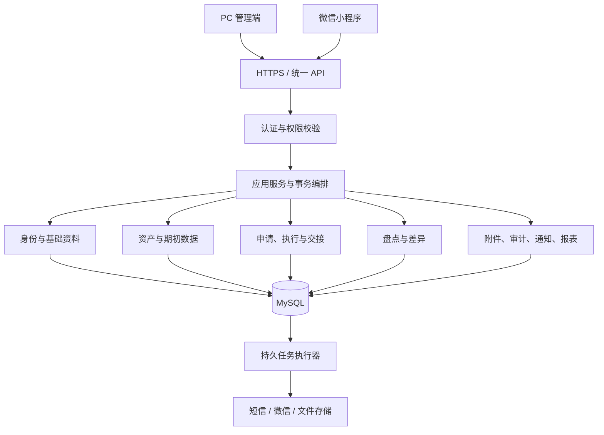

# FAMS 第六阶段：技术开发与实现计划

> 版本：V1.2 · 创建/更新：2026-09-25
> 文档状态：修订计划已确认并保存；确认依据为用户本轮“确认修订计划”。  
> 执行状态：`IN_PROGRESS`。D6-01A、D6-02A/B/C、D6-03A、D6-04～D6-08 及其已关闭子任务、D6-09A 均为本地 `DEV_VERIFIED`；D6-08B/C/D 固定候选 `6d94db8` 经用户本人本轮复核全部 PASS。D6-01B 与 D6-03B 远端能力尚未完成。
> 项目阶段唯一入口：[DESIGN-HANDOFF.md](../../../DESIGN-HANDOFF.md)。  
> 维护责任：AI 在每次任务变更和交接时更新；计划、范围及里程碑验收由用户确认。

**Goal：**以 PRD V1.5、IA D0.2 和 D0.4 为基线，交付可运行、可联调、可追溯并具备第七阶段 QA 输入的固定资产管理系统。

**Architecture：**Java 模块化单体，PC 与小程序共用业务 API。核心业务使用 MySQL 短事务，外部投递使用持久事件及后台任务。

**Tech Stack：**Java 21、Spring Boot 4.1、MyBatis 核心 3.5.x / MyBatis-Spring 4.x / MyBatis Spring Boot Starter 4.x、MySQL 8.4、Flyway、Vue 3 / TypeScript / Element Plus、微信原生 TypeScript、OpenAPI、GitHub Actions。后端运行兼容性与契约工具具体组合已由 D6-02B 冻结；尚未实施的 PC、小程序及质量工具仍按各自关口验证后冻结。

**执行方式：**整体计划确认并收到开发启动指令后，按本计划逐任务实施；默认在当前任务顺序执行，可使用 `superpowers:executing-plans` 工作流。未获明确授权不自动启用多代理并行开发。每个任务编码前须补齐任务卡、相关契约、数据设计和验证条件。

## 一、目标、基线与开工条件

### 1. 已确认决策

| 项目 | 会话中确认的决策 |
|---|---|
| 开发组织 | 用户主导、AI 实施；用户负责产品决策和验收 |
| 后端路线 | Java 优先，模块化单体 |
| PC 脚手架 | Vue 3 官方 create-vue、TypeScript、Element Plus |
| 小程序 | 微信原生 + TypeScript |
| 身份 | 一期系统账号；PC 和小程序对应同一员工身份 |
| 数据与基础组件 | MySQL 8.4、MyBatis、Flyway、数据库持久化任务；一期不引入 Redis、消息队列或注册中心 |
| 接口协作 | 契约先行，生成 Java 接口/模型及 TypeScript 类型 |
| 仓库与托管 | 当前 fams 目录转为单仓；GitHub 私有仓库 |
| 交付节奏 | 业务里程碑推进，不按未经验证的固定日期倒排 |
| 外部服务 | 当前云环境、小程序、短信和域名未准备；先定义适配接口，采购另设关口 |
| Git 提交 | 强制采用 type(scope): summary、正文及四个 Agent 元数据字段，详见 §四.4 |

上述逐项选择与整体计划确认分别记录。2026-09-12 用户已确认本轮修订计划；D6-01A 启动、修复/复核及本地验证已记录于 §六.3。执行顺序为：D6-01A 本地治理 → G0 / D6-02A 验证候选组合 → 完成首批契约 → 通过关口后进入 G1 业务编码；D6-01B 远端与 CI 另待实际权限。

### 2. 开发范围与权威基线

- [PRD V1.5](../specs/2026-09-03-fixed-asset-product-design.md)：业务规则和一期范围。
- [IA D0.2](../specs/2026-09-06-fixed-asset-ia-interaction-design.md)：F01～F10、PC P01～P26、小程序 M01～M14。
- [D0.4 设计交接](../designs/2026-09-06-fams-ui/HANDOFF-D0.4.md)：视觉、组件与交互状态。
- [第五阶段覆盖清单](../specs/2026-09-11-fams-usability-test-matrix.csv)：检查开发任务是否遗漏功能域；设计覆盖不是实现证据。

一期不增加采购、财务折旧、多租户、多级审批、BPMN、专业维修派工等能力。`datae.ndm2` 仅作业务参考，不直接转换为产品数据库。

全局硬约束：

1. 任意一名资产管理员作出一次决定；整单由唯一当前库管执行；必要时由实际接收人确认。
2. 资产生命周期、单据进度、实物去向、保管责任和业务锁分别建模；待交接不是资产生命周期状态。
3. 需求数量与具体资产分配分离，部分履行遵守 PRD 数量守恒。
4. 正式保管关系和状态只能经合法业务动作改变，不能通过资产编辑、扫码或盘点直接改写。
5. 业务记录和凭证保持追溯；完成、驳回、取消和转后续不被后续操作覆盖。
6. 不恢复已取消的大规模用户招募或 R0/R1/R2 原型验证方案。
7. 所有 shell 命令使用 `rtk` 前缀；不编造 Git、CI、真实服务或生产验收记录。

### 3. 第六阶段完成定义

交付：

1. 可重复构建、可部署到联调环境的后端、PC 和小程序。
2. 覆盖一期全部功能的接口、数据库、页面和业务链路。
3. 开发自检、契约检查、真实接口联调及关键业务回归证据。
4. 第七阶段 QA 所需版本、数据、验收矩阵、测试工具和已知问题清单。

第六阶段完成不等于正式 QA 通过，也不等于允许生产上线。性能、安全专项、完整验收和恢复演练在第七阶段正式执行；第六阶段同步实现能力并准备工具，不把质量问题全部延后处理。

### 4. 进度与变更管理

`DESIGN-HANDOFF.md` 继续作为唯一项目阶段入口；第六阶段已进入进行中并链接本计划。第六阶段任务明细以本计划 §四.5 的台账为准，不维护第二套相互竞争的进度。

业务变更先记录原规则、变更原因、影响页面/接口/数据/验收项，由用户确认后更新基线。开发发现设计缺口只重新打开对应条目，不重启已关闭的整个第五阶段。

## 二、技术架构、脚手架与数据设计

### 1. 技术基线

| 层面 | 方案 | 约束 |
|---|---|---|
| 后端运行时 | Java 21、Spring Boot 4.1 候选版本线、Maven Wrapper | 官方 Initializr 起步，验证后冻结补丁版本 |
| HTTP 与安全 | Spring MVC、Bean Validation、Spring Security | 统一认证、授权、参数校验及错误处理 |
| 数据访问 | MyBatis 核心 3.5.x、MyBatis-Spring 4.x、Starter 4.x、MySQL 8.4 InnoDB、Flyway | 三项 MyBatis 组件分别记录版本；SQL 可审查；数据库变更全部版本化 |
| 会话 | Spring Session JDBC | 会话持久化；停用、解绑后权限失效 |
| PC | create-vue、Vue 3、TypeScript、Vite、Vue Router、Pinia、Element Plus | 按 D0.4 适配，不直接套用其他后台模板 |
| 小程序 | 微信原生、TypeScript | 独立页面和运行时，复用接口类型 |
| 接口工具 | OpenAPI 3.0.4、OpenAPI Generator、契约校验及差异检查 | Java 接口/模型和 TypeScript 类型来自同一契约 |
| 后台任务 | 数据库任务表、持久事件表、受控工作线程 | 可重试、重启恢复、查询失败原因 |
| 文件 | 存储适配接口、隔离区、恶意文件扫描 | 本地可用文件系统；联调/生产存储单独配置 |
| 开发环境 | Docker Compose | MySQL、文件扫描等依赖可重复启动 |
| 自动检查 | GitHub Actions、JUnit、Testcontainers、Vitest、Playwright | 本地与 CI 使用同一检查入口 |
| 静态与架构检查 | Checkstyle、SpotBugs、ArchUnit、ESLint、TypeScript、JaCoCo（候选工具） | D6-03A 固定兼容版本、规则范围和覆盖率门槛，详见 §四.3 |
| 运行指标 | Spring Boot Actuator / Micrometer | D6-03A 建立受限指标入口；D6-08、D6-24 接入业务任务指标，不公开管理端点 |

规划时已核对的官方依据：

- [Spring Boot 系统要求](https://docs.spring.io/spring-boot/system-requirements.html)：与 Java 21 相容。
- [MyBatis Spring Boot Starter](https://mybatis.org/spring-boot-starter/mybatis-spring-boot-autoconfigure/)：MyBatis Starter 4 支持 Spring Boot 4.0+。
- [Vue TypeScript](https://vuejs.org/guide/typescript/overview)：create-vue 支持 TypeScript。
- [Spring Session JDBC](https://docs.spring.io/spring-session/reference/guides/boot-jdbc.html)：会话持久化方案。

这些是选型资料，不是本项目兼容性测试通过证明。已确认的是 Java 模块化单体、MyBatis、MySQL、Vue 和原生小程序等技术路线；D6-02A 已验证生成流水线，D6-02B 已用固定补丁版本、Node 24 LTS、包管理器、生成器、容器镜像及锁文件完成本地真实运行验证、独立复核和 reviewed implementation HEAD 全量复跑，具体组合已正式冻结。每次验证固定输入版本，不能边测试边隐式升级；尚未实施的客户端和质量工具仍须通过各自关口。

兼容性失败处理规则：

1. AI 保存最小失败样例、候选版本、命令、退出码和原始报告，区分生成器配置、依赖冲突、框架缺陷与业务代码错误。
2. 优先在已确认路线内修正配置或调整候选组件组合；每轮修复重跑同一组关口用例，不手改生成代码，不通过删除失败用例或放宽契约获得通过。
3. 连续两轮针对性修复仍未通过，或确认存在无法满足契约的缺陷时，立即提交重新选型记录：已尝试方案、替代组合、支持窗口、业务影响及成本。不得启动依赖该失败能力的任务；无依赖工作可继续。
4. Boot 4.0 可作为解决特定版本问题的候选，不能作为 Jackson 3 问题的通用出口；不预设某个旧版本为长期支持兜底。重新选型时核查当日官方支持政策，区分开源与商业支持，并通过同一套验证。
5. AI 负责调查与建议，用户决定已确认路线的变化；待决期间相关任务记 `BLOCKED`。版本冻结后的升级作为独立任务，不混入业务修改。

### 2. 系统结构



后端作为一个应用部署，业务模块通过内部服务接口协作。核心业务在同一数据库短事务内完成，不跨人工等待持有数据库事务，不引入分布式事务或 Saga。

### 3. 业务模块与边界

| 模块 | 职责 |
|---|---|
| 身份与基础资料 | 员工、组织、角色、数据范围、微信绑定、分类、仓库和位置 |
| 资产 | 建卡、编码、标签、当前保管快照、资产版本、业务锁 |
| 申请与执行 | 管理员决定、整单处理权、需求明细、分配、交出、接收、取消和转派 |
| 专项业务 | 借还、维修、返厂轮次、报失找回、报废处置和受控纠正 |
| 盘点 | 任务快照、分配版本、现场事件、差异复核、封存和迟到证据 |
| 期初与批量任务 | 导入预检、核验发布、承接记录、回滚、导出和标签任务 |
| 支撑能力 | 附件、审计、持久事件、站内通知、外部通道和报表 |

模块内采用 Controller、Service、Mapper 分层；Controller 不承载业务事务。HTTP DTO、业务模型和数据库实体分离。跨模块只调用内部服务接口，不直接调用其他模块 Mapper。

跨模块原子业务由应用服务统一编排；模块间禁止循环依赖，以架构测试检查。共享代码只承载通用技术能力，不把审批或资产状态规则塞入通用工具类。

### 4. 单仓组织

以下为开发启动后的目标目录，不表示当前已创建：

```text
fams/
├─ backend/                 Maven：生成契约模块 + Spring Boot 应用
├─ apps/
│  ├─ web/                  PC 管理端
│  └─ miniprogram/          微信原生小程序
├─ contracts/               OpenAPI、公共模型、错误码、请求响应示例
├─ packages/
│  └─ api-types/            生成的 TypeScript 类型
├─ infra/                   本地及联调环境配置
├─ scripts/                 构建、检查、数据准备、联调验证入口
├─ docs/                    现有设计资料与开发文档
├─ output/                  本地运行证据，默认不提交
└─ .github/                 PR 模板与 CI
```

D6-01 初始化 Git 前分类现有文件：正文、原型源码和必要设计规范进入版本控制；ZIP、大量导出图、运行日志、临时证据及可能敏感数据按清单排除或外置。保留当前文件，不删除既有证据。变更后的相对链接必须可用，不以排除文件制造无法复核的设计引用。

### 5. 核心数据约束

数据库详细设计先于对应业务编码完成，包含 ER 图、字段字典、唯一约束、索引、状态迁移和事务边界。

分别建模：

- 资产生命周期、异常状态、当前保管关系。
- 申请、需求明细、具体资产分配与实物交接。
- 管理员批准版本、库管处理权、资产业务锁。
- 借用责任、维修快照、返厂轮次、报废与处置。
- 盘点快照、原始事件、多项差异、封存报告。
- 期初批次、原始行、承接关系、后台任务及审计事件。

必须遵守：

1. 数据库 ID 对外统一字符串；资产编码独立管理，废号不复用。
2. 业务锁用持久记录和唯一约束；库管处理权持久保存于申请执行关系。
3. 页面关闭、超时或后台任务租约到期不得释放业务锁。
4. 审批、分配、交接和关联转换采用条件更新、版本校验及短事务。
5. 业务事实、资产更新、审计和待办事件同事务提交；外部消息事务外投递。
6. 已完成业务和履历不覆盖、不物理删除；纠错追加关联记录。
7. 数据库只通过 Flyway 变更，禁止修改已执行迁移或依赖 ORM 自动改表。
8. 期初批次先预检和暂存，再原子发布；承接关系失败不得暴露半成品。
9. 大批次发布验证事务耗时和恢复路径，不擅自改变 PRD 的批次原子语义。

标识设计规则：数据库主键与 API 字符串表示分别决定。D6-02C 优先评估数据库 `BIGINT` 主键、API 十进制字符串传输的简单方案，记录范围、索引及生成策略；不能由“字符串 ID”推导出必须采用 UUIDv7/ULID。离线事件使用客户端可生成的独立 UUID，并以服务端唯一约束去重。资产编码独立管理且废号不复用；二维码载荷须明确定位、换标和失效规则，扫码所得标识不授予业务权限。最终字段、约束和二维码规则在 D6-02C 设计记录中冻结，当前不视为数据库已经存在。

后台执行采用至少一次尝试的语义。业务与事件同事务持久化；工作线程使用条件领取、租约和执行代次防止过期执行者写回。消费者以业务键去重，重试次数、退避、失败待处理、人工重试权限及审计纳入任务契约。外部通道支持幂等键时传递稳定键；不支持时记录发送未知状态及对账路径，不能承诺端到端恰好一次。任务租约仅控制执行器，不改变库管处理权和资产锁。基础可靠性在 D6-08 验证，完整通知与恢复在 D6-24 收口。

## 三、接口契约、认证与联调规范

### 1. 契约先行流程

每个业务切片依次完成：

**PRD/页面映射 → 状态与权限梳理 → OpenAPI 变更 → 契约审查 → 生成类型 → 后端和页面实现 → 契约检查 → 真实联调。**

OpenAPI 是对外接口唯一来源。接口平台和文档站展示同一契约，不另写第二套字段定义。Java 生成接口与 DTO，Controller 实现生成接口；TypeScript 生成共享类型，双端分别封装请求。微信请求使用平台能力，不直接使用浏览器 fetch 客户端。

固定生成配置，禁止人工修改生成目录。D6-02 验证接口生成、Spring Boot 4 / Jackson 3 配置、编译和序列化。官方能力依据：[Spring Generator 配置](https://openapi-generator.tech/docs/generators/spring/)。

G1 业务编码前必须交付首批真实设计包（D6-02C）：D6-04 登录及权限、D6-06 建卡、D6-07 入库，以及这些流程依赖的 D6-05 基础资料。交付位置为 `contracts/` 和 `docs/development/`（开发启动后创建），包含完整 OpenAPI、请求/响应示例、ER 与字段/索引字典、枚举与状态转换、权限矩阵、错误码、事务/幂等边界及 PRD/页面/AC 映射。正常路径和拒绝路径共同审查；后续业务仍逐切片扩展契约，不要求 G0 一次设计完所有业务。

D6-02A 以这批流程的代表性模型建立“生成 → Java/TS 编译 → 实际 HTTP 请求/响应 → 契约断言”的检查入口。D6-02C 定稿后重跑检查。固定版本的生成器须实际支持所需 Boot 4/Jackson 3 配置；文档列有选项不能替代运行证明。通过标准：必测用例全部通过、重复生成无差异、生成目录无人为补丁。

JSON 断言以项目实际 HTTP 编解码配置为准：

- 校验日期、时间偏移、枚举、必填/缺失、`null`、空字符串、零值；错误输入必须返回约定错误响应，不只检查响应序列化。
- 金额保持十进制字符串，包含小数尾零等业务要求；超过 JavaScript 安全整数范围的 ID 在双端往返不丢精度。小数精度与舍入规则逐字段定义。
- 普通 JSON 对象按字段、类型和值比较，不把属性字母排序当业务契约；数组按契约校验顺序。签名、幂等摘要等需要稳定字节表示时另定规范化规则并覆盖字段换序用例。
- `ONE_BASED_MONTHS` 影响 `java.time.Month` 的数字表示，不意味着 ISO 日期月份会偏移；实际使用该表示时才增加专项断言。`FAIL_ON_NULL_FOR_PRIMITIVES` 属于输入反序列化检查。
- 不把 Jackson 裸库默认值直接当作 Spring Boot 实际接口行为；检查实际自动配置和定制配置，并将选定行为显式纳入契约用例。

依据：[JSON 对象与数组语义](https://datatracker.ietf.org/doc/html/rfc8259)、[Jackson Month 配置](https://raw.githubusercontent.com/FasterXML/jackson-databind/jackson-databind-3.0.0/src/main/java/tools/jackson/databind/cfg/DateTimeFeature.java)、[Spring Boot 日期默认配置](https://docs.spring.io/spring-boot/3.4/how-to/spring-mvc.html)。这些来源用于解释检查边界，不代表 FAMS 已通过检查。

### 2. 通用接口约定

| 项目 | 约定 |
|---|---|
| API 路径 | `/api/v1`；PC 与小程序共用业务接口 |
| JSON | camelCase；稳定英文枚举与中文文案分离 |
| 标识与数字 | ID 为字符串，数量为整数，维修费用为十进制字符串 |
| 时间 | 事件时刻内部使用 Instant，接口统一 UTC ISO 8601（Z）；业务日期使用 LocalDate / `YYYY-MM-DD` |
| 时区 | 企业默认 `Asia/Shanghai`；工作日按企业维护日历计算 |
| 分页 | page 从 1 开始，默认 20 条，最大 200 条 |
| 排序 | 字段白名单，加稳定 ID 排序保证分页确定性 |
| 成功响应 | 类型化结果；分页包含 items/page/pageSize/total |
| 错误响应 | 统一 code/message/requestId/fieldErrors，按需含受授权冲突详情 |
| HTTP 状态 | 400 参数错误、401 身份失效、403 无权、404 不可见或不存在、409 冲突、429 限流 |
| 批量结果 | 明确整批原子或逐项处理；逐项处理返回每项结果 |
| 未知结果 | 超时不显示成功；沿用原幂等键重试或查询回执 |
| 字段缺省 | 逐字段声明必填、可空和缺省值，不混用缺失、空字符串与 null |

每个写接口明确操作身份、作用对象、前置状态、批准范围、所需版本、事务范围、幂等规则、错误码、审计和消息副作用。

时间落地规则：业务日期不做时区换日；事件输入允许契约声明的有效偏移，统一归一为 Instant，输出 UTC，展示转换至 `Asia/Shanghai`。服务端业务当前时间通过可注入的 `Clock` 获取；数据库字段精度、UTC 存储和 JDBC 映射由 D6-02C 固定并测试往返。72 小时按绝对时长计算，不按工作日或三次自然日切换计算；不能用首次上传时间替代客户端首次持久化时间作为期限起点。

时间验收编号 T-02-01（日期与跨时区往返）、T-17-01（首次持久化、重启与重试不改期限）、T-18-01（截止前 1 毫秒、恰好截止、截止后）、T-18-02（权限失效、原回执、时间异常的裁决优先级）。D6-02C 冻结时间精度；D6-17/18 使用固定时钟、客户端时间源测试接口及校准证据，保留原始观察时间，覆盖设备时钟回拨与无法核实时不自动采信。

### 3. 业务动作与版本

不提供通用修改资产状态入口。以下为计划中的接口命名和行为基线，完整清单在对应任务编码前纳入 OpenAPI：

| 动作 | 接口 | 核心校验 |
|---|---|---|
| 管理员决定 | `POST /applications/{id}/decisions` | 管理员、待审批状态、申请版本 |
| 库管领取 | `POST /applications/{id}/claims` | 库管、已批准、申请版本、当前无人处理 |
| 实物分配 | `POST /applications/{id}/allocations` | 当前处理人、处理权版本、批准范围、资产可分配 |
| 记录交出 | `POST /allocations/{id}/handovers` | 当前处理人、分配版本、真实交出事实 |
| 实际接收 | `POST /allocations/{id}/receipts` | 实际目标人、接收凭证版本、资产版本 |
| 盘点上传 | `POST /inventory-tasks/{id}/events:batch` | 当前身份、参与关系、事件 ID、分配版本、期限 |
| 差异决定 | `POST /inventory-differences/{id}/decisions` | 管理员、任务及差异版本、证据、关联业务 |
| 后台任务 | `GET /jobs/{id}` | 当前身份、任务归属、结果访问权限 |

不同业务申请采用明确创建模型，不使用包含任意字段的巨大通用申请接口。接口清单按 F01～F10 建立，每项关联页面和 AC。

### 4. 幂等与并发

- 关键写操作携带 `Idempotency-Key`，绑定当前身份、操作与请求载荷摘要。
- 同键同载荷返回原结果；同键不同载荷返回冲突。
- 回放前重新验证当前身份和访问权，不恢复已撤销权限。
- 网络失败沿用原键；修改内容或明确新业务才生成新键。
- 审批竞争只产生一个有效决定；库管竞争只产生一个整单处理人。
- 旧页面提交返回当前结果及授权范围内的处理信息，不能覆盖。
- 业务失败整体回滚；冲突拒绝审计单独可靠保存，不能随失败事务消失。
- 任务执行租约可回收，业务处理权和资产锁不可据此回收。

### 5. 身份与权限

- PC 账号密码登录，首次登录修改初始密码；失败锁定并留安全日志。
- PC 采用安全 Cookie 会话并启用 CSRF 防护。
- 小程序以微信登录换取服务端会话；绑定必须完成企业登记手机号短信验证。
- 会话拟定为闲置 30 分钟、绝对有效期 8 小时；有效绑定的小程序可通过微信登录重新建立会话。
- 员工停用、解绑和角色变化在后续请求立即生效，不只等待会话过期。
- 每次校验角色、数据范围、业务关系、当前处理人及敏感字段。
- 前端使用服务端返回的可执行动作展示按钮；服务端仍独立校验每次操作。
- 系统管理员不自动取得审批、执行或敏感业务访问权。

D6-04 细化 Cookie 的 HttpOnly、Secure、SameSite、路径和 CSRF 传输约定，并验证登录后会话轮换、注销及密码变更的失效范围。D6-10 明确小程序通过 HTTPS 请求头传递服务端签发的不透明会话凭证，凭证关联同一员工和当前绑定；不将微信 code、session_key 当业务访问凭证。客户端缓存、到期、清理和错误处理纳入契约，服务端在会话建立与每次业务请求重新核验账号、绑定及权限版本。

认证验收 A-04-01：注销/停用后的旧会话拒绝；A-04-02：CSRF 缺失或错误时写操作拒绝；A-10-01：解绑/换绑后旧凭证及离线队列不能恢复权限；A-10-02：停用与微信重登并发时，即使生成了会话，后续业务请求也必须因当前身份失效而拒绝。真实微信、短信与真机证据由 D6-10B 承担。

短信限流、验证码有效期、错误次数与换绑规则直接遵守 PRD。会话等工程默认值随本计划整体确认生效，不冒充 PRD 原有要求。

### 6. 离线盘点与附件

离线盘点采用持久事件队列：

- 先持久化，再显示本地已记录；照片转为持续保存文件，不只保存临时路径。
- 保存事件 ID、账号/绑定、任务/分配版本、观察时间、首次持久化时间及时间校准依据。
- 队列按身份隔离，重启恢复；解绑、停用、账号切换按安全规则处理。
- 72 小时从首次持久化起算，重试、重启、封存不重置。
- 上传按 PRD-INV-006 顺序裁决：当前身份/绑定/安全参与关系 → 同 ID 同载荷原回执 → 时间有效性 → 截止期限 → 正常或迟到处理。达到截止时刻即过期，已成功接收的合法重试不因晚于期限而翻案。
- 回执区分接受、重复、冲突、迟到、拒绝；上传成功不等于计入完成数。
- 封存后证据只追加，不修改原报告和最近盘点日期。
- 存储失败、空间不足、时间异常、照片丢失有明确反馈。

附件执行 PRD 格式、数量和大小限制；进入隔离区后校验内容并扫描。扫描未通过或不可用时不开放下载。下载采用短时可验证授权，兑换和实际访问均检查当前权限，不使用永久公开链接。

## 四、协作规则、Git / CI 与开发里程碑

### 1. 责任分工

| 责任 | 负责人 |
|---|---|
| 需求解释、范围取舍、计划确认、里程碑验收 | 用户 |
| 技术方案、契约草案、任务拆解、实现、自检和交接 | AI |
| 企业账号、短信、域名、云资源办理 | 用户 |
| PR 合并及里程碑进入下一阶段的最终决定 | 用户 |
| 缺陷修复、回归与证据补齐 | AI |
| 关键权限、事务、迁移及恢复的独立技术复核 | D6-02C 由用户本人审阅，按复核单逐域给出结论；指定不等于通过 |
| 干净环境复跑与原始证据采集 | AI 建立入口，独立执行环境运行；与独立技术复核分别记录 |

默认在当前任务顺序实施，不自动启动多代理同时修改。后续获准并行时，先确定任务所有权、共享文件负责人；接口契约、公共模型和迁移编号不可无协调并行修改。

### 2. 单任务规范

每张任务卡包含任务 ID、目标、PRD/页面/AC、前置任务、S/M/L/XL、实施负责人、复核人、涉及目录、消费/新增接口、正向和拒绝路径、事务与权限、验证命令及预期结果、证据位置、数据影响、回滚方法、风险编号和已知限制。

每次交付一个可独立审查的功能边界：

**实现 → 对应检查 → 真实联调 → 自审 → 更新台账 → 小提交 → PR。**

业务规则、权限和事务必须有有意义的单元/集成测试；低风险视觉修改采用定向构建和页面核验，不为凑数量编写重复测试。编译、组件替身测试、真实联调、正式 QA 的结果分别报告。

### 3. 分支、评审与 CI

- `main` 加短期功能分支，不设长期并行开发分支。
- 分支例：`feat/D6-08-asset-import`、`fix/D6-15-receipt-conflict`。
- 提交按功能拆分，格式化、依赖升级、业务修改不混为大提交。
- PR 描述问题、结果、任务、验证证据、迁移及回滚影响。
- AI 自审不记为人工批准；未明确授权不自动合并。
- 检查绑定 PR 当前提交；有新提交后不能沿用旧提交的通过结论。
- D6-01 核实私有仓库保护能力及账户权限；不可配置时记录缺口，不宣称已经保护。
- CI 配置统一汇总必需检查 `required-ci`，检查失败阻止按计划合并。

`required-ci` 汇总以下结果：

1. PR 新增提交消息格式校验。
2. OpenAPI 语法、示例、兼容性检查。
3. 类型生成及生成结果一致性。
4. 后端测试、真实 MySQL 集成测试、迁移检查。
5. PC 类型检查、测试及构建。
6. 小程序类型及构建检查。
7. 依赖、密钥及产物检查。
8. 静态检查、模块边界检查和覆盖率规则。

D6-03A 固定候选工具及规则：Checkstyle 检查 Java 约定，SpotBugs 检查缺陷模式，ArchUnit 检查模块循环、跨模块 Mapper 访问及 Controller 事务边界，ESLint/TypeScript 检查双端代码，JaCoCo 产出行/分支覆盖率。已有依赖/密钥/契约差异检查也必须固定实际工具版本及失败等级；工具不兼容先记录和替换等价工具，不静默删除门禁。

配置规则时明确覆盖范围、生成代码排除依据、失败等级和覆盖率阈值，纳入 D6-03A 审查；当前不编造尚未校准的覆盖率百分比。权限、状态、事务、恢复及幂等的正向/拒绝验收用例必须全部通过，覆盖率不能替代这些用例。G0 关闭前不得留下未定义的阻断规则。D6-03B 用故意违反模块边界、契约和 commit 格式的临时负例证明远端 `required-ci` 会失败，随后清除负例并验证正常版本通过。跳过、取消或未运行不能被汇总成成功。

CI 与开发环境提供可用的 RTK，并固定检查工具版本。真实微信、短信和真机验证单独记录，不用 CI 中的替身测试代替。全部 hook、工作流和检查命令目前均为待实现任务，不因本规范落盘而声称已经生效。

### 4. Git commit 强制格式

所有提交必须采用以下格式；标题后、正文与 trailers 之间各保留一个空行；四个 `Agent-*` 字段各占一行并放在末尾。

```text
<type>(<scope>): <summary>

<正文：描述本次变更的背景、动机与主要变化>

Agent-Task: <原始任务描述或任务 ID>
Agent-Model: <实际使用的模型标识>
Agent-Decision: <关键设计决策及理由>
Agent-Limitation: <已知局限或后续 TODO；没有则填写“无”>
```

字段规则：

| 字段 | 强制要求 |
|---|---|
| type | 仅允许 feat、fix、refactor、perf、docs、test、build、ci、chore、style、revert |
| scope | 必填，使用实际业务域或工程范围，如 asset、inventory、auth、contracts、web、miniprogram、ci、docs |
| summary | 简洁描述本次实际变化，不写“更新代码”“修复问题”等笼统标题 |
| 正文 | 必填，说明背景、动机和主要变化，不能仅重复标题 |
| Agent-Task | 必填，优先 D6-xx，可附原始任务描述；非开发任务使用其真实原始描述 |
| Agent-Model | 必填，记录实际使用的模型标识；无法核实时写“无法核实”，不得根据示例猜测 |
| Agent-Decision | 必填，说明关键设计决策及理由；无额外决策时说明遵循的既有规则 |
| Agent-Limitation | 必填，如实说明局限或后续 TODO；没有则写“无” |

同一提交对应一个可审查功能边界。不得把任务未满足的验收条件仅记入 `Agent-Limitation` 后视为任务完成。占位符、虚构模型、重复或缺失 trailers 不满足规范。

提交示例（仅示例，不表示此功能已经开发；模型无法核实时明确说明）：

```text
fix(inventory): 拒绝封存后的旧版本复核提交

封存与差异复核同时提交可能改写已经冻结的盘点结果。
增加任务版本校验，并在冲突响应中返回当前可见结果。

Agent-Task: D6-18 差异与封存
Agent-Model: 无法核实
Agent-Decision: 在同一短事务校验任务和差异版本，避免产生孤立后续单
Agent-Limitation: 真机弱网联调尚未完成，本任务不得标记已验收
```

执行要求：

- D6-01 配置和验证本地 `commit-msg` 校验；D6-03 在 CI 接入同一校验规则。使用成熟提交消息校验工具承载标题规则，并补充正文和 trailers 校验，避免本地与 CI 各自维护规则。
- 本地 hook 便于提前反馈，CI 为权威检查；不能通过跳过 hook 规避规则。
- CI 基于实际 PR 基线检查全部新增提交，不仅检查最后一条；历史设计记录不补造提交。
- 校验用例覆盖合规提交、缺 scope、非法 type、空正文、缺失/重复/空 trailers、字段未分行及仍含占位符。
- 对“决策是否真实”“局限是否遗漏”等语义内容由自审和用户评审核实，格式检查不冒充事实验证。
- 默认功能分支 rebase 更新、合并时优先 squash；最终 squash 消息仍必须包含正文和四个 trailers，不使用平台自动生成的简略消息替代。
- 最终合并消息在合并前使用同一校验器检查；合并后 main 的检查也校验新提交。保留各原提交格式，防止更换合并方式后丢失来源。
- Squash 正文和四字段描述合并后的实际变化，并关联 PR 与全部原任务。PR 留存原提交 SHA、任务及模型来源映射；合并前核实记录可访问，Squash 模型字段描述实际整理该提交的模型，不伪称所有原提交使用同一模型。影响验收的 limitation 必须同步任务台账。
- 不额外制造空壳 merge commit；确需其他合并策略时，最终提交也遵守同一格式并记录策略变化。

### 5. 里程碑与任务台账

以下 D6 编号只表示第六阶段内部任务。每项交付相关契约、实现、必要页面、测试和记录。本节父任务与子任务表共同构成唯一任务状态台账，任务开始、受阻、送审和验收时及时更新；详细证据链接写入 §六.3 的执行记录。

状态：`NOT_STARTED` 未开始、`IN_PROGRESS` 进行中、`IN_REVIEW` 待审查、`DEV_VERIFIED` 开发验证通过、`ACCEPTED` 已验收、`BLOCKED` 受阻、`NEEDS_FIX` 需修复。

全表默认实施负责人为 AI、验收责任人为用户；关键权限/事务/迁移/恢复的独立复核人须由用户指定，并在任务卡实名或以明确的独立会话标识记录。D6-02C 已由用户本人完成关键复核并留下逐域结论；后续关键任务仍逐项记录。S/M/L/XL 是初步相对规模：S 为单点、M 为局部闭环、L 为跨层业务切片、XL 为多闭环；不对应未经测量的天数。XL 下列必需子任务分别实施，不作为一次提交交付；L 若实际跨越多个独立闭环，也须先拆分。

| 里程碑 | 任务 | 初估 | 开发前置 / 关闭依赖 | 风险 | 交付与通过条件 | 当前状态 | 证据/结果 |
|---|---|---|---|---|---|---|---|
| G0 开发准备 | D6-01 基线与仓库 | M | 开发启动指令 | R-04 | 分类文件、初始化单仓/私有远端、协作规则、追溯表、本地提交格式检查 | IN_PROGRESS | D6-01A 已验证；D6-01B 远端已提供且有推送权限，当前公开仓库；隐私与协作设置验收仍待执行 |
| G0 | D6-02 契约与脚手架 | XL | D6-01A；内部 A → B → C | R-01/R-02 | 固定版本、生成类型、双端构建、健康和错误契约验证 | IN_PROGRESS | D6-02A/B/C `DEV_VERIFIED`；本地业务入口已满足，远端 G0 项仍开放 |
| G0 | D6-03 环境与 CI | L | D6-02A/B；远端部分另依赖 D6-01B | R-04/R-05 | Compose、迁移、统一检查入口、PR 全部新增提交格式与 required-ci；干净环境重复启动 | IN_PROGRESS | D6-03A `DEV_VERIFIED`；D6-03B 远端权限已具备，工作流及分支保护待配置验证 |
| G1 身份与资产底座 | D6-04 PC 登录与权限 | L | D6-02C、D6-03A | R-02/R-05/R-06 | 账号登录、初始密码、停用、角色/数据范围；真实登录后权限正确 | DEV_VERIFIED | A/B/C/D 本地闭环；用户本人五域及总评 PASS，含签署记录的 reviewed HEAD `8943dc3` 统一门禁退出 0、127 项阻断观察；见 `docs/development/D6-04-task-card.md` |
| G1 | D6-05 基础资料 | M | D6-04 | R-02 | 组织人员、分类、仓库位置、编号字典；停用和依赖校验 | DEV_VERIFIED | A/B/C 均已用户复核并通过签署后本地双门禁；B 固定 `e15c8ce` 任务库 24+1、统一门禁 203；见 `docs/development/D6-05-task-card.md` |
| G1 | D6-06 建卡、台账和标签 | L | D6-05A/C、D6-05B 五组接口；父任务关闭前仅允许 D6-06A 建表；其余实现与关闭依赖 D6-05B 引用拒绝验证和父任务 | R-02/R-03 | 单个/复制建卡、查询、详情、标签；禁止直接改保管状态 | DEV_VERIFIED | 用户回复“全部复核PASS”；签署记录固定 HEAD `84b66f0` 任务 MySQL 与统一门禁 217 项通过，仅本地，见 `docs/development/D6-06-task-card.md` |
| G1 | D6-07 审批与执行底座 | L | D6-06A 建表、D6-05B 五组接口；父任务关闭前仅允许 D6-07A 入库单建表；其余实现与关闭依赖完整 D6-06 | R-05/R-07/R-08 | 用入库完成一次审批、唯一库管领取、验收入库、审计及站内待办 | DEV_VERIFIED | 入库后端与 PC 候选已落地，真实登录主路径通过；56 项 Java 测试及统一门禁分段复跑通过，独立复核待执行；见 `docs/development/D6-07-task-card.md` | 用户本人本轮复核全部 PASS；不重复历史验证。
| G1 | D6-08 导入与期初底座 | XL | D6-07 | R-03/R-07/R-08 | 错误定位、后台任务、在库/在用期初发布、受控批次回滚 | DEV_VERIFIED | A/B/C/D 已本地验证；用户本人 2026-10-04 对候选 `6d94db8`、交接 `b007a5f` 复核全部 PASS，父任务关闭；见任务卡 |
| G1 | D6-09 附件与外部适配 | L | D6-04、D6-03A；真实通道依赖资源 | R-04/R-06 | 文件隔离扫描、权限下载；外部通道接口与配置管理 | IN_PROGRESS | D6-09A内部附件能力本地DEV_VERIFIED；D6-09B实际外部适配NOT_STARTED，父项仍开放；以本节必需子任务及D6-09任务卡为准 |
| G2 小程序与流转 | D6-10 微信登录绑定 | L | D6-04、D6-05、D6-09A；真实验证依赖资源 | R-04/R-06 | 真实短信绑定、换绑、解绑、停用/会话；外部关口满足后才能关闭 | IN_PROGRESS | D6-10A 候选 d903199 经用户本人 2026-10-06 复核全部 PASS、本地 DEV_VERIFIED；D6-10B 真实短信/真机待全部功能开发后联调 |
| G2 | D6-11 领用与分配 | L | D6-07、D6-09A；小程序部分依赖 D6-10A | R-02/R-07 | 数量申请、审批、独占分配、无法满足和关联重新申请 | DEV_VERIFIED | 用户本人 2026-10-07 对固定候选 92c1662、送审交接 701da4d 全部复核 PASS；本地 DEV_VERIFIED，完整门禁退出 0，详见 D6-11 任务卡 |
| G2 | D6-12 交出与接收 | L | D6-11；真实移动验收依赖 D6-10B | R-06/R-07 | 逐资产交接、受限接收、未交出取消、交出后收回取消 | BLOCKED | 内部全功能 A 经用户本人全部复核 PASS 为 DEV_VERIFIED；959fd3c 完整门禁退出 0，真实 HTTP/MySQL、PC/M09、并发/回滚/重启通过；B 真机按用户安排后置，不以内部结果关闭父任务，见 D6-12 任务卡 |
| G2 | D6-13 借用与归还 | L | D6-12、D6-08C | R-02/R-07 | 到期、延期、验收入库、责任关闭及历史；期初借用承接 | DEV_VERIFIED | 业务候选 e99bca5 完整门禁退出 0；真实浏览器、原生处理器→HTTP/MySQL 和硬重启通过；A/B/C 已用户独立复核，外部真机后置 ；用户本人 2026-10-09 复核全部通过，关闭为本地 DEV_VERIFIED。 |
| G2 | D6-14 调拨与人员交接 | L | D6-12 | R-06/R-07 | 个人/公用、部门代办、跨仓库、停用后的移交 | DEV_VERIFIED | 用户本人 2026-10-09 复核全部通过；f983439 完整门禁、真实页面与同库硬重启通过，证据 2c6c9ac，认知 a752157；见 D6-14 任务卡 |
| G2 | D6-15 异常与转派 | L | D6-12、D6-14 | R-05/R-07 | 异常代确认、责任告知、批准目标变更、受控转派 | IN_PROGRESS | D6-15A 已获用户复核通过；B/C/D/E实现与本地证据已送审，综合ffe7069完整门禁通过；用户指定独立复核待完成，父项保持开放 |
| G3 盘点与证据 | D6-16 任务与快照 | L | D6-06、D6-09A、D6-10A | R-02/R-06 | 创建、发布、分配、重分配、取消及终止 | IN_PROGRESS | 最终功能候选a57a9f6完整门禁Java200/Web32/mini53及实际HTTP/PC证据已具备，A/B/C/D均IN_REVIEW；非实施者未签，见D6-16任务卡及独立材料，不再沿用早期0555b27待验摘要 |
| G3 | D6-17 现场与离线 | XL | D6-16 | R-04/R-06/R-09 | 扫码/手工、正常确认、多重差异、本地队列、照片和回执 | IN_PROGRESS | 744032a完整门禁通过，A/B材料送审；C真机弱网依D6-10B后置，父项和独立复核开放 |
| G3 | D6-18 差异与封存 | XL | D6-17、D6-14；盘亏闭环另依赖 D6-21 | R-05/R-07/R-09 | 并发复核、期间流转、迟到/期限、封存报告、正式调拨关联 | IN_PROGRESS | 复核关联、同步、封存、迟到及A8已形成固定本地切片证据；A/B仍IN_PROGRESS，C盘亏转报失NOT_STARTED并依赖D6-21，完整联合和独立/外部复核未收口，见必需子台账及D6-18任务卡 |
| G4 维修与资产退出 | D6-19 报修与维修 | L | D6-07、D6-09A、D6-13 | R-02/R-07 | 员工/公用报修、科技协助、内部处理、返还、关闭并归还 | IN_PROGRESS | A/B/C固定完整门禁及实际链路已具备，C固定cd2ba8b Java432/Web150/mini239，A/B/C均IN_REVIEW，父项待独立复核，见[D6-19任务卡](../../development/D6-19-task-card.md) |
| G4 | D6-20 返厂与换机 | L | D6-19 | R-02/R-07 | 多轮返厂、异常结束、整机换新；新旧实物分别追溯 | IN_PROGRESS | A1固定38df375、A2固定089e06a及B固定d10f246均IN_REVIEW；C1固定885dc46修复表单禁用，完整门禁588/181/287及实际PC/提交JVM/独立入库通过并送审，C2固定56e0b67已用户复核通过，D尚未实施，父项保持IN_PROGRESS；见最新开发交接 |
| G4 | D6-21 报失与找回 | L | D6-07；盘亏联动验收另依赖 D6-18A | R-07 | 遗失责任、找回去向、关联转换；盘亏转报失 | IN_PROGRESS | A1已用户审核DEV_VERIFIED；A2原生候选482756e送IN_REVIEW，B/C/D未开始；见D6-21任务卡与2026-10-29-d6-21a2-review-handoff.md |
| G4 | D6-22 报废与处置 | L | D6-20、D6-21 | R-05/R-07 | 审批执行、驳回恢复、处置、冲正、报废后找回 | NOT_STARTED | 尚未执行 |
| G4 | D6-23 全状态期初承接 | L | D6-08C、D6-20、D6-22 | R-02/R-07 | 维修、返厂、待报废导入及真实后续业务 | NOT_STARTED | 尚未执行 |
| G5 第六阶段收口 | D6-24 通知与异常跟进 | L | D6-08A；全量规则依赖 D6-15、18、20、22 | R-04/R-08 | 完整时限、工作日、去重升级、无人处理及管理员恢复 | NOT_STARTED | 尚未执行 |
| G5 | D6-25 报表与工作台 | L | D6-08A、D6-18、D6-23 | R-02/R-03 | 指标分母/排除项、导出、审计、抽样辅助，不新增抽样管理模块 | NOT_STARTED | 尚未执行 |
| G5 | D6-26 全范围联调 | XL | D6-01～25 全部必需子任务及真实外部联调 | R-02/R-04/R-05 | 40 页、F01～F10、AC-01～53 开发回归及问题清单 | NOT_STARTED | 尚未执行 |
| G5 | D6-27 QA 交接 | M | D6-26；QA 环境和资源 | R-03/R-04/R-05 | 固定候选版本、环境/数据、性能脚本、安全清单、备份恢复脚本及交接 | NOT_STARTED | 尚未执行 |

#### 5.1 必需子任务与验收编号

以下子任务继承父任务负责人、风险、PRD 范围及证据要求；每项状态单独维护。此处拆分只细化交付，不扩大一期范围。父任务仅在全部必需子任务通过且独立复核要求满足后才可记 `DEV_VERIFIED`；任一必需子任务受阻时保留已完成子项证据，父任务记 `BLOCKED`，不得整项授予通过。父任务验收仍由用户确认。

| 子任务 | 初估 | 前置 | 交付与验收条件 | 状态 | 证据 |
|---|---|---|---|---|---|
| D6-01A 本地基线 | M | 开发启动 | 文件分类、Git 初始化、追溯矩阵、commit-msg 正反例通过 | DEV_VERIFIED | 本地验证脚本退出 0；本轮修复补充 `defaultIgnores: false` 与 3 类默认忽略标题负例；见 `docs/development/` 与 D6-01A 报告 |
| D6-01B 远端仓库 | S | D6-01A、GitHub 权限 | 私有远端、访问控制及保护能力实查；明确缺口 | IN_PROGRESS | 2026-10-09 用户提供 origin 并授权推送，有管理及推送权限；当前公开仓库，远端协作、CI 与分支保护按本项继续配置验收，未宣称完成 |
| D6-02A 生成流水线 | M | D6-01A | §三.1 代表模型生成/编译/实际 HTTP 契约断言全部通过，重复生成无差异 | DEV_VERIFIED | 2026-09-13 本地验证、任务级独立复核均通过；reviewed HEAD `8ca2c4a`，runtime 检测修正 `8cfca60` 后全量复跑通过；见 `docs/development/D6-02A-task-card.md`、`D6-02A-generation-pipeline.md` 及任务报告 |
| D6-02B 运行兼容性 | M | D6-02A | 真实 MySQL、Flyway、会话、回滚、重启及双端构建通过；冻结候选组合 | DEV_VERIFIED | 固定摘要 MySQL 8.4.11、Flyway、MyBatis 事务、JDBC Session、应用/数据库重启、Java/共享 TS 构建本地门禁退出 0；独立复核问题已完成两轮修复并关闭，`ff8f166` 全量复跑通过，组合已冻结；见 `docs/development/D6-02B-task-card.md`、`D6-02B-runtime-compatibility.md` |
| D6-15A 调拨受控转派 | L | D6-14 | 核验实物、锁和未同步结果后整单转派；处理权版本、旧处理人隔离、审计与幂等 | DEV_VERIFIED | 用户本人 2026-10-12 本轮复核全部通过；业务 8d542e1、门禁 f46fba6、送审 HEAD 453a374；本地证据见任务卡 |
| D6-15B 其他流程受控转派 | L | D6-15A | 入库、领用、归还等适用流程受控转派 | IN_PROGRESS | B1/B2/B3 PC转派 IN_REVIEW；小程序及后续适用流程继续开发 |
| D6-15B1 入库受控转派 | L | D6-15A | 整单处理权、部分验收事实保留、剩余锁核对、PC/API、原子审计与重试 | IN_REVIEW | 4e46893 完整开发门禁退出 0；真实 HTTP/MySQL、Web 24/24、两次页面同库硬重启通过；独立复核待完成 |
| D6-15B2 领用/借用申请受控转派 | L | D6-15A | 整单处理权、数量与分配事实保留、完整实物锁快照、PC/API、审计与重试 | IN_REVIEW | d51785c HTTP/MySQL4项、Web25/25、页面恢复通过；产品检查146项及覆盖达标，命令因索引计数差异postflight退出1，恢复后单独postflight退出0；独立复核待完成 |
| D6-15B3 归还受控转派 | L | D6-15A | 归还单处理权版本、实物阶段和锁快照、原子审计幂等、PC/API | IN_REVIEW | 47fbab5完整门禁退出0，Java149/行92.77%/分支75.23%；V28升级、HTTP3项、Web26/26、页面及两次硬重启通过，独立复核待完成 |
| D6-15B4 小程序调拨受控转派 | M | D6-15A | 原生整单快照核对、接任选择、明确确认、原键重试和身份隔离 | IN_REVIEW | a08a8ae完整开发门禁退出0；34项小程序测试、typecheck/build和原生HTTP/MySQL1/1通过，独立复核待完成，真机后置 |
| D6-15C 异常代确认与责任告知 | L | D6-15A | 凭证、一次管理员批准、当前处理人执行及结果责任告知 | IN_PROGRESS | C1领用/借用代确认开始；C2调拨与C3两端联合验收后续继续 |
| D6-15C1 领用/借用异常代确认 | L | D6-15A | PC/API真实凭证、一次批准、当前库管执行、责任通知与核查入口 | IN_REVIEW | a8b1005完整门禁退出0；行92.90%、分支75.47%；HTTP4/4、真实浏览器两次硬重启通过；独立复核待完成 |
| D6-15C2 调拨异常代确认 | L | D6-15C1 | 调拨真实接收证据、一次批准、当前处理人执行和原目标责任通知 | IN_REVIEW | 65d3d67完整门禁退出0；Java158/行92.96%/分支75.58%；HTTP7/7与四角色两次硬重启通过，独立复核待完成 |
| D6-15C3 两端及联合验证 | L | D6-15C1/C2 | 小程序与PC入口、身份权限、并发恢复与联合验证 | IN_REVIEW | e54820a完整门禁退出0；Java165/行92.97%/分支75.69%、小程序45、HTTP14/14；独立复核及真机后置 |
| D6-15D 批准目标变更 | L | D6-15A | 批准范围变更及物理阶段约束 | IN_PROGRESS | D1～D4固定门禁通过并送审；独立复核待完成，父任务不关闭 |
| D6-15D1 领用/借用目标变更 | L | D6-12、D6-13 | 按明细批准目标覆盖，保留已完成及物理事实 | IN_REVIEW | 修复候选6baf5c1完整门禁退出0，Java173/覆盖93.00%及75.74%，独立复核待完成；交出冻结及旧格式兼容见当前HTTP证据 |
| D6-15D2 调拨目标变更 | L | D6-14、D6-15D1 | 未完成调拨明细及接收权变更 | IN_REVIEW | 候选d60543e完整门禁退出0，Java181/覆盖93.05%及75.81%，真实浏览器/SQL及两次硬重启通过；独立复核待完成 |
| D6-15D3 小程序目标变更 | L | D6-15D1、D6-15D2 | 原生办理/审批、原身份重试及接收联调 | IN_REVIEW | 候选abc2b3f完整门禁退出0，Java183/覆盖93.16%及75.99%，mini51及真实链19/升级1通过；独立复核待完成 |
| D6-15D4 目标变更联合验证 | L | D6-15D1～D3 | 已完成部分、未分配余量、并发、恢复及代确认漂移 | IN_REVIEW | 候选a7ec1fe完整门禁退出0，Java189/覆盖93.17%及75.93%，定向25/升级1；独立复核待完成 |
| D6-15E 联合验证与独立复核 | L | D6-15A/B/C/D | 契约、权限、并发、恢复、性能冒烟及独立复核 | IN_PROGRESS | E1内部性能冒烟启动；E2独立复核汇总待完成，不提前关闭父任务 |
| D6-15E1 内部联合与性能冒烟 | M | D6-15B/C/D | 固定候选联合门禁、例外历史规模与查询计划检查 | IN_REVIEW | 新入口ffe7069完整门禁退出0，Java190/覆盖93.19%及75.95%，统一Web30/build及mini51/build；开发冒烟与填充升级通过，独立复核待完成 |
| D6-15E2 独立复核汇总 | L | D6-15E1 | 非实施者针对固定候选完成契约/权限/并发/恢复/证据复核 | IN_REVIEW | 综合复核材料绑定ffe7069及本地main基线，复核人待用户指定，各域/总评待填写；不冒充实施者自检通过 |
| D6-02C 首批真实设计包 | L | D6-02B | 登录/基础资料/建卡/入库完整契约、ER、状态、权限、错误码、标识与时间决策审查；重跑生成验证 | DEV_VERIFIED | 102 个 operation、162 个示例、数据/权限/错误设计与 35 行追溯已完成；任务级 reviewed HEAD `d3b8d6c` 为 PASS/CLEAN；用户本人四域及总评 PASS、问题清单无；签署记录提交 `31f3004` 完整门禁退出 0 |
| D6-03A 本地统一检查 | M | D6-02A/B | Compose、检查工具/规则/覆盖率阈值、受限指标入口；干净环境复跑及静态检查负例通过 | DEV_VERIFIED | 用户本人对固定送审 SHA `1d985267` 的范围、质量规则/负例、Compose/指标/恢复及总评全项 `PASS`、问题清单无；签署记录提交 `22b45e6` 的完整入口退出 0，84 项阻断观察、28 个验证器测试、23 个 Java 测试、质量/覆盖率、TS、真实 MySQL、指标、恢复及清理全部通过 |
| D6-03B 远端 CI | M | D6-03A、D6-01B | PR 全部提交校验、required-ci 汇总、保护关联；违规负例失败且正常版本通过，绑定实际提交 | NOT_STARTED | 2026-10-09 用户提供 origin 并授权推送，有管理及推送权限；当前公开仓库，远端协作、CI 与分支保护按本项继续配置验收，未宣称完成 |
| D6-04A 后端认证与会话 | M | D6-02C、D6-03A | 产品迁移、密码校验、Cookie/CSRF、会话轮换/失效、当前身份与权限、安全审计 | DEV_VERIFIED | 固定 SHA `d4eddec`：Java 21.0.7、MySQL 8.4 产品迁移、3 个真实 HTTP 测试、1 个应用重启续会话测试和默认回归通过；统一入口 101 项阻断观察通过，行 87.43%、分支 77.27%，Checkstyle/SpotBugs 0，恢复与清理通过 |
| D6-04B 账号与授权配置 | M | D6-04A | 账号状态、显式角色、受控数据范围/字段权限、授权版本与旧会话失效 | DEV_VERIFIED | 固定 SHA `383768a`：真实 MySQL 7 个 HTTP 场景、授权代际/范围/字段/撤权失效及拒绝路径通过；统一门禁 109 项观察、行 91.70%/分支 78.52%、Checkstyle/SpotBugs 0；见 D6-04 任务卡 |
| D6-04C PC 登录与权限外壳 | M | D6-04A | P01、首次改密、会话恢复、权限感知导航和稳定错误反馈；真实 API、无状态注入 | DEV_VERIFIED | Web `f41632c`；重复错误修复 `c087c43` 后 14/14 测试、构建、lint/typecheck；隔离 MySQL 的真实浏览器 P01/改密/恢复/权限，统一门禁固定 SHA `f5aef5e` 117 项通过；见 D6-04 任务卡 |
| D6-04D 真实链路与复核 | M | D6-04A/B/C | 真实 MySQL、Cookie/CSRF、A-04-01/02、真实浏览器和非实施者复核 | DEV_VERIFIED | 浏览器 Cookie/CSRF、注销、停用及双用户角色撤销即时失效与 JDBC Session 清理已取证；用户本人五域及总评 PASS；签署记录 HEAD `8943dc3` 完整门禁 127 项通过 |
| D6-06A 资产事实表 | M | D6-05A/C、D6-05B 五组接口 | 按 D6-02C §5.1 向前迁移真实资产表、约束与索引；验证空库和既有 V3 库升级；此项不代表建卡 API 可用 | DEV_VERIFIED | V4 `f145897`；任务自有 MySQL 新建库及 V3→V5 升级、用户复核 PASS、签署 HEAD `e15c8ce` 双门禁通过；共享/生产库未升级 |
| D6-07A 入库目标表 | M | D6-06A | 按 D6-02C §6.1 向前迁移真实单头和明细目标表；验证空库和既有版本升级；此项不代表审批或验收可用 | DEV_VERIFIED | V5 `6776395`；任务自有 MySQL 新建库及 V3→V5 升级、用户复核 PASS、签署 HEAD `e15c8ce` 双门禁通过；审批/验收未实现 |
| D6-08A 持久任务底座 | M | D6-07 | 领取、租约/执行代次、去重、退避、失败记录及恢复；进程崩溃/重复领取无丢任务和重复业务副作用 | DEV_VERIFIED | 独有 MySQL 的并发、租约/代次、回滚/退避及 SIGKILL 后新 JVM 恢复通过；产品门禁 Java 59 项、质量与恢复退出 0；用户在当前会话确认复核全部 PASS，见任务卡 |
| D6-08B 导入预检 | M | D6-08A | 行错误、格式/容量边界、公式注入、重复导入处理；遵守单文件 20,000 行/20 MB | DEV_VERIFIED | Excel 模板、映射、V14 批次/HTTP、PC 预检及 CSV、容量边界已落地；候选 `6d94db8` 完整产品门禁退出 0，分支 75.03%；用户本人 2026-10-04 本轮复核全部 PASS，见任务卡 |
| D6-08C 发布与回滚 | L | D6-08B | 在库/在用期初原子发布、重复发布、失败回滚、重启恢复、下游发生业务后拒绝回滚 | DEV_VERIFIED | V15/V16 发布与受控回滚、三角色 PC、撤权、浏览器、SIGKILL 重领和写入中失败回滚已验证；候选 `6d94db8` 门禁退出 0；用户本人 2026-10-04 本轮复核全部 PASS，见任务卡 |
| D6-08D 开发性能冒烟 | M | D6-08C | §五.1 测量报告、索引/执行计划与查询次数检查；正确性用例通过，测得风险进入台账 | DEV_VERIFIED | 独有 MySQL 一万行预检、边界、十万资产规模及查询计划已测；列表引用 N+1 已修复，重领/发布/撤权/写入中失败单轮计时已记录；正确性候选门禁通过，用户本人 2026-10-04 确认开发冒烟边界 PASS，见任务卡 |
| D6-09A 内部附件能力 | M | D6-04、D6-03A | 隔离、真实扫描、当前权限下载与适配接口；本地后端可独立验证 | DEV_VERIFIED | 上传/权限下载/纠错/PC 附件区、真实 ClamAV、草稿清理/对账及 V7→V12 升级已验证；精简产品门禁通过，独立复核待执行 | 用户本人本轮复核全部 PASS；不重复历史验证。
| D6-09B 实际外部适配 | M | D6-09A、已选资源 | 选定通道与存储配置、失败反馈和真实证据；未选供应商时受阻 | NOT_STARTED | 尚未执行 |
| D6-10A 小程序会话逻辑 | M | D6-04、D6-05、D6-09A | 传输、失效、绑定状态及 A-10-01/02 内部用例；替身结果单列 | DEV_VERIFIED | 2026-10-06 用户本人对固定候选 d903199、交接 9b969ee 复核全部 PASS；门禁退出 0，Java 79、客户端 18/18，行 92.14%、分支 75.41%；仅内部能力通过，见 D6-10 任务卡 |
| D6-10B 真实绑定联调 | M | D6-10A、D6-09B、AppID/短信/HTTPS | 真实微信登录、短信绑定/换绑/解绑、停用及真机旧凭证拒绝 | NOT_STARTED | 用户 2026-10-06 指定真实短信及真机联调待全部功能开发后统一执行；真实通道证据仍须补齐，不阻断后续内部功能开发 |
| D6-11A 领用事实与迁移 | M | D6-07、D6-09A | 向前新增申请/需求、批准快照、唯一处理权、分配、无法满足和来源链；真实空库/V18 升级、重复迁移、约束及回滚 | DEV_VERIFIED | 用户本人 2026-10-07 对固定候选 92c1662、送审交接 701da4d 全部复核 PASS；本地 DEV_VERIFIED，完整门禁退出 0，详见 D6-11 任务卡 |
| D6-11B 申请与审批 | M | D6-11A；小程序依赖 D6-10A | 本人/合法代办数量申请、当前授权、固定版本一次审批及 PC/小程序页面闭环 | DEV_VERIFIED | 用户本人 2026-10-07 对固定候选 92c1662、送审交接 701da4d 全部复核 PASS；本地 DEV_VERIFIED，完整门禁退出 0，详见 D6-11 任务卡 |
| D6-11C 分配与后续申请 | L | D6-11B | 整单独占、资产锁与版本、部分分配、无法满足原因/摘要、异议去重和关联重新申请 | DEV_VERIFIED | 用户本人 2026-10-07 对固定候选 92c1662、送审交接 701da4d 全部复核 PASS；本地 DEV_VERIFIED，完整门禁退出 0，详见 D6-11 任务卡 |
| D6-11D 开发验证与复核 | M | D6-11A/B/C | 真实链路/持久效果、并发与恢复、开发冒烟、固定候选门禁及用户独立复核 | DEV_VERIFIED | 用户本人 2026-10-07 对固定候选 92c1662、送审交接 701da4d 全部复核 PASS；本地 DEV_VERIFIED，完整门禁退出 0，详见 D6-11 任务卡 |
| D6-12A 内部交出接收闭环 | L | D6-11、D6-10A | 逐资产交出、受限实物接收/拒收、未交出取消、交出后收回验收取消、两端页面及真实内部开发验证 | DEV_VERIFIED | 固定候选 959fd3c 完整门禁退出 0：Java 必需 109、Checkstyle/SpotBugs 0、行 92.57%/分支 75.50%；真实浏览器、8 HTTP/MySQL 用例、V20 升级及硬重启恢复通过；用户本人 2026-10-07 全部复核 PASS，见 D6-12 任务卡 |
| D6-12B 真实移动验收 | M | D6-12A、D6-10B | 真实微信/HTTPS/真机扫码接收及身份失效拒绝，外部证据与内部替代分列 | BLOCKED | 用户明确真实短信/真机待全部功能开发后联调；内部功能继续，不以替代结果关闭父任务 |
| D6-13A 借用申请与接收 | L | D6-12A | 未来归还日、一次审批、实物接收、正式借出与唯一开放关系 | DEV_VERIFIED | e99bca5 真实 HTTP/MySQL 与原生接收处理器证明唯一借用关系及数量守恒；浏览器申请/审批/交出通过，已独立复核 ；用户本人 2026-10-09 复核全部通过，关闭为本地 DEV_VERIFIED。 |
| D6-13B 延期归还与期初承接 | L | D6-13A、D6-08C | 延期历史、正常验收入库、损坏/缺失后续及期初借用 | DEV_VERIFIED | 23 项交接 HTTP/MySQL、期初发布撤销、V21→V25 升级及真实延期归还/硬重启通过；见 D6-13 任务卡，已独立复核 ；用户本人 2026-10-09 复核全部通过，关闭为本地 DEV_VERIFIED。 |
| D6-13C 两端及开发验证 | L | D6-13A/B | PC/M05 页面、真实内部链路、恢复、完整候选门禁及独立复核 | DEV_VERIFIED | e99bca5 完整门禁退出 0：Java 125、行 92.38%/分支 75.11%、Checkstyle/SpotBugs 0；两端和内部真实链路通过；外部短信/微信/真机后置，独立复核已通过 ；用户本人 2026-10-09 复核全部通过，关闭为本地 DEV_VERIFIED。 |
| D6-14A 契约与调拨事实 | M | D6-12A、D6-13 复核 | 固定来源/目标快照、整单处理权、活动锁、向前迁移和公开接口契约 | DEV_VERIFIED | 用户本人 2026-10-09 复核全部通过；f983439 完整门禁、真实页面与同库硬重启通过，证据 2c6c9ac，认知 a752157；见 D6-14 任务卡 |
| D6-14B 调拨执行与接收 | L | D6-14A | 个人/公用实际责任接收、跨仓库现场凭证、位置核实、取消收回与原子责任变更 | DEV_VERIFIED | 用户本人 2026-10-09 复核全部通过；f983439 完整门禁、真实页面与同库硬重启通过，证据 2c6c9ac，认知 a752157；见 D6-14 任务卡 |
| D6-14C 人员交接与两端 | L | D6-14B | 停用责任清单、有效接任者、PC/M09 受限接收及身份隔离 | DEV_VERIFIED | 用户本人 2026-10-09 复核全部通过；f983439 完整门禁、真实页面与同库硬重启通过，证据 2c6c9ac，认知 a752157；见 D6-14 任务卡 |
| D6-14D 开发验证与复核 | M | D6-14A/B/C | 真实 HTTP/MySQL、浏览器、并发/回滚/恢复、固定门禁与用户独立复核 | DEV_VERIFIED | 用户本人 2026-10-09 复核全部通过；f983439 完整门禁、真实页面与同库硬重启通过，证据 2c6c9ac，认知 a752157；见 D6-14 任务卡 |
| D6-16A 任务与快照后端 | M | D6-06、D6-09A、D6-10A | V31扩展、范围预览发布、生命周期、唯一执行人及分配历史、期初回滚保护 | IN_REVIEW | a57a9f6完整门禁Java200/静态0/Web32/mini53及真实链路通过；见D6-16独立复核材料，结论待审 |
| D6-16B 管理与应盘入口 | M | D6-16A | PC管理真实链路、小程序最小应盘快照、身份与分页隔离、原键重试 | IN_REVIEW | a57a9f6完整门禁Java200/静态0/Web32/mini53及真实链路通过；见D6-16独立复核材料，结论待审 |
| D6-16C 联合门禁与恢复 | M | D6-16A/B | 填充V30升级、重复迁移、并发、撤权、手工结果取消保护、固定候选统一门禁 | IN_REVIEW | a57a9f6完整门禁Java200/静态0/Web32/mini53及真实链路通过；见D6-16独立复核材料，结论待审 |
| D6-16D 独立复核 | S | D6-16C | 用户指定非实施者绑定完整reviewed SHA，契约权限并发恢复各域结论 | IN_REVIEW | 材料已备，用户指定非实施者及完整reviewed SHA结论待填写；不代签PASS |
| D6-17A 现场采集 | M | D6-16 | 扫码/手工、正常与多重差异、证据和照片的真实页面闭环 | IN_REVIEW | 744032a完整门禁Java217/静态0/Web32/mini84，生产处理器真实HTTP及本机照片恢复通过，独立材料待审；实际WXML/真机另验 |
| D6-17B 离线持久化 | L | D6-17A | 身份隔离、先落盘再展示、杀进程恢复、时间校准、空间不足和照片丢失；T-17-01 通过 | IN_REVIEW | 744032a完整门禁及真实文件/两次进程退出/原载荷重试、M12离线入口通过，独立结论待审 |
| D6-17C 上传与回执 | M | D6-17B；真机依赖 D6-10B | 原键重试、回执清理、权限失效、任务重分配及真实弱网验证 | IN_PROGRESS | 744032a内部HTTP14和完整门禁通过，已清理照片过期首传及范围所有权拒绝已覆盖；独立复核与真机弱网仍待外部联调 |
| D6-18A 复核与关联 | L | D6-17C、D6-14 | 并发决定、期间流转、原子关联单及转锁；可先验证独立路径，盘亏关联由 D6-18C 收口 | IN_PROGRESS | A1至A7固定门禁通过；A7候选bec34b9已获250Java/Web76/mini141完整门禁，盘盈实际入库验收和恢复已验证。A8候选2eeab4b完整门禁Java314/Web93/mini176、静态0及恢复通过；完整PC页面、损坏/盘亏真实后续和独立复核仍待 |
| D6-18B 封存与迟到 | L | D6-18A | T-18-01/02、封存并发、迟到只追加、报告/计数/最近盘点日期不被改写 | IN_PROGRESS | B1/B2a/B2b/B3固定门禁通过；B3候选0c4e4f3获Java307/Web91/mini173、静态0及重启恢复，PC落库另有标识工作树包证据；A8固定2eeab4b通过，A/C真实所有者和独立外部继续开放 |
| D6-18C 后续业务闭环 | M | D6-18B、D6-21 | 盘亏转报失及后续结束/拒绝推进；跨任务 AC 全链路通过 | NOT_STARTED | 尚未执行 |
| D6-19A 原地内部维修 | L | D6-07、D6-09A、D6-13 | 本人/同部门公用报修，单管理员批准无费用内部范围，库管独占受理与原地修复；两端与真实恢复/并发/回滚及固定门禁 | IN_REVIEW | 固定71a74b8完整本地门禁：Java329/Web97/mini189、静态0、行92.98%/分支75.56%、依赖及双重启清理通过；真实HTTP14/升级1、PC三角色ClamAV和实际JVM终止恢复另绑工作树包。独立复核未满足，见D6-19任务卡 |
| D6-19B 科技协助与返还 | L | D6-19A | 受邀科技只写意见，离开原人后实际返还接收，逾期借用/失效目标回库及原子关闭，受控转派及维修异常代确认/结果通知异议 | IN_REVIEW | B1～B3各固定完整门禁通过；最终fb22632 Java403/Web134/mini213、静态0、行92.87%/分支75.15%、依赖/双重启/精确清理/干净后检通过。B3 HTTP16/升级1/摘要单元3、PC真实ClamAV与提交JVM强杀恢复另绑工作树包；单管理员批准不执行，真实库管执行才结束并通知。非实施者复核未满足，父项仍开放，见D6-19任务卡 |
| D6-19C 损坏后续接续 | M | D6-19A/B、D6-18A | 损坏退库/归还继承处理人与唯一锁，盘点差异关联真实维修及实际结束，跨域原子回滚与两端链路 | IN_REVIEW | 固定cd2ba8b完整门禁退出0，Java432/静态0/行92.77分支75.14/Web150/mini239、依赖、应用及同卷数据库重启/精确清理/干净后检通过；C1/C2实际PC原生原图及强杀另绑源包；首轮cc0715a审计失败保留，两个moderate工具告警仍在；非实施者独立复核待签 |

| 必需子项 | 规模 | 前置 | 验证范围 | 状态 | 当前证据 |
|---|---|---|---|---|---|
| D6-20A1 无费用返厂轮次后端/PC | L | D6-19A/B/C固定实现 | 明确范围变更批准、两轮待寄出/实际寄出/原机收回、独占处理权/唯一锁、受限原件、回滚并发恢复/真实PC及固定门禁 | IN_REVIEW | 固定38df375完整门禁446/160/239及静态0，真实PC取消+两实际往返/四原件/提交JVM强杀原键恢复通过；独立入库后COMPLETED/IN_STOCK/锁0。见D6-20任务卡及a1-pc-jvm-38df375.json；独立复核未签，V52冻结 |
| D6-20A2 原生返厂及原件 | M | D6-20A1 | 当前身份/原键待定、真实Page opaque HTTP/MySQL轮次/原件字节及清理 | IN_REVIEW | 固定089e06a完整门禁448/161/267、静态0、行92.89%/分支75.18%，真实opaque/原件恢复已验；见product-gate-089e06a.json，独立复核未签，不以适配器当真机 |
| D6-20B 费用与初始直接范围 | L | D6-20A1/A2 | 初始单管理员直接范围、费用约束/报价/合计去重与两端实际链路 | IN_REVIEW | 固定d10f246完整门禁582/169/279、静态0及真实PC两轮费用/8原件/提交JVM强杀原键恢复通过，独立实际入库后COMPLETED/IN_STOCK/锁0；见product-gate-d10f246.json及b6-pc-jvm-d10f246.json，非实施者未签 |
| D6-20C 实物换新与部件变更 | L | D6-20A/B、D6-07入库 | 新卡新码新序列真实换机入库、旧机责任及部件事件追溯 | IN_PROGRESS | C1固定885dc46修复表单禁用，完整门禁588/181/287及实际PC/提交JVM/独立入库通过，已送独立复核；C2固定56e0b67整机新卡及独立入库已获用户复核；C1待签，不计C完成 |
| D6-20C1 同原机部件事实 | M | D6-20A/B | 部件专用原件、前后资料、原机身份、不可变历史、两端及实际PC/提交JVM恢复 | IN_REVIEW | 固定885dc46完整门禁588/181/287、静态0；PC上传后直接录入、两条观察保留首条、三原件真实扫描及提交JVM强杀原键恢复通过，独立入库COMPLETED/IN_STOCK/锁0；见c1-pc-jvm-885dc46.json，非实施者未签 |
| D6-20C2 整机换新及独立入库 | L | D6-20C1、D6-07所有者边界 | 新卡新码新序列、不可变换机来源、实际独立入库、旧机责任及双向追溯 | DEV_VERIFIED | 固定56e0b67完整门禁595/192/295、静态0与最终三角色PC/真实ClamAV/提交JVM原键恢复通过；独立新机入库COMPLETED/IN_STOCK，旧机完整行/维修锁/未收回保持，双向页面与所有者追溯通过。见最终C2送审交接；用户本人2026-10-28确认复核通过，C2本地DEV_VERIFIED |
| D6-20D 真实异常结束与恢复 | L | D6-20A/B源端口、D6-21/22具体转换 | 无法收回真实报失转锁/找回续修、收旧凭证真实报废/驳回恢复，不填虚假收回 | NOT_STARTED | 不以父项互等制造循环；具体端口可先交付，集成未实做不关闭 |


| D6-21A 独立报失及核实查找 | L | D6-07、D6-09A | 本人/部门作用域、图证/锁、撤回/共享决定、唯一认领、核实查找、两端及恢复 | IN_PROGRESS | A1已用户审核通过，A2原生候选482756e送IN_REVIEW；父项不提前关闭 |
| D6-21A1 独立报失后端/PC | L | D6-07所有者边界 | 待审批只锁、批准不判遗失、核实SEARCHING、原责任/借用保持、PC/原件/JVM恢复 | DEV_VERIFIED | eb1c09f完整门禁602项XML合计/必需集合481、静态0/mini295；最终29f0b30 Web198及同源证明、三角色PC/实际扫描/JVM15432原键回放通过；见A1送审及证据，用户本人2026-10-28本轮审核通过，送审ebb8aa3 |
| D6-21A2 原生报失及原件 | M | D6-21A1 | 原生Page、opaque真实链路、原件/未知结果/身份替换恢复 | IN_REVIEW | 2026-10-29候选482756e：实际Page/opaque/Spring/MySQL到SEARCHING及原键/原图重试；HTTP7/架构3、Mini312/Web198、静态/类型/lint/构建PASS；独立复核未代签，真机后置；见A2复核交接 |
| D6-21B 确认遗失与找回 | L | D6-21A | 原责任/借用保留、30日跟进、结案后重新审批找回、实际去向 | IN_PROGRESS | B1固定248621a送IN_REVIEW；B2找回及实际去向仍必需，A2复核未代签 |
| D6-21B1 确认遗失及持续跟进 | M | D6-21A1/A2 | 当前处理权及完整核实证据、LOST/释放锁、责任/借用不变、30日清单与原键恢复 | IN_REVIEW | 固定248621a完整产品门禁489必需Java/Web202/mini316、静态零问题、行92.96%/分支75.38%；三角色实际PC/ClamAV/确认JVM原键恢复通过，见B1复核交接；全量XML未归档、定向XML已留；未代签独立复核 |
| D6-21B2 找回申请与合法去向 | L | D6-21B1 | 查找中授权找回、结案后新申请/共享审批/唯一认领、身份位置状况核对及原日期恢复 | IN_PROGRESS | B2a固定256159e送IN_REVIEW；B2b变化去向及C仍必需 |
| D6-21B2a 原责任原地完好找回 | L | D6-21A/B1 | SEARCHING原授权；LOST新申请/单管理员审批/新唯一认领，原身份位置/合法责任校验及原借用日期判断 | IN_REVIEW | 固定256159e：Java必需499/全量XML620、Web207/小程序319通过；两条PC/JVM及在库/公用HTTP补核通过，待独立复核 |
| D6-21B2b 找回实际变化去向 | L | D6-21B2a、C具体所有者端口 | 责任/位置变化或损坏关联退库归还调拨维修并原子转锁；返厂/报废特例 | NOT_STARTED | 与C联验，不能先解除异常或解锁 |
| D6-21C 跨业务转换 | L | D6-21A/B、D6-18/20具体源端口 | 归还/盘亏/维修报失、拒绝恢复、找回真实后续及原子转锁 | NOT_STARTED | 尚未执行 |
| D6-21D 联合验证与复核 | M | D6-21A/B/C | 权限并发原件、JVM恢复、门禁与非实施者复核 | NOT_STARTED | A1局部不替代全项联合验证 |

| D6-26A 覆盖核对 | M | D6-01～25 必需子任务 | 40 页、10 流程、53 AC 无遗漏；全部证据指向实际候选提交 | NOT_STARTED | 尚未执行 |
| D6-26B 实际联调回归 | L | D6-26A、真实外部资源 | PC/小程序/后端与真实通道完成正向及拒绝路径；独立复跑 | NOT_STARTED | 尚未执行 |
| D6-26C 缺陷与复核收口 | M | D6-26B | 缺陷分类、修复回归、关键技术独立复核；无未关闭的验收阻断项 | NOT_STARTED | 尚未执行 |

业务锁恢复验收纳入原任务，不新增产品角色或任意解锁入口：

- **L-07-01**：领取后关闭页面、超时、重启或换设备，原处理人能在重新认证后续办；其他库管不能抢占，任务租约回收不影响业务锁。
- **L-07-02**：区分有效在途、终态残留及关联不一致。仅有可证明的单据终态和一致性前置条件时允许受控修复；关联不一致先诊断并按业务事实修复，不能直接删锁。
- **L-15-01**：受控转派校验当前权限、单据状态、目标人资格及处理权版本，同一事务改变处理人和相关版本，保留原因、前后记录、审计和通知。
- **L-15-02**：转派与旧处理人执行竞争时仅合法版本生效；重复修复无重复副作用，修复失败全部回滚。已交出资产不得因此变回可分配库存；有效在途锁只经合法转派、取消或履行推进。

#### 5.2 依赖与关口

- 里程碑原则上顺序推进，未通过先修复再验收。外部资源阻塞时可继续无依赖任务，但受阻任务和里程碑保持未完成。
- 身份/权限、审计和站内待办从 G1 建设，G5 补全收口，不能延后到最后才接入。
- 盘点转报失依赖 D6-21；G3 未具备后续能力时保留处理中，不声称盘亏闭环。跨里程碑 AC 在全部依赖完成后才关闭。
- 期初状态随对应模块验证后开放；维修/返厂/待报废承接在 D6-23 完成，不展示未实现的可用入口。
- 无法完成真实微信/短信联调时 D6-10 不关闭；PC 和后端可继续的任务需标注实际验证范围。
- 不按日历承诺未经验证的工期；G1 后依据实际任务耗时、返工及用户评审投入估算节奏，外部等待单列。

- G0 本地业务开发入口至少要求 D6-01A、D6-02A/B/C、D6-03A 通过；远端权限阻塞时，可按已满足的依赖继续本地工作，G0 整体仍未关闭，不能进行未具备检查条件的远端合并。首批权限/事务设计的独立复核须在 G1 业务编码前完成。
- 依赖按表中的具体子任务判断，不能以父任务未关闭阻止所有无依赖工作，也不能以局部可运行关闭父任务。D6-21 可先实现自身报失/找回，再与 D6-18A 联动，最终 D6-18C 关闭盘亏链路，避免形成父任务之间的循环等待。
- 2026-09-24 用户授权 D6-06A、D6-07A 的真实基础建表在 D6-05 父任务关闭前先行，以解除 D6-05B 引用拒绝验证的依赖环。仅建表与 D6-05B 跨表拒绝检查可先行；D6-06/07 服务、页面及父任务关闭仍按完整依赖和各自验收条件执行。新表中的测试夹具不能替代尚未实现的业务写入链路；并发跨模块约束在生产写入路径接通后重验。
- 默认同时实施一个切片。每张任务卡记录实施投入、返工轮次、复核等待和外部等待；G0 本地关口完成后校准工具链成本，G1 核心闭环完成后用业务实际投入重估 G2～G5 的大小、依赖和顺序。仍未完成的真实外部验证在估算中单列。
- 发现 L 无法形成单一可审查闭环时，或实际投入超过任务卡估算上限时，在继续扩展前拆分并更新估算。若新估算需要改变一期范围、验收或并行方式，由用户决定；未获决定继续原范围内无依赖工作，不自动裁剪范围或启用多代理。

#### 5.3 风险登记与独立复核

风险负责人均为 AI，负责测量、缓解和更新；外部资源及范围/路线决策由用户承担对应动作。以下均为规划时尚未验证的风险，不是已发生缺陷或已被排除的风险。关闭须链接证据及复核结论，不能仅因技术选型不变而关闭。

| 风险 | 未验证事项 | 缓解任务 / 触发动作 | 当前状态 |
|---|---|---|---|
| R-01 版本与生成兼容 | 候选组件能否共同满足契约 | D6-02A/B；连续两轮修复失败触发 §二.1 重新选型 | MITIGATED：D6-02A/B 探针范围已验证并冻结；后续新增依赖仍须防漂移 |
| R-02 交付规模 | 顺序执行的投入、返工及跨模块设计成本 | G0/G1 两次校准；XL 分拆；估算失真即调整台账 | UNVERIFIED |
| R-03 容量与性能 | 无 Redis/MQ 的当前方案能否满足目标 | D6-08D 测量、D6-25 查询回归、第七阶段正式压测；不以缺少失败证据宣称达标 | UNVERIFIED |
| R-04 外部资源 | 私有 CI、微信、短信、HTTPS、存储、QA 环境可用性 | D6-01B/03B/09B/10B/26B/27；按依赖阻塞，不以替身关闭 | UNVERIFIED |
| R-05 实现与证据正确性 | AI 自检遗漏、环境复现及独立技术审查 | D6-03B、关键任务复核及 D6-26C；D6-02C 已由用户本人完成关键复核 | PARTIALLY_MITIGATED：D6-02C 四域复核已通过；后续任务仍未验证 |
| R-06 双端身份 | 凭证生命周期、停用/重登竞争、附件权限 | A-04-01/02、A-10-01/02；真实拒绝路径验证 | UNVERIFIED |
| R-07 业务一致性与恢复 | 并发、数量、原子发布、错误解锁与历史覆盖 | D6-07/08C/12～15/18/22；事务失败及恢复用例 | UNVERIFIED |
| R-08 持久任务 | 重复执行、过期执行者写回、外部发送结果未知 | D6-08A、D6-24；崩溃/争抢/重复投递和对账证据 | UNVERIFIED |
| R-09 离线时间与证据 | 时钟异常、边界、账号失效、照片持久化 | D6-17/18；T-17-01、T-18-01/02 与真机证据 | UNVERIFIED |

独立复核分两类记录：①干净环境按固定版本复跑命令并保留退出码/原始产物；②由非实施者审查需求、权限、事务、迁移及恢复设计。CI 是独立执行环境，不自动等同于独立技术判断；第二 AI 会话也必须给出实际审查对象、证据及问题处置，不能只写“通过”。用户可指定技术人员或独立 AI 会话；D6-02C 已由用户本人完成复核，固定对象、逐域结论和门禁证据见 `docs/development/D6-02C-critical-technical-review.md`。后续关键任务仍须在各自关闭前落实复核；未满足时相应关口待审或受阻。产品与里程碑验收仍由用户决定。

## 五、验证、外部依赖与交付

### 1. 开发验证矩阵

建立以下完整追溯：

**PRD 条款 → F 流程 → P/M 页面 → operationId → 业务/数据模块 → D6 任务 → 测试 → 证据 → QA 状态。**

53 个 AC 全部分配责任任务；跨任务条目列出全部依赖，不以某一个页面或接口完成关闭整个 AC。D6-01 建立矩阵，之后每次任务更新对应条目；本计划落盘不表示矩阵或 AC 已验证。

| 类别 | 必测场景 |
|---|---|
| 审批与独占 | 两管理员决定竞争、批准/取消竞争、两库管领取、转派后旧页面写入 |
| 资产与数量 | 同资产竞争分配、3 件部分履行、替换分配、交出未接收、收回取消 |
| 身份与权限 | 其他员工资产/附件、系统管理员越权、失效绑定上传、公用代办与个人接收区别 |
| 事务与重试 | 响应丢失、同键不同载荷、关联建单/转锁失败、投递失败、进程重启 |
| 盘点 | 断网、杀进程、重分配、照片持久化、时间异常、71/72 小时边界、封存与上传/复核竞争 |
| 维修与退出 | 借用到期维修关闭、两轮返厂、换机、遗失报废驳回、不可逆处置后的冲正拒绝 |
| 期初与批量 | 半成品发布防护、重复发布、下游业务后回滚拒绝、行错误、公式注入 |
| 通知 | 零微信触达、已读未处理升级、无人有效、角色恢复、代确认执行成功后才通知 |
| 界面 | D0.4 关键页、长字段、空状态、冲突反馈、键盘焦点、小程序字体/触控区域 |

数据库关键测试使用真实 MySQL，不以 H2 替代。浏览器业务验证使用实际登录和真实后端，不注入登录状态或以 mock 证明业务完成。小程序保存开发者工具和真实设备两类证据。

开发阶段测量要求（D6-08D，后续查询和任务修改做定向回归）：

- 单文件一万行导入冒烟，同时验证 PRD 单文件最多 20,000 行、20 MB 的边界及超限拒绝。十万资产的数据库规模通过合规分批数据准备达到，不以十万行单文件绕过导入限制。
- 在记录 CPU/内存、MySQL 配置、数据分布和版本的环境中，测量导入耗时、峰值内存、事务时间、失败回滚及重启恢复；检查代表性列表/详情/扫码 SQL 的索引、执行计划和查询次数，避免逐行查询随页大小失控。
- D6-08D 开始前将样本、测量次数和开发告警预算写入任务卡；尚未测量时不承诺导入耗时。正确性用例失败直接阻断；出现事务不可恢复、任务丢失/重复业务副作用或未解释的明显资源风险时记 `NEEDS_FIX`，不能仅交报告后关闭。
- D6-24 观测待办数量、最老待办年龄、重试次数、终止失败数及处理延迟；验证崩溃恢复、租约争抢、旧执行代次写回被拒绝、重复投递去重及外部结果未知的对账路径。指标不包含短信内容、凭证或敏感附件信息。
- 开发冒烟只证明指定样本和环境的行为；第七阶段完整负载目标另行验收。是否调整索引、批量策略或引入组件根据瓶颈证据决定，改变已确认路线仍按 §二.1 执行。

### 2. 第七阶段的输入

第六阶段实现并准备，第七阶段正式执行和出结论：

- 10 万资产卡、50 并发活跃用户、读写 8:2、持续 30 分钟压测。
- 常用列表/详情 p95 ≤ 2 秒；扫码查询 p95 ≤ 1.5 秒；接口错误率 < 0.5%。
- 全角色、接口、附件、导出、身份失效及依赖安全专项。
- 数据库、附件和权限配置恢复演练，核验 RPO ≤ 15 分钟、RTO ≤ 4 小时。
- 全部 AC 正式验收及缺陷回归。

容量数字是工程目标，不是实测结果。保留第五阶段轻量口径，不恢复大规模招募。

### 3. 外部资源关口

用户选择先定接口、采购另设关口，供应商尚未选择。资源责任及阻塞规则如下：

| 资源 | 用户准备内容 | 最晚关口 | 当前事实 |
|---|---|---|---|
| GitHub | 仓库归属、访问权、CI 和保护能力 | G0 远端协作完成前 | 尚未创建/核验 |
| 小程序 | 企业主体账号、AppID、开发权限 | D6-10 真实绑定前 | 未准备 |
| 短信 | 供应商、签名、验证码/通知模板、测试号码 | D6-10 与短信升级验证前 | 未准备 |
| HTTPS | 联调域名、证书、平台域名配置、可达服务 | 真机联调前 | 未准备 |
| 文件存储 | 实际服务、访问策略、扫描环境 | 附件真实联调完成前 | 未准备 |
| 企业资料 | 组织人员样本、角色、工作日日历、支持联系方式 | 对应功能验收前 | 尚未提供/核验 |
| QA 环境 | 独立数据库、文件存储、备份位置、资源规格 | 第七阶段开始前 | 未准备 |

适配接口只抽象本项目需要的短信发送、微信登录/订阅、文件存取和扫描，不建设通用集成平台。选定供应商后增加适配任务及真实证据；本地替身只证明内部逻辑。凭证通过环境配置提供，不写进文档或仓库。

缺失资源时保持阻塞，不增加免短信绑定、身份绕过、公开附件等替代捷径。部署和生产资源的购买、开通及上线不属于本次文档保存授权。

### 4. 开发交付文档

整体计划确认并启动开发后，先建立相关规范，再编码业务：

1. 本计划、已确认决策及里程碑台账。
2. 架构、版本基线、目录与模块依赖规范。
3. API 通用规范、全量接口目录、权限矩阵和契约。
4. 数据模型、迁移规范、状态机及事务边界。
5. 协作规则、任务卡、PR 模板和 CI 检查说明。
6. 需求—页面—接口—任务—测试矩阵。
7. 环境启动、外部依赖、部署与 QA 交接说明。

当前已保存 D6-01A 的文件分类清单、追溯矩阵、任务卡、提交校验与本地验证入口；首批真实设计包由 D6-02C 在 G1 业务编码前交付，其他契约、数据模型和验收条件仍在对应任务前确定；实现者不得自行改变已确认路线、业务边界或验收口径。

## 六、持续维护与恢复入口

### 1. 文档责任

| 内容 | 唯一维护位置 | 更新时机 |
|---|---|---|
| 项目八步阶段、当前下一步 | 根 DESIGN-HANDOFF.md | 阶段启动、关闭或下一步变化 |
| 本阶段技术决策、规则、D6 任务状态 | 本计划 | 决策变化、任务开始/受阻/送审/验收 |
| 一期业务需求 | PRD V1.5 及获批修订 | 仅业务变更批准后 |
| 页面流程与视觉 | IA D0.2、D0.4 现役入口 | 设计缺口或需求变更影响对应条目时 |
| 详细契约、数据库、测试证据 | 对应任务产物，由本计划链接 | 与实现、检查及 PR 同步 |

维护规则：

1. 每次开发任务开始、状态变化及结束前更新台账和本节，不等整轮开发结束再补写。
2. `DEV_VERIFIED` 必须有对应版本、环境、实际检查命令、退出码、原始产物及证据链接，并满足必需子任务和独立复核要求；`ACCEPTED` 必须有用户验收依据。检查失败、跳过和未运行分别记录。
3. `BLOCKED` 写明条件、责任人和恢复动作；跳过、替身和未运行分别说明。
4. 更新不覆盖旧证据：记录日期、提交/PR、环境、样本和验证边界。文档修改不改写历史完成事实。
5. 计划实质变更提升版本并追加变更记录；日常进度更新修改更新时间及执行日志。
6. 每次交接保留当前提交、完成/未完成/受阻项、最后检查、证据、残留进程和下一任务。
7. “随进度维护”指后续执行每个开发任务时同步更新，不代表已建立后台自动化或无人值守轮询。
8. 本地 `main` 已初始化并可通过版本历史恢复文档；远端尚未配置，不覆盖后续人工修改。

### 2. 当前检查点

- 已完成：V1.0 保存与 commit 规范；三位专家两轮意见核对；用户“确认修订计划”；V1.1 修订及根交接入口/规则同步；D6-01A 本地基线验证及本轮默认忽略标题修复/复核。
- 进行中：D6-01 父任务（D6-01B 远端子任务仍未开始）、G0、D6-07 父任务；D6-02A/B/C、D6-03A、D6-04A/B/C/D 与 D6-04 父任务、D6-05A/B/C 与 D6-05 父任务、D6-06/06A/07A 均为本地 `DEV_VERIFIED`。D6-03B 受远端权限约束；D6-09A 已开始；D6-08、D6-10～D6-27 尚未开始。
- 当前外部条件：小程序、短信、域名和部署环境未准备；详见 §五.3。
- 下一步：按依赖推进 D6-07 审批与执行底座；D6-01B、D6-03B 待远端权限具备后单独核验。
- 当前提交/PR：D6-01A～D6-05 见各任务卡；D6-06 后端 `6ef20d9`、页面 `10890d1`、测试 `8c06b94`，签署后双门禁 HEAD `84b66f0`；无远端 PR，远端尚未配置。
- 开发/QA 验证：D6-04/D6-05 固定提交证据见各任务卡。D6-06 候选 `8c06b94` 的 V3→V6 历史升级通过；用户复核 PASS 后，固定 HEAD `84b66f0` 的任务 MySQL HTTP 与统一门禁 217 项通过，Java 行 90.34%、分支 75.08%。远端 CI、第七阶段 QA 和生产仍未验证。

### 3. 执行记录

每条开发记录包含：日期、任务 ID、状态变化、提交/PR、涉及产物、实际命令与结果、证据位置、局限/阻塞、下一步。尚无实际开发记录时不填写虚构结果。

| 日期 | 记录类别 | 结果 | 验证边界 | 下一步 |
|---|---|---|---|---|
| 2026-10-07 | D6-11 全功能送审 | 92c1662 完整产品门禁退出 0；申请审批、两端页面、独占分配/替换、无法满足/核查、来源再申请及范围变更全部实现，当前提交真实浏览器和硬重启恢复通过 | 必需 Java 100 项，Checkstyle/SpotBugs 0，行 92.29%、分支 75.09%；父任务与 A/B/C/D 为 IN_REVIEW，待用户独立复核；真实短信/真机后置 | 按任务卡 A/B/C/D 矩阵统一复核，通过后进入 D6-12 |
| 2026-10-07 | D6-11B/C/D 连续开发 | 用户要求全部 D6-11；申请审批、两端页面、唯一分配、无法满足/核查、关联再申请和范围变更已落盘，真实链路验证中 | A 待用户复核；父任务及 B/C/D 仍 IN_PROGRESS，不把自测作为独立验收 | 完成真实内部验证并对固定候选执行完整门禁后统一送审 |
| 2026-10-07 | D6-11A 送审 | 固定 `8143676`：新增 V19 七张领用事实表；空库/V18 升级/重复迁移及 9 个约束/事务/并发用例通过，完整门禁退出 0；见任务卡及证据 | Java 必需测试 88、行 92.17%、分支 75.41%，A 为 IN_REVIEW，父任务 IN_PROGRESS；尚无领用接口/页面，独立复核未完成，真实短信/真机后置 | 复核 A-11-01～04；下一功能切片为 B 申请审批、C 分配再申请、D 验证复核 |
| 2026-10-07 | D6-11 启动 | 从 D6-10A 已复核基线 `00c795c` 进入领用与分配，登记 A/B/C/D 必需子任务 | A 首先验证真实迁移/约束；尚无接口页面或父任务通过结论；真实短信/真机后置 | 完成 A 后接 B 申请审批、C 分配再申请、D 验证复核 |
| 2026-10-06 | D6-10A 绑定与原生页面 | 继续实现 V18 验证/限流/回执、绑定换绑解绑、核验更正及 M01/M14；A 保持 IN_PROGRESS | 真实 MySQL/HTTP 定向 50/50、客户端 18/18、原生构建和架构检查通过；页面处理器接真实服务与持久化，微信/短信/传输替身范围单列；完整候选门禁尚未执行 | 固定候选门禁，独立复核后才可关闭 A；D6-10B 继续待真实资源 |
| 2026-10-06 | D6-10A 用户复核通过 | 用户本人明确“复核全部pass”；候选 d903199、送审 9b969ee 的内部能力清单全部 PASS，A 从 IN_REVIEW 转本地 DEV_VERIFIED | D6-10 父任务 IN_PROGRESS，B NOT_STARTED；真实短信/真机按用户安排留到全部功能开发后统一联调；远端 CI/QA/生产未验证 | 下一项 D6-11 领用与分配，内部功能开发继续；外部证据不免除 |
| 2026-10-06 | D6-10A 最终候选送审 | 5e339d5 绑定/页面，b6ac2e3 Node/依赖修正，f3352cd 适配命名，d903199 Spring 初始化校验；A 转 IN_REVIEW，父任务 IN_PROGRESS，B NOT_STARTED | 固定 d903199 完整产品门禁退出 0，Java 必需 79、Checkstyle/SpotBugs 0、行 92.14%、分支 75.41%，客户端 18/18、构建、审计及重启清理通过；原始日志见 D6-10 任务卡 | 待独立复核及真实微信/SMS/HTTPS/真机；远端 CI/QA/生产未完成 |
| 2026-10-05 | D6-10A 会话切片候选门禁 | `a502744` 隔离工作树完整产品门禁退出 0；A 和父任务保持 IN_PROGRESS | [原始输出](../../development/evidence/D6-10A-product-gate-a502744.txt)：必需 Java 66 项、分支 75.29%、客户端 10 项及兼容探针重启恢复；微信/短信替身范围单列 | 下一切片为验证码与绑定动作、M01/M14 页面；独立复核与真实资源关口仍待满足 |
| 2026-10-05 | D6-10A 开始 | 从 main `df8cb6d` 顺序实施会话切片，父任务及 A 保持 IN_PROGRESS，见 [任务卡](../../development/D6-10-task-card.md) | 当前源码和认证入口影响分析；未声称微信、短信或真机通过 | 实现持久会话与客户端传输，再采集真实 MySQL/HTTP 及门禁证据 |
| 2026-09-25 | D6-07 入库业务主路径 | 保持 `IN_PROGRESS`；V7 执行表、事务动作与 PC 页面初版落地，见 `docs/development/D6-07-task-card.md` | 任务自有 MySQL HTTP `scripts/verify-d6-07.py` 退出 0；Java 21 `-Pquality validate`、Node 24 PC 构建/类型检查退出 0。仅单条主路径与部分拒绝，未跑完整统一门禁、浏览器和并发恢复用例 | 补竞争、回滚、响应未知与页面交互，固定候选后一次完整门禁并送独立复核 |
| 2026-09-23 | D6-05B 厂商纵切片 | B 保持 `IN_PROGRESS`；厂商管理与活动引用入口已实现 | V2 新建任务库启动、现有身份及厂商真实 MySQL HTTP 8/8 退出 0；Java `-Pquality verify` 退出 0：67 项测试、行 1676/1882、分支 416/552（75.36%）、Checkstyle/SpotBugs 0，任务 Compose 资源精确清理。仅厂商局部证据，B 其余四组及统一门禁尚未完成 | 继续分类、品牌、仓库和位置，扩展正反用例并保持覆盖率门禁 |
| 2026-09-23 | D6-05B 品牌纵切片 | B 保持 `IN_PROGRESS`；品牌管理、默认厂商引用与活动选择器已实现 | 任务自有 MySQL HTTP 10/10 退出 0；Java `-Pquality verify` 退出 0：69 项测试、行 1844/2066、分支 470/620（75.81%）、Checkstyle/SpotBugs 0，Compose 资源精确清理。已验证厂商停用后历史品牌关联保留且活动选择器省略默认厂商；分类、仓库、位置及统一门禁尚未完成 | 继续分类、仓库与位置；完成 B 五组后复跑统一门禁并独立复核 |
| 2026-09-23 | D6-05B 分类纵切片 | B 保持 `IN_PROGRESS`；分类树、父引用、模板字段与活动选择器已实现 | 任务自有 MySQL HTTP 12/12 退出 0；Java `-Pquality verify` 退出 0：71 项测试、行 2056/2302、分支 539/716（75.28%）、Checkstyle/SpotBugs 0，Compose 资源精确清理。已验证循环拒绝、停用祖先和版本冲突；仓库、位置及统一门禁尚未完成 | 继续仓库、位置并覆盖跨仓和引用停用规则；完成 B 五组后复跑统一门禁 |
| 2026-09-23 | D6-05B 仓库纵切片 | B 保持 `IN_PROGRESS`；仓库管理与活动选择器已实现 | 任务自有 MySQL HTTP 14/14 退出 0；Java `-Pquality verify` 退出 0：73 项测试、行 2198/2458、分支 579/768（75.39%）、Checkstyle/SpotBugs 0，Compose 资源精确清理。启用位置依赖阻止停用；资产、入库和开放业务表尚不存在，相关引用拒绝路径未验证，位置 API 与统一门禁未完成 | 继续位置树与跨仓规则；后续业务模块接入仓库停用的活动资产/开放引用检查，不得把当前结果当作完整仓库契约验收 |
| 2026-09-23 | D6-05B 位置纵切片 | B 保持 `IN_PROGRESS`；五组管理接口已落地，位置树和跨仓校验已实现 | 任务自有 MySQL HTTP 16/16 退出 0；Java `-Pquality verify` 退出 0：75 项测试、行 2431/2724、分支 671/892（75.22%）、Checkstyle/SpotBugs 0，Compose 资源精确清理。位置循环、跨仓、停用父级及仓库关联已覆盖；资产当前位置和开放单据表未建立，相关位置/仓库停用拒绝路径无法验证，统一门禁与独立复核仍待完成 | 固定提交后跑统一门禁；保持 B `IN_PROGRESS`，待下游表接入真实引用检查后补齐负例并送审 |
| 2026-09-23 | D6-05B 固定提交统一门禁 | B 保持 `IN_PROGRESS`；HEAD `0a13638` 本地开发门禁通过 | 干净 HEAD `0a13638` 执行 `scripts/verify-d6-03a.py` 退出 0：167 项阻断观察；Java 质量、TypeScript、依赖、应用/MySQL 重启恢复、Compose 精确清理、工作树前后检查均通过。缺失的下游引用拒绝用例和独立复核不包含在本次通过结论内 | 记录 B 残余边界；在不提升 B 状态的前提下推进独立的 D6-05C，待业务表接入后补齐 B 引用验证 |
| 2026-09-23 | D6-05C 启动与迁移 | C `NOT_STARTED → IN_PROGRESS`；B 继续 `IN_PROGRESS` | 新增 Flyway V3 的编号规则/序列/分配记录和不可变参数版本/状态表；任务自有新建 MySQL 上既有 16 项 HTTP 用例退出 0。仅为迁移兼容性证据；C 的接口、并发分配、参数切换与统一门禁尚未完成 | 按编号规则与分配、业务参数两段实施并逐段验证，不提前关闭 C 或父任务 |
| 2026-09-23 | D6-05C 编号规则管理 | C 保持 `IN_PROGRESS`；规则 CRUD 与活动目标唯一约束已实现 | 任务自有 MySQL HTTP 18/18 退出 0；Java `-Pquality verify` 退出 0：77 项测试、行 2617/2934、分支 738/984（75.00%）、Checkstyle/SpotBugs 0。已覆盖角色、幂等、版本、非法模式和分类前缀缺失/冲突；内部号段分配、并发、活动规则下的分类变更约束及参数接口尚未完成 | 继续不可回收号段分配与参数版本，完成 C 后跑固定提交统一门禁并独立复核 |
| 2026-09-23 | D6-05C 参数版本与分配实现 | C 保持 `IN_PROGRESS`；参数 `4d0dcd7`、分配与分类约束 `beea5bd` | 任务自有 MySQL 22 项集成用例（HTTP 与内部调用）退出 0；Java `-Pquality verify` 退出 0：81 项测试无失败/跳过，行 2872/3211、分支 874/1155（75.67%）、Checkstyle/SpotBugs 0。覆盖版本切换、权限/日历/期限拒绝、并发分配、已提交废号不回收、序列耗尽及活动分类前缀约束；后续资产与入库服务尚未接入分配器 | 在固定干净提交跑统一门禁并送独立复核，不将局部测试扩展为 QA 或生产结论 |
| 2026-09-23 | D6-05C 固定提交统一门禁 | C `IN_PROGRESS → IN_REVIEW`；父任务仍 `IN_PROGRESS` | 干净 HEAD `beea5bd` 的 `scripts/verify-d6-03a.py` 退出 0：177 项阻断观察；契约生成、Java/TypeScript、依赖、应用和 MySQL 重启恢复、Compose 精确清理、工作树前后检查均通过。C 尚缺用户本人独立复核；B 仍缺下游引用表上的拒绝验证与复核 | 按 `docs/development/D6-05C-independent-review.md` 复核 C；修复问题并在最终提交重跑门禁后再判断 `DEV_VERIFIED` |
| 2026-09-23 | D6-05B 下游依赖顺序检查 | B 与父任务仍 `IN_PROGRESS`；未改变 D6-06 既定依赖 | D6-06 台账依赖 D6-05，但 B 关闭所需的资产/开放业务引用表要由后续业务任务提供，现有顺序无法同时满足；当前任务库无这些表，不能声称已验证拒绝路径 | C 复核后裁定下游建表子任务的提前范围，再按 §六规则修订计划和补齐 B 真实 MySQL 证据；不得靠跳过用例关闭 B |
| 2026-09-24 | D6-05C 用户独立复核回复 | 用户本人回复“全部复核PASS”；C 五域及总评按复核单记 `PASS`，无已报告问题；C 暂保持 `IN_REVIEW` | 最近明确展示的 HEAD 为 `b3c6451`；用户未另附实际 reviewed HEAD、逐项命令或原始记录，不补造。含签署记录的最终任务库与统一门禁尚未执行 | 固定签署记录并在干净提交重跑双门禁；通过后决定 C 本地 `DEV_VERIFIED`，B 与父任务继续按未闭合条件记录 |
| 2026-09-24 | D6-05C 签署后双门禁 | C `IN_REVIEW → DEV_VERIFIED`（仅本地）；B 与父任务保持 `IN_PROGRESS` | 用户本人五域及总评 PASS；干净 HEAD `48ec5d5` 的 `scripts/verify-d6-05a.py` 22 项真实 MySQL 集成用例退出 0，清除生成目录后的 `scripts/verify-d6-03a.py` 183 项阻断观察退出 0，质量、TypeScript、依赖、应用/数据库恢复、Compose 精确清理及工作树前后检查通过。用户未附实际 reviewed HEAD 或逐项原始档案；远端 CI、QA、生产未验证 | 处理 B 的下游表依赖顺序，再补齐真实引用拒绝与独立复核；父任务尚不能关闭 |
| 2026-09-24 | D6-06A/07A 提前建表启动 | 用户授权两个真实建表子任务先行，D6-05B 与父任务保持 `IN_PROGRESS` | 依据 D6-02C §5.1/§6.1 设计增量 V4/V5，不修改既有 V1～V3；停用查询接入资产和未结入库目标。此行只记录实施启动，迁移、负例、统一门禁和独立复核结果须以后续固定提交记录 | 在任务自有 MySQL 验证两条升级路径和引用拒绝，再按功能拆分提交；不得把建表视为 D6-06/07 全功能关闭 |
| 2026-09-24 | D6-05B 真实引用拒绝送审 | B `IN_PROGRESS → IN_REVIEW`；D6-06A/07A 建表 `IN_REVIEW`，D6-05/06/07 父任务仍 `IN_PROGRESS` | 计划 `6c025be`、V4 `f145897`、V5 `6776395`、引用守卫 `d1567ba`、补充分支 `f812646`。候选 `0828dc8` 的任务库 24 项真实 MySQL 集成用例及 1 项真实 Flyway V3→V5 历史升级用例退出 0，旧仓库数据保留；干净 HEAD 的 D6-03A 统一门禁退出 0、199 项阻断观察、前后工作树干净。`148d55a` 门禁因专项升级类被常规质量扫描计为跳过而失败，已由 `0828dc8` 修复，不计通过。共享/生产库升级和 D6-06/07 写入服务竞争未验证 | 按 D6-05B 独立复核单取得用户实际结论；签署后对固定 HEAD 重跑双门禁，再判断本地关闭 |
| 2026-09-24 | D6-05B 与 D6-06A/07A 用户复核回复 | 用户本人回复“全部任务复核PASS”；B 与两个先行建表子任务暂保持 `IN_REVIEW` | [B 独立复核单](../../development/D6-05B-independent-review.md)据总体回复将五域和总评记 `PASS`、无已报告问题；未另附实际 reviewed HEAD、逐项命令或原始审阅记录，关联最近送审文档 HEAD `592c1bf` 和实现候选 `0828dc8`，不补造。签署记录固定提交双门禁尚未执行 | 提交签署记录，在该干净提交上重跑任务库和统一门禁；通过后判断 B、D6-06A/07A 及 D6-05 父任务的本地状态 |
| 2026-09-24 | D6-05B 与 D6-06A/07A 签署后双门禁 | B 与 D6-06A/07A `IN_REVIEW → DEV_VERIFIED`；D6-05 父任务 `IN_PROGRESS → DEV_VERIFIED`，均仅本地 | 含用户签署记录的干净 HEAD `e15c8ce`：`scripts/verify-d6-05a.py` 退出 0，24 项真实 MySQL 集成用例及 1 项 Flyway V3→V5 历史升级用例；`scripts/verify-d6-03a.py` 退出 0，203 项阻断观察，恢复和资源清理通过，门禁前后工作树干净。首次统一门禁会话输出丢失不计通过，仅采用后续留存日志和退出码的重跑结果。D6-06/07 服务和跨模块写入锁尚未实现；共享/生产库升级、远端 CI、QA、生产未验证 | 进入 D6-06 建卡、台账与标签业务纵切片，按自身验收条件接入并验证写入锁协议；D6-07 父任务保持进行中 |
| 2026-09-25 | D6-06 建卡、台账与标签送审 | D6-06 `IN_PROGRESS → IN_REVIEW`；D6-07 保持 `IN_PROGRESS` | V6 迁移、后端资产/标签/筛选服务及 PC 台账分功能提交；候选干净 HEAD `8c06b94` 的 `scripts/verify-d6-06.py` 真实 MySQL HTTP 退出 0，`scripts/verify-d6-05a.py` 24 项及 Flyway V3→V6 升级退出 0，`scripts/verify-d6-03a.py` 213 项阻断观察退出 0，Java 行 90.34%、分支 75.08%，TypeScript、依赖与恢复通过。完整独立复核未发生；远端 CI、QA、共享/生产升级未验证，详见 D6-06 任务卡 | 取得实际复核结论并在签署后干净提交重跑任务库与统一门禁；再判断本地 `DEV_VERIFIED`，随后进入 D6-07 |
| 2026-09-25 | D6-06 用户独立复核回复 | 用户本人回复“全部复核PASS”；D6-06 暂保持 `IN_REVIEW` | 回复关联最近明确送审的 HEAD `717ac49`；未另附实际 reviewed HEAD、逐项命令或原始审阅记录，不补造。签署记录固定提交双门禁尚未执行；远端 CI、QA、生产仍未验证 | 提交本签署记录，在干净提交上重跑 D6-06 任务库和 D6-03A 统一门禁；通过后判断本地关闭 |
| 2026-09-25 | D6-06 签署后双门禁 | D6-06 `IN_REVIEW → DEV_VERIFIED`（仅本地）；D6-07 保持 `IN_PROGRESS` | 含用户回复的干净 HEAD `84b66f0`：`scripts/verify-d6-06.py` 真实 MySQL HTTP 退出 0；`scripts/verify-d6-03a.py` 退出 0，217 项阻断观察，Java 必需报告 56 项、行 90.34%、分支 75.08%、Checkstyle/SpotBugs 0，TypeScript、依赖、应用/数据库重启恢复及资源清理通过，工作树前后干净。远端 CI、QA、共享/生产升级未验证 | 进入 D6-07 审批与执行底座；后续业务事实接入时补齐对应高级筛选和附件边界 |
| 2026-09-23 | D6-05B 启动 | B `NOT_STARTED → IN_PROGRESS`；D6-05A 保持本地 `DEV_VERIFIED`，父任务保持 `IN_PROGRESS` | 按现役 OpenAPI 五组接口和既有数据设计实施；Flyway 新增向前迁移，不改 V1。真实 MySQL、活动引用、权限、幂等、审计与统一门禁尚未形成 B 的通过证据 | 先完成迁移与分类/厂商等独立主数据，随后仓库/位置关联，再完成 B 专项与统一门禁 |
| 2026-09-23 | D6-05A 签署后双门禁 | D6-05A `IN_REVIEW → DEV_VERIFIED`（仅本地）；D6-05 父任务保持 `IN_PROGRESS` | 用户本人五域及总评 PASS；含签署记录的固定 HEAD `5c4dfa0`，`scripts/verify-d6-05a.py` 真实 MySQL HTTP 7/7 退出 0，`scripts/verify-d6-03a.py` 153 项阻断观察退出 0，质量、TypeScript、依赖、应用/数据库恢复、精确 Compose 清理和干净工作树检查通过。用户未另附逐项审阅档案；远端 CI、QA、生产未验证 | 进入 D6-05B，按任务卡完成分类、品牌、厂商、仓库与位置；B/C 完成前父任务不得关闭 |
| 2026-09-23 | D6-05A 用户独立复核回复 | 用户本人回复“复核完毕,任务项全部pass”；按复核单五域及总评记 `PASS`，无已报告问题；D6-05A 暂保持 `IN_REVIEW` | 最近明确送审的 HEAD 为 `c5549f3`；用户未另附实际 reviewed HEAD、逐项审阅命令或原始记录，不补造。含签署记录的提交尚需重跑 D6-05A 和统一门禁；远端 CI、QA、生产未验证 | 固定签署记录并复跑双门禁；通过后决定 D6-05A 本地 `DEV_VERIFIED`，再开始 B |
| 2026-09-23 | D6-05A 独立复核人指定 | 用户本人明确指定承担复核；D6-05A 保持 `IN_REVIEW`，D6-05 父任务保持 `IN_PROGRESS` | 固定 HEAD `e77796b` 统一门禁退出 0、149 项阻断观察；复核单已给出五域检查入口和回复格式。指定复核人不等于逐域 PASS，尚无用户结论；远端 CI、QA、生产未验证 | 用户按复核单给出实际 reviewed HEAD、逐域和总评结论；处理问题后复跑最终门禁，再决定 D6-05A 状态 |
| 2026-09-23 | D6-05A 送审检查点 | D6-05A `IN_PROGRESS → IN_REVIEW`（送审范围 `4017bfd..588bb05`；D6-05 父任务仍 `IN_PROGRESS`；无远端 PR） | 组织依赖 500/409 映射已修复；CSV 契约 104 operation/164 示例、82 项契约单测及两次生成一致；任务 MySQL 8.4 的 7 项真实 HTTP 和 3 项 CSV 解析单测通过。固定 HEAD `588bb05` 统一门禁退出 0：143 项阻断观察，Java 66 项无失败/跳过，行 88.97%/分支 75.40%，Checkstyle/SpotBugs 0，TypeScript、依赖、应用/数据库重启恢复和精确清理通过。独立复核、远端 CI、QA、生产未执行 | 用户指定独立复核人或明确独立会话标识，记录 reviewed HEAD 和逐项结论；问题闭合后复跑门禁，再决定 D6-05A 是否达到 `DEV_VERIFIED`；B/C 暂不启动 |
| 2026-09-23 | D6-05A 文档扫描复验 | D6-05A 保持 `IN_REVIEW`；D6-05 父任务保持 `IN_PROGRESS` | 任务卡本机路径触发 D6-02B 扫描，`60632e2` 移除路径后 D6-02B 通过；固定 HEAD `60632e2` 统一门禁退出 0：147 项阻断观察，Java 质量报告 38 项测试、Maven 总计 66 项无失败/跳过，行 88.97%/分支 75.40%，Checkstyle/SpotBugs 0，恢复与清理通过。关键独立复核、远端 CI、QA、生产仍未执行 | 用户指定独立复核人或明确独立会话标识；以最终 reviewed HEAD 记录结论、闭合问题并复跑门禁，B/C 暂不启动 |
| 2026-09-23 | D6-05A 草稿交接历史记录 | 当时状态 `IN_PROGRESS`（任务启动提交 `f55808f`；组织、员工、CSV 草稿尚未提交） | 当时任务 MySQL 8.4 HTTP 为 4/5，依赖冲突预期 409 实际 500，CSV 契约和统一门禁尚未完成；该失败已在后续送审检查点修复，不代表当前状态 | 保留为历史失败证据，以本表较新送审检查点和任务卡为当前口径 |
| 2026-09-23 | D6-05 基础资料启动 | `NOT_STARTED → IN_PROGRESS`（分支 `codex/d6-05-master-data`，基线 `dbb1057`；无远端 PR） | 沿用已确认的 D6-02C OpenAPI、数据与权限设计；按三个纵切片实施，不引入通用元数据引擎。每段关闭前要求真实 MySQL、SYSTEM_ADMIN 允许路径、非授权角色拒绝路径和 D6-03A 统一门禁 | 先交付组织、员工、标准模板导入和员工停用后的账号/会话即时失效 |
| 2026-09-12 | 文档保存（不计作 D6 开发任务） | 总计划及 commit 规范落盘，27 项均未开始 | Python 只读检查退出 0：3 份文档、22 个本地链接有效、D6-01～27 连续且均未开始、代码块成对、提交规则及入口链接齐全、未初始化 Git；无产品或 CI 验证 | 整体计划确认及后续开发启动指令 |
| 2026-09-12 | V1.1 修订确认与落盘（不计作 D6 开发任务） | 用户“确认修订计划”；补齐任务级修订、子任务、依赖、风险、版本关口、契约/时间/认证及复核机制 | rtk proxy python3 只读检查退出 0：3 份文档、22 个本地链接有效、代码块成对；27 项父任务与 24 项子任务均未开始；9 项风险均未验证；51 个依赖节点/157 条边无环及未定义引用。与修改前内容比对，原 27 项任务交付范围、commit 模板和示例保留。未初始化 Git；无开发、运行态或 CI 验证 | 等待开发启动指令；启动后执行 D6-01A，D6-02C 关闭前落实独立复核安排 |
| 2026-09-12 | D6-01A 本地基线 | `IN_PROGRESS → DEV_VERIFIED`（本地提交 `652656f`、`f2c967c`、`907437a`、`6b60ab7`） | RED：`rtk python3 tools/git/test_commit_message_validator.py` 退出 1，合规夹具因 validator 文件不存在而失败；GREEN：同命令退出 0，6 个行为测试通过；为补齐重复 trailer 负例再次 RED（原实现误收 body 内重复项）并 GREEN（6 个测试通过）；`rtk scripts/verify-d6-01a.py` 提交树退出 0：main、无 remote、hook active、8 个高风险候选忽略、398 个跟踪文件/0 个超大/0 个敏感名和内容、53 行连续矩阵、hook 正负路径通过；npm 安装有上游 `git-raw-commits` 弃用警告 | D6-02A 生成流水线；D6-01B 待 GitHub 私有仓库与权限 |
| 2026-09-12 | D6-01A 独立复核修复轮次 | `NEEDS_FIX → IN_PROGRESS → DEV_VERIFIED`（修复提交 `338d49d`） | RED：新增 `Merge branch 'topic'`、`fixup! docs(repo): establish baseline`、`v1.2.3` 三类真实 validator 拒绝夹具后，现状退出 1，3 个子测试因 default ignore 被错误接受；GREEN：设置 `defaultIgnores: false` 后同命令退出 0，7 个测试 `OK`；`rtk scripts/verify-d6-01a.py` 目标回归退出 0，保留本地 `main`、无远端、无产品实现和无 CI 的边界；入口文档同步记录修复/复核状态 | 下一步按计划进入 D6-02A；D6-01B 远端与 CI 尚未完成 |
| 2026-09-13 | D6-02A 生成流水线启动 | `NOT_STARTED → IN_PROGRESS`（分支 `feat/D6-02A-contract-generation`） | 已读取任务 brief、工作区规则和 TDD/测试编写规范；按 Java 21、Spring Boot 4.1.1、OpenAPI Generator 7.25.0、OpenAPI 3.0.4、Node 24.18.0 / npm 11.16.0 候选组合开始建立生成、编译与真实 HTTP 契约验证；尚无通过结论 | 先完成代表契约与生成入口，再按 RED→GREEN 实现最小 HTTP 探针；交接时置 `IN_REVIEW` |
| 2026-09-13 | D6-02A 生成流水线交接 | `IN_PROGRESS → IN_REVIEW`（提交 `5f24b83`、`4cf6299`；无远端 PR） | `rtk run 'export JAVA_HOME=...; export PATH=...; python3 scripts/verify-d6-02a.py'` 退出 0：Java/TS 生成两次差异 0，Java 编译、Node 24.18.0 / npm 11.16.0 类型检查、9 个随机端口 HTTP 用例、commit-message suite、`git diff --check` 全部通过；目标输出未跟踪 | 由控制器安排独立复核；通过后再关闭 D6-02A 并进入 D6-02B；产品业务实现仍未开始 |
| 2026-09-13 | D6-02A 独立复核修复轮次 | `NEEDS_FIX → IN_REVIEW`（提交 `27a8e5e`、`809bd65`、`f183951`；无远端 PR） | 修复生成前双目标清空及全树等价检测；Java/TypeScript 手改与 TypeScript 陈旧额外文件拒绝、无预存树接受；以版本化最小模板和 `generateSupportingFiles=false` 移除 runtime/Fetch/API transport，`lib=["ES2022"]` 无 DOM；HTTP 响应先校验字段/JSON 类型、数组完整顺序，日期负例仅替换目标字段。`rtk run 'export JAVA_HOME=...; export PATH=...; python3 scripts/verify-d6-02a.py'` 退出 0：Java 4、TypeScript 3、差异 0；9 个 HTTP 用例、commit-message suite、diff check 均通过 | 仍由控制器安排独立复核；通过后进入 D6-02B，D6-02C 未开始，产品业务实现仍未开始 |
| 2026-09-13 | D6-02A 独立任务级复核关闭 | `IN_REVIEW → DEV_VERIFIED`（reviewed HEAD `8ca2c4a`；runtime 检测修正提交 `8cfca60`） | 独立复核结论：Spec Compliance PASS clean、Task Quality PASS clean、无 Critical；`8cfca60` 将 runtime 检测改为 generated/shared roots 递归精确匹配；随后 `rtk run 'export JAVA_HOME=...; export PATH=...; python3 scripts/verify-d6-02a.py'` 退出 0，Java 4/TypeScript 3、差异 0、9 个 HTTP 用例及 commit-message suite 全部通过。该任务级复核不替代 D6-02C 关闭前计划范围内权限、事务、迁移、恢复关键独立技术复核 | 下一实际任务为 D6-02B；D6-02C、D6-01B 及产品业务实现仍为 `NOT_STARTED` |
| 2026-09-13 | D6-02B 运行兼容性交接 | `NOT_STARTED → IN_PROGRESS → IN_REVIEW`（实现提交 `777103b`、`11f2626`、`a6a3eb8`；无远端 PR） | 固定 Java 21.0.7、Boot 4.1.1、MyBatis Starter/Core/Spring 4.1.0/3.5.19/4.1.0、Flyway 12.4.0、Session 4.1.1、Connector/J 9.7.0、Node/npm 24.18.0/11.16.0 与 MySQL 8.4.11 摘要；`rtk run 'export JAVA_HOME=...; export PATH=...; python3 scripts/verify-d6-02b.py'` 退出 0：非法迁移拒绝并隔离重建，V1/V2 与 InnoDB，MyBatis 写读，失败事务零残留，真实 Session cookie，应用及数据库同卷重启，8 个验证器测试、12 个启用 profile 的 Java 测试 0 skipped、共享 TypeScript 与完整 D6-02A 门禁通过；精确容器/卷/进程清理完成。实施代理额度中断后控制器只接管验证器防假通过与交接收尾，见任务卡限制 | 安排独立任务级规格/质量复核并对 reviewed HEAD 全量复跑；通过后才冻结组合、关闭 D6-02B 并进入 D6-02C；产品业务仍未开始 |
| 2026-09-13 | D6-02B 独立复核修复轮次 | `IN_REVIEW → NEEDS_FIX → IN_REVIEW`（修复提交 `c6e7ed2`、`97304b5`；无远端 PR） | 独立任务会话首轮为 Spec/Quality FAIL：清理命令失败可误报、无关启动失败可满足非法迁移、专属 JUnit 有固定数据库回退、D6-02A 门禁晚于生成，另有敏感扫描漏配；逐项建立 RED 后修复。D6-02A 现先于生成构建，V999 要求 Flyway/文件/SQL 三重证据，JUnit 在 context 前拒绝非随机任务库，清理尽力执行且任一退出/超时不可验证均失败；敏感扫描补齐。完整门禁退出 0：15 个验证器测试、15 个启用 profile 的 Java 测试 0 skipped、真实 MySQL 全路径与清理通过；历史 RED 精确命令仍不可恢复并如实保留 | 由同一独立会话复核修复轮；通过后控制器对 reviewed HEAD 全量复跑，再决定 `DEV_VERIFIED` |
| 2026-09-13 | D6-02B 独立复核第二修复轮 | `IN_REVIEW → NEEDS_FIX → IN_REVIEW`（修复提交 `04d93cc`；无远端 PR） | 定向复核确认前轮 5/6 项已处理，但 I2 仍可被只有 `org.flywaydb` 包名、V999 和 SQL State 的合成日志满足。新增精确负例先失败，再把判据收紧为明确 Flyway 异常类、精确 V999 文件及 SQL 失败原因三者同时成立；16 个验证器测试通过，真实非法迁移及完整 MySQL 门禁退出 0 并精确清理 | 再次独立复核该单点修复；通过后控制器对 reviewed HEAD 全量复跑，再决定 `DEV_VERIFIED` |
| 2026-09-13 | D6-02B 独立复核关闭 | `IN_REVIEW → DEV_VERIFIED`（reviewed implementation HEAD `ff8f166`；无远端 PR） | 原独立任务会话确认 Flyway 异常类修复已处理且无新增 Critical/Important；同一会话定向复核 `ff8f166` 的验证状态/工作流状态分离为已处理且无新增 Critical/Important。控制器随后运行统一入口退出 0：固定摘要 MySQL、非法迁移拒绝与隔离恢复、V1/V2 InnoDB、MyBatis、事务零残留、JDBC Session、应用/数据库重启、16 个验证器测试、15 个 profile Java 测试 0 skipped、默认 Java 回归、共享 TypeScript、提交夹具、差异与敏感扫描均通过；容器、卷与进程精确清理。历史初始 RED 精确命令缺口继续保留 | 候选组合冻结；下一实际任务 D6-02C，产品业务、远端/CI、QA 与生产仍未开始 |
| 2026-09-13 | D6-02C 首批真实设计包启动 | `NOT_STARTED → IN_PROGRESS`（分支 `feat/D6-02C-first-design-package`，基线 `9a181cd`；无远端 PR） | 已建立任务卡并锁定首批范围：登录/权限、基础资料、建卡/台账/标签、日常入库；计划产物覆盖 OpenAPI/示例、ER/字段/索引、状态、权限、错误、标识/时间、事务/幂等、迁移/恢复、追溯及可执行生成验证。当前不创建产品实现或迁移，不改变 D6-02B 冻结版本 | 先按 TDD 建立设计包语义验证，再完成产物并重跑 D6-02A/B；关键独立技术复核人/方式待用户指定，未落实前不得关闭 |
| 2026-09-14 | D6-02C 本地实现、验证与送审 | `IN_PROGRESS → IN_REVIEW`（送审前实现候选 `69e81bf`；无远端 PR） | 已完成 98 个 operation、151 个 schema、150 个正常/拒绝示例、领域数据设计、权限/错误/事务设计、34 行可执行追溯及验证器。固定 Java 21、Node 24.18.0 / npm 11.16.0、PyYAML 6.0.2 下完整入口退出 0：70 个单元测试、OpenAPI 无错误、真实契约 Java 154/TS 150 文件连续生成零差异并隔离编译、D6-02A/B 保留门禁和差异检查通过，生成目录已清理。默认 Java 25 / Node 16 的首次复跑被正确拒绝，不计通过。相邻过宽/收缩契约提交已压为净结果 `302a8f8`，重写前后树一致并保留本地恢复分支。尚无产品实现、业务运行、远端/CI、QA 或生产证据 | 非实施者执行任务级规格/质量复核；用户指定权限、事务、迁移、恢复关键独立技术复核人/方式；处理意见后对 reviewed HEAD 重跑完整门禁，满足两项复核才可关闭 |
| 2026-09-14 | D6-02C 任务级复核修复轮次 | `IN_REVIEW → NEEDS_FIX → IN_REVIEW`（修复提交 `e74046f`～`bdd81ae`；无远端 PR） | 非实施者在 `86fd596` 报告 6 个 Important：生成物证据保护、组织业务选择器、资产草稿隔离、入库创建者读取、可实现授权配置、资产/入库数据字典。逐项以测试和小提交修复；第二轮确认组织、草稿及创建者读取关闭，但生成入口清理、授权历史唯一键和日期快照冻结仍有 3 个 Important | 继续按 RED→GREEN 修复剩余三项，再由同一职责复核 |
| 2026-09-15 | D6-02C 任务级复核关闭 | 状态保持 `IN_REVIEW`（修复提交 `a206c72`、`f50e77e`、`ade9e3a`、`d3b8d6c`；无远端 PR） | `a206c72` 让真实入口在任何命令/清理前拒绝并保留预存生成物；`f50e77e` 以新 authorization id/代次保存替换与撤销历史；`ade9e3a` 统一草稿业务日期与 snapshot、提交后冻结；第三轮唯一 Important 为撤销示例复用主键，`d3b8d6c` 补齐 `800/v1 → 801/v2 → 802/v3 → 803/v4` 后，非实施者对该 HEAD 给出 Spec/Quality PASS、CLEAN、0 Critical/Important。控制器随后完整入口退出 0：81 个测试、102 operation/162 示例、Java 163/TS 159 双次零差异及隔离编译、D6-02A/B 回归、差异检查和生成目录清理通过 | 用户指定权限、事务、迁移、恢复关键独立技术复核人/方式；问题关闭并再跑最终门禁后才可记 `DEV_VERIFIED` |
| 2026-09-15 | D6-02C 关键技术复核人指定 | 状态保持 `IN_REVIEW`（reviewed implementation HEAD `d3b8d6c`；无远端 PR） | 用户明确回复“由我本人进行审阅复核”；已建立 `D6-02C-critical-technical-review.md`，固定权限、事务/并发、迁移、恢复四域问题、证据和回复模板。当前只完成复核人指定，未预填通过、未关闭 R-05，也未进入产品编码 | 等待用户逐域结论；有问题则修复并复核，无问题则记录签署结论并对最终 reviewed HEAD 完整复跑 |
| 2026-09-15 | D6-02C 用户复核与最终门禁关闭 | `IN_REVIEW → DEV_VERIFIED`（reviewed implementation HEAD `d3b8d6c`；签署记录提交 `31f3004`；无远端 PR） | 用户本人对权限、事务与并发、迁移、恢复及总评全部给出 PASS，问题清单为“无”。控制器随后在签署记录提交上运行完整入口并退出 0：81 个 D6-02C 单元测试、102 operation/162 示例、OpenAPI、Java 163/TS 159 双次零差异及隔离编译、D6-02A/B 保留门禁、差异检查和生成目录清理均通过。仅关闭设计与技术门禁，不代表产品运行、CI、QA 或生产验收 | 进入 D6-03A 本地统一检查；D6-01B 等待 GitHub 私有仓库与权限 |
| 2026-09-15 | D6-03A 本地统一检查启动 | `NOT_STARTED → IN_PROGRESS`（分支 `feat/D6-03A-local-quality-gate`，基线 `5676bd9`；无远端 PR） | 已建立任务卡并锁定 Compose、Java/TypeScript 静态与架构检查、覆盖率校准、依赖/密钥/契约漂移及受限指标范围。新工作树首次 D6-02C 基线因 `tools/git` 锁定依赖未安装而退出 1；安装根目录及 `tools/git` 锁文件依赖后，同一固定 Java 21 / Node 24.18.0 完整入口退出 0，81 个 D6-02C 测试、102 operation/162 示例、Java 163/TS 159 生成编译及 D6-02A/B 保留门禁通过。无产品、CI、QA 或生产结论 | 先为统一验证器建立 RED，再逐项固定工具并以真实命令取得 GREEN；覆盖率阈值仅在实测后冻结 |
| 2026-09-15 | D6-03A 本地实现、验证与送审 | `IN_PROGRESS → IN_REVIEW`（首轮全绿实现候选 `a6b4a56`；验证器自测试阻断 `c72db1c`；无远端 PR） | 已固定摘要 MySQL Compose、Java/TS 静态与架构规则、75% 行/分支阈值和回环管理指标。RED→GREEN 修复旧基线扫描误用、嵌套 Python/Node 选择、lint warning 误判、Prometheus 媒体类型及 RTK 启动日志过滤。`a6b4a56` 完整入口退出 0：D6-01A 与 D6-02A/B/C、23 个 Java 测试 0 skipped、Checkstyle/SpotBugs 0、行 76.24%/分支 75%、TS lint/typecheck/双规则负例、npm 高危审计、真实 MySQL、受限指标、应用/数据库重启及精确清理共 77 项阻断观察通过；`c72db1c` 后 28 个验证器测试单独退出 0 并已纳入统一入口。详见 `docs/development/D6-03A-local-quality-gate.md`。无产品、远端 CI、QA 或生产结论 | 固定送审 HEAD 并完整复跑；由用户本人执行非实施者规格/质量复核，有问题则修复，无问题则对 reviewed HEAD 再跑统一门禁后关闭 |
| 2026-09-21 | D6-03A 用户本人复核 | 状态保持 `IN_REVIEW`（固定送审 SHA `1d9852670e11189a7a85eca0b670eca93072b80c`；无远端 PR） | 用户本人对范围符合、质量规则与负例、Compose/指标与恢复及总评全部给出 `PASS`，问题清单为“无”。该结论固定实现送审对象，无需修复；签署记录提交上的统一门禁尚未运行，不提前写 `DEV_VERIFIED` | 提交签署记录，在该提交上完整复跑统一门禁；通过后关闭 D6-03A 并进入 D6-04 |
| 2026-09-21 | D6-03A 用户复核与最终门禁关闭 | `IN_REVIEW → DEV_VERIFIED`（reviewed implementation HEAD `1d9852670e11189a7a85eca0b670eca93072b80c`；签署记录提交 `22b45e68d6e58438f5e86adc5e3d8b729e4cfc89`；无远端 PR） | 用户本人全项 `PASS`、问题清单无。控制器随后在签署记录提交上运行完整入口并退出 0：84 项阻断观察、28 个验证器测试、630 个跟踪文件精确敏感扫描、16 个提交格式、D6-01A 与 D6-02A/B/C 保留门禁、23 个 Java 测试 0 skipped、Checkstyle/SpotBugs 0、行 76.24%/分支 75%、TS lint/typecheck/双规则负例、高危 npm audit 0、真实 MySQL 首次/重复启动、受限指标、应用/数据库同卷恢复及容器/网络/卷精确清理全部通过 | 下一实际本地任务 D6-04；D6-01B、D6-03B 继续等待 GitHub 私有仓库与权限 |
| 2026-09-21 | D6-04 PC 登录与权限启动 | `NOT_STARTED → IN_PROGRESS`（分支 `feat/D6-04-pc-login-permissions`，基线 `5f4bc8a`；无远端 PR） | 已建立任务卡并把 L 级跨层切片拆分为 D6-04A 后端认证会话、D6-04B 账号授权、D6-04C PC 登录权限外壳、D6-04D 真实链路与复核；锁定真实 MySQL、真实 Cookie/CSRF、A-04-01/02 和 P01 无状态注入边界 | 先按 TDD 完成 D6-04A；未取得真实链路证据前不写产品通过 |
| 2026-09-21 | D6-04 局部实现交接 | 状态保持 `IN_PROGRESS`（任务启动提交 `423fd8a`；其后产品草稿未提交；无远端 PR） | 后端已有认证/授权领域原语、8 张表的产品迁移草稿及 4 个测试类；`rtk mvn -f backend/pom.xml test` 退出 0，34 项中 auth 11/11 通过、3 项既有 runtime HTTP 测试因专用属性未启用而 skipped。PC 已有 Vue/Vite/API/store/路由/页面草稿；固定 Node 24.18.0 下 `npm run test:web` 退出 0、8/8 通过，但 `npm run build:web` 因类型、别名和 Node 类型问题退出 2。没有真实 MySQL 产品迁移、业务 HTTP、Session/Cookie/CSRF、浏览器或独立复核证据；详见任务卡 | 保留工作树，不提交或宣称局部草稿完成；先完成 D6-04A 真实链路，再收敛 B，修复 Web 构建并完成 C，最后执行 D6-04D |
| 2026-09-21 | D6-04A 后端认证与会话关闭 | `IN_PROGRESS → DEV_VERIFIED`（实现/验证提交 `3d965c1`、`17815c8`；门禁兼容修复至固定 SHA `d4eddec`；无远端 PR） | 生成 `AuthApi` 实现、MyBatis/BCrypt、Spring Security 与 JDBC Session、安全 Cookie/CSRF、登录统一失败、失败锁定、首次改密、会话轮换/注销、员工/账号/认证纪元/授权版本失效、HMAC 幂等与脱敏安全事件均已落地。`scripts/verify-d6-04a.py` 在 Java 21.0.7、MySQL 8.4 上退出 0：3 个真实 HTTP 测试、1 个重启测试及默认回归通过；同 SHA 的 D6-03A 统一入口退出 0：101 项阻断观察、必需报告 27 项、行 87.43%/分支 77.27%、Checkstyle/SpotBugs 0、TS/依赖/指标/应用与数据库恢复及精确清理通过 | 继续 D6-04B 账号/角色/范围/字段授权配置；D6-04C 构建、D6-04D 浏览器与非实施者复核、远端 CI、QA 和生产仍未验证 |
| 2026-09-22 | D6-04B 账号与授权配置关闭 | `IN_PROGRESS → DEV_VERIFIED`（契约 `f63a640`、实现 `7feafde`、拒绝测试 `383768a`；无远端 PR） | 独立生成的 12 个账号/角色/授权操作、固定角色基线、MySQL 不可变授权代际、版本化组织/仓库范围与敏感字段、HMAC 幂等原结果、管理员/CSRF/乐观锁及安全审计已落地。真实 HTTP 7 个场景覆盖范围变更/撤销后的旧会话失效、引用漂移、无权限、重复/版本冲突；1 个重启场景及默认 Java 回归通过。固定 SHA `383768a` 的 D6-03A 统一门禁退出 0：109 项阻断观察、Java 31 项、行 91.70%/分支 78.52%、Checkstyle/SpotBugs 0、保留门禁/TS/依赖/指标/恢复/精确清理通过。迁移只在新建任务库执行，未对共享库升级 | 继续 D6-04C 修复 Web 构建、接真实 API；D6-04D 浏览器与非实施者复核、远端 CI、QA 和生产仍未验证 |
| 2026-09-22 | D6-04C PC 登录外壳及 D6-04D 局部链路 | C `IN_PROGRESS → DEV_VERIFIED`，D `NOT_STARTED → IN_PROGRESS`（Web `f41632c`，隔离浏览器夹具 `4af9077`，路径修复 `f5aef5e`；无远端 PR） | Web 13/13 测试、构建、lint/typecheck 退出 0；真实 MySQL + Vite 同源公开入口经浏览器表单登录/首次改密/刷新恢复，Cookie 为 Secure/HttpOnly/SameSite=Lax/Path=/api；缺失 CSRF 的注销 403，点击注销 204，停用后两项读取 401、JDBC Session 1→0。固定 SHA `f5aef5e` 的完整 D6-03A 门禁退出 0、117 项阻断观察；初轮 `4af9077` 因脚本机器绝对路径被 D6-02B 拒绝，已修复并重跑。两次任务库及端口清理、原始含密码浏览器快照删除，仅保留忽略目录下无凭证工作台截图；见 D6-04 任务卡 | D6-04D 补角色/授权变化浏览器证据和非实施者复核；对 reviewed HEAD 复跑后才能关闭父任务；远端 CI、QA 和生产仍未验证 |
| 2026-09-22 | D6-04D 双用户角色撤销及 Web 错误反馈修复 | D `IN_PROGRESS → IN_REVIEW`（Web 修复 `c087c43`、隔离双用户夹具 `50bcf5f`；无远端 PR） | 管理员经公开 API 建账号授予 `ASSET_ADMIN`，第二浏览器表单登录/首次改密后仅显示资产业务动作；旧版本撤权 409，读取最新版本后重试 200；第二浏览器刷新 `/me` 与 `/permissions` 均为 401 并返回 P01，JDBC Session 仅余管理员。无测试口令或令牌留存，任务容器及端口已清理，原始快照删除。改密错误重复显示先有失败组件用例再修复；固定 Node 24.18.0 的 Web 14/14 测试、构建、lint/typecheck 退出 0。固定 SHA `50bcf5f` 的干净隔离检出执行 D6-03A 完整入口退出 0：121 项阻断观察、Java 31 项、行 91.70%/分支 78.52%、Checkstyle/SpotBugs 0、保留门禁/依赖/指标/恢复/精确清理通过；视觉回归未单独重放浏览器；见 D6-04 任务卡 | 安排非实施者规格/权限/质量复核，对 reviewed HEAD 完整复跑；未满足前父任务不关闭 |
| 2026-09-22 | D6-04D 独立复核人指定 | D 保持 `IN_REVIEW`（用户消息“由我本人进行复核”；无复核结论） | 已建立 `docs/development/D6-04-independent-review.md`，固定实现候选 `50bcf5f` 与基线 `5f4bc8a`，列出需求/契约、认证/权限、账号并发、迁移/恢复/审计、PC/质量五域问题、证据边界和回复模板。此记录只证明复核人选择与复核准备，不表示逐域审查或签署通过 | 等待用户逐域结论；有问题则核对、修复并重审，无问题则记录签署并对最终 reviewed HEAD 完整复跑 |
| 2026-09-22 | D6-04D 用户复核与本地关闭 | D `IN_REVIEW → DEV_VERIFIED`，父任务 `IN_PROGRESS → DEV_VERIFIED`（用户消息“复核项目全部pass”；送审 SHA `42112c0`，签署记录/门禁 SHA `8943dc3`；无远端 PR） | 用户对复核单五域及总评明确全部 PASS、无已报告问题；未另附阅读文件或命令，未代填。控制器在干净隔离检出以 Java 21.0.7 / Node 24.18.0 执行 `scripts/verify-d6-03a.py`，退出 0：127 项阻断观察、32 个验证器测试、37 条提交格式、707 个跟踪文件敏感扫描、31 项 Java 测试、行 91.70%/分支 78.52%、Checkstyle/SpotBugs 0、保留门禁/TypeScript/依赖/指标/应用与数据库恢复/精确清理通过；见 D6-04 任务卡和独立复核单 | 进入 D6-05 基础资料；D6-01B/03B 远端能力、QA 和生产仍未验证 |

### 4. 变更记录

| 版本 | 日期 | 变更 | 依据 | 对开发进度的影响 |
|---|---|---|---|---|
| V1.0 | 2026-09-12 | 保存完整第六阶段计划、会话确认的选型、任务台账和维护规则 | 用户要求保存至项目并随开发维护，切换模式后确认执行保存 | 文档落盘；开发仍未开始 |
| V1.0 | 2026-09-12 | 补齐 type(scope): summary、正文、四个 Agent trailers、本地/CI 校验及最终合并提交规则 | 用户指定 commit 格式及本会话补充说明 | 纳入 D6-01、D6-03 的未来实现与验证；当前未配置 hook/CI |
| V1.1 | 2026-09-12 | 将两轮评审收敛为任务级修订：版本验证及失败出口、首批真实契约、JSON/时间/标识、认证、恢复、质量检查、工作量/依赖、独立复核与风险台账；保留强制提交格式并补 squash 追溯 | 用户确认上轮修订方案：“确认修订计划” | 计划已确认并保存；27 项父任务与 24 项必需子任务均未启动，不改变第 1～5 步完成结论 |
| V1.2 | 2026-09-24 | D6-05B 引用拒绝与 D6-06/07 建表间的依赖环拆解为 D6-06A 资产事实表和 D6-07A 入库目标表；仅允许建表及相应主数据跨表拒绝校验提前 | 用户“允许,按照你的建议开始执行任务”；D6-05 任务卡已记录顺序环 | D6-05B 仍需真实 MySQL、固定提交双门禁与独立复核；D6-06/07 父任务的服务与业务闭环不因此通过 |

### 5. 评审处置索引

依据为用户提供的三位专家两轮意见、第三位专家《fams-stage6-对抗性审查.md》及其第六节复审补记，以及本会话逐条核对后的修订方案。外部报告属于评审证据，不直接构成执行指令；本版依据用户对修订方案的确认落盘。报告前文与明确撤回的复审结论冲突时，以撤回/修正后的意见记录，不恢复旧建议。

| 议题 | 本版处置 | 落点 |
|---|---|---|
| 先锁版本后验证、失败无出口、MyBatis 术语 | 修正为候选组合；三项组件分列；两轮失败后有证据重新选型 | §二.1、D6-02A/B |
| 生成器与 Jackson 3、首批契约空缺 | 首验实际 HTTP 生成闭环；G1 前完成真实设计包 | §三.1、D6-02C |
| JSON 默认值变化 | 采纳实际输入/输出断言；对象属性顺序不作业务要求，Month 数字表示按使用场景检查 | §三.1 |
| 时间与主键 | 固定日期/事件时刻及 Clock 规则；主键与传输表示分离，详细字段在设计包冻结 | §二.5、§三.2、T 系列用例 |
| 双端认证与失效竞争 | 明确凭证载体与失效规则，内部逻辑和真实通道分开验收 | §三.5、D6-10A/B |
| 业务锁恢复 | 采纳分类恢复与过度解锁防护；撤回任意强制释放 | L-07-01/02、L-15-01/02 |
| 工作量、外部阻塞与独立复核 | 父子任务依赖、两次校准及责任明确；D6-02C 已由用户本人完成四域复核 | §四.5、D6-02C 复核单 |
| 性能及持久任务 | 登记未验证风险并提前测量，不宣称无中间件必成或必败 | D6-08A/D、D6-24、R-03/R-08 |
| 提交成本及 squash 来源 | 保留用户强制四字段；格式与真实性分开检查，补原提交映射 | §四.4 |
| 静态质量与可观测性 | 指定候选工具、规则冻结责任和负例验证；开发阶段接入指标 | §二.1、§四.3、§五.1 |

本版不采用未经测量的确定工期、自动删减一期范围、自动增加并行实施者、将商业支持当开源兜底，或将另一 AI 的结论本身当作独立验证证据。

- 2026-09-27 D6-07 送审候选：补齐 PC 草稿修订，修复组织选项权限和位置契约字段；真实表单登录完成建卡、提交、管理员批准、库管认领与验收。完整门禁在覆盖门槛处失败后，定向补充权限/不存在单据负例；Java 与后续门禁段退出 0（56 项测试，Checkstyle/SpotBugs 0，行 91.24%、分支 75.04%，TypeScript 和基础重启恢复通过）。不重复历史治理/SHA 检查，不声明最后一次完整入口 PASS；独立复核、业务并发重放/中途重启专项及正式 QA 边界见任务卡，父任务改为 IN_REVIEW。

- 2026-09-27 D6-07 并发重放定向修复：账号行锁覆盖入库写事务，幂等查询使用当前读；真实 MySQL 同键并发建单与提交、相同键不同内容冲突验证通过。仅运行任务验证入口，不重跑历史治理与统一门禁；送审状态和未验证的管理员竞争/业务中途重启边界保留。

- 2026-09-27 D6-07 送审证据补齐：同步起跑的两个管理员独立账号竞争批准/驳回，唯一决定、审计及成功幂等记录成立；任务 HTTP 验证退出 0。入库整单认领后及验收提交后两次强制杀死任务后端，重启后保留会话/处理权并完成原键验收重放；数据库验收记录 1、有效锁 0、开放待办 0。恢复环境停止并清理，任务仍 IN_REVIEW，等待非实现者独立复核。未执行全量 QA 或在 SQL 事务内部注入崩溃。

- 2026-09-27 D6-09A 按既有依赖并行启动，分支 codex/d6-09-attachments；D6-07 保留 IN_REVIEW 并已请求非实现者复核。实现附件隔离存储、不可变内容摘要、格式与单文件限额、INSTREAM 扫描适配和超时失败处理；7 项定向测试通过。当前没有产品上传/下载路由，模拟协议测试不是实际扫描验收；真实扫描、业务总量并发限制、权限短时下载和清理继续开发，详见任务卡。

- 2026-09-27 D6-09A 增加 V8 前向附件元数据迁移和业务作用域配额事务；真实 MySQL 同步竞争第 9 张、PDF 数量、50 MiB 总量和旧快照后并发提交用例通过，验证容器清理。上传权限、版本、文件补偿、真实扫描及下载路由尚未接线；保持 IN_PROGRESS，不运行历史治理/提交 SHA 检查。

- 2026-09-27 D6-09A 接通内部上传业务：隔离写入后的登记拒绝清理；提交结果不确定保留文件等待对账。入库端口限定草稿创建者/当前独占处理人追加，扫描后重新检查当前账号授权与单据版本，元数据登记和单据版本递增共享事务；7 项业务定向测试与 3 项写入协调器测试通过。产品 HTTP/幂等、真实扫描、下载与对账继续开发，不声明本任务 DEV_VERIFIED。

- 2026-09-27 D6-09A 新增入库附件 multipart 路由和配置接线、V9 上传账号/键幂等记录及 OpenAPI 契约。重放返回原附件，不同内容冲突且临时文件清理，3 项新增定向测试通过；真实 MySQL 新库迁移至 V9 和原配额竞争测试通过。真实 HTTP/重放竞争、上传审计、ClamAV 和下载/对账仍待完成，保持 IN_PROGRESS。

- 2026-09-27 D6-09A 上传审计与登记、版本、幂等共用事务；真实 HTTP/会话/CSRF/MySQL 同键同步上传、重放/冲突、角色拒绝、扫描时撤权、审计故障回滚和文件清理通过。扫描器仅为控制时机的测试替身，未声明真实 ClamAV 已验证；验证容器和临时文件清理。下一步查询、真实扫描、短时下载授权及对账/草稿清理，任务继续 IN_PROGRESS。

- 2026-09-27 D6-09A 接通附件列表与 60 秒授权地址、当前权限重查的内容读取；真实 HTTP/MySQL 覆盖跨账号/篡改授权拒绝、业务关系变化、扫描状态变化、同长度文件替换拒绝、新授权版本不接受旧链接及管理员/双角色范围。签名定向过期测试和契约生成通过；仅运行任务入口，不重复历史治理/SHA 审计。真实 ClamAV、PC 入口、对账与草稿清理继续开发。

- 2026-09-27 D6-09A PC 附件入口接线，4 项上传重试/权限状态/转义/同源下载定向测试、类型检查、lint 与构建通过；真实浏览器登录、建卡、草稿、文件选择上传 PNG 返回 201 和新版本，直接提交审批 200 后附件区只读。当前无 Clamd，真实 UNAVAILABLE 隔离状态及下载禁用验证成立，不能替代 CLEAN/EICAR 扫描证据。运行栈与隔离文件已清理；下一步真实 ClamAV、草稿清理和对账。

- 2026-09-27 D6-09A 真实 ClamAV 1.4.6（库 28129）接入一次性 HTTP/MySQL 验证：干净文件可下载、PDF 内嵌标准 EICAR 感染隔离、停止真实 daemon 后扫描不可用隔离，下载授权均按扫描状态处理；记录/幂等/审计/版本一致，任务容器与文件清理。固定开发候选镜像 1.4.6，不新增历史 SHA 审计；PC 正向下载、草稿清理和文件对账继续开发。

- 2026-09-27 D6-09A 草稿附件 30 日清理接线：V10 持久删除任务、维护审计与单据版本原子提交，文件删除失败退避重试。真实 MySQL 验证到期边界、已提交保留、候选查询后的提交重查、删除重试、文件已删状态重放与审计故障回滚通过；仅状态恢复模拟，不声称进程强杀。验证资产清理，父子任务保持 IN_PROGRESS，下一步纠错与文件对账。

- 2026-09-27 D6-09A 修复扫描器运行异常逃逸造成的无主文件路径：转换为 UNAVAILABLE 隔离结果；格式校验失败的删除异常保留为附加错误。7 项 intake 定向测试通过，不扩大回归；异常提交和删除失败的持久文件对账仍待实现。

- 2026-09-27 D6-09A 无主文件对账接线：V11 对象锁与产品登记事务共用，24 小时宽限后仅删除当前无元数据的 UUID 文件，已有记录保留；已删文件不能再登记。真实 MySQL 清理/并发登记保留与原配额/HTTP 用例通过，验证资产清理；不复算内容摘要、不重复历史 SHA 审计。真实提交确认丢失未注入，纠错和 PC 正向下载继续实现。

- 2026-09-27 D6-09A 纠错不可变版本关联持久层完成：V12 保存前版本、版本号和原因，原件不变、禁止分叉、跨业务与累计配额超限拒绝。真实 MySQL 新库及现有 HTTP 验证通过；纠错业务授权/幂等/HTTP/页面尚未接线，保持 IN_PROGRESS。

- 2026-09-27 D6-09A 纠错上传内部用例接线，原附件/原因加入幂等身份，沿用当前账号、业务权限与版本重查并追加纠错审计。纠错与原幂等定向 5 项测试通过（依赖替身），HTTP/PC 和真实纠错事务验证继续开发，保持 IN_PROGRESS。

- 2026-09-27 D6-09A 纠错 HTTP/契约接线，真实会话/CSRF/MySQL 同键并发纠错、原因冲突、旧版本/旧原件拒绝、审计失败整体回滚和原件保留通过；扫描为时机替身，验证资产清理。PC 纠错入口/版本关系展示继续开发，保持 IN_PROGRESS。

- 2026-09-27 D6-09A PC 纠错入口与列表版本/原因展示接线；最新版本按钮、原因固定及原请求重试定向测试通过，附件共 5 项无失败/跳过，类型检查/lint 通过。真实 HTTP/MySQL 路径回归通过；浏览器纠错/CLEAN 下载仍待验证，保持 IN_PROGRESS。

- 2026-09-27 D6-09A 当前构建真实浏览器登录、CLEAN 上传、追加纠错、版本/原因展示及两版授权下载字节一致通过（实际 Clamd 1.4.6）；新增启动时编译当前后端的独有 Clamd 运行入口，运行资产正常退出清理。本轮夹具缺型号/单位，审批提交被业务完整性检查拒绝，不计通过。候选统一门禁及独立复核尚待完成，保持 IN_PROGRESS。

- 2026-09-27 D6-09A 隔离真实 MySQL V7→V12 升级通过，原仓库名称/版本保留，附件 7 表存在，重复迁移无新增执行；验证资产清理。不代表共享/生产升级或 V8 已有附件夹具验证，保持 IN_PROGRESS。

- 2026-09-27 D6-09A 候选门禁发现下载授权非业务写分类及附件错误契约遗漏，已补声明并同步契约测试例外名单；门禁尚未进入产品质量阶段，不计通过，继续 IN_PROGRESS。

- 2026-09-27 D6-09A 契约 82 项通过；按用户加速口径直接执行产品检查，避免重复历史治理审计。修复实际 Checkstyle 报告的 37 项格式问题，质量 validate 通过；完整质量及运行恢复检查继续，保持 IN_PROGRESS。

- 2026-09-27 D6-09A 修复实际架构测试发现的附件/入库循环依赖：附件改用业务端口，入库保留授权实现；架构 3 项通过，真实 HTTP 回归启动，继续 IN_PROGRESS。

- 2026-09-27 D6-09A 端口修复后真实 HTTP/配额回归通过；质量入口接入独立附件任务库和必需测试报告，验证器 32 项通过。新增现役产品开发入口 `scripts/verify-product-development.py`，按用户加速要求不重复历史提交及治理基线审计；保留 Java/TypeScript/依赖/真实恢复检查，结果独立报告，继续 IN_PROGRESS。

- 2026-09-27 D6-09A 产品入口附件三套运行测试无失败；分支覆盖 74.60% 未过 75% 门槛。补充请求边界 24 项通过，确认非法请求不读取/登记；修正常规测试命名选择，专用 Clamd/升级单独执行。整体质量入口待重跑，保持 IN_PROGRESS。

- 2026-09-27 D6-09A 产品覆盖达标（行 91.99%、分支 75.51%），修复实际 SpotBugs 可变结果引用及路径空值风险，对必要注入协作者仅作精确字段规则例外。定向静态分析 0 项、结果隔离 2 项通过，完整产品入口继续，保持 IN_PROGRESS。

- 2026-09-27 D6-09A 精简产品开发门禁退出 0：Java 必需报告 59 项、Checkstyle/SpotBugs 0，行 92.00%、分支 75.47%；TypeScript、依赖、应用/数据库重启恢复与运行资产清理通过。A 转 IN_REVIEW，父任务仍 IN_PROGRESS；未重跑历史治理，不称旧完整入口通过，独立复核及外部适配未完成。

- 2026-09-27 用户本人确认 D6-07 与 D6-09A 复核全部 PASS，结合已有本地证据转 DEV_VERIFIED；D6-09 父任务外部适配仍未完成。解除 D6-08A 前置，开始持久任务实现；不重复历史 SHA 或已通过的无变化检查。

- 2026-09-27 D6-08A 分支 codex/d6-08-durable-jobs：V13 任务表和内部幂等提交、租约/执行代次、领取续约、完成回调事务及退避失败服务落地，Java 21 编译通过。尚未验证真实迁移、并发和进程恢复，不计 DEV_VERIFIED；下一步执行任务自有 MySQL 用例。

- 2026-09-28 D6-08A 定向 MySQL 用例：独有 MySQL V1→V13、同键并发提交、竞争领取、租约换代与旧代次拒绝、业务回调异常整体回滚、失败退避和终态不重领通过。分离的两次 JVM 在同一数据库上完成领取后退出、到期重领与业务完成；正常退出不能代替强制崩溃。候选质量门禁、独立复核及 D6-08B 导入业务接线仍待执行，状态 IN_PROGRESS。

- 2026-09-28 D6-08A 送审候选：增加真正进程组 SIGKILL，领取提交后强制终止，再由新 JVM 到期重领并完成唯一业务副作用；独有 MySQL 任务入口退出 0。产品门禁 Java 59 项、Checkstyle/SpotBugs 0、行 92.02%、分支 75.01%，TypeScript、依赖、应用/数据库重启均通过；此前组合运行的既有 InboundHttpTest 间歇断言失败保留为风险。D6-08A 转 IN_REVIEW，等待非实施者复核；未验证事务中断注入和共享/生产升级。

- 2026-09-28 D6-08B 开始：选择 Apache POI 5.5.1 读取 XLSX，提供可见模板/填写说明、20 MB 和 20,000 行边界、公式单元格拒绝及行列原值错误；3 项定向用例通过。尚无导入 HTTP、业务引用预检、持久批次与确认发布，不将解析组件称为导入功能完成。

- 2026-09-28 D6-08B 增加纯业务预检：可选列映射、编码优先、范围内唯一名称、停用引用、批内及既有资产编码/序列号重复检查；正确/错误行分别输出。7 项定向测试和 Java 质量 validate 通过；Apache POI 传递依赖以 dependencyManagement 收敛。目录数据库快照、持久批次、HTTP 与确认仍待实现，继续 IN_PROGRESS。

- 2026-09-28 D6-08B 目录读取端口接线：读取真实分类、组织、仓库、位置和人员快照，按 500 个标识一组查询已有资产编码/序列号供预检；Java 21 编译通过。尚未完成真实 MySQL 的业务组合预检、批次持久化和 HTTP，不计子任务完成。

- 2026-09-28 D6-08B V14 批次与真实 HTTP：不可变 XLSX、逐行预检快照、上传/预检事件原子保存；库管角色与当前会话/CSRF、同键重放/不同文件冲突、If-Match-Version 预检竞争和错误行分页，在独有 MySQL 下通过。Java 质量 validate 通过；PC 入口、确认后任务/结果和候选产品门禁仍待执行，状态 IN_PROGRESS。

- 2026-09-28 D6-08B PC 与预检文件：库管页面接通模板、上传、映射、预检、行分页和重新打开批次；归属校验的预检 CSV 提供原值及错误，导出单元格作公式防护。独有 MySQL/HTTP 定向入口通过，Web 检查和构建通过。完整候选门禁的 Java 阶段命中既有 InboundHttpTest 并发断言间歇失败，尚未作为通过证据；确认发布和最终结果仍待实现，状态 IN_PROGRESS。

- 2026-09-29 D6-08C 开始：V15 向前增加限时窗口、批次独占核验和发布来源映射结构；系统管理员指定库管，库管预检后提交资产管理员复核，批准时与持久任务同事务入队。独有 MySQL V1→V15、真实会话/CSRF/角色与单任务 HTTP 定向入口和 Java 质量 validate 通过；执行器、实际资产/履历发布、结果和回滚仍待实现，当前只表示提交和排队，状态 IN_PROGRESS。

- 2026-09-29 D6-08C 发布首片：批准后持久工作器在租约终态事务中重查窗口、当前角色及预检结果，原子创建有效在库、在用个人/公用资产、标签、期初履历和批次来源；最终 CSV 包含成功编码及错误原因。独有 MySQL/真实 HTTP 正确/错误行、两种在用保管关系、重复轮询和 Web 构建通过。业务撤权/失败注入、受控回滚和开发性能冒烟仍待完成，保持 IN_PROGRESS。

- 2026-09-29 D6-08C 受控回滚：V16 向前增加申请/管理员决定/库管执行及任务记录，原始资产卡保留编码，标签令牌归档后失效；下游履历或业务锁发生后拒绝整批回滚。独有 MySQL/真实 HTTP 验证回滚终态、标签失效、编码保留和拒绝路径。撤权/进程重启注入、PC 核验入口和容量冒烟仍待完成，保持 IN_PROGRESS。

- 2026-09-29 D6-08C PC 核验入口：库管申请核验与回滚，资产管理员待办、逐行检查、数量及实物抽样确认，系统管理员限时期初窗口均已接入；新增只读状态/待办契约。Web lint/typecheck/build、Java 质量 validate、独有 MySQL/真实 HTTP 定向脚本及契约唯一键检查通过。真实浏览器操作、撤权/失败恢复和 D6-08D 冒烟待完成，D6-08C 保持 IN_PROGRESS。

- 2026-09-29 D6-08C 排队后撤权：第三批经真实会话/HTTP 核验批准，撤销库管角色后工作器拒绝发布；独有 MySQL 中批次 FAILED、发布来源 0 行。定向脚本退出 0；业务专属崩溃重领、真实浏览器和 D6-08D 冒烟仍待完成。

- 2026-09-29 D6-08D 启动：预写样本与预算后，在独有 MySQL 8.4.11 以一万行不同编码在库样本测得上传 324 ms、预检 3,788 ms，持久化 10,000/10,000 正确行，业务阶段堆峰约 329 MiB；20,000 行读取、20,001 行及 20 MB+1 字节拒绝通过。仅一次开发冒烟；十万资产数据库规模、发布/失败事务、查询计划与次数未测，状态 IN_PROGRESS。
- 2026-09-29 D6-08D 规模续测：独有 MySQL 以 10 批准备十万资产耗时 4,975 ms，50 行列表/计数/详情/标签扫码 SQL 单轮分别为 9/8/9/5 ms，计划使用 `idx_asset_ledger`、`PRIMARY`、`uk_asset_tag_hash`。列表引用 N+1 已改为每类一次批量查询，50 行定向测试及真实 HTTP 查询通过；发布/失败事务和业务专属进程恢复时间仍待测，状态 IN_PROGRESS。
- 2026-09-29 D6-08A 用户复核：用户在当前会话确认复核结果全部 PASS；结合原候选门禁及独有 MySQL/跨 JVM 恢复证据，A 本地 DEV_VERIFIED，B/C/D 保持各自状态。
- 2026-09-29 D6-08C 业务专属崩溃重领：独有 MySQL 与真实 HTTP 完成窗口、预检、核验批准，首 JVM 领取后 SIGKILL，新 JVM 租约到期重领并发布；执行代次 2、来源 1 行、重复轮询无新增。工作器恢复发布 354 ms，不含租约等待与应用启动；失败事务注入待完成。
- 2026-09-29 D6-08D 发布与撤权失败计时：独有 MySQL/真实 HTTP 单轮工作器轮询，正常发布 55 ms、撤权后拒绝 17 ms，分别持久化来源 1/0 行；不含上传、预检或调度等待，写入中失败事务仍待测。
- 2026-09-29 D6-08C/D 写入中失败：独有 MySQL/真实会话 HTTP 批准后在发布来源 INSERT 注入异常，事务回滚后资产/标签/来源均 0 行，批次 FAILED、重复轮询无副作用；工作器至失败记录 75 ms。定向脚本退出 0，候选门禁和独立复核仍待完成。
- 2026-09-29 D6-08 候选门禁：在 JDK 21/独有 MySQL 顺序运行持久任务、导入批次与真实 HTTP 用例并计入 JaCoCo，三项通过；主质量运行行覆盖 91.18%、分支 71.72%，未达原定 75% 门槛，整体退出 1。入库并发用例曾间歇失败，最新一次通过；B/C/D 仍 IN_PROGRESS，下一步补关键拒绝/恢复分支后重跑一次。
- 2026-09-29 D6-08C 三角色浏览器链路：独有 MySQL/Java/Vue 与 Playwright CLI 真实登录 systemadmin、warehouse、assetadmin，按页面开窗、上传、1 正确/1 错误预检、核验批准、发布、申请及批准整批撤销、执行和刷新；数据库从 PUBLISHED/来源 1 行转为 ROLLED_BACK/来源仍 1 行。测试夹具已清理；仅模拟抽样确认，不代表真实实物，C 专属进程崩溃重领待完成。
- 2026-09-30 D6-08 交接：提交 `4c2e757` 补核验驳回/重提、回滚驳回/重请、确认数量和预检人员范围/重复标识等业务用例；独有 MySQL/真实 HTTP、预检定向测试、Java 质量 validate 通过。新增用例尚未跑完整候选门禁；最后一次门禁在 `b11502f` 上分支 71.72% 且退出 1，D6-08B/C/D 不上调状态。开发位于隔离分支 `codex/d6-08-durable-jobs`，未合并或推送；下一步完成门槛后独立复核。
- 2026-10-04 D6-08B/C/D 候选送审：`2f656f3`、`be40ae3`、`ec8c6b6`、`f80f985` 补预检、输入、核验和窗口拒绝路径；`6474f87` 将已复现的入库认领 MySQL 死锁回滚映射为 409；`6d94db8` 复制导入记录集合、补 SQL 非空检查并精确处理 Spring 注入字段的 SpotBugs 误报。独有 MySQL D6-08 定向入口及入库并发入口通过；Java 21 + Node 24 的完整产品门禁在代码候选 `6d94db8` 退出 0，59 项必需 Java 测试、Checkstyle/SpotBugs 0、行 91.99%、分支 75.03%，Web lint/typecheck、依赖审计与应用/数据库重启恢复通过；原始输出见 `docs/development/evidence/D6-08-product-gate-6d94db8.txt`。B/C/D `IN_PROGRESS → IN_REVIEW`，父任务仍 `IN_PROGRESS`；独立复核人与逐项结论未提供，远端 CI/QA/生产未验证。

### 2026-10-04 主线整合执行记录

用户本人直接确认“复核全部 pass”，将 D6-08B/C/D 和父任务关闭为本地 `DEV_VERIFIED`。以 `codex/d6-08-durable-jobs` 的交接 `b007a5f` / 代码候选 `6d94db8` 为统一基准，整合全部现有分支历史和工作树成果到 `main`。分支清单、等价证明、本地未提交资产恢复及验证见 [主线整合记录](../../development/2026-10-04-main-integration.md)。后续业务按现役顺序推进 D6-09B 外部适配或 D6-10；远端 CI、QA 与上线独立处理。

- 2026-10-04 主线候选 `3b901ff`：按锁文件补齐根目录依赖后完整产品门禁退出 0，59 项 Java、Checkstyle/SpotBugs 0、行 91.99%、分支 75.03%，Web/依赖/应用及 MySQL 重启恢复通过，资源已清理、工作树干净。12 个分支 HEAD 均已纳入 main，11 个工作树检查通过；AOCI 正式对齐仍有工具声明的治理停点，产品本地 DEV_VERIFIED 不代表认知或远端/QA/生产通过。

| 2026-10-07 | D6-11 用户复核关闭 | 用户本人确认全部复核通过；固定候选 92c1662、交接 701da4d，A/B/C/D 和父任务本地 DEV_VERIFIED | 计划及 D6-11 任务卡 | 按计划启动 D6-12，真实短信/真机后置 |

| 2026-10-07 | D6-12 启动 | A 内部闭环 IN_PROGRESS；B 真实移动验收依用户安排 BLOCKED，父任务 BLOCKED，内部开发继续 | D6-12 任务卡验收矩阵 | 完成交出、受限接收及取消闭环并验证 |
| 2026-10-07 | D6-12A 全功能送审 | 04e033a 实现交出、实际接收/拒收、未交出取消及收回验收取消；959fd3c 修复真实浏览器发现的 UTC 时间标识并补中文状态；最终候选完整门禁退出 0，Java 必需 109、行 92.57%、分支 75.50% | D6-12 任务卡、原始门禁、真实 PC/M09→HTTP/MySQL、权限/原键重试/并发/事务回滚/硬重启证据 | A 为 IN_REVIEW 待用户复核；B 真机后置，父任务保持外部 BLOCKED；下一内部项 D6-13 |

| 2026-10-07 | D6-12A 用户复核与 D6-13 启动 | 用户本人确认固定候选 959fd3c、送审交接 de338a0 全部复核 PASS；A 本地 DEV_VERIFIED，B/父任务外部 BLOCKED；D6-13 和 A/B/C IN_PROGRESS | D6-12 / D6-13 任务卡 | 按计划推进剩余内部功能，外部短信/微信/真机统一后置 |

| 2026-10-07 | D6-13 内部实现检查点 | 借用接收、延期、三类退还、期初承接及提醒已落盘；真实交接 HTTP/MySQL 18 项、期初发布撤销和 V21→V25 重复升级通过；PC 21/小程序 26 项通过 | D6-13 任务卡与本地原始日志；A/B/C 和父任务仍 IN_PROGRESS | 对固定候选执行完整门禁，补真实浏览器与业务硬重启后统一送审 ；用户本人 2026-10-09 复核全部通过，关闭为本地 DEV_VERIFIED。 |

| 2026-10-09 | D6-13 全功能送审与压缩恢复约束 | 业务候选 e99bca5 完整门禁退出 0，Java 125、Checkstyle/SpotBugs 0、行 92.38%/分支 75.11%；23 项交接 HTTP/MySQL、M05 真实处理器原键重试、三角色浏览器及两次硬重启通过；清理工具 2230161 实测自有容器/匿名卷移除 | D6-13 任务卡及两份 evidence；父任务与 A/B/C 为 DEV_VERIFIED；用户授权 736ece8 压缩后按当前证据继续，不重复 Whole-Index 加载；未建立 CI/QA/真机证据 | 用户按 A/B/C 矩阵独立复核后关闭并进入 D6-14；外部短信/微信/真机仍统一后置 ；用户本人 2026-10-09 复核全部通过，关闭为本地 DEV_VERIFIED。 |

| 2026-10-09 | D6-13 用户复核关闭与 D6-14 启动 | 用户本人明确复核全部通过，e99bca5 / 6931e89 的父任务和 A/B/C 本地 DEV_VERIFIED；D6-14 与 A 开始 | D6-13、D6-14 任务卡；外部短信/微信/真机继续后置 | 实现调拨与人员交接，完成内部验证后送独立复核 |

| 2026-10-09 | D6-14 内部实现检查点 | V26 及向前/重复迁移、调拨审批与实际接收、拒收收回、跨仓库凭证、停用交接清单及 PC/M09 已落盘；12 项真实 HTTP/MySQL 调拨验证通过 | D6-14 任务卡及 output/d6-14-runtime.log；A/B/C/D 仍 IN_PROGRESS | 执行真实浏览器与固定候选完整门禁后送独立复核 |

| 2026-10-09 | D6-14 固定候选送审 | f983439 完整开发门禁退出 0，Java 137、Checkstyle/SpotBugs 0、行 92.41%/分支 75.13%；12 项调拨 HTTP/MySQL、PC 22/小程序 30、最终候选四角色浏览器与两次同库硬重启通过 | D6-14 任务卡、evidence/d6-14 原始门禁与截图；父任务及 A/B/C/D 为 IN_REVIEW | 用户按矩阵独立复核，通过后进入 D6-15；外部短信/微信/HTTPS/真机继续后置 |

| 2026-10-09 | D6-14 用户复核关闭与 main 远端整合 | 用户本人确认 f983439 / 2c6c9ac 全部复核通过，父任务及 A/B/C/D 本地 DEV_VERIFIED；12 工作树干净，17 分支均纳入 a752157，main 从 df8cb6d 快进；用户授权 origin 为 LiXuD/fams-manage | D6-14 任务卡及 2026-10-09-main-remote-integration.md；远端为公开空仓库，具备管理/推送权限 | 推送 main 并核验远端一致；D6-01B/03B 设置与 CI 另验，下一内部功能 D6-15，外部真机仍后置 |

| 2026-10-12 | D6-15 启动 | 从 main 创建 codex/d6-15-exceptions，先实施调拨受控转派切片 D6-15A | V27 升级及全部 transfer HTTP 子集退出 0；output/d6-15-runtime.log | D6-15 父任务 IN_PROGRESS；异常代确认、责任告知、目标变更及其他流程转派待开发；独立复核未完成 |

| 2026-10-12 | D6-15A 切片送审 | 调拨 PC/API 受控转派，业务候选 8d542e1；f46fba6 完整门禁退出 0，Java 142、静态检查零问题，行 92.45%/分支 75.06% | D6-15 任务卡及 evidence/d6-15；两次页面同库硬重启、200/409 竞争唯一成功、审计失败回滚通过 | A IN_REVIEW；父任务 IN_PROGRESS；B/C/D/E 尚未完成，远端 CI/QA/生产未验收 |

| 2026-10-12 | D6-15A 用户复核关闭，启动 B1 | 用户本人确认本轮复核全部通过；A 本地 DEV_VERIFIED，父任务仍 IN_PROGRESS | 业务 8d542e1、门禁 f46fba6、送审 HEAD 453a374 | 推进入库受控转派；B 其他流程及 C/D/E 尚未完成，远端 CI/QA/生产未验收 |

| 2026-10-12 | D6-15B1 入库切片送审 | 4e46893 完整开发门禁退出 0；真实 HTTP/MySQL 入库回归、PC 24/24、部分验收后转派与两次同库硬重启通过 | D6-15 任务卡、evidence/d6-15/inbound-browser-persistence.txt 及入库门禁日志 | B1 IN_REVIEW；B 和父任务 IN_PROGRESS；其他流程、mini 页面、C/D/E 继续待开发；远端 CI/QA/生产未验收 |

| 2026-10-12 | D6-15B2 领用/借用转派开发 | PC/API整单转派实现；真实页面从申请审批到部分分配、转派、接任交出，两次同库硬重启保持数量/锁/责任 | D6-15任务卡、requisition-browser-persistence.txt；初始HTTP2项和Web25/25通过 | B2 IN_PROGRESS，补边界竞争测试、固定候选全门禁与独立复核；其他功能继续待开发 |

| 2026-10-12 | B2固定候选验证，启动B3 | d51785c产品检查通过，Java146、静态零问题、行92.58%分支75.20%；完整命令postflight因分析器改写索引计数退出1，精确恢复后独立postflight退出0 | evidence/d6-15/d6-15-requisition-product-gate.log及d6-15-requisition-postflight.log；B2 IN_REVIEW | B3归还转派IN_PROGRESS；独立复核、其他必需功能继续未完成 |

| 2026-10-12 | B3归还转派功能验证 | V28追加处理权版本；历史行与元数据升级/重复/约束通过，HTTP3项、Web26/26、四角色页面及两次同库硬重启通过 | D6-15任务卡、return-browser-persistence.txt；本地升级和HTTP失败已定位修复并重跑 | B3保持IN_PROGRESS，执行固定候选完整门禁后送独立复核；父任务未关闭 |

2026-10-12 D6-15B3送审：归还转派固定候选47fbab5完整开发门禁退出0；V28升级、
真实HTTP并发/回滚、四角色浏览器与两次硬重启通过，B3 IN_REVIEW，独立复核待完成。
证据 docs/development/evidence/d6-15/d6-15-return-product-gate.log；B及父任务保持IN_PROGRESS。
继续小程序转派及C/D/E，不以局部切片关闭全部功能开发。

2026-10-13 D6-15B4送审：a08a8ae完整开发门禁退出0；原生实际处理器清单选择到转派、
响应丢失原键重试、责任和锁保持及旧库管拒绝通过；B4 IN_REVIEW，继续C1领用/借用代确认。

2026-10-13 D6-15C开始：拆C1领用/借用、C2调拨、C3两端及联合验证，保持原一期范围。
新增凭证冻结和结果通知持久事实；复用现有接收事务，拒绝争议和目标/范围/实物锁漂移。

2026-10-13 D6-15C1：领用/借用PC/API代确认、不可变真实凭证与责任人员结果通知
已实现。V29升级/重复迁移、HTTP事务/回滚/权限/重试和真实浏览器两次硬重启通过，
Web27/27通过；固定候选完整门禁及独立复核待完成，保持IN_PROGRESS。

2026-10-13 D6-15C1门禁修复：f1a6f8f因通知Controller事务越界未通过，已按既有
架构边界移入Service；并补转派后原幂等键处理权复核。V29升级1/1、HTTP3/3通过，
完整候选门禁待重跑，继续IN_PROGRESS。

2026-10-13 D6-15C1继续：b336fc3门禁分支覆盖74.51%未达标，保持IN_PROGRESS。
补充实际证据丢失/漂移、授权代领与手工签收、驳回/重提及权限分支；新增责任人员核查
请求和管理员共享队列，故障回滚及原键重试保持原资产责任。升级1/1、真实HTTP4/4、
Web28/28及类型检查通过；核查页面真实浏览器及新固定候选完整门禁待完成，独立复核待完成。

2026-10-13 D6-15C1候选a8b1005完整产品门禁退出0，行92.90%、分支75.47%，
恢复、清理及干净postflight通过，转IN_REVIEW；独立复核待完成，C父任务不关闭。
开始C2调拨代确认，C3两端联合验证后续继续。证据见D6-15任务卡。

2026-10-13 D6-15C2实现调拨共用凭证许可与原接收事务、PC入口和目标责任通知核查。
升级1/1、真实HTTP7/7、Web28/28及类型检查通过。四角色真实ClamAV浏览器两次硬重启
通过：批准不改责任，执行后目标4/组织2/位置2、通知/事件各1、锁0，核查不解除责任。
C2仍IN_PROGRESS，固定候选门禁及独立复核待完成；C1已送审，父项不提前关闭。

2026-10-13 D6-15C2固定候选65d3d67完整门禁退出0，Java158、行92.96%、分支75.58%，
恢复清理和干净postflight通过，转IN_REVIEW；独立复核待完成。开始C3小程序及两端联合验证。

2026-10-13 D6-15C3原生办理与文件传输实现；两条原生handler直连真实HTTP/MySQL，
六类失去回执原键重试、扫描后登出拒绝、旧下载授权隔离及大编号精度通过。
升级1/1、HTTP12/12、小程序45/45、Web28/28、双端类型检查及原生构建通过，
契约生成编译和SpotBugs通过；完整固定候选门禁及独立复核待完成，保持IN_PROGRESS。
真实微信、HTTPS资源与真机仍按安排后置，不以内部替身证明外部联调。

2026-10-13 D6-15C3追加正常接收与代确认并发开发检查，领用/调拨均一成功一冲突，
通知仅在代确认胜出时唯一生成；最新升级1/1、HTTP14/14通过。固定候选门禁待执行。

2026-10-13 D6-15C3固定候选e54820a完整门禁退出0，Java165、小程序45，
行92.97%、分支75.69%，恢复、清理和干净postflight通过，转IN_REVIEW。
C1/C2/C3独立复核待完成，不关闭C或D6-15父项；下一步D批准目标变更。

2026-10-13 D6-15D启动：D1领用/借用明细目标变更IN_PROGRESS；D2调拨、D3小程序、
D4联合验证NOT_STARTED。保留原需求、已完成事实及交出地点，单管理员批准仅更新待接收
目标与授权，不提前转移资产责任；真实升级、权限、并发和恢复证据待验证。

2026-10-13 D6-15D1：V30、PC/API及目标权限切换已实现；独有MySQL升级1/1、
HTTP4/4（含借用/故障回滚/转派后失权）、Web29/29通过，真实浏览器审批与两次
硬重启保持原需求/交出地点/正式库存/活动锁，资源精确清理通过。固定候选门禁和
独立复核待完成，D1保持IN_PROGRESS；D2/D3/D4待执行，详见任务卡与持久化证据。

2026-10-13 D1候选9d28896门禁中止（130）：联合检查发现资产异常映射缺口，
补入目标控制器并由真实HTTP验证漂移409/无提案/锁保持，最新升级1/1、HTTP5/5通过。
本轮Compose资源精确清理，原候选未通过；修复提交需重新执行固定候选完整门禁。

2026-10-13 D1补齐PRD部门公用责任人角色校验；批准后撤权也阻断正常及代确认接收，
最新升级1/1、HTTP6/6通过。按最终稳定候选执行完整门禁后再送独立复核。

2026-10-13 D1候选b64ad2a门禁退出1：旧公用接收并发夹具缺少部门资产员角色。
补齐前置角色并重新认证，原并发排他断言不变；多角色实际角色审计和未交出批准
边界亦已验证，最新目标HTTP7/7加既有并发1/1、升级1/1通过。候选失败清理及
干净postflight通过；固定新候选后再运行完整门禁，D1保持IN_PROGRESS。

2026-10-13 D1固定候选5186b9a完整门禁退出0：Java172、Checkstyle/SpotBugs0，
行92.99%、分支75.82%，双端及依赖、应用/数据库重启恢复、资源清理、干净
postflight通过；D1转IN_REVIEW，独立复核另记。D2调拨目标变更启动IN_PROGRESS；
D3/D4仍NOT_STARTED，D和D6-15父任务不关闭，真实外部资源及QA生产另验。

2026-10-13 D1源检查补发现交出前目标变更的冻结范围遗漏：批准引用快照与旧格式
兼容已实现，真实HTTP及新候选门禁待验，D1转回IN_PROGRESS；不撤销5186b9a
历史门禁通过事实，也不将新修复并入旧证据。AOCI本轮40条文本已Apply，业务
修复使尚未写入批次绑定过时，稳定后须重新Plan；截图策展债务仍保留。

2026-10-13 交出冻结范围修复：新批准记录保存服务端引用快照，旧格式按冻结
ID/版本兼容；后续交出使用新目标、原需求保持，旧目标grant拒绝。升级1/1、
目标8/8加并发1/1真实HTTP通过；D1仍IN_PROGRESS，固定新候选完整门禁待验。

2026-10-13 D1修复候选6baf5c1完整门禁退出0，Java173、静态检查0、行93.00%/
分支75.74%，双端及依赖、应用/数据库恢复、资源清理、干净postflight通过；
D1再次IN_REVIEW，独立复核待完成。D2继续实现，D3/D4未开始，父任务保持进行中。

2026-10-14 D6-15D2继续：共享目标更正事务通过领域端口接入调拨，保留领用旧API及幂等指纹。
真实MySQL/HTTP交接17项、升级1项全部通过，包含改派后重放拒绝、晚失败回滚、
拒收/收回阶段约束、已完成兄弟明细保留、库存实际收妥及大整数目标人员ID。
Web30项及类型检查通过，已增加调拨目标变更页面入口和原操作重试测试。
当前仍IN_PROGRESS：强契约生成、实际浏览器持久化/恢复及固定候选完整门禁待完成；
不替代独立复核、远端CI、QA或生产验收。运行日志位于output/d6-15-d2-transfer-runtime-summary.log。

2026-10-14 D6-15D2浏览器闭环及两次新JVM恢复通过，专用数据库容器/卷清理已验证。
证据及边界见[调拨目标更正记录](../../development/2026-10-14-d6-15d2-transfer-target-change.md)。
定向静态检查首次发现4项可变对象暴露，快照防御复制及注入字段精确豁免后为0。

2026-10-14 D6-15D2候选d60543e完整产品门禁退出0：Java181、静态检查0，
行10580/11370=93.05%、分支3846/5073=75.81%，Web30、小程序46及双端构建，
依赖完整性、应用/数据库恢复、任务资源清理和干净postflight通过。D2转IN_REVIEW，
独立复核待完成。D3启动，D4未开始，D及父任务不关闭。
AOCI本轮原子应用50条文本，剩余文本候选0；既有截图策展债务仍在，不宣称治理对齐。

2026-10-14 D6-15D3原生办理及单管理员决定已实现，两域原生处理器到真实HTTP/MySQL
再到新目标实际签收通过，提请/审批/签收均注入丢失响应并原键重试。定向19项和
升级1项、mini51及原生构建通过，静态检查0。固定候选完整门禁及独立复核待完成，
不冒充真实微信/短信/公网HTTPS/真机渲染。见[小程序目标更正记录](../../development/2026-10-14-d6-15d3-mini-target-change.md)。

2026-10-14 D6-15D3候选abc2b3f完整产品门禁退出0：Java183、Checkstyle/SpotBugs0，
行10593/11371=93.16%、分支3855/5073=75.99%，Web30与mini51、双端构建、
依赖、应用/数据库恢复、精确资源清理及干净postflight通过。D3 IN_REVIEW独立复核
待完成，D4启动，父任务不关闭。AOCI本轮19文本原子更新完成，截图策展仍未对齐。

2026-10-14 D6-15D4定向HTTP25项及升级1项通过，新增六项覆盖已完成全行保留、
未分配余量及原目标后续分配、完全未分配范围新批准、两域目标审批/实际接收竞争，
旧代确认失效后重新上传新目标凭证并新批准执行。原许可/凭证及旧通知保持，未改
生产行为。固定候选完整门禁待验，独立复核及父项不关闭。见[联合验证记录](../../development/2026-10-14-d6-15d4-target-joint-verification.md)。

2026-10-14 D6-15D4候选a7ec1fe完整门禁退出0：Java189、静态0，
行10594/11371=93.17%、分支3852/5073=75.93%，Web30、mini51及双端依赖恢复、
精确资源清理和干净postflight通过。D4 IN_REVIEW独立复核待完成，D父项不关闭。
E启动，分内部性能冒烟E1及独立复核汇总E2，合成规模数据与正式性能验收分列。

2026-10-14 D6-15E1开发冒烟通过：一万条合成历史、预热3/采样20/分页20，
p50=24.919ms、p95=26.581ms，创建人索引反向扫描，首末页和资产/锁保持验证通过。
此为本地单客户端读冒烟，夹具写入不当业务写延迟，未冒充数据库statement实测查询数。
同时补齐实际V29已交出分配及关联全行升级保持证明，目标26/升级1通过。
完整候选门禁及E2独立复核待完成。见[开发冒烟记录](../../development/2026-10-14-d6-15e1-development-smoke.md)。

2026-10-14 E1门禁覆盖核对：7730c97原入口退出0（Java190，覆盖93.20%/76.05%，
mini51及TS检查/小程序构建、依赖恢复清理）。此前Web30与Web构建是另行执行，
早先记录中的双端验证不表示它们已由统一脚本运行。现新增Web组件测试与生产构建
两条阻断命令，影响LOW，须以新固定候选重跑；不回填旧候选覆盖或修改历史原始日志。

E1统一入口补充验证：Web30及生产构建、既有验证器32项通过；注入Web测试/构建
命令失败后立即停止，不继续后续检查。该负例为控制流注入，未破坏业务源码。
新入口固定候选完整门禁待执行，7730c97原始日志保留且不回填新增覆盖。

2026-10-14 E1新统一入口ffe7069完整门禁退出0：Java190/静态0，行93.19%、
分支75.95%，同一候选统一Web30测试及生产构建、mini51及原生构建，依赖恢复清理
与干净postflight通过。E1转IN_REVIEW。E2综合材料已准备并送审，复核人待用户指定，
不代签PASS；D6-15及B/C/D/E父项保持开放。后续内部开发项D6-16依赖底座已满足，
可继续盘点任务与快照开发，不把独立复核或外部联调误记完成。

### 2026-10-14 D6-16 启动

依据PRD-INV-001/002继续盘点任务与快照。专用候选数据库V30的81表只读结构基线已取得，未导出业务行。先实现资产公开投影及盘点所有者结构，再任务生命周期、分配和两端入口，最后固定候选真实运行与恢复验证。D6-15独立复核保持待审，不代签或关闭父项。

D6-16当前分支codex/d6-16-inventory-tasks，基线9715ff8。PC实际发布/分配及两个新JVM恢复已取得，新增原生HTTP、撤权、并发及任务外手工结果边界正在验证；后续固定候选门禁单独绑定。V31尚未发布，修改前所有曾应用的数据库均为本任务一次性资源且已移除，再次验证从新专用库开始。

D6-16候选0555b27完整门禁退出0：Java198、静态0、覆盖92.93%/75.55%，Web32/构建及mini53/构建、依赖恢复清理通过。随后仅完善中文状态、设备本地时间及管理员最小人员选择；最终源码需新候选门禁，不回填0555b27。父项保持IN_PROGRESS，独立复核不代签。

2026-10-14 D6-16最终功能候选a57a9f6完整门禁退出0：Java200、静态0、覆盖93.06%/75.69%，Web32/mini53及构建类型依赖、应用与MySQL恢复清理通过。补齐停用基础资料只读范围、旧数值大整数JSON和回执兼容，PC发布两项同库证明精度及无资产副作用。A/B/C证据及D复核材料IN_REVIEW，父项开放，非实施者结论待填写。下一内部开发项D6-17，保持同G3顺序；不以开始开发代替D6-16或里程碑验收。见[独立材料](../../development/2026-10-14-d6-16-independent-review-pack.md)。

2026-10-14 D6-17启动，基于D6-16最终功能及固定门禁继续同G3开发；先实现现场事实与持久事件，离线期限、原键及照片恢复一并设计。D6-16独立复核仍开放，D6-17B/C不预签完成，实际微信真机依赖后置。

2026-10-16 D6-17工作区实现现场事实、持久照片/队列和接收回执；定向填充V31升级1项、真实HTTP9项（包含两次原生处理器强制退出及实际丢响应恢复）、客户端70项通过。收口扫描时间、无效标签、强请求身份及UTC证据列表后重跑中，尚未固定候选门禁或独立复核。A/B/C及父项保持IN_PROGRESS，真机弱网等外部依赖不代签。详见[D6-17任务卡](../../development/D6-17-task-card.md)。

2026-10-16 D6-17定向收口通过：填充V31升级/重复迁移1项、真实HTTP11项（含两次原生处理器强制退出、持久照片、实际丢响应、专属签名下载及重分配/取消竞争）、时间策略2项、客户端78项及类型构建、静态0、验证器32项。当前仍为工作区证据，固定候选统一门禁待执行。独立复核及真机弱网等外部依赖保持开放，父项不关闭。见[运行记录](../../development/2026-10-16-d6-17-runtime-evidence.md)。


### 2026-10-18 D6-17 固定候选门禁阻断及补证

ab08478 完整门禁因分支74.67%未达75%退出1，行92.59%；已执行运行测试零失败，后续双端未执行，不记通过。已补真实拒绝与识别最小披露路径，升级1及HTTP13通过；正固定新候选重跑，D6-17父项及子项保持IN_PROGRESS，独立复核与真机后验边界不变。详见D6-17运行证据中的失败记录与新定向摘要。


### 2026-10-18 D6-17 M12入口与期限边界补齐

379d2f8 Java216/Checkstyle0/SpotBugs0/行92.98%/分支75.65%通过，但完整门禁被3项客户端lint错误阻断，不记通过。已修规范并补本机待上传总入口、退出/解绑数量确认及旧弹窗隔离，mini84/类型/构建/lint通过；暂存照片清理先于过期首传的真实失败已复现并修复，补范围所有权和空photoIds拒绝验证。最终新候选统一门禁仍待执行，台账保持IN_PROGRESS，真机/独立复核另验。


### 2026-10-18 D6-17最终固定门禁与独立材料

744032a54c4d8dc8336aa3b2e78a03b5767dc24e完整产品门禁退出0，Java217、Checkstyle/SpotBugs0、行11733/12623（92.95%）、分支4245/5611（75.65%）、Web32、mini84，类型/构建/依赖/应用及数据库重启恢复/精确清理和工作区干净全部通过。旧覆盖率和lint失败不回填。独立复核包2026-10-18-d6-17-independent-review-pack.md绑定该完整SHA及基线d2a4baf；A/B材料IN_REVIEW，C真机依D6-10B仍IN_PROGRESS，父项开放，不代签PASS。下一同G3内部项D6-18，前序复核及外部验收继续独立保留。


### 2026-10-18 D6-18A1启动

从822d980续接，D6-17功能744032a完整门禁及送审材料保留，前序独立复核及外部真机未代签。专用MySQL8.4.11上用744032a实际构建物迁移V32后只读采集93基表/1视图及Flyway行政历史，不读业务行，临时JVM容器卷已清理。按D6-18任务卡先做管理员三栏和正常按项批量采信；差异关联、封存及D6-21盘亏闭环仍待，A/B/C和父项不提前关闭。

### 2026-10-18 D6-18A1工作树验证

V33新增复核事实、独立主题与持久原回执，原V32不改。7项真实MySQL升级/HTTP覆盖双管理员竞争、逐项冲突、真实调拨往返、名称变化、超安全整数ID、撤权/解绑及SQL失败回滚；Web36项含4项复核组件场景，静态检查0。真实PC登录、双项显式采信及MySQL核对通过：2项复核/2项NORMAL主题/1份回执，原始观察2条、资产日期及版本未变、无业务锁。测试夹具初次SQL缺少字符集参数导致名称乱码；修正utf8mb4后重启独占环境、重复真实页面及SQL核对通过，中文名称正确。门禁函数LOW影响（1直接调用/1流程），将V33升级放在首个最新schema HTTP前，新增复核HTTP必跑报告；门禁自身32项测试通过。全部是工作树证据，未完成固定候选门禁，不提升A/B/C或父项状态。

### 2026-10-18 D6-18A1固定候选门禁

0dde7888565198cbdac66daeb15f5122fee38db5完整产品门禁退出0：Java224，Checkstyle/SpotBugs0，行11980/12886（92.97%）、分支4347/5749（75.61%）；Web实际Vitest JSON为36/36、零失败跳过（RTK输出解析提示不代替实际结果），mini84，lint/type/build/dependency及应用和同卷数据库重启恢复、精确资源清理与干净工作区均PASS。A1仅正常采信及三栏路径，不是A全量完成；独立差异、正式调拨关联、封存/迟到、D6-21后续与独立复核仍开放。保留工作树浏览器和固定候选门禁两类证据，不互相冒充。下一继续A2独立差异与正式业务关联。

### 2026-10-18 D6-18A2启动

A1固定门禁通过后，从81c827a继续A2独立差异处理与正式调拨原子关联。实际V33专用MySQL元数据为96基表/1视图，无业务行读取；JVM、容器和卷已精确清理。新增V34决定历史/正式关联表，不修改V33。正在实现按维度版本共同提交、保留旧决定及调拨完成/取消后的当前版本继续；当前未编译、未验收，A和父项保持IN_PROGRESS。

### 2026-10-18 D6-18A2工作树联调与恢复

V34填充升级/重复迁移保留V33结论，两项升级及11项真实HTTP通过；PC40项组件、类型lint构建、Checkstyle/SpotBugs0及门禁32项通过。真实页面创建位置差异正式调拨后，SQL为1正式单/1待办/1业务锁/1决定及2独立维度；位置处理中、观察冲突OPEN，原始观察3条、资产日期版本未变。强杀服务后新JVM复用原会话同键同载荷返回原响应，未重复建单/决定/待办；构建物eed41e1f5277554e37aec695673ab0a002ce4ba0b77a11fe3eb6ebc4c02a8e32。Java不可变Map的对象键顺序在8个进程中出现两种顺序，摘要已递归排序，真实恢复验证通过。此前格式、端口字段名、正式驳回状态和历史校准夹具失败均保留原日志，不改写为通过。当前尚无A2固定候选完整门禁；更广的证据选择/时间重建/盘盈后续、mini页面、封存迟到、D6-21及独立复核仍开放。

### 2026-10-18 D6-18A2固定候选门禁通过

bbfcffbde958779c0a54cd18c7c19ec7b29d2f80完整产品门禁退出0：Java230、Checkstyle/SpotBugs0、行12358/13302（92.90%）、分支4491/5929（75.75%），Web实际JSON40/40零失败跳过、mini84，类型lint构建依赖、应用及同卷数据库重启恢复、精确清理和干净工作区均通过。A1和A2均为内部功能切片，完整A仍IN_PROGRESS，B/C和父项开放；当前继续原始证据选择与有效观察时间复核、mini入口及后续封存，不代签独立或外部结论。

### 2026-10-18 D6-18A3启动

从A2证据提交a29895d继续有效证据选择、时间核实与不可变选择历史。实际V34元数据98基表/1视图、不读业务行，临时JVM容器卷已清理；新结构从V35前向新增。读取、差异列入及资产上下文影响LOW；不同实盘事实对应的原候选也须显式冲突复核，不默认首条获胜。当前A3尚未编译或验收，完整A、B/C及父项继续开放。

### 2026-10-18 D6-18A3工作树验证

V35追加选择历史，当前轮显式选择/改选、异常时间另存核实值及PC入口已实现，不覆盖采集事实、原始时间或已采信结论，不关闭独立差异。三项真实填充升级及14项HTTP通过；Web44项实际JSON零失败跳过、类型lint通过。真实PC选择冲突证据3后为1个SELECTED/1历史/0个ACCEPTED，原始3条观察及资产日期版本锁不变；SIGKILL新JVM原会话同键返回原结果，无重复历史，独占资源已清理。构建物43d23362c74bc3f641916909bbaef6a2a11f6633e8c152c2a351ebef5f2c8b43；尚无A3固定候选完整门禁，完整A、B/C及父项继续开放。

### 2026-10-18 D6-18A3固定候选门禁通过

f29ef322d42c4213461ac4f2ab9a209cae910536完整产品门禁退出0：Java234、Checkstyle/SpotBugs0、行12625/13584（92.94%）、分支4563/6023（75.76%），Web实际JSON44/44零失败跳过、mini84，类型lint构建依赖、应用及同卷数据库重启恢复、精确清理和干净工作区全部通过。A1/A2/A3均为内部功能切片，完整A仍IN_PROGRESS，B/C和父项开放；继续未选证据处置、最终采信、mini及后续封存，不代签独立或外部结论。

### 2026-10-18 D6-18A4启动

从A3证据提交7fef992继续未选证据反证/补充处置及最终采信；实际V35元数据99基表/1视图、不读业务行，临时资源已清理。新增结构从V36前向增加。按当前选择和所有相关独立维度版本共同提交，反证不得覆盖正式业务关联；最终采信重算未列入的原始差异并独立校验原始72小时期限，无法还原则补盘，不用核实观察时间重置首次持久化。当前草稿尚未编译/运行验收，完整A及父项开放。

### 2026-10-18 D6-18A4工作树验证

四项真实填充升级及19项HTTP通过，反证联合版本/故障回滚、不同管理员实际决定人反馈、最终采信并发和历史回滚、原始72小时时限及原回执当前授权均已验证；Web49项实际JSON零失败跳过、类型lint构建及验证器32项通过。浏览器完成选择/列入差异后确认框控制阻塞，完整页面链路未验证；独占HTTP探针补充正向链路及SIGKILL新JVM同键原回执，SQL为1采信/2历史/1反证/3关闭差异，原观察及资产日期版本锁不变，资源已清理。证据分开标注局部页面与API，不冒充浏览器cookie恢复或最终候选。A4尚无固定门禁，完整A、B/C及父项保持开放。

### 2026-10-18 D6-18A4固定候选门禁通过

f4a79fb5663913d7e5ade9899e43aa300a7a07b6完整产品门禁退出0：Java240、Checkstyle/SpotBugs0、行12970/13976（92.80%）、分支4684/6191（75.66%），Web实际JSON49/49零失败跳过、mini84，类型lint构建依赖、应用及同卷数据库重启恢复、精确清理和干净工作区全部通过。A4浏览器整链仍因确认框控制阻塞待补，独立HTTP恢复与局部页面证据明确分开，未声明浏览器cookie恢复。完整A、B/C及父项继续开放；下一内部切片小程序复核入口，统一错误元数据影响HIGH（19直接调用方），仅兼容追加并全量回归，不放宽角色或绑定校验。

### 2026-10-18 D6-18A5启动

从A4证据提交1b230ac继续小程序复核入口。MiniRequestError及checkResponse影响HIGH，已告知19个直接调用方，仅兼容追加409白名单有界不可变处理上下文，不持久化业务错误、不改状态码/401清理/绑定校验。M10从服务端list/detail的canManage决定管理入口，并补齐401清空传输身份后旧页面清理、显式403隐藏资料；读取闭包影响MEDIUM。当前尚未完成原生复核页面或真实HTTP链路，完整A及父项保持开放。

### 2026-10-19 D6-18A5原生复核联调

原生复核页面与路由已接通：分页三栏/原始观察、显式选择与毫秒时间核实、共同证据处置、独立差异、正式目标目录/关联进度、最终采信和历史。确认前固定原UUID/载荷/版本；隐藏页面后同身份重新授权读取仍保留未知结果请求，换绑、401、403与404清空私有展示及待重试操作。mini错误只保留409有界白名单，实际处理人的只读地址保持mini通道。类型检查及原生构建通过，102项mini测试零失败跳过；4项填充升级和21项真实HTTP通过，包含导出的原生处理器经opaque会话实际落库、成功响应丢失后同请求重放、原始观察不变及当前角色撤销。首轮新增断言误用需任务参数的count辅助方法导致编译停止，已修正并保留失败日志。Checkstyle/SpotBugs为0；真实原生正式调拨目录/关联分支正在补验，尚未宣称固定候选门禁通过。

用户关闭旧确认框后浏览器恢复；旧环境已清理，不重试旧写入。新独占环境完成PC登录和显式选择，第二个列入差异确认框再次阻塞按键及正式弹框接口，已异步请用户关闭。只读MySQL确认1个SELECTED、0个差异/决定/ACCEPTED，原始3条观察；完整浏览器链路仍未验证。微信换码/真实HTTPS、WXML真机渲染、摄像头与设备弱网仍属后置外部验证；完整A、B/C及父项保持开放。

### 2026-10-19 D6-18A5正式调拨契约缺陷

补充的原生正式调拨真实联调已成功创建关联单，但详情的targetSnapshot.locationId实际为JSON数字，与TransferTarget的Id字符串契约不符，22项中该新增项失败，失败日志保留。定位到TransferService.wire直接输出原目标快照JSON；影响HIGH，10直接/57上游、涉及Transfer/Requisition/Targetchange，已告知。只在调拨所有者的目标快照响应中规范五个明确Id字段，不回写批准快照、原回执、审批执行或锁。新增9007199254740995真实目录目标和精准夹具清理（LOW、0上游），检查返回精度、引用版本仍为数字、实际关联和待办/锁及待审批仍PROCESSING；正在重跑验证，未将失败回填为通过。当前浏览器构建物早于此响应修复，不将其冒充最终候选。

目标Id修复后四组升级及22项真实HTTP全部通过；原生目录选取9007199254740995并准确读取正式关联，引用版本仍为数字，待审批维度保持PROCESSING，1单/1待办/1锁，无已采信投影。mini最终102项、原生类型/构建及验证器32项通过。范围内读取处理器影响LOW（2直接/18上游），补充顶层稳定行键绑定，尚无WXML真机渲染结论。

### 2026-10-19 既有交出期限竞态修复

调拨响应修复后的既有HandoverHttpTest回归首轮82项中1失败、18因未启用代理确认开关而跳过，不能算完整通过。失败为交出后3天期限实际Duration.getSeconds=259199而预期259200，源码先读clock算期限、后读now写交出时刻形成毫秒差；与目标Id序列化无关。RequisitionHandoverService.deliver影响LOW、1直接调用方，统一一次毫秒精度交出时刻推算自然日期限并写交出两份记录，原严格期限断言保留且新增两份落库交出时刻相等检查（测试影响LOW、0上游）。重新启用d6.15.proxy.runtime后回归正在执行，失败与跳过事实保留，不降低断言或静默重试为通过。

完整HandoverHttpTest复跑82项零失败/错误/跳过，严格期限与两份交出时间一致通过；独占数据库及卷清理确认。新浏览器仍待用户关闭确认框，清理前保存局部SQL证据并以SIGINT终止独占运行器，finally精确清理应用/Vite/MySQL；该中断不算页面整链通过。继续完成静态检查、认知维护、功能提交及固定候选门禁，A/B/C与父项状态不提升。

### 2026-10-19 D6-18A5固定候选门禁通过

独立期限修复59fde94c057965152879e045bfa24869e92c24c1、原生复核功能4e6de2d9840d862fe47ec2554c6477d02987e424已本地分别提交。4e6de2d完整产品门禁退出0：Java243、Checkstyle/SpotBugs0、行13012/14001（92.94%）、分支4703/6205（75.79%），Web实际JSON49/49零失败跳过、mini102，类型/lint/构建/依赖、应用及同卷数据库重启恢复、精确清理和干净工作区全部通过。冻结候选期间被动保留覆盖率XML及运行包，包SHA256 cebcfd6553add321f7b8efd078952cbb54e77d4cf4c6669582cafd896911ed98；固定证据与完整日志已保留。当前25个文本认知条目已更新，仍有原14张PNG/28项既有治理待办，无Recovery或第三方冲突，不宣称全索引对齐。完整PC页面、真实微信/HTTPS/短信/摄像头/弱网真机、独立复核、远端CI、QA及生产继续分别验收，完整A/B/C与父项不提升；下一内部A6照片读取及身份文件清理，然后同步/封存/迟到与真实所有者后续。

### 2026-10-19 D6-18A6启动

从A5证据提交3a1055f继续两端原始照片读取。沿盘点事件所有者的list/grant/content路由及当前身份校验，不放宽通用库管附件读取。只将不可变原观察photoIds引用列为证据，缺失或不可读保留引用说明；只读取CLEAN的JPG/PNG/WEBP。PC预览对象URL在切换和卸载时撤销；小程序读取文件使用独立身份目录及生命周期清理，不放进采集队列照片目录。已有downloadEvidence临时路径未跟踪，不将旧行为冒充清理完成。准备新增受限照片下载能力、身份代际和启动恢复清理，官方API类型已核对：指定下载路径后读取filePath返回值而非tempFilePath。先完成影响分析与实现验证，完整A/B/C和父项保持开放；外部真机、真实微信HTTPS及独立验收不提前关闭。


### 2026-10-19 D6-18A6 工作树验证

原始照片两端读取、当前身份/页面后续请求保护、原生身份专属文件及启动清理、清理失败重试和受控勾选刷新已实现。Web71、mini134、类型/lint通过；独有MySQL填充升级1与HTTP15通过，真实进程强制退出及新进程照片清理、撤权后旧签名403和页面文件清理、原始事实/计数/日期/版本不变均有证明，见[D6-18任务卡A6](../../development/D6-18-task-card.md)及[a6证据](../../development/evidence/d6-18/a6-photo-runtime-and-regressions.json)。CLEAN为测试夹具，微信真机仍后置。新PC环境原生确认框再次阻塞，已请求用户关闭，未重试且完整浏览器保持NOT_VERIFIED。固定候选门禁尚待完成，D6-18A及父项IN_PROGRESS、B/C未开始，前序独立复核和外部/CI/QA/生产结论不变。


2026-10-19 A6固定功能候选`13c9c900ef4abcf59ea2487c1f2d732c9a5db0dd`完整产品门禁退出0：Java244，Checkstyle/SpotBugs0，行13016/14001（92.96%）、分支4707/6205（75.86%），Web实际JSON71/71零失败跳过、mini134，类型/lint/构建/依赖、应用及同卷MySQL重启恢复、精确清理与干净工作区通过。固定证据为`docs/development/evidence/d6-18/product-gate-13c9c90.json`及同名txt；冻结运行包SHA256 5c4b6db23ee0d5bdd3d4a95d441f2d49aaa1a4fadce1323171b1fec6cbcfdc54。完整PC仍因原生确认阻塞待补，A/B/C与父项及独立复核、真实外部、CI、QA、生产继续开放。下一内部切片为同步确认，随后封存/迟到及真实所有者后续。


### 2026-10-19 D6-18A7盘盈关联启动

封存B以前置A为依赖，先补齐盘盈独立闭环。A7只关联库管按现有权限已提交的真实入库申请，当前版本锁下保存关联及复核决定；处理中不提前关闭，实际入库完成后再核实关闭，驳回/取消保留历史并允许新版本继续。管理员不得借盘点创建或修改他人未提交草稿、代替库管建卡或绕过审批；非企业/重复登记须明确依据，重复登记绑定权威卡。V37只追加盘盈关联历史，已有V1～V36不改写；V36实际元数据已保留。B/C仍NOT_STARTED，A及父项IN_PROGRESS。


### 2026-10-19 D6-18A7工作树验证

盘盈非企业依据、重复登记权威卡、已有已提交正式入库关联及真实验收后闭环、取消/驳回新版本继续、两端线索/照片/历史和正式所有者选择已实现。V37填充升级及重复迁移通过，V1～36不改写；工作树2升级/19HTTP及Web76/mini140、类型/lint/构建通过。实际审计失败整批回滚、两管理员一成一冲及冲突审计、原生丢失实际成功响应后刷新仍保留原请求并原键重试均已验证。新JVM强制退出原回执及固定门禁正在补齐，详见[D6-18任务卡A7](../../development/D6-18-task-card.md)。不借盘点扩大库管草稿/提交权限，不提前关闭未验收入库；完整A和B/C父项及独立外部验收仍开放。


2026-10-19 A7补验：填充升级2、真实HTTP20零失败跳过；提交JVM实际被强制结束并核实PID退出，新JVM以原Cookie/键/载荷/旧任务版本返回原回执，1决定1回执及原始观察不变。原生真实HTTP丢失已提交响应后的原请求恢复、审计异常整批回滚、取消/驳回继续与双管理员竞争/拒绝审计均通过；Web76、mini140及类型/lint/构建、门禁脚本32通过。工作树证据`docs/development/evidence/d6-18/a7-finding-runtime-and-regressions.json`；JVM首轮退出观察竞态、早先清理SQL及格式失败原样留证，不计通过。固定候选门禁、完整PC页面及独立外部验收仍待。


A7最终工作树回归：历史编码“旧/码 甲”经真实小程序查找及库管实际验收通过；共享请求仅对新盘盈查找GET的固定查询字段放行编码值，其他路径/跨域/额外字段/POST负例继续拒绝。mini141、Web76、类型/lint/构建通过；并发冲突时间按UTC带时区返回且实际解析通过。Checkstyle/SpotBugs最终均为0；3个Spring共享基础设施构造字段按既有精确规则单独例外，未排除业务输入及结果。独立静态检查明确跳过测试与覆盖率，完整候选门禁仍须运行。


2026-10-20 A7固定功能候选`bec34b943caf985c85624eec963bf79f74c60905`完整产品门禁退出0：Java必需测试250、Checkstyle/SpotBugs0，行13278/14291（92.91%）、分支4800/6329（75.84%），Web实际JSON76/76零失败跳过、mini141，类型/lint/构建/依赖、应用及同卷MySQL重启恢复、精确清理和干净工作区通过。证据为`docs/development/evidence/d6-18/product-gate-bec34b9.json`及同名txt；冻结运行包SHA256 ace5815735c45021598e238b04a9f82c62a1db7c34fc49e20a274ee089c6c13e。完整PC页面、独立复核与真实外部/CI/QA/生产仍未验证；A和父项保持IN_PROGRESS，B/C未完成。旧PC夹具已核对未保存后清理；后续测试确认自行处理，不再反复请求用户关闭弹框。继续同步确认、封存/迟到及损坏/盘亏真实后续。


### 2026-10-20 D6-18B1同步确认启动

从A7证据提交c0ff23b继续同步声明独立路径，不将A前置或父任务关闭。执行人声明绑定当前身份、设备、分配版本及观察水位；新上传、重分配和换绑后重新判定，旧回执不证明当前已同步。管理员只读完整历史参与者与已知设备缺失情况；未知离线设备不可由服务端证明为空。原生必须读取当前任务设备持久队列，待传和清理归零且确认前后无新事件才提交；存储失败关闭。V37实际结构由冻结候选bec34b9在专用库采集后，V38只追加声明和回执事实。完整A损坏后续及C依赖仍开放，B1不提前实现或宣称封存。


### 2026-10-20 D6-18B1工作树验证

V38同步声明、身份所有者最小端口、PC名单及原生持久队列确认/原键恢复已实现。填充升级1、真实HTTP10、Web78、mini153和类型/lint/构建、验证器32通过；实际上传使声明失效、原事件重复不重置、换绑撤销停用、事务回滚并发及实际提交JVM退出后新JVM原回执有证据。PC只读实际名单及SQL无写入验证通过，专用资源清理；完整复核页面及固定完整门禁仍待。详见D6-18任务卡B1及对应工作树证据。A及B/C和父项继续开放，未实现封存或迟到/损坏/盘亏后续；独立复核真实外部CIQA生产不提前关闭。


B1静态收口：独立verify明确跳过测试和覆盖率，Checkstyle/SpotBugs均0；仅3个Spring共享db/json构造字段按既有精确规则例外，业务对象及门槛未放宽。固定完整门禁仍待，不把静态检查或工作树包记为候选通过。


2026-10-20 B1固定功能候选`015d4463842520667016484609f567cd2d64e3f4`完整产品门禁退出0：Java必需测试261、Checkstyle/SpotBugs0，行13531/14555（92.96%）、分支4869/6423（75.81%），Web实际JSON78/78零失败跳过、mini153，类型/lint/构建/依赖、应用及同卷MySQL重启恢复、精确清理和干净工作区全部通过。证据为`docs/development/evidence/d6-18/product-gate-015d446.json`及同名txt；冻结运行包SHA256 d1d0053533e250f498ed199f054d7e5b347d6386056b1a38ed77df7c268c9685。B1仅为执行人设备声明与当前失效判定，不能证明未知离线设备为空，也不实现封存或迟到/损坏/盘亏后续。PC同步名单只读已验证，完整复核页面及独立真实外部/CI/QA/生产仍待；A及B/C和父项继续开放。下一内部切片为未盘原因与待复核，随后封存报告、日期单调及迟到后续。


### 2026-10-20 D6-18B2a未盘原因与待复核启动

从B1证据提交cd713e9继续；实际V38冻结包结构已采集105对象，未读业务行且专用资源清理。V39仅追加当前轮未盘原因事实；当前轮没有有效观察或既有复核结论时才允许管理员显式记录，不把未盘算正常。实物未找到与无法进入/证据失效分别记录，实物未找到保留真实报失/查找义务，不能凭文本或同步豁免闭环。所有应盘项有结果或明确原因后，管理员以任务版本显式进入待复核；逾期不自动推进。已有复核结论重分配须明确新轮复盘，待复核可明确复盘回进行中或终止，已完成/取消/终止不重开。该切片不提前实现封存或关闭A/B/C父项，完整门禁和独立复核另验。


2026-10-20 D6-18B2a工作树：V39填充升级1及真实HTTP10零失败跳过，覆盖原生opaque真实请求成功回执丢失与原键恢复、实际提交JVM强制结束后新JVM重放、双管理员竞争和拒绝审计、原因/待复核中央审计故障整批回滚、正常已采信不能改成未盘、明确新轮复盘及历史保留。Web82、mini160及类型/lint通过；Checkstyle/SpotBugs0，独立静态检查明确跳过测试覆盖率，仅对新服务Spring注入db/json构造字段精确排除。旧迁移V1～38不改，V39实际升级后固定。

真实PC通过交互登录、任务列表、两项原因页内核对/确认、显式进入待复核及历史读取；SQL未盘原因2、NOT_OBSERVED2、原始观察0、采信0、原回执3，WAITING_REVIEW，资产日期/版本/业务锁不变，实物未找到后续仍开放。专用应用/Vite/MySQL及卷精确清理。该包为cd713e9上的工作树静态构建，非固定门禁候选；证据见`docs/development/evidence/d6-18/b2a-unobserved-runtime-and-regressions.json`。早先夹具、清理顺序及新JVM测试路径错误原样留证；最终升级与全部HTTP重跑通过，不覆盖首轮失败。

固定完整门禁与独立复核仍待；仅该未盘/待复核PC切片验证，完整A复核页面不冒充通过。待复核不等于封存，未盘不计正常，实物未找到不能由文字/同步豁免闭环。下一步B2b冻结报告与资产日期单调、B3迟到后续，以及损坏/盘亏真实所有者关联；A及B/C和父项保持开放，真实外部/CI/QA/生产另验。


2026-10-20 B2a首个固定候选563d0fc完整门禁失败：V39填充升级误排在同步HTTP之后，后者启动已迁移至最新版，升级预期1实际0。不是通过；原日志output/d6-18-product-gate-563d0fc.log保留，Compose容器/网络/卷及干净工作区后检通过。修正为全部填充升级先于任何当前版本HTTP，新增通用顺序回归；验证器共33项通过。业务源码及V39不改，新修正候选须重新完整门禁。


2026-10-20 B2a修正固定候选`0b0e2c213295ca03f0139e81af3aed329ee36c0a`完整产品门禁退出0：Java必需测试272、Checkstyle/SpotBugs0，行13809/14848（93.00%）、分支4943/6517（75.85%），Web实际JSON82/82零失败跳过、mini160，类型/lint/双端构建/依赖、应用及同卷MySQL重启、专用容器/网络/卷精确清理及干净工作区后检全部通过。冻结运行包SHA256 12790f8bb53a17eed5d7aaa2a068ce68dac1e9559f72752e2d77b7c7dd3f0450；固定证据`docs/development/evidence/d6-18/product-gate-0b0e2c2.json`及同名txt。563d0fc首候选的迁移顺序失败保留，修正通用顺序回归33项通过，不把首轮标成通过。

该结果仅完成B2a内部未盘原因与待复核切片：真实PC页内确认到SQL、原生opaque真实HTTP、新JVM原回执恢复已验证；未盘不计正常，ASSET_NOT_FOUND真实后续仍开放。完整A复核页面、独立复核及真实外部/CI/QA/生产未验；完整A及B/C和父项保持IN_PROGRESS/既有开放状态。下一B2b冻结报告和资产日期单调、B3迟到及损坏/盘亏所有者关联；不凭同步豁免或原因文字关闭物理差异。AOCI本轮文本已维护，旧14PNG/28条治理欠项与V39关系路径拼写修正欠项单列，未改迁移源码或治理配置。


### 2026-10-20 D6-18B2b冻结报告与日期单调启动

从B2a证据提交2af053e继续。已在独占MySQL启动0b0e2c2冻结包采集V39的106结构对象，无业务行读取且已清理。V40仅追加不可覆盖的报告头、应盘项、原证据与同步名单快照；未完成实际升级前不称验证。封存须当前管理员、任务/名单版本、全部采信或明确未盘及独立差异闭环；仅缺少同步声明可明确留原因和待补证名单，不能豁免实物缺失或独立差异。资产日期写入必须同事务、按有效已采信观察与任务时区单调推进，不改责任版本锁；冻结报告与迟到分离，B3及A/C真实后续继续开放。新端口及验证器尚未索引，影响UNKNOWN，源码及真实测试为准。


2026-10-20 B2b工作树：V39→V40填充升级通过，V40已实际迁移，后续不得改写。独立7项真实HTTP通过，包含两任务较新先封存/旧任务后封存日期不倒退、96小时后封存不重算已有效采信期限、无效资产预检与审计故障回滚。Web86、mini166、类型/lint/双端构建通过；PC完整页面、静态收口与固定完整门禁尚待。扩展11项用损坏无照片夹具触发合法照片必填拒绝，保留失败；改为带原因的未知状态冲突，没有放宽照片规则。扩展14项中原生opaque实际封存成功回复丢失后的原键恢复、真实提交JVM强退后新JVM恢复等个别项已通过，但整组有2项并发断言失败，不计整组通过。

专用InnoDB锁诊断确认账号X锁/组织X锁与报告同步名单FK需要的账号S锁循环（output/d6-18-b2b-owned-deadlock-locks-6.txt，仅锁信息，无SQL值/凭证）。封存入口增加一次完整事务回滚后的原键/载荷/版本重试，每次仍当前重新授权；竞争方报告采用当前锁定读，补传临时409后以原事件及原期限重试。现正在重跑14项；原报告/日期/计数不被穿透的断言继续保留，未改V40或共有采集事务。新轮未盘原因不能抹除旧实物缺失；完整A/B/C父项仍开放，当前不是固定候选或完整B完成。


2026-10-21 B2b最终工作树收口（实际原始运行日志日期2026-10-20）：V39→V40填充升级1项及真实HTTP14项全部通过，零失败/错误/跳过。覆盖正常及选择证据采信谱系、96小时后按原有效观察封存、两任务较新先封存后旧任务不倒退、历史实物缺失不被新未盘轮抹除、同步名单变更拒绝、审计失败整批回滚、双管理员竞争、上传/封存竞争、原生opaque成功回复丢失原键恢复，以及真实提交JVM强退后新JVM原回执。保留runtime-1/4/5/6失败与锁诊断；一次原操作事务重试及当前锁定读已在最终整组通过，不声称消灭全部瞬时锁竞争。

Web实际JSON86、mini166、门禁验证器33项通过；类型/lint/双端构建及独立静态Checkstyle/SpotBugs0。静态verify明确跳过测试/覆盖率，不代替固定完整门禁；仅5个Spring db/json构造注入字段精确排除。真实IAB从登录、预检、页内核对/确认到COMPLETED，并实际下载完整冻结JSON：报告1、应盘2、原始冻结证据1、同步名单1、采信1/未盘1、有效日期1。随后真实迟到上传LATE_REVIEW成功，新增原始观察但冻结行/任务版本/原观察/资产日期版本锁不变；安装在专用夹具中的日期变更拒绝触发器提供额外持久化证明。专用应用/Vite/MySQL及卷已清理，无浏览器控制台错误。该PC包是2af053e上的工作树静态构建，非固定候选；仅封存页面验证，完整A复核页面仍NOT_VERIFIED。

详细运行、下载校验和边界见`docs/development/evidence/d6-18/b2b-sealing-runtime-and-regressions.json`。当前固定完整产品门禁待执行；V1～V40已实际迁移且不再改写。A/B/C及父项保持开放，下一B3迟到补充决策/待办/关联复盘以及损坏盘亏真实所有者后续；未知离线设备不能由同步声明证明为空，文字及同步豁免不能关闭物理差异。独立复核、真实外部、远端CI、第7阶段QA和生产另验。


2026-10-21 B2b首个固定候选6497f28完整门禁退出1，失败点为npm高危安全审计：Vite8.3.0命中10月20日更新的launch-editor三项通告，范围8.3.0～8.3.2。此前Java必需287、Checkstyle/SpotBugs0、行14337/15421（92.97%）、分支5113/6758（75.66%）、Web实际JSON86和mini166以及类型/lint/构建通过；审计之后的应用/同卷数据库重启未执行，不能记完整通过。专用容器网络卷清理和干净工作区后检通过。失败候选日志与事实见evidence/d6-18/product-gate-6497f28-failed.json及txt，保留失败。当前定向锁定Vite8.3.4及必要依赖锁图，核对上游修复范围与Node兼容后重跑固定完整门禁；不关闭安全门禁或改业务/迁移以过检。


2026-10-21 B2b修正固定候选`70163357ee946370f2e172a05cd80e3ecd57e1ad`完整产品门禁退出0：Java必需287、Checkstyle/SpotBugs0，行14339/15421（92.98%）、分支5114/6758（75.67%），Web实际JSON86零失败跳过、mini166，类型/lint/双端构建/依赖审计、应用及同卷MySQL重启、专用容器网络卷精确清理和干净工作区后检全部通过。Vite定向8.3.4修复上游launch-editor通告，审计0漏洞；保留6497f28首候选审计失败及原日志，不回写首轮结果。冻结包SHA256 af9d881b29a0e5b2bc5fdbbb992c331cd62706392fac49ceebb775e303611490；固定证据为`docs/development/evidence/d6-18/product-gate-7016335.json`及同名txt。

B2b仅完成不可覆盖报告、有效采信谱系及日期单调切片。PC封存到实际JSON下载与迟到落库不变已在标识的早先工作树包验证；不冒充修正冻结包或完整A页面通过。完整A及B/C和父项仍开放，下一B3管理员迟到待办、补充决定与关联复盘，再推进损坏/盘亏真实所有者闭环。独立复核、真实外部/远端CI/正式QA/生产未验。AOCI文本维护完成，旧14PNG/28条治理及V39关系路径修正欠项单列，不宣称全索引对齐。


2026-10-21 B3启动：从B2b证据a7dd85d继续，已以冻结7016335包在独占MySQL采集V40的110结构对象及摘要，未读取业务行且精确清理。仅追加V41迟到清单与补充决定，保持V1～V40不变。上传中的终态合法非过期证据须同事务登记去重管理员待办；历史合法原证据通过显式准备纳入，不改原回执。补充结论与关联复盘不改变原报告/计数/最近日期/任务版本；时间或实物线索不能凭文字自动采信。当前实现开始，尚未编译、升级、运行或固定门禁验证。A/B/C及父项继续开放。


2026-10-21 B3工作树：V40→V41填充升级1及扩展18项真实HTTP零失败/错误/跳过，包含原生opaque实际成功回复丢失后同键恢复、实际提交JVM强退后新JVM原回执、双管理员竞争与处理人审计、补充/上传审计故障原子回滚、合法原事件73小时后原回执，以及关联复盘实际发布/分配/实盘/采信/封存才关闭补充待办。已结束但仍未盘的复盘不能关闭原待办，可明确再建新轮并保留前轮报告历史。默认20条有界决定历史、稳定版本排序和越界拒绝已验证。既有采集20及封存14项同一上传接入回归通过；全部独占资源精确清理。Web91、mini173、类型/lint/双端构建及门禁验证器33通过。

原始失败均保留：新代码缺大括号、事件分配头/载荷不一致与第二管理员夹具角色、错误地把持久化移到校准之前、发布URL误用以及未指向夹具参数版本。均按真实原因修正，没有放宽权限、照片、时间或覆盖率规则。V41已实际迁移不可改写；当前静态收口正在执行，真实PC和固定完整门禁仍待。仅B3切片推进，完整A/B/C及父项开放，任务外时间/实物线索与损坏盘亏真实所有者后续不靠文字或草稿闭环；详见evidence/d6-18/b3-late-runtime-and-regressions.json。独立真实外部CIQA生产另验。


2026-10-21 B3 PC验收：独立静态包SHA256 10803050c1cb509213cbb04f35500deeb26090668f063e78ac4b75ba84452d9a，使用127.0.0.1独立回环登录态，经真实登录和已注册任务路由进入、查看两条线索、页内确认补充结论及关联复盘、重新读取历史，并在任务列表打开实际草稿。SQL补充清单2、决定2、草稿1、开放待办1/关闭待办1；原冻结四类行、全部原始观察、原任务版本和资产整行/日期/版本/锁逐字不变。控制台错误0，专用应用/Vite/MySQL及卷已精确清理。该PC包为a7dd85d上工作树，非固定候选，且早于最终明确损坏后续守卫；演练UNKNOWN线索不受该守卫影响。只验证本补充切片，不声称全局首页导航或完整A复核页面通过。截图output/playwright/d6-18-b3-supplement-linked-recheck.png及d6-18-b3-linked-draft.png，落库证据output/d6-18-b3-browser-persistence.json。

明确损坏迟到线索不能仅靠NOTE关闭待办。新增真实照片上传→任务结束→合法迟到入账→文字处理被拒绝的HTTP验证，待办继续开放、任务与资产不变；真实报修所有者由D6-19承接，不由本切片伪造。最终B3 HTTP18、V41填充升级1及采集21全部通过（output/d6-18-b3-late-runtime-11.log），之前封存14回归已保留，固定完整门禁仍须统一重跑。静态前轮6个Spring构造依赖字段精确EI_EXPOSE_REP2例外后0告警；最终守卫源码的静态复查正在执行，不将跳过测试/覆盖率的独立静态检查计作固定完整通过。A/B/C父项、任务外时间/盘盈义务、损坏盘亏真实所有者及独立外部CIQA生产仍开放。


2026-10-21 B3最终稳定源：18项补充/复盘真实HTTP、1项填充升级、21项采集（含真实照片损坏迟到守卫）、Web91/mini173、类型/lint/双端构建及门禁验证器33通过；最终独立静态verify-3退出0，Checkstyle/SpotBugs0，明确跳过测试/覆盖率。PC两条实际处理、真实草稿列表和SQL不变性已验证，证据包身份与最终损坏守卫/固定候选分开记录。正在固定候选提交前认知维护；尚未完整产品门禁，不记父项DEV_VERIFIED。下一步固定完整门禁，然后任务外时间/盘盈双义务与损坏盘亏真实所有者。


2026-10-21 B3固定功能候选`0c4e4f3daf7b7d6dc6459355bf3a30d2913279f1`完整产品门禁退出0：Java必需307、Checkstyle/SpotBugs0，行14729/15855（92.90%）、分支5247/6942（75.58%），Web实际JSON91零失败/跳过、mini173，类型/lint/双端构建/依赖审计、应用及同卷MySQL重启、专用容器网络卷精确清理和干净工作区后检全部通过。冻结包SHA256 b0f2cb8bde5bef060dc92053a1aa26d67b87cf8e9d99694b1d5c78fcf9967098；固定证据见`docs/development/evidence/d6-18/product-gate-0c4e4f3.json`及同名txt。B3迟到管理员待办、补充决定和真实关联复盘切片已完成本地开发验证；独立复核仍待，不将草稿、文字或未来实盘当作原封存时实物证据。PC证据仍只绑定已标识的早先工作树包。A/B/C及父项保持开放；下一A8任务外时间/盘盈双义务，再接D6-19损坏与D6-21盘亏真实所有者。完整PC A、独立真实外部、远端CI、正式QA及生产未验证。


2026-10-21 A8启动：基线33a0c19，冻结0c4e4f3已采集V41的112结构对象并清理，V1～V41不可改写。任务外TIME原观察须独立保留TIME与FINDING义务；时间不确定不以文字重写，拟用实际有效重采线索建立显式谱系，原始时间与72小时起点不变。FINDING仍走现有非企业依据、权威重复卡或正式入库实际验收，重采与归属互不替代。仅新增V42谱系，双端页内确认及真实HTTP/恢复/回滚/封存守卫后固定门禁验证，未验证前不关闭任何父项。


2026-10-21 A8工作树：V41→V42填充升级1及采集HTTP27（原21加本轮6）零失败/错误/跳过，覆盖原生opaque实际提交回复丢失后原键恢复、提交JVM强退后新JVM原回执、双管理员竞争及实际处理人审计、审计故障整体回滚、先归属/先时间相互独立，以及实际封存冻结重采谱系。拒绝原线索自身、旧于原接收时间、其他任务及仍不确定的候选；不改原时间/到期点/事实及资产，重采计数保持原有语义。Web93、mini176、类型/lint/双端构建和门禁验证器33通过；独立静态verify退出0，Checkstyle/SpotBugs0，明确跳过测试/覆盖率，不算固定门禁。PC经真实登录及首页导航到任务，以真实ClamAV1.4.6扫描实际上传的两张照片建立线索，页内确认三决定、三义务关闭、一重采谱系；SQL原观察整行与原时间/期限、资产整行/日期/版本/锁及采集数不变。PC包d9d1efe9e1d25e5b2953d6b0baf0ddf6daba6e46911d2893d8e9fc45e8f5d352为33a0c19上独立工作树静态包，非固定候选；控制台0错误，应用/Vite/MySQL/Clamd/临时照片目录精确清理。两轮夹具失败原样保留，未放宽业务规则。详见evidence/d6-18/a8-recollection-runtime-and-regressions.json。下一固定完整门禁，再接损坏/盘亏真实所有者；A/B/C及父项、完整PC A和独立外部CIQA生产仍开放。


2026-10-21 A8固定功能候选`2eeab4b53a88260a268f6d71708850a77f8067a6`完整产品门禁退出0：Java必需314、Checkstyle/SpotBugs0，行14875/15992（93.02%）、分支5293/6986（75.77%），Web实际JSON93零失败/跳过、mini176，类型/lint/双端构建/依赖审计、应用及同卷MySQL重启、专用容器网络卷精确清理和干净工作区后检全部通过。冻结包SHA256 c2d6e0db5c35edf2cf7211c5d26c43640b293b6af02ebf7d89d1e6c754e311d6；固定证据见`docs/development/evidence/d6-18/product-gate-2eeab4b.json`及同名txt。A8仅完成任务外时间/盘盈双义务及实际重采谱系的本地开发验证，原时间仍不确定，PC证据另绑早先工作树包。A/B/C及父项、完整PC A、损坏/盘亏真实所有者、独立外部/CI/QA/生产保持开放。下一D6-19真实报修维修，再接D6-21盘亏报失及D6-18关联闭环。AOCI本轮22文本条目已维护；旧14PNG/28项治理与V39关系路径欠项和100行测试E档位提示仍单列，未宣称全索引对齐；兼容单条E修正被candidate_invalid拒绝且零正式写入、无Recovery。


2026-10-21 D6-19启动：从A8固定证据a184932进入codex/d6-19-repair，V42冻结包元数据113对象已采集并清理；按D6-19任务卡验收矩阵先执行A无费用原地内部维修，B/C为必需未完成项。新结构从V43前向追加，尚无实现或验证结论；外部真机后置、独立CIQA生产分别验收。


2026-10-22 D6-19A执行记录：工作树完成无费用原地报修核心、两端入口和24操作契约；填充V42→V43及重复迁移保留检查通过，Web97/mini185全量和新增照片通道4项、lint/typecheck/build通过。真实HTTP轮次的失败与范围见[D6-19任务卡](../../development/D6-19-task-card.md)，当前继续原生处理器/真实ClamAV/恢复/静态及固定门禁验证，未送审或关闭父项；B/C必需工作仍开放。

2026-10-22 D6-19A验证：填充升级1、真实HTTP14、架构6、静态检查通过；PC三角色含文件选择器/真实ClamAV/照片读回到实际原地修复落库及实际提交JVM强制终止后的永久原回执通过，环境清理。公共导航修复已现场核对。证据见D6-19任务卡及a-in-place-runtime-and-browser.json；正在固定完整门禁，未以局部证据关闭A或父项，B/C仍未开始。

2026-10-22 D6-19A固定候选71a74b8完整产品门禁退出0：Java329、Checkstyle/SpotBugs0、行15613/16792=92.98%、分支5519/7304=75.56%，Web97/mini189及lint/typecheck/build、依赖、应用/数据库重启和清理后干净工作区全部通过。功能提交71a74b8与证据提交分离，A转IN_REVIEW待非实施者独立复核；D6-19父项仍IN_PROGRESS，B/C必需且未完成。下一继续B科技邀请与意见、实际返还/入库/借用关闭及处理权转派，然后C损坏后续接续。完整PC原地三角色与ClamAV/实际提交JVM终止恢复的独立包身份见a-in-place-runtime-and-browser.json，不冒充固定门禁产物。外部真机/CI/QA/生产仍未验证。

2026-10-22 D6-19B启动：从A送审证据2fd8bc7继续B1科技邀请/必要资料/追加意见与附件。V43固定71a74b8包元数据118对象已捕获，无业务行，独占环境清理；V1～V43不可改写，结构从V44前向新增。认证共享入口影响为关键（103直接调用、9模块、16流程），保留现有员工业务角色白名单，新增维修协助显式入口，共用凭据/绑定/代际/在职组织校验；科技资料仍须当前有效邀请。B尚未验证，实际返还/入库/借用原子关闭及转派和C继续开放。

2026-10-22 D6-19B1工作树：邀请/最小资料/意见/附件及批准意见快照与终态待办关闭已编码，首轮Java与Checkstyle编译通过。V44真实迁移已执行并冻结；首轮填充升级测试为夹具旧维修数量预期错误，留证后修正继续验证，未计通过。后续HTTP/照片/PC、静态与固定门禁仍待，B/C父项保持开放。

2026-10-22 D6-19B1工作树验证：升级1+B1真实HTTP11+原维修14全部通过，Web108、Checkstyle/SpotBugs0；PC四角色真实ClamAV/PDF、科技意见最小授权、管理员下载字节一致、实际提交JVM强杀恢复与终态邀请关闭到持久化通过，拥有环境清理。准确证据及SHA见[D6-19任务卡](../../development/D6-19-task-card.md)和b1-collaboration-runtime-and-browser.json。当前尚未固定完整门禁，B及父项IN_PROGRESS，返还/回库/借用关闭/转派与C及独立外部CIQA生产保持开放。

2026-10-22 D6-19B1固定08ee306完整本地门禁通过，Java341、静态0、行92.69%/分支75.32%、Web108/mini189及类型/lint/build/依赖和应用/数据库重启、拥有环境精确清理与干净后检通过。受邀科技意见切片送独立复核，B及父项仍IN_PROGRESS，A仍IN_REVIEW，C未开始；准确包身份及PC独立证据见D6-19任务卡。V44冻结包121对象只读元数据已记录并清理，下一B2a实际离开后的内部接修及回库原子关闭借用，从V45前向增加；B2b返还接收/拒收/延期、B2c受控转派及C继续必需。AOCI首轮观察授权确定性回放失败保留，稳定后按既有策略成功恢复；不修改策略或声称旧PNG债务已清。外部CIQA生产与真机分别验收。

2026-10-22 D6-19B2a启动：基线B1证据5e3bb4e，执行实际离开后的内部接修与回库原子关闭借用，V44 metadata已固定，V45前向新增。责任按repair/asset/loan所有者端口分工，保留原冻结目标及借用到期/延期历史，未实现验证。B2b实际返还/拒收/延期与B2c转派及C继续必需，B/父项IN_PROGRESS。

2026-10-22 D6-19B2a工作树已实现实物接修/回库与借用所有者原子关闭、PC/小程序页和双端6操作；V45已执行冻结。升级1、HTTP8含真实原生处理器/原键入库恢复通过，Web113及类型lint通过，首轮NeedBraces失败留证。旧链路回归仍在继续，静态/PC/实际提交JVM强杀及固定门禁未完成，不记送审；B2b/c、C与父项和独立外部CIQA生产保持开放。

2026-10-22 D6-19B2a最终工作树验证：升级1/实际HTTP8含原生/科技协助11/原维修14、Web113/mini193、类型lint构建及静态0通过；PC三角色实物接修到验收入库、借用已归还及原到期日不变、实际提交JVM强杀新JVM原回执和拥有环境清理通过。准确包及持久化证据见D6-19任务卡。当前准备固定完整门禁，B/父项保持IN_PROGRESS，B2b/c和C仍必需，独立外部CIQA生产未验证。

2026-10-22：D6-19B2a固定555d698完整门禁退出0（Java350/Web113/mini193、静态0、行92.68%/分支75.28%、依赖/应用数据库重启/清理/干净后检）。固定包eef6031c7347af9235730b06f33c817f1ae630be0367727fc723028b66d06a9e；PC及实际提交JVM强杀恢复另绑工作树包。B2a切片送独立复核，B和父项保持IN_PROGRESS；下一B2b原目标返还/拒收/延期及目标变化，再B2c转派与C。V1-V45不可改写，协调替换旧写入实例；独立外部CIQA生产开放，证据见D6-19任务卡。

2026-10-22：从B2a固定证据51dd8ec启动B2b1原目标实际交出/接收/拒收/收回及独立批准延期链路；V45冻结包元数据124对象，V46仅前向追加，当前编码中尚未验证。B2b2目标变更、B2c受控转派与C仍必需，B及父项保持IN_PROGRESS；两端及真实恢复并发回滚证据须分别完成。

2026-10-22：B2b1工作树升级1/返还HTTP9/既有维修33、Web118/mini197及静态0通过，PC实际逾期拒绝→原借用延期单管理员批准→库管交出→原借用人接收至真实持久化与实际提交JVM强杀原回执通过，拥有环境清理。V46冻结；正在固定完整门禁收口，B和父项开放，下一B2b2批准目标变更、B2c转派与C，独立外部CIQA生产未验。详见D6-19任务卡。

2026-10-22：B2b1固定a019389完整本地门禁退出0：Java360/Web118/mini197、静态0、行92.73%/分支75.24%、依赖/应用数据库重启/清理/干净后检。冻结包c1a224c643fca97c22ca491757d5a37fdea6449f42346c13ea9228bf82f94c8b，PC强杀恢复另绑工作树包。切片送独立复核，B及父项开放；下一B2b2批准目标变更、B2c转派及C，按PRD9.3继承的维修异常代确认/结果通知异议接续须在B关闭前完成。V1-V46冻结，独立外部CIQA生产未验，证据见任务卡。

2026-10-23：从6bcf34b启动D6-19B2b2批准目标变更，复用TargetChangeWorkflow与维修/资产/借用所有者校验；原事实不改，实际收回后方可批准新目标，实际交出接收后才改变正式责任。V47前向新增，V1～V46冻结；当前未验证，B/父项仍IN_PROGRESS，B2c/C及继承异常代确认保持开放。

2026-10-23：B2b2工作树V47已执行冻结，填充升级1/返还HTTP16含原生目标变更和已提交批准回复原键恢复、既有实物8/科技11/维修14通过；PC122/mini200及类型lint构建/脚本33通过，首轮PC重试入口用例失败修复后通过。仍须公用权限边界回归、静态/实际PC/JVM强杀及固定完整门禁，B/父项IN_PROGRESS，不替代独立外部CIQA生产。

2026-10-23 B2b2最终工作树：填充V46升级1及返还HTTP18（原生真实opaque/HTTP/MySQL批准回复原键恢复）、既有实物8/科技11/维修14通过；PC123/mini201、类型/lint/双端构建、Checkstyle/SpotBugs0、脚本33通过。真实PC四角色完整拒收→实际收回→管理员批准新目标→新交出→新责任人实际接收到SQL为1完成单/2交出/1收回/1批准目标/10事件/资产IN_USE与PERSONAL/版本2/活跃锁0，原责任与业务日期不改；实际提交进程组97678被强杀，新组98464同库原接收回执一致且无重复。拥有环境已清理，证据绑定工作树包3fdf94997ffb68a11d4f03eb7752c79e278efc052641eb52438b669a9ed4f79c，不能替代固定候选门禁。首轮尾斜杠夹具失败、PC/mini原回执入口及实际目录契约修复事实保留。当前准备固定完整门禁，B及父项开放，B2c/C和继承异常代确认仍必需。

2026-10-23 固定前边界收口：a591ab4保留上述PC工作树链路与独立包身份；另收紧原在库维修的能力，只显示实际验收入库，服务端拒绝以目标变更创设领用。新增真实HTTP从在库报修到实际回库通过，返还HTTP最终19项全通过；PC包不冒充这条后续守卫的运行证据。V47不改，正在收口新固定候选与完整门禁，父项仍开放。

2026-10-23：B2b2固定df30962完整本地门禁退出0（Java371/Web123/mini201、静态0、行92.79%/分支75.24%、依赖高危门槛/应用数据库双重启/精确清理/干净后检）。冻结包2758b6845c3c8bab810f818f5e1253d36f7cf53e476335d1a0fb7bbcf9fd98d1；PC及提交JVM强杀原回执另绑工作树包，固定V47元数据127对象已保存清理。切片送独立复核，B/父项IN_PROGRESS，下一B2c受控转派及PRD9.3异常代确认/结果通知异议，再C与后续开发任务。V1-V47冻结，旧PNG治理与外部CIQA生产继续单列，准确证据见D6-19任务卡。

2026-10-23：从B2b2证据d468cf7启动B2c受控转派。仅单管理员核对实物阶段、未同步结果与资产锁后显式转派；处理权版本、待办、交接凭证、审计及永久原回执同事务，原审批/责任/实物交接/借用/锁不改。复用维修事件保存追加交接证据，不新增迁移；当前未验证，B及父项开放，异常代确认与C仍必需。

2026-10-23 B2c工作树：受控转派14项真实HTTP/MySQL（含原生opaque处理器、已提交转派回复丢失后的原键恢复、两管理员竞争、转派与实际接收竞争、原地/离开/待接收/拒收/逾期借用阶段、停用原处理人及审计回滚）全部通过；既有返还19/实物8/科技11/维修14通过。PC127/mini205、类型/lint/双端构建与脚本33通过。首轮新控制器错误映射遗漏造成400/409变500，修复后通过，测试导入编译失败保留；当前继续静态与真实PC/实际JVM强杀及固定完整门禁，尚未送审或DEV_VERIFIED。B异常代确认和C仍必需，父项开放。

B2c恢复验证补充：首轮PC完整报修→批准→原库管接修→管理员转派→接任库管实际回库通过，SQL实物/处理权断言通过；但强杀后从MySQL JSON重建的同义原转派请求因字段顺序不同返回409，不能算恢复通过。仅新转派入口规范化摘要后，新增同义字段乱序可重放、实际内容变化仍冲突的回归，转派HTTP最终15项全通过；原失败日志和首轮包/截图单独保留。当前重打包并重做PC/JVM恢复，固定完整门禁尚待。

2026-10-23 B2c最终工作树：转派HTTP15含真实原生处理器与同义JSON稳定摘要、既有返还19/实物8/科技11/维修14通过；PC127/mini205及类型lint构建/脚本33和静态0通过。修正包真实PC完整员工报修→批准→原库管接修→管理员转派→接任库管实际回库到SQL为1完成单/1转派/1接修/1入库/6事件/资产IN_STOCK与STORAGE/版本2/活跃锁0，源责任和原日期及原实物处理人保留。实际提交进程组71724强杀，新组72231同库永久原转派回执一致且无重复，拥有环境已清理。包312843c361ba5109cd92d1cae6ff068d806897d50cc8912bf7678f4aa6eacc67只作工作树PC证据，不冒充固定门禁。首轮错误映射/测试导入/JSON重建乱序失败均保留；当前固定候选前收口，B和父项保持IN_PROGRESS，异常代确认/C与独立外部CIQA生产仍开放。

2026-10-23：B2c固定a353a53完整本地门禁退出0（Java386/Web127/mini205、静态0、行92.79%/分支75.24%、依赖高危门槛/应用数据库重启/清理/干净后检）。冻结包c0f4d3759797fc26951b3ac5802ec64f487398db0c3b343a900bbc9d6d888eff；PC与实际提交JVM强杀原转派回执另绑工作树包，第一轮重建JSON字段乱序失败修正并重验。固定V47元数据127对象与旧摘要一致、环境清理；V1～V47不改，下一V48。切片送独立复核，B及父项IN_PROGRESS，下一维修异常代确认/结果通知异议接续及C，再后续开发。AOCI按稳定文本增量维护，旧PNG治理和独立外部CIQA生产继续单列，证据见D6-19任务卡。

2026-10-23：从B2c证据27ba761启动B3维修异常代确认与结果通知/异议接续。复用签收凭证冻结/单管理员批准/当前库管明确执行及现有通知所有者；批准不结束维修，执行须复验待接收实物、目标、借用和链锁。账号停用与员工离职分别校验，不能以代确认创造无效责任或裁定拒收争议。V47固定127对象元数据已绑定a353a53，V48仅前向追加维修实际代签关联；当前未实现验证，B和父项仍IN_PROGRESS，C必需。

2026-10-24 B3进行中：维修代确认已接入共用凭证冻结/单管理员批准/当前库管执行及结果通知异议，PC和原生入口已补；Web133、mini211、类型与lint通过。已实际执行有历史业务数据的V47→V48升级、重复迁移及旧列元数据/历史返还拒收收回/借用/盘点冻结事实不变检查，1项通过；V1～V48自此冻结，后续结构变化从V49追加。首轮新增测试大括号规范失败及HTTP套件清理遗漏上传键外键失败分别留证，当前修正后重跑，不将受污染套件记为通过。真实HTTP/原生/MySQL回滚并发、PC/ClamAV/提交JVM恢复、静态及固定完整门禁仍待，B与父项保持IN_PROGRESS，C和后续D6-20～27继续开放。

B3恢复补查：原PC/JVM包bbc149887fc90047a6c28af69e59d4027cfd7bd09e0e8a9de0511310bee88a1e一次强杀恢复通过，但8个独立Java21/Jackson进程证实共用Map.of摘要存在两种键序，不能据一次成功断言跨JVM稳定。当前新增有界旧摘要兼容及稳定对象键序摘要，24小时期限/当前权限/实际证据不变；影响分析摘要3直调、重放4直调，均LOW。相关单元和三类实际HTTP/PC恢复重验正在进行，旧PC包仅保留首轮证据，不冒充最终候选；B和父项仍IN_PROGRESS。

2026-10-24 B3最终工作树：维修异常代确认16项真实HTTP/MySQL（含原生opaque页面、真实上传下载及六类丢回复跨刷新/隐藏原请求重试、本人接收竞争、停用登录与离职区分、公用角色撤销、批准新目标、生效责任人通知/异议、转派/拒收/收回/逾期/目标漂移、实际凭证字节篡改拒绝、审计与通知晚失败整体回滚）通过；有数据V47→V48升级/重复及旧结构事实不变1项通过。摘要兼容单元3项通过，8个独立JVM新摘要一致；真实HTTP证明两种旧Map键序都可原回执重放，改版本仍冲突，过期不重放，24小时期限未改变。旧领用/调拨代确认14项在摘要修正后重验通过；既有转派15/返还19/实物8/科技11/维修14通过。Web134/mini213、全工作区类型/lint/双端构建及脚本33通过，静态Checkstyle/SpotBugs0。

最终工作树包fb9555f1d8ec94e3645ea210bfb3c4c0faf6f35877a1936ab08356fd353142f7真实PC完成员工报修→范围批准→库管领取/实际接修/实际交出→签收PDF真实ClamAV扫描上传冻结→管理员下载逐字节核验与批准→当前库管明确执行→责任人已读/异议→管理员核查及原凭证/维修双向回溯。批准未执行的SQL证明维修中、锁1、通知/签收关联0；执行后为1完成单/6维修事件/1接修/1实际返还/1凭证关联/1已读通知/1异议/1洁净签收附件/活跃锁0，资产IN_USE/PERSONAL/版本2、原责任和日期保持。实际提交进程组27935强杀，新组28408同库24小时原执行回执一致，无重复。自有数据库/ClamAV/JVM/Vite/临时文件已清理、控制台无告警错误。首轮BBC工作树包及其PC/JVM证据独立保留；8JVM发现随机Map键序后已修正并完整重验，不用首轮替代最终证据。所有失败与修正过程按原日志保留。

当前固定功能候选前收口，完整固定门禁及独立复核尚待，不声称B/父任务DEV_VERIFIED；C损坏真实后续及D6-20～27继续必需。V1～V48冻结，下一迁移V49。AOCI仍待最终稳定状态维护，不声称全仓对齐；真实短信/微信/HTTPS/真机、远端CI、正式QA和生产另验。

2026-10-24：B3固定fb22632完整门禁退出0，Java403/Web134/mini213、静态0、行92.87%/分支75.15%、依赖/应用数据库双重启/精确清理/干净后检通过。冻结包1997da485ae27d0d399fcf3186f794917e8a3961949fd86ce5f46dd7de1cee5f；最终PC/ClamAV/提交JVM强杀24小时原回执另绑工作树包，8JVM摘要稳定及旧序兼容已验证，首轮失败保留。固定V48元数据128对象只读捕获并清理，V1～V48不可改写。A/B为IN_REVIEW、父项IN_PROGRESS、C必需未完成；下一损坏归还与盘点真实维修接续，再D6-20～27。独立复核及真实外部CIQA生产未验证，证据见D6-19任务卡。

2026-10-24：从B3证据4e9b57d启动D6-19C。先实现损坏归还源端口、唯一锁原子继承、单管理员范围决定、原处理人实际接修/入库与源进度；原归还终态及已关闭借用不重开不重写，再接盘点损坏真实维修。V1～V48冻结，新增从V49前向追加。当前尚无C实现或验证结论，A/B独立复核与父项及外部CIQA生产继续开放。

2026-10-24 C1工作树：有数据V48→V49升级/重复1、损坏归还真实HTTP9含原生opaque、创建及实际入库丢回复原键恢复、双管理员竞争与创建审计/源完成晚失败回滚通过，Web137/mini219、类型lint构建/脚本33和静态0通过。PC三角色从真实借用归还到正式维修实际入库、原申请人源进度及实际提交进程组86400强杀/新组87625同库永久原回执与无重复通过，独有环境清理，准确工作树包身份和保留失败见D6-19任务卡。V1～V49冻结，后续从V50追加。C1按批次收口，C/父项仍IN_PROGRESS，C2盘点损坏及迟到实际所有者接续、完整C固定门禁与独立复核和真实外部CIQA生产继续开放。

2026-10-24：C1损坏归还批次已提交dac308f，工作区提交后干净。继续C2a盘点CONDITION损坏真实维修：仅通过维修公开端口新建或关联同资产正式维修，实际完成前保持处理中，拒绝/取消后显式继续；时间不确定性独立保留。原照片由盘点所有者按公开维修来源和当前处理权限读取，不反向依赖盘点私有服务、不复制伪造上传来源。C2b迟到损坏线索真实接续仍必需；当前C2未实现验证，C与父项IN_PROGRESS，完整C固定门禁和独立外部CIQA生产仍开放，V1～V49冻结。


2026-10-24 C2a1：盘点损坏真实维修后端/PC切片按批次收口。V49→V50有数据升级/重复1、源HTTP7、旧盘点22/旧维修14、历史载荷兼容1、架构6、Web143/类型lint构建/脚本33/静态零问题通过；源码事实与实际时间独立，原照片受当前维修处理权和盘点源双重授权，晚失败回滚/双管理员竞争/原键恢复与实际完成才闭损坏均已验证。131对象V50工作树元数据已取且独有环境清理，V1～V50冻结。证据、失败保留及准确工作树包见D6-19任务卡。下一原生入口/原图、迟到损坏、完整C固定门禁与独立复核；父项/C仍IN_PROGRESS，真实外部CIQA生产未验证。


2026-10-24：C2a1后端PC及证据已批次提交684c6dc，提交后工作区干净。继续C2a2原生盘点维修创建/关联/真实进度及受限原图：新增独立损坏发现时间和核实选择，不复用异常设备时间；原键待定与身份隔离沿用既有页面。C2b迟到损坏、完整C固定门禁/独立复核及D6-20～27仍必需，C及父项IN_PROGRESS，V1～V50冻结。


2026-10-24 C2a2：基线684c6dc继续原生盘点正式维修创建/关联/进度与维修源原图页，真实opaque/Spring/MySQL两模式完成实际批准领办接修修复、原图SHA及本机清理、未知提交原回复恢复、仅损坏关闭而时间维度保留。源HTTP9、mini231、类型lint原生构建通过，生产Java及契约未变，V1～V50冻结，独有环境清理。证据与夹具边界见D6-19任务卡；下一C2b迟到损坏及C2真实PC/进程恢复，继而完整C固定门禁/独立复核和D6-20～27。C及父项IN_PROGRESS，真实外部CIQA生产另验。


2026-10-24：C2a2已批次提交3fd8869，提交后工作区干净。开始C2b迟到损坏：在现有补充复核/独立复盘之外，以独立损坏维修义务及追加决定关联真实维修。维修只关闭损坏义务，原补充复核/时间位置等仍沿既有复盘流程；任何一项未完保持对应待办。V51前向扩展，仅为未审结历史损坏线索补登记独立义务，不回开已审结历史或改原事件/封存报告；C/父项继续IN_PROGRESS。


2026-10-24 C2b1：已知资产终态迟到损坏独立版本/历史/维修待办与原补充复核并存；真实维修创建/关联/实际完成才闭损坏，两种完成顺序保留另一义务。V50→V51有数据升级/重复1、源HTTP6、旧迟到18/采集27/维修9、架构6、Web150/脚本33/类型lint构建及静态0通过。首轮冲突Advice漏纳新控制器已修正并全部重验，失败保留；原事实和已审结历史不改。详见D6-19任务卡及c2b1机器证据，V1～V51冻结。下一C2b2原生、C2真实PC/进程恢复、完整C固定门禁/独立复核和D6-20～27；C及父项仍IN_PROGRESS，不作真实外部CIQA生产结论。


2026-10-24 C2b2：基线acd9ac4新增原生迟到损坏独立维修页，真实opaque创建/关联与实际批准领取原图接修修复链路通过，未知回复跨hide/show原键恢复，仅损坏关闭且原复核OPEN；原事实与封存保持。源HTTP8/mini239/类型lint原生构建及当前Checkstyle0，生产Java/契约/迁移未变；首轮新测试编译夹具错误修正后全部重验，独有环境清理。证据及夹具边界见D6-19任务卡；V1～V51冻结。下一C2真实PC/进程恢复，再完整C固定门禁/独立复核和D6-20～27；C及父项IN_PROGRESS，外部CIQA生产另验。


2026-10-24：C2真实PC两来源经管理员创建批准、库管实际领取读取原图接修修复、回源独立核对通过；2完成维修/2来源/0锁，时间及原补充复核各保持开放，原报告事实日期不改。提交进程组34824强杀后新组35750同库永久原回执重放一致，自有环境清理。完整固定cc0715a门禁Java432/静态0/行92.75%分支75.08%/Web150/mini239及类型lint构建通过，但undici高危审计失败，通用重启未执行，失败保留。已定向锁文件升级8.12.3并通过npm ci/高危审计/Web150与构建，下一提交修复后新候选完整重跑，再独立复核及D6-20～27；C及父项IN_PROGRESS，V1～V51冻结，外部CIQA生产另验。证据和明确边界以D6-19任务卡为准。

2026-10-24 C固定收口：undici定向修复提交cd2ba8b后冻结源码，完整产品门禁退出0，Java432/静态0/行92.77%分支75.14%/Web150/mini239/类型lint双端构建/高危审计/应用与同卷MySQL重启/精确清理/干净后检通过，固定包845ba3fd64b3605565fea556127acb305581f9bda96fac024ed1d64f689ba309。C1/C2实际PC原生ClamAV及提交JVM恢复仍分别绑定真实源工作树包，首轮cc0715a失败及moderate2保留。C转IN_REVIEW，A/B/C及父项等待非实施者签署，未自验关闭；V1～V51冻结，下一D6-20及21～27，真实外部CIQA生产另验。详见D6-19任务卡及product-gate-cd2ba8b机器证据。

2026-10-24 D6-20启动：从C证据3804097进入codex/d6-20-factory。先A1明确无费用返厂范围变更及两真实轮次，A2原生、B初始直接批准与费用、C新旧实物、D真实报失/报废集成均为必需；D的具体转换待21/22所有者实现，A/B源端口不制造父项循环。当前尚无实现或验证通过，V1～V51冻结，新结构V52前向追加。成功/异常/隐私/恢复边界见D6-20任务卡；D6-19独立复核及外部验收不代签。

2026-10-24 D6-20A1工作树：四新增表、资产公开端口及轮次/范围/原件服务和双端接口草稿已接入，初稿编译通过，当前新增契约17模型/28操作的作用域检查通过。V52未执行，最终生成编译、真实升级及业务HTTP/PC/恢复/静态固定门禁待执行；A1及父项IN_PROGRESS，外部与独立复核未验。既存历史验证器前置/分类限制未绕过或记通过，详见D6-20任务卡。

2026-10-24 D6-20A1：V51→V52实际迁移1/重复0已执行，旧业务事实/列结构保持；升级整项因MySQL CHECK异常分类断言过窄失败，已以SQL错误3819及明确约束名修正后重跑。V1～V52冻结，V52执行资源与源码SHA一致（见任务卡），后续结构从V53追加；HTTP/PC/静态/完整门禁仍待，父项不关闭。

2026-10-24 D6-20A1局部证据：升级1/真实HTTP9全部执行通过，包括21取消轮次/44历史分页、两次真实往返、私有原件和转派、并发、审计回滚及原回执；F1固定摘要单测3/全新JVM8一致；Web160/类型lint构建、门禁脚本33项通过。静态精确Spring字段规则与旧链路最终回归正在执行，完整固定门禁/实际PC和提交JVM恢复仍待。A1/父项IN_PROGRESS，其余必需子项与独立复核开放；源码工作树与固定候选证据分开，当前V1～V52冻结。

2026-10-24 D6-20A1局部回归完成：既有9套109项真实HTTP全执行PASS、项目配置Checkstyle/SpotBugs均0，V52元数据137表见schema-evidence-v52-a1-worktree.json；自有DB/进程全部清理，原共享开发数据库保留。准备功能批次提交，再固定完整门禁与实际PC/ClamAV/提交JVM恢复；A1/父项继续IN_PROGRESS，独立复核未签。

2026-10-25 D6-20A1补充边界后：升级1/真实HTTP12全执行通过，含无序列号、待寄出转派/当前处理人取消、未实际接修和重复范围拒绝；夹具纳秒精度失败保留，未放宽原规则。原109项兼容、Web160、静态0等局部证据保留，准备最终认知维护及功能批次提交；A1/父项IN_PROGRESS，完整固定门禁、实际PC/提交JVM恢复与独立复核待执行。

2026-10-25 D6-20A1：批次1c6ee3c已提交且完整固定门禁PASS，Java445/Web160/mini239，行92.84%分支75.09%，依赖高危阈值及应用数据库重启清理通过。真实PC停在第1待寄出轮次：预计日期2026-11-01显示为前一天UTC瞬时，13项扩充中的新日期红例精确复现；按5调用8流程和摘要3调用24流程CRITICAL影响预警后，仅修DATE响应投影，不改V52或永久回执。旧包PC未通过且owned环境已清理，下一日期修复批次及新固定候选/PC与提交JVM恢复，A1父项仍IN_PROGRESS，A2未开始。

2026-10-25 D6-20A1日期修复已局部验：HTTP13含五处日期投影全部通过，项目静态0；原回执和V52不改写。准备修复批次及新固定候选完整门禁，旧1c6ee3c完整门禁通过与其PC日期失败分别保留。A1/父项不提前送审，A2及后续继续待开发。

2026-10-25 D6-20A1固定38df375完整本地门禁与同包真实PC通过：Java446/Web160/mini239、静态0、行92.83%/分支75.10%；实际提交JVM强杀后完整typed原请求按旧键重放，事件/审计/待办/回执/锁无重复，4原件SHA一致。1取消不计数、两实际往返保留各轮原状，独立实际验收入库才COMPLETED/IN_STOCK/锁0，自有环境清理。旧1c6ee3c日期失败保留。A1送独立复核不自签，下一A2及后续功能，父项外部验收仍未关闭。

2026-10-25 D6-20A2启动：在035bc27交接及38df375已验后端基础上实现当前身份独立原件副本、PDF/图片受限读回和额外multipart声明元数据；保留真实魔数/扫描和旧照片白名单。MiniSessionClient/MiniRuntime影响为CRITICAL（30/39直接消费者，索引未识别原生流程），不据零流程认定无影响；保持旧端口并用全量小程序回归及真实链路复验。

2026-10-25 A2传输增量局部收口：mini251、全部TypeScript/lint及原生构建通过；真实MySQL升级1和返厂HTTP14、Checkstyle0/SpotBugs0，V52摘要不变且自有环境清理。上传副本与账号/绑定下载目录隔离，SDK配对元数据仍服从扩展名/字节/扫描，旧照片不放宽。初次样式失败和魔数HTTP400误断言保留，修正后绿色；Page/opaque/固定全门禁和独立外部仍未验。

2026-10-25 A2原生Page批次局部验证：mini267/Web161、lint/全部类型及原生构建通过，升级1/返厂HTTP15通过；最终原生处理器单项重验与串行Checkstyle0/SpotBugs0通过。真实Page→MiniSessionClient/createWxRuntime→opaque HTTP/MySQL完成1取消、2实际往返、4原件；已提交上传失响应后原键/原四版本及自有副本重放，修改选择源文件不改变送达字节，员工无私有厂家/原件，独立实物验收入库才COMPLETED/IN_STOCK/锁0。毫秒截断及确认期间身份变化遗留私有资料两红例均修复，编译/ESLint早期失败保留。一次误并行静态检查不作权威证据，待运行退出后串行重验通过。PC整单结束提示同步纠正。见evidence/d6-20/a2-native-page-worktree.json；A2仍IN_PROGRESS，下一稳定候选固定完整门禁后送独立复核，再B/C/D与D6-21～27；不以适配器或原生包构建替代真实微信/HTTPS/设备、冷进程恢复、CI/QA/生产。

2026-10-25 D6-20A2固定089e06a完整本地门禁PASS：Java448/Web161/mini267、Checkstyle0/SpotBugs0，行19080/20541（92.89%）、分支6635/8826（75.18%）；锁定依赖/高危阈值、应用及同卷数据库重启、owned清理和前后干净工作区通过。真实原生Page opaque用例在固定候选返厂HTTP15中再次执行，1取消/2实际往返/4原件和未知回执原键恢复成立；包SHA5b46f2c6f600df46e62b92b5a280f64078a6909b1a901376e1400bc5d1d5f9ff。2既存moderate及Vite体积提示保留，原生HTTPS未配置。A2转IN_REVIEW不代签，父项仍IN_PROGRESS；下一B初始单管理员直接范围及费用，再C/D和D21～27。A1 PC/提交JVM恢复仍绑定38df375，不改标为新包；微信/设备、冷进程、CI/QA/生产仍未验。见evidence/d6-20/product-gate-089e06a.json。

2026-10-25 D6-20B启动：基于acb9563及固定089e06a已验A2，先补单管理员一次批准内部或必要返厂的无费用范围，随后费用/报价/累计及超范围处理。初始范围与原维修批准、待办、审计和原键在同一短事务，不自动领取或寄出，不要求第二次范围批准。原生审批纳入同账号会话修订失效。GitNexus增量FTS失败保留索引快照后完整重建成功；实物守卫3调用和原生身份守卫26调用为HIGH，已预警。V1～V52不改，本批尚无通过声明，B及父项IN_PROGRESS。

2026-10-26 D6-20B首批单次直接范围局部通过：管理员在原决定中选INTERNAL_OR_FACTORY，原批准/私有无费用范围/待办/审计/原回执同事务落库，无第二次范围批准；不自动领取、移动实物或寄出。真实原生opaque双场景均完成1取消和2往返，直接批准失回执原键恢复、私有依据不入共同历史、并发单赢家、故障整体回滚、原地实际修复及空选项400均已验；HTTP20/升级1，旧9套109、mini269/Web162、类型lint和双构建及串行静态0。缺选项NPE500红例已修，初次类型检查早于契约生成的失败保留后按依赖顺序通过。见evidence/d6-20/b1-initial-factory-worktree.json。B仍IN_PROGRESS，费用/报价/累计与超范围及B固定全门禁和真实PC尚待；V1～V52未改，独立/微信/CI/QA/生产不代验。

2026-10-26 D6-20B费用增量启动：基于eb367b8已提交的单次直接无费用范围，下一实现私有费用约束、报价与实际费用分离、逐轮合计及超范围重审批。沿用数据库演进安全技能，先核对真实V52元数据和受控旧数据、备份恢复，再编写V53；不得改V1～V52和旧原键回执。原机实际收回可与未核实费用分别记录，不填虚假零费用；后续实际PC、两端及B固定全门禁继续待验。

2026-10-26 B费用结构：V53实际应用并冻结（e86e3c607da15c5957c4119ec60225b8ab90b1504ecffa8240b7b12a102f9870），受控V52旧列事实/旧0费用及重复比较通过；负例127行预期未拒绝待查，整项不记通过。V1～V53不再改写，必要结构修复从V54。owned环境已清理，实际费用API与两端未实现，B仍IN_PROGRESS。

2026-10-26 V53负例根因已定位：独立DriverManagerDataSource每次查询使用新连接，测试在另一连接读取LAST_INSERT_ID得到0，导致UPDATE未命中，不能据此认定约束失效。仅将测试改为按受控唯一业务键查询真实ID；V53不变，正在整体重跑。

2026-10-26 V53前向升级及重复已整体通过：V52受控旧数据所有旧列逐表一致，旧收回0费用无回填保留，新费用/报价空表，新增限额/负金额/寄出授权及一次费用事实约束通过。负例未命中根因仅是测试跨连接LAST_INSERT_ID，已改受控唯一键，迁移未改。V53继续冻结为e86e3c607da15c5957c4119ec60225b8ab90b1504ecffa8240b7b12a102f9870，正在复验新结构下旧无费用真实HTTP/opaque链路；费用API和两端仍待，B不关闭。

2026-10-26 D6-20B2数据库批次局部验证：V52隔离旧数据备份247691字节并恢复137表，所选事实逐项一致；V53有数据前向升级1/重复0且全部旧列事实不变、既有零费用无回填。新增金额/范围/一次费用事实等约束已验；V53下原返厂真实HTTP20（含两种原生opaque链路）及既有V52升级1通过，Checkstyle0/SpotBugs0，自有环境已清理。负例错用跨连接LAST_INSERT_ID及最初规范失败均保留，未重写已执行V53。见evidence/d6-20/b2-expense-schema-worktree.json；V1～V53冻结，结构只能V54起前向追加。本批只是兼容数据库基础，费用API/原件/汇总/重审批和两端尚未完成，B/父项保持IN_PROGRESS，固定完整门禁及独立/外部验收仍待。

2026-10-26 080ce00数据库批次已提交。继续费用业务后端：私有初始预算及后续范围变更、报价与逐轮最终费用、未核实费用实物收回和结束守卫正在实现及回归；首次编译通过，不算业务通过。影响分析私有get/投影及费用守卫为CRITICAL（守卫21流程），已预警；嵌套record未被图谱识别，按外层类型与真实源码检查，不能据此声称零影响。V53保持冻结，旧输入的新增字段为可空并保留兼容构造，实际原键兼容仍待回归。

2026-10-26 费用后端首轮真实回归：23项中1项失败，新增QUOTE上传被控制器既有三用途校验400拒绝；已定位并扩展为五个明确用途，不放宽旧FAULT/FACTORY_ACK/RECEIPT阶段约束。原先20项及新增未核实费用实际收回/零费用确认、初始私有费用批准均通过，但不算整体通过。首次日志保留output/d6-20b2-cost-business-first-purpose-red.log，自有环境已清理。另发现根维修审批使用旧原始JSON摘要而非F1，新增可空字段需显式省略才能保持历史三字段序列化，正在以固定旧输入红例验证，尚未宣称跨版本原键通过。

2026-10-26 费用后端扩充后真实HTTP27/升级1通过：精确两轮合计105.01、预算100超范围真实收回后重批105.01才可关闭；费用未核实可原机收回并保留NULL，后核实零；费用处理权及待办随受控转派交接，原人失权；报价/最终费用审计故障整体回滚，并发最终费用单赢家，原键重放不重复记账。原始日志output/d6-20b2-cost-business-runtime.log；旧三字段序列化红例明确失败后仅对新增可空字段NON_NULL修复，费用策略与F1单测6项重跑通过。全局历史契约校验仍在既存盘点下载授权/原生独立凭证CSRF例外处拒绝，不改旧校验器、不算整体通过；当前费用接口语义/完整契约生成及旧109回归、两端费用页面与B固定门禁仍待。

2026-10-26 定序费用当前读红例真实复现：库管寄出HTTP已在维修头FOR UPDATE等待，受控管理员批准事务夹具将范围200降为100并推进维修版本，旧可重复读快照仍按200放行150报价（预期409实际200）。夹具不是实际管理员接口并发验收；锁等待由同用户processlist确认。仅将私有授权/费用行/报价改当前锁定读并在Java精确求和，防止身份校验早于维修锁建立旧快照；不改共享身份模块或V53。红例output/d6-20b2-cost-current-read-red.log已保留，正在同一定序及完整业务重验，未将首轮27及旧109改标为修复后通过。

2026-10-26 当前读单项绿例通过；扩充31项整体仍因缺费用确认字段返回500而未过。日志显示Jackson拒绝缺失primitive boolean，被旧通用异常映射500；仅将新确认项改@NotNull Boolean，并在维修控制器局部把不可读JSON映射400，保留严格字符串金额及显式确认，不修改共享身份或关闭全局强制类型策略。首轮30通过/1失败保留output/d6-20b2-cost-confirmation-parse-red.log，自有环境清理，继续整体重跑。

2026-10-26 修复后费用HTTP31/升级1整体通过（包含当前读定序、有限预算报价、显式四版本、缺确认与金额类型400），费用策略及兼容单测6通过。静态编排误把test和独立Checkstyle目标放同次Maven，生命周期源检查0但追加目标将生成目录计入3172条；正在按项目既有独立Maven静态入口拆开重跑，未更改规则或业务源码。日志output/d6-20b2-cost-static-combined-goals-failure.log保留；不计静态完成。

2026-10-26 独立入口静态重跑Checkstyle0/SpotBugs0。完整契约Java两次生成均成功；首次直接调用历史生成函数未先清理api-types目标，首份清单混入旧ContractProbe.ts与其摘要而触发差异，非当前规格语义漂移。失败output/d6-20b2-cost-contract-dirty-target-first-failure.log保留；已归档业务及单测/静态报告，按函数的干净生成前置清理后从生成步骤重跑，不重复改规则或业务源码。

2026-10-26 干净双次完整契约生成清单一致、生成Java隔离编译通过；全量TS编译发现旧AssetImportCellError.sheet中文枚举资产被生成空成员名，TS1136/TS1109失败。保留output/d6-20b2-cost-contract-cjk-enum-red.log及原生成片段，仅在现有类型模板为生成器空枚举名回退到已有转义值字面量，ASCII成员名和全部传输值不变。图谱仅返回模板文件级0调用，不能据此声称零影响，按全部生成枚举验证；不改源码契约的中文业务值或历史审计器。继续干净全量生成/编译及后端最终回归，未计全套通过。

2026-10-26 模板第一次条件回退仍失败，已用实际JMustache1.16本地Java探针定位：空字符串在该引擎仍为真，普通#name不能检测空名。改用String.isEmpty布尔分支；探针验证Draft仍Draft、空名准确回退转义后的资产字面量。第二次失败日志output/d6-20b2-cost-contract-cjk-conditional-first-failure.log保留，继续实际全量生成及编译，不将探针代替完整产物验证。

2026-10-26 D6-20B2费用后端局部收口：HTTP31/有数据升级1/旧9套109/费用及F1单测6、Checkstyle0/SpotBugs0全部通过；完整契约干净双次487 Java/467 TS目标清单零差异及两语言隔离编译通过，恢复代表契约目标，自有环境清理。限额当前读定序红例200→409已验，版本缺失/金额类型/确认缺失400已验；初次用途白名单、三字段序列化、布尔解析、生成目录检查和中文枚举回退失败均保留。见evidence/d6-20/b2-expense-backend-worktree.json及b2-contract-enum-generation.json；这是工作树后端证据，B/父项仍IN_PROGRESS，下一PC/原生费用页面、真实两端/提交JVM及B固定全门禁，不代签独立/外部CIQA生产。V1～V53冻结且未新增迁移。

2026-10-26 后端批次最终客户端兼容回归：Web162/mini269及lint/全工作区类型通过，原生/PC费用页面尚未接入不计新费用两端验收。后端证据已绑定当前源码摘要及客户端日志。准备将既有中文枚举生成修复与私有费用后端分为两个可追溯提交，再继续费用两端。

2026-10-26 B费用两端批次启动：在a916a07后端及34f47a8模板修复上接入私有预算、报价/最终费用原件、逐轮汇总和未核实费用实际收回。原生空态9/6调用及读5调用影响为HIGH，已预警；新字段须在换身份和隐藏时清空，待定原请求金额/凭证/版本不可随只读刷新改写。本批尚无通过声明，不改V1～V53或已送审状态。

2026-10-26 费用两端首轮回归：新PC费用测试及原生新测试已接入；旧报价用途拒绝断言和按钮文案需随新范围调整，旧照片/外域防护保留。原生完整实链首轮32项中31通过，新增费用场景已完成两轮报价/待核实实际收回/费用登记及原键重放，随后测试错误断言超限时不能创建空轮次；既定安全边界在实际寄出与普通结束，空轮次本身不承诺费用，故改为断言费用待办未关闭，不改业务守卫。失败日志output/d6-20b3-expense-client-first-capability-assumption-failure.log保留，自有环境已清理，尚未计整体通过。运行夹具original函数的影响检查补查为8个直接测试调用、MEDIUM，后续全组回归覆盖；未声称该项已在修改前检查。

2026-10-26 B3费用客户端局部通过：Web169/mini279、lint/全工作区类型、双构建、Checkstyle0/SpotBugs0，真实HTTP32及既有返厂升级1通过，自有环境清理。新增原生Page→opaque→Spring/MySQL场景一次批准累计100元，两轮报价39.99/60.01、实际39.99/65.02精确累计105.01，先记录费用待核实的真实收回，后补本轮费用原件与最终金额；已提交费用回复丢失经同身份隐藏/只读刷新仍原键原金额原版本重放，不重复计费；明确105.01新范围批准后独立入库结束，员工不能读取私有费用。PC Vue组件验证相同冻结/用途/费用范围/身份清理，尚非真实浏览器验收；见evidence/d6-20/b3-expense-clients-worktree.json。完整门禁已纳入V53有数据升级，下一固定候选完整门禁及真实PC/提交JVM恢复，B/父项仍IN_PROGRESS，独立/真机/CI/QA/生产未代验。

2026-10-26 固定1c2388e首轮完整产品门禁失败：V53有数据升级/重复通过，但新增升级夹具保留954520生效参数，后续RepairFactoryHttpRuntimeCase继承夹具创建951000生效参数触发唯一活动版本约束。此轮业务组在BeforeEach即失败，不计完整通过；output/d6-20b-product-gate-1c2388e.log及固定报告保留，隔离Compose已清理。正在为升级测试增加仅限定954520自有事实的事务清理，并把正费用测试的无费用旧文案改为与实际金额一致；不改生产源码、V53或约束。先在同一新环境顺序跑费用升级→完整32业务组，再串行静态及新固定完整门禁。

2026-10-26 B4升级夹具隔离局部通过：同一自有MySQL顺序执行V53有数据升级1→返厂HTTP32（含三种真实原生opaque场景）全部无失败/错误/跳过，自有环境清理；Checkstyle0/SpotBugs0。AfterEach仅事务移除954520自有升级测试事实，保留V52备份观察夹具的受控留存语义，不改生产逻辑或V1～V53；正费用测试文案与实际预算金额一致。失败1c2388e及首轮生成目录前置失败日志均保留，见evidence/d6-20/b4-upgrade-fixture-successor.json。下一提交修复并以新固定候选重跑完整门禁与真实PC/提交JVM，B/父项继续IN_PROGRESS。

2026-10-26 固定33e730c完整产品门禁通过：归档99份Java报告582项，无失败错误跳过；Web169/mini279、静态0、行19353/20824=92.94%、分支6814/9022=75.53%，依赖高危阈值、应用及同卷MySQL重启、精确清理和干净后检通过。包SHA88b6e9b4a29b28bd1e283dcf36cc3c4b3191fc711982bc4a9d8d5dbb729d8a4a，见product-gate-33e730c.json。真实PC随后发现同路径原件连续选择未更新待传文件，保留红例；工作树修复选件后清空控件原值并单独显示文件名，真实PC同一文件连续追加厂家接收/故障用途通过真实ClamAV并落库，3原件/1报价/0实际费用/0寄出，Web169及类型lint构建通过。见b5-pc-original-reselection.json。该局部PC环境已主动停止并清理，不计完整PC或JVM验收；下一提交修复并新固定全门禁、完整两轮PC及强杀恢复，B/父项继续IN_PROGRESS。

2026-10-26 D6-20B固定d10f246完整产品门禁与真实PC/提交JVM恢复通过：Java99报告582项无失败错误跳过，Web169/mini279、Checkstyle0/SpotBugs0，行19351/20824（92.93%）、分支6813/9022（75.52%）；依赖高危阈值、应用/同卷MySQL重启、精确清理及干净后检通过。相同包SHA1ecb1c42d07dc688e6c88f3462a8724872803c6ceb86abf78a2f51c3dd2ed08e完成三角色PC：单次直接批准累计100元、1取消/2实际往返、8次同路径原件、两轮先如实未核实费用收回后确认39.99/65.02，精确累计105.01并保留费用待办/锁，管理员明确新限额后才可独立实际入库。提交JVM进程组4264强杀→5342同包重启，完整持久化typed MoneyFact原键重放，27维修事件/27审计/12待办/26回执/1锁及报价/费用/范围和附加资产/时间线/维修头/轮次事件/8原件完整行均不变；8原件字节SHA一致。最终COMPLETED/IN_STOCK/锁0，原轮次及created_business_date/last_inventory_business_date不变，员工私有接口拒绝、退出清理和浏览器错误0。旧一次结束标记等待超时导致终态未采集，不计该次PC通过；保留旧证据后改为提交完成自动留证，在全新隔离数据重跑退出0，未重复旧操作。见product-gate-d10f246.json及b6-pc-jvm-d10f246.json。B转IN_REVIEW，固定完整reviewed SHA为d10f2466b6033fd9ec4281c86fd2a57f97f001f5；非实施者未签，不关闭父项，继续C/D及D21～27。V1～V53冻结；合成PNG非真实发票/运输，真实微信/设备/冷进程、CI/QA/生产另验。

2026-10-27 D6-20C启动：B证据批次4b5eaf0已提交，固定d10f246为B送审候选，不以未签独立复核关闭父项。C1先实现同一原机收回后的部件前后资料、专用受限原件及原卡所有者事件，权限/四版本/原键/审计同事务，不改卡号和实物生命周期、责任或唯一维修锁；C2整机新卡新码新序列及标记换机来源的真实入库随后，旧机去向仍独立。资产与入库私有服务不可跨域调用，期初导入端口不可复用；旧建卡原始JSON摘要须保持兼容。V1～V53冻结，结构从V54追加，仅自有隔离环境。GitNexus当前4b5eaf0源码图谱：资产端口4直接引用、维修服务3、原件登记1调用及上传流程，均LOW；类级零流程不是运行安全证明。尚未实际应用V54或声明C功能通过。

2026-10-27 C1首轮验证：编译及V53基线1通过；备份恢复首轮因恢复库原视图DEFINER缺SELECT权限失败，未改视图定义或生产权限，在同一自有容器的精确恢复库授权原测试DEFINER仅SELECT后，139个表/视图及全部行比对通过。V54前向升级1/重复0且全部旧列事实不变，首次实际资源SHA为b5b5353d9d039d558f5e05255da27ffc298d1bc50fbb3545470653a2c179071e，自此V1～V54冻结。真实HTTP36中旧32通过、新增4因收回后夹具仍用空activeRound版本上传而400失败，未计整体通过；仅修正新夹具选择已收回具体轮次版本，不放宽生产校验。初次测试编译缺Executors导入及上述失败日志/报告均保留，自有环境清理，继续整体回归；C及父项开放，两端页面/实际PC及固定门禁尚待。

2026-10-27 C1继续回归：已收回轮次上传夹具修正后新增并发、权限/版本和晚期审计回滚通过，剩一项新断言误把资产时间线summary_json写成detail_json；仅按真实V6结构修正断言，36项全绿。独立静态Checkstyle0、SpotBugs1命中新记录ID的可空查询值直接解箱；补明确非空约束，不扩大排除规则，正在重跑同组业务及静态。V54未改，门禁新增升级组位于全部HTTP启动前，脚本33项自测通过；C尚未完成，两端及固定完整门禁待验。

2026-10-27 C1后端基础局部通过：V53受控有数据备份恢复139个表/视图及全部事实一致，V54升级1/重复0、全部旧列事实不变；V54固定SHA b5b5353d9d039d558f5e05255da27ffc298d1bc50fbb3545470653a2c179071e。最终全新V54环境HTTP36全部零失败错误跳过（含4个新部件用例及原3种opaque返厂场景），当前处理权、显式四版本、专用扫描原件、前后资料连续性、原键/并发单赢家、晚期审计全回滚和独立入库通过；原卡身份/责任/生命周期/日期及锁不因部件事实改变。独立Checkstyle0/SpotBugs0、脚本33及全工作区类型lint通过，自有环境清理。见c1-parts-backend-worktree.json；旧失败保留，未计整个C或固定完整门禁通过。下一C1两端页面/真实新opaque部件链/PC和提交JVM，再C2整机独立新卡及实际换机入库、D和D21～27。C/父项IN_PROGRESS，独立与外部验收未代签，V1～V54冻结。

2026-10-27 C1后端批次补充：所有权/依赖架构检查6项全部通过，报告与源码摘要已加入c1-parts-backend-worktree.json；仍只是后端基础，继续两端和实际全链。

2026-10-27 C1后端收口复查：新增独立现场自由描述红例在旧全局字面比较下实际409（预期200），据PRD仅要求真实前后资料与不可变历史，移除额外字符串状态机，不放宽身份、当前处理权、四版本、原件或时序检查；旧版本仍409，新核实可追加且首条完整行不变。修正后HTTP36、独立静态0、架构6全部再次通过，V54不改。证据已更新c1-parts-backend-worktree.json；仅后端基础，C1两端/PC/提交JVM、C2及D和D21～27仍待，C/父项保持开放。

2026-10-27 C1后端已提交7de71af。提交工具脚本未先停下审阅detect_changes给出的CRITICAL（50符号/33流程），已明确记录流程失误并在继续页面前补实施者范围核对：Java21公共编译器AST比较89个既有生产方法，87个不变，仅原件上传用途参数和registerEvidence阶段分支为预期改动；移动、报价与重试等未变，输入旧构造也不变。新增部件流程为明确范围，HTTP36/架构6/静态0成立；不把图谱聚合风险当成安全证明，也不代签非实施者。见c1-scope-review-7de71af.json。下一C1两端页面及新opaque/PC/提交JVM验证，再C2及后续，父项仍开放。

2026-10-27 C1两端批次局部通过：PC独立部件面板与原生Page接入最新原机收回后的专用原件、前后资料、明确身份核实、分页及行内确认；冻结四版本/原键/原件，未知结果只读刷新及隐藏恢复不改原请求。Web177、mini287、lint/全部类型/双构建、Checkstyle0/SpotBugs0通过。真实HTTP37全部无失败错误跳过，含新增Page→opaque→Spring/MySQL场景：部件原件及事实已提交响应丢失均按原键恢复，追加第二条独立观察保留首条，管理员只读、员工无私有资料，原卡编码/序列及建卡/盘点业务日期保留，仅独立实际入库后结束维修；自有容器清理完成。V54固定不改。见c1-parts-clients-worktree.json；SDK/HTTPS/扫描为显式夹具，不是真机/实际ClamAV证明。下一固定候选完整门禁、实际PC/提交JVM，再C2/D及D6-21～27；C/父项仍IN_PROGRESS，独立复核不代签。

2026-10-27 用户要求交接，停止新增功能修改。2ff8ea9固定完整产品门禁退出0：100份Java报告588项、Web177、mini287，失败/错误/跳过均0，Checkstyle/SpotBugs0，行19488/20967、分支6845/9070，类型/lint/双构建/依赖阻断阈值、应用及同卷MySQL重启、精确清理和干净后检通过。PC实际原机接修/一轮往返及三用途原件经真实ClamAV完成，但专用原件成功后部件表单持续禁用；源码判断版本props分步到达触发stale锁存，尚未新增红例或修复，部件事实/提交JVM强杀恢复/最终实际入库均未执行。PC环境因90分钟运行上限退出并自清理，确认仅原有两周MySQL保留，自有tab6关闭。C1/C/父项继续IN_PROGRESS，C2/D及D21～27未完成，独立/外部验收不代签。主入口及最新交接、固定门禁和未完成PC证据已同步，先修C1再推进后续。

2026-10-27 C1接续修复：当前main/origin/main已为455ba00，工作区干净，从此建立codex/d6-20c1-form-recovery。补成功上传后round/repair两种分步props刷新红例，修复前均失败；删除冗余版本watcher，由ready持续比较两项版本，stale仅保留明确拒绝/读取门槛。修复后Web181项及lint通过，400/409后即使props重新对齐也须显式读取，未知结果原键/身份清理保持。全工作区类型检查因packages/api-types/target缺生成契约暂失败，待完整门禁先生成再验；尚未重验实际PC、提交JVM与最终入库。C1/C/父项仍IN_PROGRESS，不代签独立复核。

2026-10-27 C1固定885dc46修复及送审：双顺序props红例旧实现均失败，删除冗余锁存后Web181及400/409刷新门槛、未知原键/身份清理通过。完整门禁Java100报告588/Web181/mini287、静态0、行19488/20967、分支6844/9070、类型lint双构建、依赖HIGH阈值、应用/同卷MySQL恢复与干净后检全部通过。PC三角色完成一轮寄出/原机收回、三用途原件真实ClamAV、上传后无手动刷新直接录入及两条独立观察保留首条。实际提交JVM59571强杀→同包重启，完整typed PartsFact按原键重放全部业务完整行不变；独立实际入库COMPLETED/IN_STOCK/锁0，原机身份/轮次/部件/业务日期保持。员工私有信息不可见，PC控制台0，自有应用/Vite/MySQL/ClamAV/原件目录及标签页清理。初次类型缺生成物及观察脚本过早取得普通JAR的启动失败均留证，校正可执行Boot包后新环境重跑通过；旧2ff8ea9失败不覆盖。C1转IN_REVIEW，非实施者未签；C及D6-20父项仍IN_PROGRESS，下一C2后D及D21～27，外部/CI/QA/生产另验。见evidence/d6-20/product-gate-885dc46.json、c1-pc-jvm-885dc46.json及2026-10-27-d6-20c1-review-handoff.md。

2026-10-27 D6-20C2启动：从9b2831a进入codex/d6-20c2-replacement，先实现厂家换机专用凭证、独立新卡和换机来源入库草稿及双向追溯，再接两端和真实独立入库。维修只编排资产/入库所有者窄端口，不使内部服务公开，不修改旧AssetCreateRequest摘要；旧机责任和原轮次收回日期保持独立。V1～V54冻结，结构从V55新增；本轮尚无通过声明，C1独立复核仍开放。

2026-10-27 C2工作树局部验证：独立新卡/新序列/新编码、厂家换机专用原件、资产和入库所有者不可变来源、来源入库草稿、取消重提与双向资产追溯已实现。V54有数据备份恢复140个表/视图及全部行事实一致，V55升级1/重复0、所有旧列事实不变；V55已实际应用并冻结SHA e3cce62cd6e4f4c90038360c46576730f86c64915953be4b8752c509fa4001fd。HTTP41、Web192、mini295局部通过，含实际Page→opaque→Spring/MySQL专用原件字节、上传和建卡已提交响应丢失的原键恢复、管理员草稿隔离及员工私有信息隔离；正常独立提交/批准/认领/实际验收使新机IN_STOCK，旧机完整行/维修锁/未收回日期保持。首轮控制器及原生客户端用途白名单遗漏、夹具入库参数缺失均保留失败后修正；自有运行容器已清理。固定完整门禁、实际PC/ClamAV及提交JVM恢复尚待，C2/C/父项仍IN_PROGRESS，独立和外部验收不代签。

2026-10-27 C2固定3bcbcf6未通过完整门禁：101份Java报告593项中1个架构用例失败（两个新增Controller持有事务），故未生成可执行验收包，PC自有MySQL/ClamAV已自动清理。另在实现者复查中发现私有返厂历史包含未提交newAsset；新增管理员真实HTTP红例1项在旧实现失败，保留history-privacy-red.xml。修正将完整typed输入只保留在不可变换机事实snapshot_json，事件仅保留安全摘要；资产查询端口自持只读事务，参考资料应用服务持有授权及查询事务，Controller不持有事务。修正工作树HTTP41及FamsArchitectureTest3全部无失败错误跳过，含真实opaque历史隔离；V55原字节冻结不改。3bcbcf6不得作为通过候选；修正候选完整门禁、实际PC/ClamAV/提交JVM仍待执行，C2/C及父项保持IN_PROGRESS，独立复核不代签。


2026-10-27 C2固定b9bf3f8完整门禁未通过：101份Java报告593项全部零失败错误跳过，行19727/21221、分支6939/9187，但SpotBugs12项阻断后续门禁；Boot包仅诊断留存，PC未执行业务并已清理。明细中2项为ReplacementFact对可变AssetCreateRequest的构造/访问别名，已通过深拷贝固定完整输入并保留日期与高精度金额，原旧请求Schema不改；另10项仅Spring共享依赖，按现有类/字段/构造器精确白名单处理，不抑制请求或返回数据。修正工作树HTTP41、架构3、快照2全部通过，Checkstyle0/SpotBugs0，原件opaque与原键重放仍通过；失败及修正XML和日志保留。下一固定新候选完整门禁、实际PC/ClamAV/提交JVM；V55原字节不改，C2/C及父项继续IN_PROGRESS，独立复核不代签。


2026-10-28 C2固定56e0b67完整门禁通过：Java102报告595项零失败错误跳过，Web192/mini295、Checkstyle0/SpotBugs0、行19724/21225、分支6929/9189，类型lint双构建、依赖HIGH阈值、应用/同卷MySQL恢复及干净后检通过。同包实际PC完成三角色报修/批准/接修、实际寄出和两用途原件真实ClamAV；上传后无手动刷新建立独立新卡与换机来源草稿。提交JVM69498/进程组69497强杀后同包重启，完整typed ReplacementFact原键回执一致，所有者业务完整行及两原件字节不变。PC已单独提交/批准/认领新机入库，最后实际验收因IAB不支持prompt改用Chrome，随后原生工具明确Mac锁定，需用户手动解锁；尚非COMPLETED，不计完整PC通过。旧机完整行/FACTORY_REPAIR/维修锁/received_at=NULL保留。初次脚本把草稿WAITING_INBOUND误判为IN_STOCK的失败已保留，修正断言后新环境重跑，生产代码未改；接修时刻早于已记录事实正常拒绝后已补正。见product-gate-56e0b67.json、c2-pc-jvm-recovery-56e0b67.json、c2-pc-final-inbound-pending-56e0b67.json及2026-10-28-d6-20c2-handoff.md。C2/C/父项继续IN_PROGRESS，最终PC与独立复核不代签；后续具体D6-21/22转换再回接D6-20D，V1～V55冻结。


2026-10-28 C2最终自有PC及提交JVM验收完成并送审：固定56e0b67完整门禁595/192/295及静态0保持。全新数据三角色PC完成接修、实际寄出、专用换机原件及上传后无手动刷新建卡；实际JVM84212/进程组84211强杀，同包重启到进程组85962，完整typed原键回执及所有者业务完整行、两原件字节不变。新机独立提交/批准/认领后，由Chrome原生提示框核对编码实际验收入库COMPLETED/ACTIVE/IN_STOCK；旧机完整行/FACTORY_REPAIR/维修锁/原轮次/received_at=NULL/业务日期与换机事实保持，原维修仍WAREHOUSE_PROCESSING。双向所有者API及两侧资产卡页面通过，员工私有资料不可见，最终页面控制台0。旧会话等待解锁后的终态追溯401曾使首轮未完整留证，修正先留SQL终态、再新会话追溯后全新数据重跑退出0；IAB负责原件、Chrome原生编码确认，未改扩展权限或注入结果。最小旧卡夹具无旧标签的提示单独记为夹具局限，新卡实际二维码可见。自有应用/Vite/MySQL/ClamAV/原件临时目录及标签页全部清理，仅原共享MySQL保留；完整合成数据导出和原件摘要另存。C2转IN_REVIEW，独立复核未签，C及D6-20父项继续IN_PROGRESS；见c2-pc-jvm-inbound-56e0b67.json及2026-10-28-d6-20c2-review-handoff.md。后续D6-21/22具体转换再回接D6-20D，V1～V55冻结，CI/QA/真机/生产不代验。

2026-10-28：用户本人明确“复核通过，继续下一项开发任务”，本次确认对应C2固定56e0b67、送审af83d20及最终PC/JVM证据。C2关闭为本地DEV_VERIFIED，C、D及D6-20父项不因此关闭，不扩大为其他历史送审项或外部验收通过。从af83d20进入codex/d6-21-loss，启动D6-21A独立报失至核实查找；B确认遗失/跟进/找回、C跨业务转换与D联合验收仍未开始。V1～V55冻结，新结构V56前向追加。


2026-10-28 D6-21A1局部工作树验证：独立报失/图证/撤回或管理员决定/唯一认领/核实SEARCHING的后端及PC已实现，原责任/借用保留；V56有数据升级1项、真实HTTP6项及架构3项、PC定向5项通过，类型/构建/Checkstyle0/SpotBugs0。首轮DI静态失败保留；固定候选完整门禁、实际PC、原生页面/JVM恢复与独立复核仍待，A及父项不关闭。证据见D6-21任务卡。

2026-10-28 D6-21A1送审：eb1c09f完整门禁退出0，104份XML合计602零失败错误跳过（必需集合481）、静态0、行20245/21805、分支7065/9387，mini295及Web/lint/type/双构建、依赖HIGH阈值、应用和同卷MySQL恢复/干净后检通过。29f0b30跨记录原件/核实输入残留已修复，先红后绿，最终Web198及lint/type/build通过；后端/契约/配置/脚本/包Git tree与固定门禁完全一致，分段证据不冒充同次完整运行。全新三角色PC/真实ClamAV图证、实际JVM15432/进程组15431强杀、同包16547重启与原SUBMIT键回执/所有者完整业务行保持通过；最终SEARCHING/原责任及日期保持/锁1/待办1，原件字节一致，控制台0，专用资源清理。前检生成目录拒绝、首轮DI和跨记录红例、首轮JVM包装进程识别断言均保留，修正验收脚本后全新重跑0。A1转IN_REVIEW，A2/B/C/D及父项保持开放；见A1送审和evidence/d6-21/a1-pc-jvm-review.json，V56冻结，下一原生及确认遗失/找回，不代签QA/真机/CI/生产。

2026-10-28 A1审核关闭及推送授权：用户本人明确“审核通过，按照项目规范提交并推送相关变更”，对应送审ebb8aa3及固定后端eb1c09f/PC29f0b30的分段同源与实际PC/JVM证据。D6-21A1本地DEV_VERIFIED，A、父项仍IN_PROGRESS；下一A2原生Page/opaque，再确认遗失与找回及关联转换。本轮仅维护审核签署并按授权推送功能分支，不自动合并main，CI/QA/真机/生产保持各自边界。

2026-10-29：从已推送且审核通过的d054405续接D6-21A2，复用现有MiniSessionClient/createWxRuntime及身份绑定原件副本，接原生报失/审批/认领/核实SEARCHING。先验证原键、版本、隐藏恢复、身份替换清理及真实opaque服务链；本轮无生产迁移，V1～V56冻结。A1仍DEV_VERIFIED，A及父项IN_PROGRESS，B/C/D未开始。

2026-10-29：D6-21A2候选482756e送IN_REVIEW，原生独立报失/图证/共享决定/唯一认领/核实查找已实现。实际链路与分段检查见[复核交接](../../development/2026-10-29-d6-21a2-review-handoff.md)及[a2-native-review.json](../../development/evidence/d6-21/a2-native-review.json)。A1保持已审核DEV_VERIFIED，A/父项进行中，B/C/D未开始。V56冻结；A1完整门禁与本轮聚焦检查分开，不代签真机、CI、QA、生产。AOCI历史14PNG治理阻塞保留，不删除或越过。


2026-10-29：继续D6-21B，按B1确认遗失/30日跟进与B2找回申请/合法去向分解必需项。B1只允许当前库管凭完整核实、线索、无法找回判断和责任证据确认，LOST后释放本查找锁，保留原借用和历史逾期并切遗失责任提醒。V1～V56冻结，V57前向追加；A2仍IN_REVIEW，B2/C/D不提前完成。


2026-10-29：D6-21B1固定248621a完整本地产品门禁退出0（Java必需489、清理前105XML/610合计无失败错误；Web202/mini316、行92.96%/分支75.38%、静态0、依赖高危阈值及应用/同卷MySQL恢复、清洁终点通过）。三角色实际PC、真实ClamAV、JVM43777强杀/同PC包原确认键第5版本回放、后续延期跟进及所有者业务行保持通过；最终LOST/BORROWED/原借用责任保留/锁0/跟进待办1。两包1502文件内容相同但ZIP摘要不同；全量XML归档助手失误，日志/包及定向XML保留，精确限制见[复核交接](../../development/2026-10-29-d6-21b1-review-handoff.md)与[b1-confirmation-review.json](../../development/evidence/d6-21/b1-confirmation-review.json)。B1转IN_REVIEW，A2未代签，A/B/父项仍进行中，B2/C/D未开始；V1～V57冻结，后续V58追加；外部真机CIQA生产另验。


2026-10-29：启动B2a原责任原地完好找回；B2b变化去向与C仍必需，A2/B1未代签复核。原SEARCHING处理人沿批准核实授权恢复，CONFIRMED_LOST原结案事实保留，另建申请共享批准/驳回/撤回，重新唯一认领后才可恢复。核实原机编码/序列号、时间、登记位置、完好与原责任合法；原借用不关闭不改期，按原日期或已有延期恢复提醒。V1～V57冻结，新增V58。

- 2026-10-30：D6-21B2a新增V58独立找回申请与审批/认领版本，查找中沿原授权、结案后重新审批认领；原责任、登记位置、原机与借用身份在恢复事务内复核。当前HTTP/MySQL22、架构3、Web205、小程序319通过，Checkstyle/SpotBugs零问题，V57→V58带数据升级及重复执行通过。仍为IN_PROGRESS；固定候选完整门禁、PC/JVM及独立复核未完成，不提升父项状态。

- 2026-10-30：B2a候选0663055的PC实际验收发现审批页未展示申请原机及核实证据，停止该轮验收与完整门禁，隔离环境已清理。补齐PC/原生只读申请证据及审批组件回归；不把中断轮次记为通过，重新固定候选后重跑。

- 2026-10-30：B2a候选8af7c12已跑通重新审批认领、实际找回及提交JVM硬重启原回执回放，业务行保持不变。验收发现已找回历史报失单仍沿用持续跟进标签；补齐两端已找回显示，数据库原遗失状态不重写；完整门禁主动中断并完成自有环境清理，重新固定候选，不把中断记录作为通过。

- 2026-10-30：D6-21B2a固定256159e送IN_REVIEW。完整产品门禁退出0，必需Java499与全量106XML/620项均零失败、错误、跳过；Web207、小程序319通过，行93.0164%/分支75.5053%，Checkstyle/SpotBugs0，依赖及应用/同卷MySQL恢复通过。查找中沿原授权、结案后重新审批认领两条PC路径完成，提交JVM分别硬重启并原回执回放，原责任/借用日期/业务行/原件不变；在库/公用HTTP补核通过。全部自有验收环境清理，完整XML及1513包条目身份已归档。独立复核未满足，A2/B1仍IN_REVIEW，B2/B及D6-21仍IN_PROGRESS，B2b/C/D及真实外部、CI、正式QA、生产仍开放。交接见docs/development/2026-10-30-d6-21b2a-review-handoff.md；AOCI现有历史Scope裁决仍不代替业务验证或完整系统认知。
