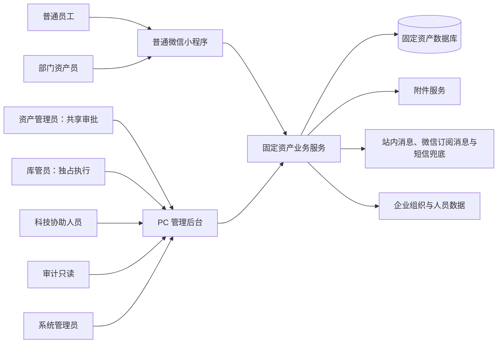
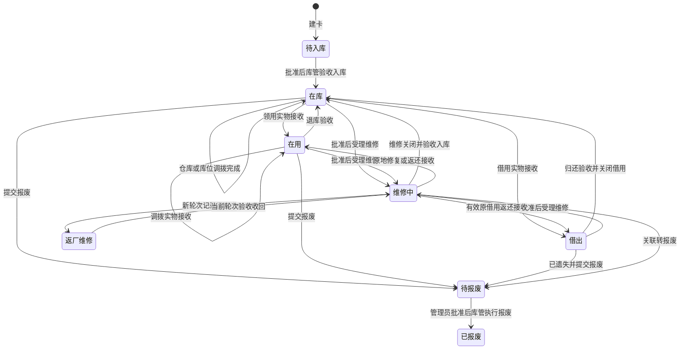
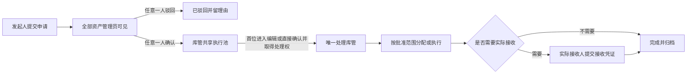

# 固定资产管理系统产品设计文档

> 文档类型：产品需求与业务设计（PRD）  
> 产品形态：PC 管理后台 + 普通微信小程序  
> 适用对象：单个企业内部、多组织/多部门，约 500 名用户，低并发  
> 参考资料：`datae.ndm2` 固定资产数据库模型  
> 版本：V1.5
>
> 日期：2026-09-06

### V1.5 盘点复核与代确认通知补齐

本版核验 R10–R13：明确盘点差异复核的版本竞争、冲突反馈及后续业务关联；补充异常代确认实际执行后的责任告知；说明管理员角色恢复后保留待办重新可见。不增加借用累计持有硬上限、审批层级或新的处理角色。

逐项判断见 [R10–R13 裁决记录](2026-09-06-r10-r13-review-adjudication.md)。以下各版说明保留历史沿革，当前产品行为以本版正文为准。

### V1.4 再审查吸收说明

本版核验第三份外部再审查，补齐非医疗原因未确认的合法交接、关联业务单一追溯入口、抽样记录方法、凭证来源展示、离线事件期限、部门公用代办明细、跨仓库申请引导和无人跟进升级；明确微信未核验可用时的降级要求，并补充无法满足部分重新申请的关联规则。不新增审批层级、强制值班人数、证据信任评分、自动拆单或自动夺取处理权。

逐项依据见 [V1.3 再审查裁决记录](2026-09-06-v1.3-rereview-adjudication.md)。外部意见只作为待核验主张，当前产品行为以本版正文为准；以下 V1.3、V1.2 说明及各轮裁决保留决策沿革。

### V1.3 外部审查吸收说明

本版对两份外部审查逐项核验，保留已确认的单管理员审批、多成员共享池、整单库管独占、非财务 V1 边界。补充用户可理解的状态与下一步、数量展示、科技协助和异常代确认页面、初次绑定资料纠正、离线持久化与补传、待核验及失联处理提醒、凭证关联和短事务边界；不增加强制复核人、自动夺取库管处理权、财务核销、GPS 取证、语音盘点或分布式事务框架。

逐条采纳、部分采纳和不采纳的依据见 [外部审查裁决记录](2026-09-05-external-prd-review-adjudication.md)。该记录负责解释审查意见，本 PRD 负责定义当前产品行为；两份外部审查本身不成为新的需求或实施指令。以下 V1.2 修订说明保留既有决策沿革，现行规则以本版正文为准。

### V1.2 修订说明

本版落实 16 项评审修复选择，并以用户确认的角色机制为准：资产管理员是可配置多人的角色，所有资产管理员均可查看全企业全部申请，任意一人确认或驳回即生效；批准后进入库管员共享执行池。库管员同样可配置多人，首位进入编辑或直接执行确认且成功取得处理权的库管员独占该申请，其他库管员只读。库管执行和实物接收属于业务履行，不构成第二级审批；异常代确认、误报废冲正也不要求第二名管理员复核。

同步补齐关联业务与锁转移、维修结束与到期借用、遗失责任与报废驳回、期初未结业务承接、业务关系授权、实物交出与取消、数量状态汇总、实盘事实和迟到证据、报废处置与冲正、多轮返厂与换机、组织人员交接及完整验收场景。V1.1 中由资产管理员兼任分配和验收、按组织限制管理员申请可见性、双人复核等旧规则已替换，不再作为实施依据。

## 1. 文档结论

本产品面向单个企业内部使用，围绕“资产现在在哪里、由谁保管、处于什么状态、经历过什么”建立固定资产生命周期闭环。

第一期聚焦：

- 资产建卡与入库；
- 领用与退库；
- 借用与归还；
- 部门、人员和位置调拨；
- 盘点与差异处理；
- 员工报修、科技人员简单处理、复杂问题返厂；
- 报废；
- 二维码、消息、履历、权限、审计和基础报表。

报失与找回作为上述流程共用的轻量异常处理能力提供，不扩展成独立的安保或赔偿审批系统。

第一期明确不建设采购、财务折旧、复杂 BPMN 审批、耗材库存、IoT、合同管理、多租户 SaaS 和专业维修工单系统。

所有需要管理判断的业务采用固定的轻量控制方式：

```text
发起人提交 → 任意一名资产管理员确认或驳回 → 任意一名库管员取得独占处理权并执行 → 必要时实际接收人确认 → 完成
```

资产管理员确认是唯一审批节点。同一管理员角色可授予多名员工，任意一人确认即完成该节点；库管员是独立执行角色，负责实物分配、验收和交接记录，不再审批一次。实际接收人确认是实物交接凭证。全流程不设置第二名管理员复核或逐级会签；重要动作的页面二次确认仅用于防误点击。

## 2. 从参考数据库中取舍

`datae.ndm2` 覆盖了较完整的企业资产管理场景，但其 217 张 EAM 表同时包含历史版本、客户定制、工作流耦合和过度扩展。本产品只吸收其中稳定、通用的业务知识。

### 2.1 保留的精华

| 参考模型中的思路 | 产品中的保留方式 |
|---|---|
| 资产分类、品牌、厂商、仓库、位置独立管理 | 作为基础资料，避免在资产卡中重复录入 |
| 建卡、入库、领用、借还、调拨、盘点、维修、报废覆盖完整 | 收敛为第一期七条核心业务链路 |
| 分层记录盘点范围、应盘明细和执行结果 | V1 收敛为“盘点任务—资产快照—扫描事件/结果”，不复制两套盘点模型，也不增加未使用的周期计划层 |
| 业务单据保留处理记录 | 形成统一业务记录和资产履历 |
| 折旧、维修、巡检记录保存历史快照 | 第一阶段仅在流转、盘点和报修记录中保存必要快照 |
| 创建人、修改人、逻辑删除、版本字段 | 保留审计与并发控制思想 |
| 标签、二维码、RFID 等资产识别能力 | 第一期采用二维码，预留标签类型扩展 |

### 2.2 去除的糟粕

| 参考模型中的问题 | 产品处理 |
|---|---|
| `eam_asset` 超过 130 个字段，混入财务、设备、维保、审批和标签 | 产品页面按基本信息、保管信息、扩展信息和履历分区，不暴露“大宽表”设计 |
| 52 张 `act_*`、24 张 `bpm_*` 和 EAM 审批配置 | 全部排除，采用固定的一步管理员确认 |
| 两套盘点、两套转移以及复制/Demo/客户定制表 | 每类业务只保留一个权威模型 |
| 通用 `selected_code` 间接关联资产 | 每张业务单据明确列出资产明细 |
| 大量状态字符串、流程 ID、下一审批人列表 | 使用受控状态和固定业务规则 |
| 将耗材、备件、软件许可、IoT 设备混入固定资产 | 第一期只管理固定资产；其他域保持边界 |
| 专业巡检、保养、维修班组和复杂派工 | 改为员工报修、科技人员简单处理、返厂维修 |
| 采购和财务折旧过早进入核心 | 第一阶段排除，避免增加不必要复杂度 |

### 2.3 设计原则

1. **一物一卡**：一项可独立保管和追踪的实物对应一张资产卡和一个资产编码。
2. **状态由业务驱动**：禁止在资产编辑页直接修改使用人、位置和资产状态。
3. **当前状态与历史事实并存**：资产卡展示当前状态，业务单据和履历保留变化过程。
4. **扫码解决现场问题**：小程序围绕确认、借还、盘点和报修设计，不复制整个 PC 后台。
5. **角色共享、一次确认**：所有资产管理员共享申请池，任意一人确认后交库管员；库管员独占执行申请，不建设多级会签或流程设计器。
6. **异常必须闭环**：盘点差异、逾期借用、返厂未收回和待报废资产必须有明确处理结果。
7. **权限默认最小化**：员工只看到本人相关资产；敏感字段、导出和批量操作单独授权。
8. **个人与公用分开建模**：个人资产必须落实到使用人；部门公用资产必须落实到责任部门资产员和固定位置。
9. **不为未来财务场景提前采集数据**：第一期不采集资产原值，不借固定资产系统替代财务台账。

## 3. 产品目标与非目标

### 3.1 产品目标

- 建立统一、可信、可搜索的固定资产台账。
- 准确记录资产所属组织、使用组织、个人使用人或部门公用责任人、当前处理库管、仓库和位置。
- 让领用、借还、调拨、盘点、报修和报废有清晰记录与责任交接。
- 让普通员工通过微信小程序完成高频现场操作。
- 让资产管理员通过共享申请池作出业务决定，库管员通过执行池、本人处理清单和异常清单完成实物管理。
- 为审计人员提供完整资产履历和可追溯业务记录。

### 3.2 成功指标

约 500 名员工是企业提供的当前规模信息，不是系统实测基线；10 万张资产卡是容量设计目标，不代表企业已有 10 万项资产。上线前通过期初数据试导入形成资产数量和数据质量基线，上线后第一个完整自然月形成业务基线，稳定运行三个月后按下表验收。

| 指标 | 口径 | V1 目标 |
|---|---|---:|
| 保管信息完整率 | 状态为在库、在用、借出、维修中、返厂维修或待报废的资产中，满足该状态必填保管字段的资产数 ÷ 同口径有效资产数 | ≥ 98% |
| 核心业务抽样留痕率 | 抽样范围内能匹配系统单据的入库、领退、借还、调拨、盘点、报修/返厂、报失/找回和报废实际业务数 ÷ 抽样发现的全部同类实际业务数 | 100% |
| 有效二维码覆盖率 | 已绑定有效二维码且抽查时实物标签可识别的有效资产数 ÷ 应贴标有效资产数 | ≥ 98% |
| 盘点任务可追踪率 | 能按执行人统计应盘、已盘、差异和未盘数量的盘点任务数 ÷ 已发布盘点任务数 | 100% |
| 关键异常可发现率 | 借用逾期、盘点冲突/差异和返厂超期记录中，在产生后 5 分钟内进入站内异常清单的记录数 ÷ 同类异常总数 | 100% |
| 资产查询任务成功率 | 代表性用户在指定资产编码已知的前提下，60 秒内找到当前状态和完整履历的人次 ÷ 测试总人次 | ≥ 90% |
| 导入错误可定位率 | 能返回批次、工作表、行号、字段、原始输入和原因的失败行数 ÷ 全部失败行数 | 100% |

说明：

- 本节“有效资产”指已发布且生命周期状态不是待入库、已报废的资产；期初待核验数据、草稿和已回滚批次不进入分母；
- 98% 和 90% 是产品验收目标，不伪装成现状数据；基线形成后如需调整目标，必须保留评审记录，但不改变统计公式；
- “60 秒找到资产”是季度可用性任务测试指标，不是服务端 SLO；服务端性能指标见 §17.1；
- 系统留痕率通过每月抽查线下交接记录、管理员访谈和异常台账计算，每月样本不少于 30 笔，同类实际业务不足 30 笔时全量核对；不能仅用系统自身数据证明 100%；
- 二维码只有在贴标确认或最近一次盘点中成功识别过，才计入有效二维码覆盖分子；仅在数据库生成二维码但未贴到实物不计入；
- 查询任务测试每季度至少覆盖 20 名代表性用户，并包含普通员工、部门资产员和资产管理员，统一从登录后的首页开始计时；
- 首次基线、每月结果、样本范围和计算时间都必须存档，避免只展示无法复算的百分比。

抽样留痕率的 100% 是目标，不是对全企业所有线下行为的事实保证。报告必须显示实际样本和漏记数，例如抽到 30 笔、1 笔未留痕时报告 29/30 = 96.7%，不能改成只检查系统已有的 29 笔。抽样分母为统计窗口内发现的实际业务，后补登记保留实际发生时间、录入时间及补录标记，不能回写原抽样结果。实际保管责任或登记位置改变需要正式记录；原责任人照管下、原位置内的短时共同使用不单独制造调拨单，跨位置交出或责任已转移不能以“口头借用”豁免登记。

抽样执行采用已有导出表或人工核对表，不新增抽样管理模块：每月先记录统计起止时间、抽查部门/位置、业务类型和选样方法，再从实物与当前保管人核对、线下交接凭据、盘点差异及访谈中收集实际业务，最后与系统匹配。每笔样本记录资产或交接对象、实际时间、发现来源、匹配单号或漏记原因；同一实际交接的多份证据合并为一笔。仅有模糊回忆、不能确认是否发生的线索单列待核实，不硬凑分母；未取得可核实样本时显示“样本不足/无法评价”，不能显示 100%。

报告明确为“本次样本观察结果”，附样本窗口、样本量、选样方法及覆盖限制，不外推为全企业精确留痕率；便利抽样不编造置信区间。缺少完整抽样名录时，“不足 30 笔全量核对”仅指声明范围内能够核实的全部业务，并披露覆盖不足。漏记通过已有盘点差异及正式业务入口补录，保留实际时间、系统录入时间、发现来源和补录标记，仍经适用的管理员确认与库管核实，不追认从未作出的历史批准，也不重复执行已发生的实物交接。后续已有流转时使用关联纠正，不靠补录旧单覆盖当前责任；这些补录不能改写原样本结果。

阶段 1–2 首次可操作版本增加两项轻量可用性走查，不建设新的埋点或评分平台：选取 3–5 名实际管理员/库管员（人数不足则全员），用有库存的 5 件申请验证审批、取得处理权及分配；选取实际盘点人员在同一房间核对 10 件正常资产及少量差异。记录独立完成数、耗时、误操作和求助点，首次结果作为基线，发现会导致错误交接或无法完成的交互必须修正后复测。不能用文档推演冒充已完成用户研究，也不未经现场试用先给扫码耗时设虚假精确阈值。

### 3.3 第一阶段非目标

- 不计算资产折旧、净值和财务凭证；
- 不管理采购申请、订单和到货验收；
- 不管理耗材数量余额和备件库存；
- 不建设 BPMN、流程编排器和多级审批；
- 不跟踪返厂维修的快递过程；
- 不建设专业维修、巡检和保养体系；
- 不实现 RFID、蓝牙、IoT 自动发现；
- 不提供多企业租户、客户计费和 SaaS 运营能力。

## 4. 用户与角色

### 4.1 普通员工

核心诉求：知道自己保管了什么，快速完成接收、借还、盘点和报修。

可执行操作：

- 查看本人正在使用或借用的资产；
- 发起领用、借用、归还、退库和报修申请；
- 报告本人责任资产暂时找不到，并查看找回结果；
- 确认收到领用或调拨资产；
- 执行分配给本人的盘点任务；
- 查看本人发起业务的进度和结果。

### 4.2 部门资产员

核心诉求：协助部门管理资产、人员交接和盘点。

可执行操作：

- 查看本部门资产；
- 代部门员工发起领用、退库、调拨和报废；
- 作为责任人接收和管理部门公用资产；
- 为本部门资产发起报失并协助查找；
- 协助完成部门盘点；
- 查看本部门未确认、逾期、盘点差异和报修情况。

### 4.3 资产管理员（审批角色）

- 可配置一名或多名资产管理员；所有成员均可查看全企业全部已提交申请，包括待确认、执行中和历史申请，不按仓库或部门隐藏；未提交草稿仅创建者可见；
- 对待确认申请，任意一名管理员确认或驳回即生效；仅查看或打开审批页面不占用申请，提交决定时由服务端原子竞争，后提交者只看到已处理结果；
- 确认领用、借用、调拨、退库、归还、报修、报失、报废及受控纠正的业务意图、范围和必要条件；批准后进入库管共享执行池；
- 创建盘点、分配执行人、复核差异，管理期初核验发布、人员资产交接及异常处理；
- 可查看资产台账和执行进度；敏感字段、附件及导出仍单独授权；
- 不因资产管理员角色自动获得库管编辑或验收权，不可绕过库管处理人修改执行事实；
- 库管处理人离职、长期缺席或无法继续处理时，可按 §9.5 受控转派，但不能直接替库管执行。

### 4.4 库管员（执行角色）

- 可配置一名或多名库管员；全部成员可查看全企业已批准申请、执行状态和必要库存，不再按原仓库队列拆分同一申请；敏感字段和导出另行授权；
- 首次进入编辑、领取处理或直接确认执行时，必须在服务端取得整张申请唯一处理权；成功前不能修改任何执行数据；仅查看不占用；
- 一人取得处理权后，其他库管员只能查看，即使该申请含多项资产、跨多个仓库，也不能编辑、分配、验收、取消或确认其中任一明细；
- 建卡、导入、标签打印；按已批准申请分配资产，记录交出、接收异常、退库与归还验收、维修去向、返厂轮次、报失核验、找回和报废处置；
- 单据完成后不可继续编辑；原处理人也只能通过关联纠正申请修复错误；
- 跨仓库执行由同一处理库管负责申请全部写操作，收集目标仓库现场签收凭证，不把申请交给另一库管共同编辑；
- 处理人独占权与资产业务锁是两种独立控制，规则见 §7.6、§9.5。

### 4.5 科技协助人员

不是专业维修人员，仅查看被邀请工单的必要信息，填写初步判断、内部处理方式和结果，建议返厂或报废。其贡献保存为被邀请的处理记录，不取得库管处理权，不能分配资产、验收、改变维修目标或关闭申请。

### 4.6 审计只读人员

- 查看授权范围内的资产卡、业务单据、盘点结果和操作日志；
- 导出经过授权的报表；
- 不能新增、修改、确认或删除任何业务数据。

### 4.7 系统管理员

- 维护账号、角色、组织人员、一般数据范围、系统参数、编号、字典、通知和导入模板；资产管理员与库管员均按角色成员配置，可以配置多名成员；
- 启用或关闭初始化窗口，不代替库管员执行导入或资产管理员核验发布；
- 配置角色不等于取得该角色业务权限，不因系统管理员身份自动获得资产审批、库管执行、员工手机号、维修费用或业务附件权限；
- 至少配置一名启用的资产管理员和一名启用的库管员；角色无人可处理时保留待办并告警，不自动批准或降级授权；
- 同一员工可被显式授予多个角色，各动作仍记录实际使用角色；系统不要求管理员和库管员必须是不同自然人，但同一申请始终只有一个当前库管处理人。

## 5. 产品形态与信息架构

### 5.1 系统上下文



### 5.2 PC 管理后台菜单

1. 工作台
2. 资产台账
   - 资产列表
   - 日常批量建卡
   - 期初初始化（仅受控窗口可见）
   - 标签打印
3. 入库管理
   - 待入库资产
   - 入库单
4. 使用管理
   - 领用与退库
   - 借用与归还
   - 调拨
   - 报失与找回
5. 盘点管理
   - 盘点任务
   - 盘点差异
6. 报修与返厂
   - 报修受理
   - 内部处理
   - 返厂轮次（待寄出/已寄出/已收回/异常结束）
   - 维修记录
7. 报废管理
   - 报废申请
   - 待确认
   - 已报废资产
   - 待处置与处置记录
   - 冲正与报废后找回
8. 统计分析
9. 基础资料
   - 组织人员、分类、仓库、位置、品牌与厂商
10. 系统管理
   - 管理员与库管员角色成员
   - 共享申请池、库管执行池及受控转派

### 5.3 微信小程序导航

小程序采用四个主入口：

- **首页**：申请中心、待接收、我的资产、部门公用资产、借用中、盘点任务、我的报修；
- **扫码**：资产查看、接收确认、归还、盘点、报修和报失；
- **我的**：我的资产、我的申请、借用记录、报修记录、账号绑定；
- **消息**：业务结果、到期提醒、盘点通知和报修进度。

### 5.4 PC 登录

- 优先复用企业已有账号体系；没有统一认证时使用系统账号密码；
- 账号与企业员工身份绑定，停用员工不能继续登录；
- 首次登录要求修改初始密码；
- 连续失败触发临时锁定和安全日志；
- PC 登录权限与小程序绑定身份使用同一角色和数据范围；
- 是否接入企业单点登录作为部署选项，不影响资产业务模型。

### 5.5 业务术语

| 术语 | 唯一定义 |
|---|---|
| 所属组织 | 对资产拥有管理责任的公司或部门，通常在资产退出前不随临时借用变化 |
| 使用组织 | 当前实际使用资产的部门；个人使用时通常取使用人所属部门，部门公用时为责任部门 |
| 使用人 | 对个人使用资产承担日常保管责任的员工；部门公用资产必须为空 |
| 部门公用资产责任人 | 代表部门接收和盘点公用资产的部门资产员，不等同于个人使用人 |
| 资产管理员 | 可由多人担任的全企业审批角色；所有成员看全部申请，任意一人确认即生效 |
| 库管员 | 可由多人担任的执行角色；批准申请进入共享执行池，首位取得处理权者独占整张申请 |
| 库管处理权 | 决定谁可编辑或执行一张申请；持续保存到终态或受控转派，不因关闭页面或超时自动释放 |
| 仓库 | 资产处于在库状态时的保管单元；非在库资产可以保留来源仓库，但不把它当作当前位置 |
| 位置 | 资产当前可被找到的物理地点，可属于仓库、办公区或其他场所 |
| 保管关系 | 使用模式、使用组织、使用人或部门责任人、仓库、位置共同形成的当前责任快照 |
| 业务锁 | 具体资产被一张未完成的互斥单据占用的系统标记，不是资产生命周期状态 |
| 期初资产 | 系统上线前已存在、通过受控初始化导入的资产，不等同于日常新购入库资产 |

## 6. 核心领域对象

| 对象 | 产品含义 |
|---|---|
| 资产卡 | 一项固定资产的唯一身份和当前概要 |
| 资产分类 | 控制资产类别、默认字段和编号规则 |
| 资产标签 | 二维码等实物标签与资产的绑定关系 |
| 使用模式 | 区分个人使用和部门公用，决定责任字段和接收人 |
| 保管关系 | 当前使用部门、使用人或部门公用责任人、仓库和位置；库管处理人属于单据执行关系，不是资产永久保管字段 |
| 业务申请 | 员工按分类、规格和数量表达需求，不要求先知道具体资产编码 |
| 申请明细 | 一条需求及其申请数量、已分配数量和逐项处理状态 |
| 资产分配 | 当前处理库管员在管理员批准范围内，将具体在库资产分配给需求明细的记录 |
| 入库单 | 一批资产正式进入可管理状态的记录 |
| 领用单 | 以领用需求为单头，关联需求明细、具体资产分配和实物接收结果的记录 |
| 退库单 | 在用资产返回仓库的记录 |
| 借用单 | 以借用需求为单头，关联预计归还日、具体资产分配和实物接收结果的临时使用记录 |
| 归还单 | 借用资产实物验收和归还结果 |
| 调拨单 | 部门、使用人或位置发生变化的记录 |
| 盘点任务 | 在固定范围和时间内核对一批资产的任务 |
| 盘点结果 | 每项应盘资产的实际核对结果 |
| 报修单 | 员工提交的故障和后续处理记录 |
| 报废单 | 资产永久退出正常流转的记录 |
| 报失记录 | 对暂时找不到或确认遗失资产的发现、查找和找回事实记录 |
| 管理员共享申请池 | 全企业申请的审批与查询入口，全部资产管理员可见，任一人提交决定成功即生效 |
| 库管共享执行池 | 全企业已批准申请的执行入口，库管员原子取得整单处理权后独占执行 |
| 交接记录 | 记录实物交出、临时去向、收回与实际接收的事实 |
| 返厂轮次 | 一次独立寄出、收回或异常结束的事实，隶属同一维修单 |
| 处置记录 | 报废后的待处置、已处置或遗失核销事实与责任 |
| 资产履历 | 由所有业务单据和审计事件形成的时间线 |

## 7. 状态模型

### 7.1 资产状态

| 状态 | 含义 | 允许的主要操作 |
|---|---|---|
| 待入库 | 已建卡但未正式入库 | 补资料、申请入库、取消建卡 |
| 在库 | 已验收入库，由库管保管 | 领用、借用、调拨、盘点、报修、报废 |
| 在用 | 已分配给个人或部门公用 | 退库、调拨、盘点、报修、报废 |
| 借出 | 有尚未关闭的借用责任关系 | 归还、延期、盘点、报修；已遗失时可关联报废 |
| 维修中 | 内部处理、待寄出、收回后处理或待返还确认 | 维修结束、返厂、关联报失或报废 |
| 返厂维修 | 原机已寄出且未实际收回，包含关联异常核实期间 | 验收收回、无法收回时关联报失、凭换机收旧依据关联报废 |
| 待报废 | 已提交报废申请，尚未执行最终报废 | 审批、执行报废、驳回或受控取消 |
| 已报废 | 已执行报废，退出日常流转 | 处置、审计、符合条件的受控冲正或报废后找回登记 |

待库管处理、处理中和待交接属于业务单据状态，不新增资产生命周期状态。批准和分配本身不改变领用、借用、调拨资产的当前状态和正式保管关系；交出后在交接记录中展示当前实物去向，实际接收后一次性更新正式状态和保管关系。

| 异常状态 | 含义 | 业务限制 |
|---|---|---|
| 正常 | 无报失异常 | 按生命周期及业务锁操作 |
| 查找中 | 报失已批准并由库管核实进入查找 | 禁止独立正常流转，只允许查找、盘点复核、找回或确认遗失 |
| 已遗失 | 库管已按批准的核实任务记录遗失事实和责任证据 | 禁止正常流转，只允许找回、关联报废和审计 |

报失待审批时只加业务锁，不提前改变异常状态。异常状态不解除原保管责任；已遗失的借用资产在最终执行报废前仍保留未关闭借用关系。已报废资产的找回不直接恢复正常流转，见 §8.9。

### 7.2 业务单据状态与数量汇总

| 状态 | 含义 |
|---|---|
| 草稿 | 未提交，发起人可编辑 |
| 待管理员确认 | 任意一名资产管理员可确认或驳回当前申请版本 |
| 已驳回 | 审批不同意，保留理由；重新申请生成新版本及新的审批记录 |
| 待库管处理 | 已批准、尚无库管取得处理权 |
| 库管处理中 | 已有唯一处理库管，仍在分配、核实或执行 |
| 待交接 | 至少一项资产等待实际接收或需收回后才能取消 |
| 部分完成 | 已无待处理量，存在成功与未满足/取消混合结果 |
| 已完成 | 全部批准业务已履行，状态和实物事实一致 |
| 无法满足 | 审批通过但履行量为零，全部需求无法满足或无法满足与取消混合 |
| 已取消 | 全部未完成部分经合法取消且无已完成履行 |
| 已转后续业务 | 单资产处理结果为转报修、报失或报废等，关联后续单号，不伪称正常完成 |

审批、执行和交接分开记录。申请被批准后不会因为库存不足变为“已驳回”；库管只能记录无法满足及原因。管理员确认时的申请版本和批准范围永久保留。

领用/借用每条需求记录申请数量、待分配数量、待交接数量、已完成数量、无法满足数量和已取消数量。后五项互斥且之和等于申请数量；“已分配总量”由待交接与已完成数量计算，不单独参与守恒。每项具体资产分配独立记录待交出、已交出待接收、已接收、收回待取消和已取消状态及历史；取消并更换分配时旧分配留痕，不重复占用需求数量。

单头汇总按以下优先级确定：

1. 未批准按草稿、待管理员确认、已驳回或审批前已取消显示；
2. 批准后未认领为待库管处理；有待交接量时为待交接；无待交接但仍有待分配量或未完成执行动作时为库管处理中；
3. 无待处理量时，全部完成为已完成，完成量大于零但小于申请量为部分完成，全部取消为已取消，零完成且存在无法满足为无法满足；
4. “已完成部分 + 待分配部分”仍是库管处理中，“部分已分配 + 部分无法满足”在接收前仍是待交接；不能提前显示部分完成；
5. 多资产单据中关联转换在明细上保存已转后续业务。全部明细已转则单头为已转后续业务；混合正常完成、转后续和取消时终态为部分完成，并分别展示各结果数量，不能把已转后续计入成功履行数量。

领用/借用一旦已接收，原申请履行结果永久保留；后续退库、归还、报失、报废另开关联单据，不把历史已完成量减回零。借用是否未还由借用关系判断，不由借用申请单是否已完成判断。

### 7.3 状态变化原则



上图展示主要正向生命周期；取消建卡、批次回滚、驳回恢复和冲正以 §7.5、§16.5、§16.7 的规则为准，不把删除草稿或回滚批次画成新的资产流转状态。状态只由 §7.5 的动作改变。报废提交即冻结为待报废，批准本身不代表库管已完成报废。驳回或合法取消恢复报废前快照，异常状态和未关闭责任不被清除。原始快照目标已失效时保留冻结并进入受控纠正，不直接恢复非法保管关系。

### 7.4 返厂轮次与资产状态

| 轮次子状态 | 动作 | 资产状态 | 记录要求 |
|---|---|---|---|
| 待寄出 | 当前处理库管在批准维修范围内建立新轮次 | 维修中 | 轮次号、厂家、预计收回日期 |
| 已寄出 | 库管记录实物交出 | 返厂维修 | 寄出日期、经办人、厂家接收依据 |
| 已收回 | 库管验收原实物 | 维修中 | 实际收回日期、状态、结果、费用 |
| 异常结束 | 无法收回原机并关联报失，或整机换新并关联旧卡后续处理 | 随关联业务合法转换 | 原因、厂家凭证、关联单号；不得填写虚假收回日期 |

同一维修单可有多轮返厂，同一资产同时只能有一个待寄出或已寄出的活动轮次。再次寄出必须新建待寄出轮次，旧轮次日期、厂家结果和费用不覆盖；待寄出取消留审计，不计实际返厂次数。维修费按轮次汇总，重复上传凭证不重复计费。

### 7.5 状态迁移前置条件

除草稿、建卡或导入待入库数据、标签、基础资料、查看、盘点证据、已批准范围内的事实记录及管理员专属盘点管理外，执行动作必须有有效的单管理员批准记录。由当前处理库管校验申请版本、批准范围、资产版本和业务锁后执行；接收人仅通过受限接收凭证完成接收，不取得库管编辑权。未提交草稿和建卡批次仍受创建者或批次独占权限控制。

| 业务动作 | 源状态 | 完成目标 | 必要条件 |
|---|---|---|---|
| 日常入库 | 待入库 | 在库 | 入库已批准，库管验收仓库、位置与实物 |
| 领用接收 | 在库 | 在用 | 已批准并由处理库管分配、交出；实际接收人确认 |
| 借用接收 | 在库 | 借出 | 同上；预计归还日接收时仍有效 |
| 退库验收 | 在用 | 在库或维修中 | 已批准；损坏联动维修时同步建立以在库为返回目标的维修快照 |
| 归还验收 | 借出 | 在库或维修中 | 已批准；同步关闭借用；遗失不得伪造归还 |
| 在用调拨 | 在用 | 在用 | 批准目标完整；责任人变化由实际目标人接收 |
| 在库调拨 | 在库 | 在库 | 同一处理库管记录调出及目标仓库现场收妥凭证；不允许另一库管编辑该申请 |
| 报修受理 | 在库、在用、借出 | 维修中 | 保存原状态、完整责任快照和借用关系；必要时记录维修接收事实 |
| 返厂寄出/收回 | 维修中/返厂维修 | 返厂维修/维修中 | 当前合法轮次、实物与厂家凭证完整 |
| 维修关闭并入库 | 维修中 | 在库 | 库管验收入库；原借用尚未关闭时同事务记录关联归还、关闭借用、关闭维修；不要求先恢复借出 |
| 维修返还 | 维修中 | 在用或借出 | 返还目标仍有效；实物离开过保管人时先待返还确认，实际接收后更新状态和释放锁；原地修复可直接关闭 |
| 提交报废 | 在库、在用、维修中；已遗失的借出；已遗失无法收回或有厂家换机收旧/销毁凭证的返厂维修 | 待报废 | 独立提交无其他锁；关联提交按 §7.6 转锁；保存完整源快照，不提前关闭借用；厂家已收旧不伪记为遗失 |
| 执行报废 | 待报废 | 已报废 | 单管理员批准，处理库管核对实物或遗失责任证据；关联借用在此时以遗失终止关闭 |
| 报废驳回/取消 | 待报废 | 合法源状态 | 按原快照恢复，遗失异常保留，借用关系仍未关闭；从维修转来时按关联转换规则恢复维修或保持冻结待纠正 |
| 误报废冲正 | 已报废 | 经批准且实物核实的在库或在用 | 未实际处置、未产生不可逆后续、证据完整；恢复借出另按有效借用手续办理，不自动重开已终止借用 |

维修快照必须包含 source_status、使用模式、使用组织、使用人或公用责任人、仓库、位置、原借用关系和到期日。到期借用不能自动恢复借出：默认维修关闭并归还入库；如确需续用，管理员对延期变更作一次确认，新的到期日和实际接收均有效后才能继续借用。原人员离职、位置停用、员工拒收时保留维修锁，由处理库管转回库或提交目标变更，不强行恢复快照。

### 7.6 资产互斥与关联业务转移

资产业务锁控制同一资产不能被两个独立状态变更业务同时占用；库管处理权控制同一申请只能有一个库管写操作，二者必须分别校验。

| 业务 | 资产锁起点 | 释放或移交条件 |
|---|---|---|
| 尚未分配的领用/借用需求 | 不锁库存；批准并认领也不锁具体资产 | 分配实物时才取得资产锁 |
| 入库、退库、归还、调拨、报修、报废、报失/找回 | 指定具体资产并提交时，在事务中检查状态和取得锁；草稿仅选择不占锁 | 合法完成、驳回、取消，或关联转换移交 |
| 分配后领用/借用 | 当前处理库管提交分配时 | 接收完成，或核实未交出/已收回后的取消 |
| 维修、返厂、待返还 | 原维修链路持续持锁 | 维修闭环或关联异常转换，不因某轮已收回提前释放 |
| 查找中报失 | 核实任务继续持锁 | 找回闭环，或确认遗失后结束本次查找单并释放锁；已遗失异常仍阻止正常流转 |
| 盘点证据、查看、标签重打、非保管资料维护 | 不占资产锁 | 不得改保管关系、状态或待执行批准依赖的字段 |

同一资产只能有一个活动业务锁，报失/找回与入库、领退、借还、调拨、维修及报废的独立状态变更动作全部互斥。同类反向单据也互斥。超时、关闭页面、换设备不能自动释放锁；孤立锁仅可根据单据终态受审计修复。

以下为关联转换白名单，不允许当作独立业务绕过原锁：

| 原业务 → 后续 | 同事务必须保存的结果 |
|---|---|
| 损坏退库/归还 → 维修 | 实物验收、归还时关闭借用、创建关联维修、在库返回快照、资产进入维修中及锁移交 |
| 归还发现遗失 → 报失 | 原归还标记已转后续，保留未关闭借用责任，建立报失待审批记录并移交锁，不能生成正常归还结果 |
| 维修/返厂无法收回 → 报失 | 冻结原维修返回目标、轮次记录异常依据，创建报失并转锁；找回后可原子交还维修继续处理 |
| 维修/有厂家收旧依据的返厂 → 报废 | 保存维修事实、原维修快照、厂家凭证和明确恢复入口，创建报废待审批记录，进入待报废并转锁；返厂收回日期仍按真实事实留空 |
| 报失 → 报废 | 保存已遗失证据和原责任，创建报废申请并转锁或在已遗失单已关闭时重新取得锁；不提前关闭借用 |
| 找回 → 归还/退库/调拨/维修 | 原找回证据、实际去向、后续申请和锁原子衔接；后续批准或执行前不能解锁为可分配库存 |
| 维修关闭 → 入库/关联归还 | 验收入库、关闭未结借用、关闭维修、更新保管关系后释放锁，避免维修与归还相互等待 |

涉及新的管理决定（例如报废、转为遗失处理、超出批准范围的目标变化）时，后续申请仍由任意一名管理员单次确认，不要求原审批人或第二名复核人。原处理库管经本次转换显式确认后可承接后续申请，保留连续处理权；其他库管不得借新单号抢办。后续尚未批准时只能记录待审批转换，不得提前执行其最终状态。

这里的“同一事务”只指一次用户动作内、同一业务数据库中的短事务，不包含等待未来人工审批或外部消息投递的时间；不跨人等待持有数据库事务，也不要求引入分布式事务或 Saga 框架。

| 时点 | 本次短事务与失败结果 |
|---|---|
| 提交关联转换 | 一次提交原单据冻结/转后续、后续待审批记录、合法资产变更与锁移交，任一步失败整体回滚；成功后提交事务、保留持久业务锁并返回待审批 |
| 等待或批准后续 | 等待期间无长数据库事务；管理员决定是另一次短事务，持久化唯一审批结果和执行待办，不提前执行后续实物动作 |
| 驳回后续 | 另一次短事务记录驳回并按实际事实创建继续处理记录、关联关系及锁；保留原历史终态，不称为回滚早先已提交事务；若目标已失效则保持受控冻结并生成异常待办 |
| 执行后续或重试 | 当前处理库管以最新版本执行新的短事务；响应丢失重试同一请求 ID；事务失败保持该步前完整状态，持久待办可继续，不重做已经成功的旧步骤 |

没有后续动作且资产仍遗失时可关闭核实单并释放资产锁，异常状态仍阻止正常流转；原机未收回的返厂异常不得恢复虚假在库。服务重启后从持久单据和待办恢复进度，现有异常修复任务核对失配对象；不能凭超时删除锁或伪造成功。

异常代确认、取消已交出资产和报废冲正也受同样事务与版本校验约束，不能以管理员或库管角色绕开实物证据。

## 8. 详细功能设计

### 8.1 基础资料

#### PRD-BASE-001 组织与人员

- V1 以系统内维护和标准模板导入为身份资料来源；导入显式区分新增、更新和停用，不因模板缺少某人而删除；后续可接单向身份源；
- 员工记录工号、姓名、企业登记手机号、部门和状态，角色可多选；资产管理员和库管员分别配置多人；
- 员工调部门只更新身份资料，不静默重写资产使用组织和历史责任。系统生成资产及待接收、借用、盘点、维修核对清单，由管理员安排正式交接；
- 员工离职或停用立即撤销访问和未同步上传权限，不以资产未清为由保留登录；历史员工业务身份在责任清理前不可删除，姓名等历史快照永久保留；
- 公用责任人离职、停用或撤销角色时，立即冻结新增公用接收，生成责任移交待办；管理员指定临时有效部门责任人，库管通过正式调拨完成责任变更，原责任事实保留直到交接；
- 库管员离职或撤销角色时，其处理中的申请冻结写操作，不自动释放到共享池；由管理员核对实物去向后受控转派；旧处理人的未提交修改和会话立即失效；
- 待接收人失效、盘点执行人变动按业务关系授权及任务版本处理，不自动把任务转给新部门全体员工；
- 组织撤销前处理资产、责任和未完成业务；无有效目标人员或组织的变更保留异常清单，不伪造空责任。

#### PRD-BASE-002 资产分类

- 支持多级分类树；
- 分类包含编码、名称、上级分类、启用状态和说明；
- 已被资产使用的分类不能删除，只能停用；
- 分类可配置建议单位、编号前缀和扩展字段模板；
- 停用分类不影响历史资产查看。

#### PRD-BASE-003 仓库与位置

- 仓库独立维护；
- 位置使用树结构，可表示楼宇、楼层、房间、区域和库位；
- 同一资产只能有一个当前位置；
- 位置停用前必须迁出有效资产；
- PC 端支持按位置查看资产清单。

#### PRD-BASE-004 品牌与厂商

- 分别维护品牌和生产厂商；
- 同一品牌可关联一个默认厂商；
- 已引用记录只能停用，不能物理删除。

#### PRD-BASE-005 编号规则

- 支持按企业统一编号或按分类前缀编号；
- 编号可包含固定前缀、日期和流水号；
- 资产编码全企业唯一且永久不复用；
- 业务单号按业务类型分别生成；
- 批量创建时预占号段，失败号码可保留为废号，不重新分配给其他资产。

#### PRD-BASE-006 企业业务参数

- 维护企业时区、工作日历、节假日、管理员处理时限、交接时限和消息升级阈值；
- 默认时区为 `Asia/Shanghai`，工作日按企业日历计算，自然日按该时区的 00:00—24:00 计算；
- 参数变更记录修改前后值、生效时间和操作人，只影响新创建单据或任务；
- 资产管理员或库管员角色无有效成员、短信通道和微信消息模板缺少必要配置时，在系统管理工作台显示配置异常。

### 8.2 资产建卡与台账

#### PRD-ASSET-001 单个建卡

必填字段：

- 资产名称；
- 资产分类；
- 规格型号；
- 单位；
- 有效的所属组织（部门或公司）；申请审批进入全企业共享池，不要求按组织配置管理员队列；
- 初始仓库和位置。

可选字段：

- 品牌、厂商、序列号；
- 购置日期、保修到期日；
- 默认服务商、服务联系人和服务电话；
- 供应来源；
- 图片、附件、备注；
- 分类配置的扩展字段。

保存草稿时可以暂缺非关键字段；提交入库前必须通过完整性校验。

第一期不采集资产原值、净值和折旧字段。维修费用是维修单据的事实字段，只能用于维修记录和运营分析，不能据此生成财务凭证。

#### PRD-ASSET-002 批量导入

导入流程：

```text
下载模板 → 填写数据 → 上传 → 字段映射 → 校验预览 → 确认导入 → 下载结果
```

要求：

- 模板带字段说明和示例，不依赖隐藏列；
- 分类、部门、人员、仓库和位置优先按唯一编码匹配；只有目标范围内名称唯一时才允许按名称匹配，重名或跨层级歧义必须报错；
- 错误精确到行号、列名、原始输入和原因；
- 正确行与错误行可以分别处理；
- 重复资产编码、重复序列号、无效组织和停用分类必须阻断；
- 导入为后台任务，用户离开页面后仍可继续；
- 结果文件包含成功资产编码和失败原因；
- 防止 Excel 公式注入。

每次导入生成不可变批次号。批次内资产尚未产生真实下游业务时，可发起批次回滚申请，由任意一名资产管理员批准、唯一处理库管执行；任一资产已进入下游业务后禁止整批回滚，只能正式纠正。期初发布自带承接记录的判定见 PRD-INIT-002。回滚与原因永久保留，编码记为废号不复用。

#### PRD-ASSET-003 复制建卡

- 可以选择一张资产作为模板；
- 只复制分类、品牌、厂商、型号、单位和扩展字段；
- 不复制资产编码、序列号、当前使用人、业务状态和历史记录；
- 创建数量大于 1 时逐项生成独立资产卡。

#### PRD-ASSET-004 二维码

- 每项资产生成唯一二维码；
- 二维码仅包含不可猜测的资产访问标识；
- 支持单张和批量打印；
- 标签模板至少支持企业名称、资产名称、资产编码和二维码；
- 重新打印不改变资产编码和二维码身份；
- 资产报废后扫码显示“已报废”，不暴露敏感历史。

#### PRD-ASSET-005 资产台账

默认列表字段：资产编码、名称、分类、型号、生命周期状态、异常状态、使用模式、所属组织、使用组织、使用人/部门公用责任人、当前处理库管（有未结业务时）、位置、入库日期、最近盘点日期。

筛选条件：

- 资产编码、名称、序列号；
- 分类、生命周期状态、异常状态、使用模式、部门、使用人、部门公用责任人、当前处理库管或业务申请；
- 仓库、位置；
- 入库时间、最近盘点时间；
- 是否借用逾期、是否长期未盘点。

支持保存个人常用筛选、导出当前结果和批量打印二维码。

#### PRD-ASSET-006 资产详情

采用以下页签：

1. 基本信息；
2. 当前保管；
3. 标签与附件；
4. 领用、借还与调拨；
5. 盘点记录；
6. 报修与返厂；
7. 报失与找回；
8. 报废信息；
9. 操作日志。

所有业务记录按时间倒序展示，并能进入原始单据。

#### PRD-ASSET-007 个人与部门公用资产

资产在“在用”状态必须选择一种使用模式：

| 使用模式 | 必填保管字段 | 必须为空 | 实物接收人 |
|---|---|---|---|
| 个人使用 | 使用组织、使用人、位置 | 部门公用责任人 | 该使用人本人 |
| 部门公用 | 使用组织、部门公用责任人、固定位置 | 使用人 | 部门公用责任人 |

- 打印机、会议平板、会议室显示屏等不应虚构个人使用人，统一使用“部门公用”；
- 部门员工可查看本部门公用资产的基础信息并发起报修，部门公用责任人负责接收、退库、调拨和盘点；
- “我的资产”只显示个人使用和本人借用资产；“部门公用资产”使用独立入口和统计口径；
- 使用模式或责任主体发生变化必须通过领用、退库或调拨业务完成，禁止直接编辑；
- 目标部门没有有效部门公用责任人时，不允许分配为部门公用资产；
- 部门公用责任人离职、停用或角色撤销立即失去访问权；未交接资产进入责任移交清单，按 PRD-BASE-001 指定临时责任并完成调拨或退库，不延迟账号停用。

#### PRD-INIT-001 期初初始化与未结业务承接

上线前可受控导入在库、在用、借出、维修中、返厂维修和待报废资产。系统管理员启用窗口，库管员领取并独占导入批次操作，资产管理员任意一人核验批准发布。初始化不伪造历史员工申请，统一标记来源为期初承接。

| 导入状态 | 必填依据 | 发布时生成的承接记录 |
|---|---|---|
| 在库 | 仓库、有效位置、所属组织 | 当前保管关系及期初履历，无虚构日常入库单 |
| 在用个人/公用 | 使用模式、组织、有效使用人或责任人、位置 | 期初责任关系及基线履历 |
| 借出 | 借用人、借出日期、预计归还日、实际位置 | 期初借用关系；历史到期可导入，发布后进入逾期统计，不因无日常申请而无法归还 |
| 维修中/返厂维修 | 原状态与完整保管快照、原借用资料（若有）、当前实物去向、阶段；返厂须有厂家及寄出依据 | 期初维修单、必要的未结借用、当前返厂轮次、独占处理库管、资产锁及下一步待办 |
| 待报废 | 报废原因、报废前完整状态与责任快照；遗失时有证据；源为维修时有必要维修事实 | 待管理员确认的期初报废申请、未结责任与必要维修承接、资产锁；批次发布不等于批准报废 |

每项记录保留批次、原始行、导入人、基准日期及外部凭证。未知字段不得编造；无法确定合法后续动作的行保留待核验，不发布。借用、维修等期初事实由发布确认承认其既有事实，不反向伪造历史审批；新增目标变更仍走单管理员确认。

#### PRD-INIT-002 初始化核验与封板

- 期初资产先进入待核验标记，不进入正式业务或统计；库管准备数据，任意一名资产管理员完成数量、必填信息及抽样实物核验后按批次批准发布；
- 发布时原子建立卡片、承接关系、所需单据、处理权、资产锁和待办；同一发布重试不重复生成，任一关联失败不得留下只有卡片的半成品；
- 尚无后续业务的已发布批次可受控回滚，批次自身生成的期初履历及承接记录不算下游动作，但必须一起撤销并留审计；发生归还、收回、审批报废、盘点等后续动作后禁止整批回滚；
- 发布后才能打印标签和正常办理业务；关闭初始化后禁止日常模板直接创建非待入库状态；
- 再次开启必须由系统管理员填写原因、限定时间及执行人并告警；正式上线前封板，不以补录为由开放无期限初始化。

#### PRD-INIT-003 待核验跟进

期初页面提供待核验清单，按批次、原始行、缺失字段、负责库管、首次发现时间和待核验天数筛选。默认 5 个工作日未解决时进入管理员工作台提醒，可说明原因并设置下次核实日；提醒不是自动发布或强制编造数据的期限。负责库管可下载已有错误清单、现场核对并补充依据，这属于初始化核验，不把未发布卡片混入正式盘点和有效资产统计。正式上线时必须明确剩余待核验数量、范围及跟进人，不得把它们隐藏或算作已成功纳管。

### 8.3 入库

#### PRD-IN-001 创建入库单

- 库管员建卡或导入待入库资产，按批次形成入库申请；尚未提交的批次由创建库管独占编辑；
- 入库单包含资产明细、目标仓库、位置、日期、经办人和备注，支持批量设置后逐项调整；
- 提交时取得具体资产锁，进入全体资产管理员可见的申请池，任意一人确认或驳回；批准后进入库管执行池，原创建人也必须取得当前处理权才能执行。

#### PRD-IN-002 确认入库

- 当前处理库管验收实物，检查编码唯一、资料完整、批准范围、仓库及位置有效；
- 验收成功资产进入在库并释放资产锁；申请全部完成后库管处理权归档，不能再次编辑；
- 入库已完成不能删除，错误通过资料更正或关联调拨处理；身份、数量或所有权错误使用受控纠正申请，不直接改保管字段。

### 8.4 领用与退库

#### PRD-USE-001 领用申请

- 员工为本人申请，部门资产员可代本部门员工或部门公用申请；
- 填写分类、规格、数量、用途、期望日期及位置，偏好品牌/型号不代表库存承诺，不要求员工选择资产编码；
- 个人使用指定实际使用人；部门公用指定使用组织、有效部门责任人和固定位置；
- 尚未分配实物的需求不锁库存，申请数量与后续数量分布按 §7.2 守恒。

#### PRD-USE-002 管理员确认与库管分配

- 全部资产管理员看同一申请，任意一人批准需求版本或驳回；批准仅表示允许履行，不表示具体资产已分配或交出；
- 批准后库管员进入编辑或直接执行时原子取得整单处理权，只有当前处理人可分配；
- 从在库、异常正常、无资产锁的库存选择实物，分配时再次校验批准的分类、数量、接收目标、资产版本及锁；
- 可部分分配，未满足数量暂留待分配或明确无法满足，不长期预约未来库存；申请人可对无法满足部分另行申请；
- 超出批准数量、分类或接收目标的修改必须发起变更确认；已经完成的部分不回退，库管只能在批准范围内更换未交出资产；
- 已分配部分为待交接，未接收前不得显示部分完成；处理中的待分配和无法满足数量都不占具体资产锁。

“无法满足”按数量记录库存不足、规格不匹配、暂不可用或其他原因，其他须说明；系统保存当时申请要求、执行人、时间和可用库存查询结果摘要，不要求库管为正常缺货额外上传截图。结果同时对申请人和管理员可见。申请人认为有误可从原申请通知管理员核查，在已有待办中按申请去重显示；不能据此修改已完成数量。V1 不按未采集的资产价值设复核门槛，也不让正常部分分配再等一次审批。

无法满足数量旁提供“就此部分重新申请”，带入原申请及需求行、原因和仍需数量，创建普通新草稿并重新走一次管理员确认；原行保持无法满足，不恢复为待分配。提交时校验来源需求行及本次数量不超过来源无法满足量；同一来源已有后续记录时入口改为查看最新后续，不再从旧结果反复建单。最新后续无履行且全部取消/驳回时可再次申请；部分履行后仅从其最新无法满足行继续，全部完成则不再提供未满足重申。重复点击或重试返回同一关联草稿/提交结果，额外新增的需求另走普通申请，改变规格或目标须由申请人明确修改并按新版本审批。申请次数报表保留真实新旧次数，活动待分配量仍只按 §7.2 的待分配项统计，原无法满足量不混入待分配；不建设跨申请需求余额或对独立申请猜测去重。

#### PRD-USE-003 交出与接收

- 处理库管记录未交出、已交出待接收、收回待取消等实物事实、经办时间、临时保管人或去向；实物已交出时资产列表同时显示正式责任和当前实物去向；
- 接收人通过受限待办查看资产清单，可逐项扫码或小批量整体确认，必须核对实物及资产编码；
- 个人资产由实际使用人确认，公用资产由指定责任人确认；接收动作只提交接收凭证，不开放库管编辑权；
- 接收后原子更新使用模式、使用组织、责任人及位置，进入在用并释放资产锁；
- 不一致或拒收时保留待交接和锁，处理库管记录异常并核实实物；未交出可取消，已交出必须收回验收才能取消。按 §9.3 代确认真实接收后为已完成，需退回时办理关联退库/归还，不直接取消或虚增可用库存。

#### PRD-USE-004 退库

- 使用人、部门公用责任人或有权代办的部门资产员发起，填写原因和实际状况；
- 任意一名管理员批准后，由唯一处理库管现场验收，记录正常、损坏或缺少附件的结果；
- 正常时进入在库，清空使用模式、使用组织、个人使用人和公用责任人，设置仓库及库内位置；缺少附件须明确补交、接受缺项或关联处理结果，不能静默结单；
- 损坏时可在批准的损坏处理范围内，同一事务完成退库验收、生成维修记录并移交锁，资产直接进入维修中，维修返回目标为在库；
- 已停用人员不能登录代操作，遗留责任由管理员组织并由库管凭实际验收完成，不伪造离职人员确认。

### 8.5 借用与归还

#### PRD-BORROW-001 借用申请

- 按分类、规格、数量、用途、预计归还日期和使用位置提交，预计归还日期晚于当前日期；
- 任意一名管理员批准后，唯一处理库管从在库、异常正常且无锁的库存分配，数量及部分履行同领用；
- 实物交出和实际借用人接收按 §8.4 规则，接收时再次核对日期仍有效，过期先办理延期变更或取消未交出分配；
- 接收后资产进入借出，建立未结借用关系并释放分配锁；申请单已完成不代表借用已归还；
- V1 不允许在用资产直接转借，必须先退库再借用。

#### PRD-BORROW-002 到期与延期

- 到期前提醒，到期未还进入逾期清单，不自动改变资产状态；
- 员工或处理人员可提出延期变更，任意一名资产管理员单次确认后生效，保存原日期、新日期、原因和版本；无具体实物变化的延期由确认事务直接记录生效，不增加无意义的库管验收；
- 延期、维修或遗失不删除历史逾期区间；普通维修期间原借用责任和到期提醒继续保留，确认遗失后停止该资产未来普通归还催办，改入遗失责任跟踪；
- 遗失后找回且未报废时，按原日期或有效延期结果恢复到期判断；不把找回日当成新的借出日。

#### PRD-BORROW-003 归还

- 借用人从我的借用发起；停用员工遗留借用由部门资产员或管理员代发起并记录原因；
- 管理员批准后，由唯一处理库管验收，记录正常、损坏或遗失；
- 正常时进入在库，关闭借用，清空当前使用责任字段并设置仓库和位置；
- 损坏时同事务关闭借用并建立以在库为返回目标的维修记录，资产直接进入维修中；
- 遗失时按 §7.6 转报失，归还明细记录已转后续业务，借用不关闭，不得产生正常归还流水。

### 8.6 调拨

#### PRD-TRANSFER-001 调拨申请

- 支持所属组织、使用组织、个人使用人、公用责任人、仓库和位置变更，至少一项真实变化，展示前后对比；
- 发起人须有来源资产操作权，目标人员和位置按目标选择规则提供，不因调拨开放目标部门完整台账；
- 目标个人须为有效员工；目标公用责任人须为目标部门有效资产员；
- 全体管理员可见并由任意一人批准，批准后进入库管共享执行池；同一申请跨仓库或组织也不自动拆给不同库管，整单由一人独占执行；
- 当前资产保持原状态与责任并持锁，直到交接完成。

#### PRD-TRANSFER-002 调拨执行与接收

- 唯一处理库管记录实物交出及去向；个人使用人或公用责任人变化时，目标实际责任人通过受限接收凭证确认；
- 在库跨仓库调拨由同一处理库管收集目标仓库现场收妥凭证，记录实际签收人、时间、位置及凭证；目标仓库其他库管可现场签字，但不能在系统中编辑或确认该申请；
- 同仓库或同部门仅位置变化且责任人不变时，处理库管现场核实后直接完成，省略员工接收；
- 完成时原子更新全部目标字段并留前后快照；接收异常或实物未收回时保持锁，不因超时自动取消；
- 库管不能修改已批准的责任目标；目标变更按 §9.6 办理。

跨仓库/位置申请引导：选择的资产涉及多个来源或目标仓库、位置分组时，申请编辑页及管理员审批页展示已有位置层级下的分组数量、资产数与来源/目标摘要，提示“本单由一名库管记录全部执行；如需多名库管分别负责，建议按这些分组分别提交”。不新增站点资料域，不推测距离或强制按每个房间拆单。用户可保留整单，或在提交前按分组整理独立申请；已提交且未批准时可由有权发起人取消后重建，管理员可驳回并说明分组建议。批准后不直接拆出子单或改变处理权，确需重办须先由当前处理库管按未交出取消/已交出收回规则处理原明细，不能让新单重复占用同一资产。

整单处理人负责核对并记录各现场的交接凭证，不要求本人到每个仓库往返；现场实际签收者可以提供与资产清单对应的凭据，但没有原申请的系统写权。50 项跨 5 处只是走查样例，不作为企业现有规模或必须拆 5 单的业务阈值。

### 8.7 盘点

#### PRD-INV-001 创建与生命周期

资产管理员按使用部门、所属组织、分类、仓库/位置、生命周期、异常状态及当前责任人组合筛选，显示预计数量；发布时固化应盘集合、资产版本和完整责任快照，后续流转不改变集合。待入库、期初未发布资产不进入正式盘点。

```text
草稿 → 待开始 → 进行中 → 待复核 → 已完成
          ↘ 已取消   ↘ 已终止
```

- 草稿可编辑或删除；发布后待开始，到开始时间或管理员手动开始进入进行中；
- 尚无执行结果（包括手工结果）的已发布任务可填写原因后取消，进行中但无结果也适用；已有结果只能终止，保留全部证据；
- 到期未完成保持进行中并标记逾期；所有应盘项有结果或有明确未盘原因后可进入待复核，显示尚未同步确认的执行人；
- 正常结果复核、差异处置及必要的同步确认完成后才能封存；已完成、已取消、已终止均不能重开，可复制范围创建新任务；
- 草稿、取消、终止和未盘项不计作成功盘点，报表分别统计。

#### PRD-INV-002 分配与授权版本

- 按部门或位置分配，一项资产只有一名主执行人；执行人通过业务关系仅查看自己的应盘资产及必要责任信息；
- 管理员可重分配未盘项或发起明确复盘，保存原执行人、新执行人、任务分配版本和原因；
- 重分配前旧人离线产生的事件上传后只作为待复核证据，不自动计数；客户端自报时间不能单独证明旧授权有效；
- 两人证据可能来自重分配、复盘或管理员核验；无任何任务授权的人不能借“多人冲突”规则写入盘点证据。

#### PRD-INV-003 实盘事实与连续扫码

- 进入房间或区域时先选定实际位置，现场位置切换必须显式确认；扫码只识别资产身份，不能自动证明其位置或责任正确；
- 每项记录账面快照与实际位置、实际使用模式、实际保管人/公用责任人、实物状况、观察时间和必要照片；账面值可以展示供核对，但不得未经现场确认自动作为实盘事实；无法确认的字段记录未知和原因，不能判正常；
- 实际保管人采用任务授权内的最小身份选项，不显示联系方式；范围外人员记受限的待核实责任线索，由管理员核实，不开放全员信息；
- 结果可同时包含位置、保管人、使用模式和实物状态差异；任务外已登记资产不是盘盈，只形成任务外发现线索，由管理员关联其权威资产卡；
- 正常、差异、盘盈线索、无效标签和任务外分别反馈；连续扫码不被统计刷新阻塞，重复明确提示；
- 每个事件生成唯一客户端 ID，保存账号、绑定、任务及分配版本、资产快照版本、实际观察、扫描时间、接收时间、设备和证据；同 ID 重试返回原结果；
- 同一授权任务内不同事件事实一致，只计一条，后续保存为重复；事实冲突进入人工复核，不能覆盖；
- 任务期间发生真实保管或生命周期流转时标记期间流转，保留任务快照、事件证据和当前信息。普通名称等非保管字段版本变化不直接判为实物流转，依据变更事件类型复核；
- 扫描、同步和复核都不能直接改资产责任，只有正式业务能改变当前资产。

正常盘点采用“房间位置复用 + 逐件核实”：页面常驻当前实盘房间，每次扫描展示最小账面责任和状况，执行人核实一致后点击一次“与现场一致”即可保存，只有差异项展开修改及必要拍照。正常项不要求逐字段重输或逐件上传照片；换房间时确认切换，不把前房间位置默默套用。人员不明或状态不确定可选“不确定，待核实”，不能为了提速自动判正常。

#### PRD-INV-004 手工与盘盈

- 标签损坏可按编码或名称搜索，手工必须填写原因，记录实际观察和来源；
- 无正式卡的实物建立盘盈临时记录，包含位置、描述、照片和发现人，不自动创建卡或分配新编码；
- 管理员核实后关联补建卡入库申请或记录非企业资产依据；临时记录不得绕过正常审批、入库和唯一性校验。

#### PRD-INV-005 差异复核与闭环

- 管理员复核正常项可批量接受；每个差异须记录采信证据、处理人、方式、原因和最终状态；
- 位置/责任不符通过正式调拨完成或以明确证据确认账面正确后关闭，不能仅填写“已核实”绕过资产变更；
- 盘亏继续查找为处理中；可经管理员确认转入有责任人、时限和已建立待办的报失单后，以已转后续业务关闭本次盘点差异，后续遗失结果继续可追踪；仅填报失说明不足以闭环；
- 盘盈须补建卡入库完成，或核实非企业资产/重复登记后才能关闭；
- 多重差异逐项闭环，一项关闭不能覆盖其他未处理差异；冲突、重复与期间流转均保留全部原始事件。

复核按“差异项 + 当前处理版本”原子提交：服务端校验管理员当前权限、任务可复核状态、证据及相关资产信息版本，首个合法且事务提交成功的决定生效；只打开页面不占用。后提交的旧版本请求返回“该差异已由 X 于 T 处理”及当前处理方式、进度和只读入口，不再写入有效结论。与已生效决定不同的提交记为冲突拒绝审计，不标成相同证据或重复结论；同请求 ID、同载荷重试按 §16.6 返回原结果。

选择正式调拨等后续业务时，本次短事务同时保存差异处理方式、关联单据与必要待办，失败整体回滚；沿用该业务审批及资产锁规则，不能先产生孤立后续单再竞争差异决定。调拨尚未完成时差异保持处理中，不能先记已修正；后续完成/驳回按最新处理版本及既有关联继续处理规则推进，不被“首位决定”永久锁死，也不覆盖此前决定。直接确认账面正确须有明确依据，不能覆盖已有有效关联处理；已关闭差异有新证据时走补充复核或关联复盘，不在旧终态上改结论。

位置、责任人等不同差异保留独立结果；一次动作涉及多项时须校验全部涉及差异的版本，作为同一动作共同提交或失败。同一资产的多个正式变更仍受资产业务锁约束，不因为差异编号不同就并行改责任。批量接受按项返回成功或冲突，不能用整批成功掩盖失败项；任务封存与复核提交并发时校验任务版本，已封存后只能走迟到/补充复核，不改变原报告。

#### PRD-INV-006 封存与迟到证据

- 封存前显示未盘原因、未闭环差异、尚未同步确认的执行人；执行人确认已同步，管理员确需强制封存时填写原因，留待补证清单；
- 已完成结果不可覆盖。任务结束后，账号与绑定仍有效且保有任务参与关系的人员，可在事件保留期内提交迟到证据，只追加到迟到证据区，不修改封存报告、完成数或最近盘点日期；
- 迟到证据与已采信结果冲突时产生管理员待办，可记录补充复核结论或创建关联复盘任务；原报告版本仍可审计；
- 账号停用、解绑或关系被安全撤销后拒绝上传，管理员记录证据缺失并安排补盘，不绕过失效身份；
- 同步回执区分已接受、重复、冲突待复核、迟到待复核和明确拒绝。传输成功不等于计入完成数；
- 最近盘点日期仅按已复核接受的有效观察时间单调更新；迟到、重复、未盘和被拒绝证据不更新，旧任务晚复核不能把较新的最近盘点日期改旧。

未同步事件的 72 小时从该事件首次成功持久化时刻起算，截止时刻 = 首次持久化时刻 + 72 小时；封存、重试和重启均不重置期限，达到截止时刻即过期。

上传裁决顺序如下；任务是否封存以服务端接收处理时的权威状态为准，封存与证据入账并发时不能穿透已封存报告：

| 条件 | 结果 |
|---|---|
| 当前账号、绑定或安全参与关系无效 | 拒绝上传并执行安全清理；迟到和时间字段不能恢复权限 |
| 当前身份有效，同 ID 同载荷已有回执 | 返回原回执，不重复计数；重试晚于期限不推翻之前成功接收的结果 |
| 首次上传时间信息无效或无法核实 | 不自动采信，进入时间异常复核；不能借修时间延长期限或改授权，无法还原时安排补盘 |
| 首次上传已达到事件截止时刻 | 明确过期，不计入盘点、不接收为原任务迟到证据；保留最小失败提示并安排新补盘 |
| 未过期，原任务尚在执行/复核且授权版本适用 | 按正常证据、重复或冲突规则处理，不保证上传即采信 |
| 未过期，任务已完成、取消或终止 | 仅追加迟到证据和必要复核待办，绝不改变原报告与计数 |

未在线获知封存而继续采集的离线观察，在期限内可作为封存后补充线索，明确标注其观察时间，不据此证明封存时资产状况；已获知封存的客户端停止原任务新采集，后续现场工作使用关联复盘。客户端时间以最近服务端时间校准并保留原始观察时间；设备时间异常或事件先后无法核实时，仅进入时间异常复核，不自动采信、延长期限或改变权限。离线缓存到期在客户端运行/恢复时清理；服务端独立拒绝已过期的首次上传，不能依赖客户端是否实际执行过清理。

### 8.8 报修与返厂

#### PRD-REPAIR-001 员工报修

- 员工可为本人责任资产及本部门公用资产报修；部门资产员可为本部门资产报修；其他角色按明确业务关系或全企业业务权限发起；
- 从详情或扫码填写故障、影响程度、发生时间和图片，不支持视频；不能报修已报废资产；
- 报修提交取得资产锁，暂不改变生命周期，进入管理员共享申请池；照片、实际人员信息和费用按字段权限隔离。

#### PRD-REPAIR-002 管理员确认与库管受理

任意一名资产管理员可邀请科技人员提供初步意见，并单次决定：允许内部处理、允许必要时返厂，或驳回无效报修。批准记录明确允许的处理方式和费用约束（如企业启用费用限额）。建议报废时建立关联报废申请，管理员对其进行一次决定，不把维修批准当作报废授权。

批准后由库管员取得整单处理权，受理时保存原状态、完整责任快照和借用关系，核实保修期、服务商及联系方式。内部处理记录实物当前处理人、位置和交接依据；返厂记录服务商及寄出轮次。原使用/借用责任作为冻结的返回目标保留，不能把服务商写成企业员工。

同一处理库管负责后续执行。科技协助人员只可追加被邀请的处理意见；无需拆机或专用工具的简单问题可内部处理，超出能力返厂。超出已批准维修范围时提出变更，由任意一名管理员确认后继续，不增加固定审批层级。

#### PRD-REPAIR-003 内部处理

- 科技协助或处理库管记录处理人、故障原因、方式、时间和结果，结果为已恢复、需返厂或建议报废；
- 在原使用地点完成且实物未离开保管人时，处理库管核实后可关闭；
- 实物离开过保管人时，恢复使用必须进入待返还确认，接收前资产仍维修中且持锁；
- 需回库、原借用到期、人员失效或拒收时按 §7.5 维修关闭并入库动作处理；不得要求资产先进入借出才能归还；
- 维修期间替代设备使用普通借用申请，不能让替代设备和原设备共用一项资产身份。

#### PRD-REPAIR-004 多轮返厂

```text
同一维修单：第 1 轮待寄出 → 已寄出 → 已收回
                                  → 新建第 2 轮待寄出 → 已寄出 → 已收回
                                  → 或记录无法收回并关联异常业务
```

每轮保存独立轮次号、厂家/服务商、服务联系人和电话、寄出日期、预计收回日期、实际收回日期、故障、处理结果、费用、图片及报价或凭证。轮次状态及资产映射以 §7.4 为准；收回后仍处于维修中，不能因本轮结束释放整个维修链路的锁。不采集快递公司、运单号或运输节点。

#### PRD-REPAIR-005 收回、换机与无法收回

- 原实物收回由处理库管验收，确认身份及状况；仍有问题则创建新轮次；无维修价值转关联报废；
- 整机换新必须新建独立资产卡，保存厂家换机凭证、新旧资产关联及新序列号。新卡走标记为换机来源的建卡入库申请；旧卡按实际是否被厂家收走、确认销毁或暂留维修分别进入有依据的报废或异常处理，不复用旧编码；
- 更换部件但仍是同一实物，保留原卡，记录变更前后部件/身份资料及维修依据，不覆盖旧事件；
- 厂家无法收回原机时，轮次记录异常事实，原收回日期留空，通过 §7.6 转报失。已确认遗失后可关联报废；不得为结束工单填写虚假收回；
- 新旧资产的单据各自完整且可互相追溯；换机期间不得把两件实物算作同一资产，也不得隐藏旧资产待处理责任。

#### PRD-REPAIR-006 维修关闭与返还

- 回库：处理库管验收入库，原未结借用同事务归还关闭，形成关联记录；原借用已关闭则不重复关闭；
- 返还原使用方：先确认目标仍有效，记录交出，实际个人或公用责任人确认后更新正式保管并关闭维修；
- 继续原借用：到期日必须有效；过期先由任意一名管理员批准延期，历史逾期保留；
- 原人员停用、目标失效或接收异常：保留实物去向和锁，由处理库管改为回库或发起目标变更；
- 小程序展示实际处理阶段和返还待办，不能把厂家已收回显示为员工已收到。

### 8.9 报废、处置与冲正

#### PRD-SCRAP-001 报废申请

- 普通员工可为本人资产发起，部门资产员可为本部门资产发起，管理员和库管员可在业务权限内代发起；
- 小程序申请中心、本人资产详情提供报废入口；填写原因、现状、建议处置方式和附件；
- 在库、在用可独立申请；维修中可关联转报废；借出实物存在时先归还；已遗失的借出或原机无法收回且已遗失的返厂资产，可凭遗失证据关联申请；
- 提交保存原状态和责任快照，资产进入待报废并锁定；不关闭原借用。仅有报废申请或管理员批准不能算作已报废事实。

#### PRD-SCRAP-002 单管理员确认与库管执行

- 所有资产管理员可见申请，任意一人确认或驳回；确认固定当前资产清单、依据及允许的处理范围，无第二名管理员复核；
- 批准后库管取得或继承唯一处理权，核对实物、当前去向、身份和批准范围；遗失资产用报失证据和责任记录替代不可能完成的实物核验；
- 执行报废时才进入已报废：借用来源以遗失终止关闭借用，在用或在库来源不要求不存在的借用终止记录；资产保留原责任与去向作为历史及待处置责任，不混入可用库存；
- 驳回或合法取消恢复报废前合法快照，保留遗失异常和未关闭借用；维修来源按 §7.6 恢复关联继续处理任务；
- 已执行报废不能普通取消，误操作按冲正申请处理。

#### PRD-SCRAP-003 物理处置闭环

- 报废后自动创建处置记录，状态为待处置、已处置或遗失核销；由当前处理库管负责，可指定现场经办人但不能把申请编辑权授予其他库管；
- 待处置记录责任人、保管位置、计划处置日期和方式，默认执行报废后 30 个自然日到期，可配置；超期进入异常清单；
- 已处置须有实际日期、方式、接收或处置对象、经办人和凭证；厂家已收旧或销毁时可依据该凭证登记处置，不要求先虚构回库。遗失核销关联已遗失证据，不伪造物理销毁；
- 报废申请执行完成与处置记录结案分开统计，处置记录是关联执行对象，继承原处理库管及其独占规则；追加处置事实不修改已完成报废申请。已报废但待处置仍纳入现场保管与异常清单，不参与可流转库存；
- 卡片、二维码、全部事实永久保留；不建设处置收入、折旧或会计凭证。

#### PRD-SCRAP-004 误报废冲正

- 库管、原申请人或资产管理员可发起关联冲正申请，记录原报废单、错误原因、实物核验和拟恢复责任；
- 仅允许未实际处置、无不可逆下游事实、身份及去向核验通过的资产；任意一名资产管理员批准即可，不要求第二名复核或不同管理员；
- 批准后唯一处理库管执行，默认验收入库；恢复在用必须落实有效责任人、位置并完成必要接收；已终止借用不自动重新开启，继续借用走新申请；
- 同事务记录冲正、更新资产与处置记录（标记因冲正撤销并保留原事实）、释放锁；不覆盖原报废单和历史统计事件；
- 已销毁或已移交实际处置禁止普通冲正。已报废遗失资产后来找回时登记报废后找回事实和临时保管，保持已报废，凭新纳管申请及实物验收批准恢复原卡为在库；不得为同一找回实物重复建卡，也不得借此抹掉原遗失核销和借用终止。

### 8.10 报失与找回

#### PRD-LOSS-001 发起与批准

- 当前责任人、借用人、部门资产员、获分配的盘点人、管理员或库管发现资产找不到时，从详情、归还异常或盘点差异发起；
- 填写最后见到时间、最后位置、情况和图片，提交取得资产锁但不改变异常和责任；关联转换按 §7.6 转锁；
- 全体管理员可见，任意一人批准核实或驳回；批准后库管取得或继承处理权，记录核实证据后进入查找中。批准核实不是提前认定遗失；
- 驳回无效报告恢复原链路合法处理权与资产锁；独立无后续报告驳回后释放锁。

#### PRD-LOSS-002 核实与确认遗失

- 当前处理库管按批准核实任务记录查找过程、责任人、下次复核日和实际发现；继续查找仍是处理中；
- 至少记录最后保管人核实结果、已查找范围和时间、相关交接/维修/盘点线索、无法找回的判断理由及责任证据后，由该库管记录确认遗失事实、异常变为已遗失；不能仅凭申请人一句找不到直接判遗失。本次核实单可结案，释放资产锁，已遗失异常仍阻止日常流转；不新增另一管理员审批层级；
- 确认遗失保留原使用或借用责任、盘点/维修关联及历史逾期；未结借用不关闭，转入遗失责任跟踪；
- 确需报废时另建关联报废申请，由任意一名管理员单次确认，处理库管最终执行报废时才遗失终止借用；
- 不处理赔偿、公安报案或财务损失认定，仅记录说明与凭证。

确认遗失后，即使本次核实单结案，该资产仍留在遗失跟进清单，显示原责任、跟进库管及下次跟进日；默认 30 个自然日复核是否找到、继续保留或提交已有报废流程，可记录延期原因。该清单使用现有异常跟踪能力，不增加独立核销审批。业务关系“未关闭”表示责任事实尚未退出，不等同于仍欠一笔财务款；已遗失实物退出台账使用报废中的遗失核销，不要求不存在的物理销毁，也不引入赔偿或财务损失认定。

#### PRD-LOSS-003 找回与后续

- 查找中发现实物，由当前处理库管在原核实授权下记录找回；已遗失核实单已结案后另建找回申请，由任意一名管理员批准并取得新的唯一处理权；
- 核对资产身份、时间、实际位置和状况；原责任合法且实物仍由原人保管时，可恢复异常正常并结束找回，借用按原日期或已批准延期判断；
- 实际责任已变化或损坏时，同事务建立关联退库、归还、调拨或维修并移交锁，后续审批/执行前不能解锁为可用库存；
- 从维修/返厂异常找回时，若原处理尚未结束，关联继续维修，不能直接恢复为维修前在用；若已报废则按 PRD-SCRAP-004 处理；
- 每次报告、核实、确认遗失、找回和责任变化形成不可删除履历，不能通过找回覆盖已发生的遗失事实。

## 9. 共享审批与库管独占执行

### 9.1 固定机制



管理员与库管员均是可配置多人的角色。审批只需一名资产管理员作出决定；库管员确认表示执行实物动作，不是第二次审批。库管取得处理权后，其他库管对整张申请及全部执行明细只读。员工接收、科技意见、管理员处理变更申请等仅能操作各自专用记录，不赋予库管执行编辑权。

### 9.2 不需要员工接收的动作

- 库管按批准入库、退库和归还任务现场验收；
- 同部门或同仓库仅位置变更且责任人不变，处理库管核实后完成；
- 原使用地点完成且实物未离开责任人的内部维修；
- 报废执行、处置事实、管理员正常盘点结果复核；
- 无实物变更的延期及系统基础资料维护。

入库等仍需相应管理员业务批准；盘点创建、分配和结果复核由管理员角色直接执行，不为了形式新增自我审批或库管签批。

### 9.3 实际接收与异常代确认

- 个人领用、借用由实际使用人/借用人确认，公用资产由指定部门责任人确认；变更责任主体的调拨及维修返还同样处理；
- 在库跨仓库交接由该申请唯一处理库管录入目标仓库现场签收凭证，不开放其他库管对原申请的确认按钮；
- 已有可核对的实际交付事实，但接收人因休假、无法使用设备、停用、住院或经催办仍未操作时，处理库管可提交异常代确认请求，附真实交接凭证、实际签收对象、日期、未确认原因及必要联系记录；不以医疗证明作为门槛。任意一名资产管理员一次确认后，由当前处理库管执行代确认；
- 纸质签收单、与资产清单对应的物流签收凭据或授权代理签收依据可供核验，不因此建设物流跟踪。代理代收不自动把代理人或未实际承接的员工变成责任人；必须核实批准目标实际收到或有明确委托代收依据，责任目标改变则先办理目标变更；
- 超时或不配合本身不能代替交付证据。接收人否认收到、资产不符或依据不足时保留交接异常，由库管核查、收回或办理已有目标变更，不用代确认强行裁定争议。真实收回按 §16.2 验收取消；代确认实际收到后，如需退回必须办理关联退库/归还，不把已完成接收直接取消；
- 异常代确认不要求第二名管理员复核，系统管理员角色不能代批或代执行；必须保留原接收人、实际签收人、提交人、批准人和执行人，单独统计；
- 已离职个人不能被代确认成新的在用责任人；必须先变更到有效责任主体或办理回库。异常代确认只能补足真实交接凭证，不能绕过目标有效性或伪造不存在的交付；
- 对原申请的异常变更许可是一次独立的单管理员决定，不配置多级流程；同一账号显式兼有角色时也不要求换人，但全过程角色和动作分别留痕；
- 异常代确认实际执行成功后，按 §13.2 向生效责任人发站内结果通知；仅批准尚未执行时不能告知责任已建立。通知不要求再确认一次，未读不回滚交接；有异议可从业务详情使用现有管理员协助入口，由管理员核查，不能因点击异议自动解除责任。

### 9.4 管理员或库管自己发起

- 管理员发起资产申请也保存明确确认动作；本人可确认，无需另一管理员，页面二次核对仅防误点击；
- 库管发起入库、异常、变更或冲正时，仍需一名管理员批准；仅有库管角色不得自批；
- 同一人兼任两个角色时，可以审批后以库管角色取得处理权并执行，不跳过批准记录、独占处理权和实物证据；
- 已完成单据不能因原批准人或处理人身份而编辑，只能发起关联纠正申请。

### 9.5 共享池、原子处理权和受控转派

管理员共享申请池不再按组织、仓库、专属资产队列限制申请可见性。所有管理员看全部申请；多个管理员同时确认、驳回或与发起人取消竞争时，仅当前申请版本的首个合法决定成功，其他请求返回实际已生效的决定，不重复派发库管待办。

库管规则：

1. 全部库管看已批准申请及其状态；查看详情不占用。点击进入编辑、领取处理或直接执行确认时，服务端以申请 ID 和版本原子取得处理权；进入编辑必须先收到成功回执，再加载可写表单；
2. 首个取得处理权的库管为整单唯一处理人；其他库管的编辑、分配、附件修改、验收、执行确认、取消及明细修改均由服务端拒绝，返回处理人、取得时间和只读入口；
3. 处理权持续保存，不因关闭浏览器、退出、断网或超时自动释放。同一处理人换设备可继续，仍须使用最新版本；过期页面提交失败；
4. 已完成、已取消、已驳回和已转后续的终态申请只读，原处理人也不能再次确认；相同请求 ID 重试返回原结果，不产生第二次动作；
5. 跨仓库、跨组织、多资产申请均由同一库管执行，不按明细分给多名库管；若确需不同人执行，申请人应事先分成独立申请，不能处理中拆单绕开处理权；
6. 已认领申请不允许其他库管自行抢办。处理人离职、休假或无法继续时，任意一名管理员可填写原因并受控转派给启用的库管；转派前核对未交出、已交出、待收回、未同步结果及资产锁，保存交接凭证；
7. 转派在同一事务更新处理人和处理权版本，旧处理人的会话写权限立即失效；资产锁和已批准范围不释放、不变更。新处理人取得原申请唯一处理权，转派不是第二级审批；
8. 无管理员或库管成员时保留待办并产生配置异常；不自动批准、自动认领或扩大系统管理员权限。默认审批时限 2 个工作日、库管领取时限 1 个工作日，超时提醒但不自动夺取处理权。

共享池的跟进责任：配置一名值班提醒管理员及可选替补，负责检查未处理和需要转派的清单，但其他管理员仍可随时处理所有申请，不取得审批独占权。角色成员停用或明确登记无法继续处理时即生成去重的“需要转派”待办；仅能通过超时推断可能缺席时，在超时检查后 5 分钟内生成待办，而不声称系统能识别所有人的实际休假或失联状态。值班人失效转提醒有效替补，无替补则提醒其余有效管理员并显示配置异常；无人有效时保留待办等待配置恢复。

工作台支持按原库管筛出受影响申请、查看每张实物阶段并办理已有受控转派。系统只自动提醒和升级，不自动换处理人或解锁；管理员未处理时持续在既有异常清单显示，不能保证所有人缺席时仍完成实际交接。重试、提醒和页面刷新不得重复建立转派单或改变原处理人。

补充持续未处理升级：不强制配置两名值班人，角色最低人数仍按 §4.7。原业务超时即在全体有效管理员共享清单标红；超时后再满 1 个工作日仍无业务处理结果、有效转派或带下一跟进时间的核查记录时，向全体有效管理员生成同一异常的站内强提醒，已读也触发，不能只等值班人被停用。记录核查不等于完成，下一跟进时间到期仍未解决则继续提醒；同一异常每日最多一次群体站内强提醒，完成后全员同步移出待处理，历史保留。值班人及替补均失效时立即通知其余有效管理员；没有有效管理员时向系统管理员显示配置修复告警并保留业务待办，不授予其审批权。该规则只解决告警覆盖，不保证所有人员实际缺席时仍能完成交接。

管理员角色恢复：系统管理员重新启用员工并恢复其资产管理员角色，或为其他有效员工授予该角色后，该管理员按当前角色权限可见原保留的全部已提交申请；原待审批及异常待办无需发起人重提，最迟在既有 5 分钟待办时限内出现在共享池。复用原申请、版本、时限及超时历史，不重新建单、重置时限或自动批准；目标人员/资产已失效的申请仍须按最新事实校验并处理异常。库管处理权和资产锁保持原状，需要转派时仍由有效资产管理员明确操作；系统管理员配置角色不等于取得审批权。

### 9.6 批准范围变更与两种锁

批准版本包含资产/需求范围、数量、接收目标、关键日期及允许的处理方式。库管只能补充和执行范围内的事实；增加数量、改变类别或责任目标、延期、转报废、异常代确认等通过关联变更请求由任意一名管理员确认，原申请审批历史保留。已完成部分不可回退，变更只作用于未完成部分。

资产锁不等于库管处理权：一张未分配申请可已由库管独占但尚无资产锁；一张待审批的指定资产申请可已有资产锁但尚无库管处理人。审批决定、认领、分配、交出、实际接收、取消、关联转移都必须校验各自需要的版本及权限，不能互相替代。

## 10. 页面设计

### 10.1 PC 工作台

#### 指标卡

- 资产总数；
- 在库；
- 在用；
- 借出；
- 维修中/返厂；
- 查找中/已遗失；
- 待报废；
- 待管理员确认；
- 待库管领取、库管处理中和待交接；
- 借用逾期；
- 待处理盘点差异。

每张卡可点击进入对应筛选结果。

#### 工作区

- 管理员共享申请池、库管共享执行池、我的处理中（按角色显示）；
- 近期即将到期借用；
- 盘点任务进度；
- 最近资产动态；
- 快捷入口按角色显示建卡、导入、入库、创建盘点、共享申请池和执行池；库管他人处理中申请只读。

#### 图表

- 按部门资产数量；
- 按分类资产数量；
- 按状态资产数量；
- 最近六个月入库、领用、调拨、报修和报废趋势。

图表必须支持下钻，不做无法追溯到明细的装饰性数据。指标卡显示汇总并作为筛选入口，工作区展示同一口径的待办明细；逾期和盘点差异不在同屏重复摆放两套相同汇总卡。

### 10.2 资产列表

- 顶部为搜索、常用筛选和高级筛选；
- 中部为表格，支持固定资产编码和名称列；
- 右侧操作根据生命周期状态、异常状态、权限和业务锁显示查看、领用、借用、退库/归还、调拨、报修、报失或报废；
- 批量操作只在选中资产均满足条件时可用；
- 状态不一致时明确列出不可操作资产和原因；
- 导出采用后台任务并记录导出人和筛选条件。

### 10.3 资产详情

页面顶部始终显示：资产名称、编码、二维码、生命周期状态、异常状态、使用模式、使用人/部门公用责任人、当前实物去向、位置和主要操作。

信息分为：

- 基本信息；
- 当前保管；
- 附件和标签；
- 业务记录；
- 时间线履历；
- 操作日志。

不同角色看到的人员联系方式、维修费用、附件和历史范围不同。第一期资产卡不展示或采集资产原值。

### 10.4 统一业务单据

领用、退库、借还、调拨、报修、报失和报废采用一致布局：

- 单据编号、状态、发起人和时间；
- 业务说明；
- 领用/借用需求数量分布及实际分配；其他业务展示适用的实物明细；
- 明细级处理状态和未满足原因；
- 当前可执行操作；
- 处理记录；
- 附件；
- 操作日志。

管理员确认区显示申请内容、批准范围与业务影响；库管执行区常驻“当前由谁处理、开始时间、是否可编辑”和实物阶段。普通用户用业务语言看进度，不要求理解两种锁、版本号或事务；技术版本及内部锁标识放在授权诊断信息中。只读角色不展示可写控件，服务端仍拒绝越权操作。

| 场景 | 提示示例与下一步 |
|---|---|
| 尚未领取 | “尚无人处理。开始处理后，该申请由你负责。”按钮为开始处理；仅查看不领取 |
| 已被其他库管领取 | “该申请正在由张某处理，你可查看进度。”展示取得时间，提供查看进度及通知管理员协助；不显示可编辑按钮 |
| 本人续办或已转派 | 本人显示继续处理；被转派的旧页面显示“该申请已转交其他库管，本次未保存”，加载只读最新内容，不重放旧修改 |
| 资产被另一业务占用 | 有权者显示占用业务、单号及入口；受影响员工无权查看原单时显示“该资产有未完成业务，暂不能退库，可通知资产管理员协助”，不泄露他人附件或手机号 |

“通知管理员协助”仅为既有管理员待办增加与原申请/本人责任资产关联的去重提醒，显示已提交状态；不建设聊天或客服工单系统。无权扫描别人的资产不能利用此入口查询处理人或枚举申请。

### 10.5 盘点任务

- 顶部显示应盘、已盘、未盘、正常和差异数量；
- 显示各执行人完成进度；
- 支持查看未盘、重复扫码和差异明细；
- 正常项支持批量确认；
- 差异项逐项处理；
- 完成任务前显示未闭环项清单。

### 10.6 申请与资产分配

- 员工侧申请表单先填写分类、规格、数量、用途和日期，不展示全企业在库资产明细；
- 管理员侧展示全部申请及管理决定；库管侧展示已批准需求、可用库存、资产锁及当前处理人，只有处理人可分配；
- 分配支持批量选择，提交时校验整单处理权、批准版本和每项资产，返回逐项明确结果；一项冲突不能造成其他项结果未知，成功项的需求数量与资产锁同事务更新；
- 结果按 §7.2 显示待分配、待交接、已完成、无法满足、已取消数量与单头状态，不混用分配量和完成量；
- 部分满足、调整分配和取消交接都写入处理记录，申请人可在小程序查看每条明细结果。

数量展示采用同一组业务口径：顶部固定申请总量、待分配、待交接、已完成、无法满足、已取消；待交接中再分“待交出”和“已交出待接收”，二者之和等于待交接量，不重复计入总量。示例：申请 3 件、待分配 0、待交接 1（待交出 0、已交出 1）、已完成 1、无法满足 1、取消 0。库管在具体资产行执行分配或交出，员工只对“已交出待接收”项看到确认接收按钮；“待分配”不写成容易误解的“剩余可申请量”。

### 10.7 兼岗、导航与空状态

PC 按账号已有权限合并展示工作区，以待审批、待处理、我处理中、我协助的报修和个人业务区分任务，不要求反复切换角色或重新登录。按钮明确写批准申请、开始处理、记录交出、确认接收，服务端根据动作确定角色，不接受客户端自报角色扩大权限。管理员兼库管批准后显示“已批准，可开始处理”，但不自动取得库管处理权；若已被另一库管领取则只读。小程序仍只覆盖既定员工现场能力，不因兼岗新增整套 PC 审批或执行后台。

首次进入审批池或执行池展示一行可关闭的说明：审批池为任意管理员处理即可；执行池为开始处理后由本人负责。空列表区分暂无申请与筛选无结果，后者提供清除筛选。没有角色权限或已被别人处理不能显示成暂无任务，也不使用强制教程阻塞业务。

### 10.8 科技协助页面

管理员可在审批前的报修详情邀请科技人员提供初步判断；批准后由当前处理库管邀请内部协助。选择器只列有科技协助角色的启用人员，邀请写入站内待办和“我协助的报修”，不要求短信或微信作为唯一入口。科技人员在 PC 查看被邀请的资产概要、故障、必要照片和已有意见，填写判断、处理方式、结果及必要附件；提交后原邀请人和处理库管在同一时间线看到意见。邀请撤销或单据结束后不能继续写入，科技意见不直接关闭维修或取得库管处理权，不建设派工排班。

### 10.9 异常代确认页面

仅当前处理库管可从待接收明细点击“申请异常代确认”，系统带入原单、目标人和资产清单，填写不能本人操作的原因、实际签收人、实际交接时间及可核对凭证。管理员共享待审批区按“异常代确认”标识展示原目标与实际签收信息；任意一人批准或驳回，结果返回原申请。批准后原处理库管点击明确的“执行代确认”才提交结果，驳回则保留原交接和锁。更换目标、资产或凭证依据后须更新该变更请求版本，不能复用旧许可。

代确认不增加独立见证角色，也不把库管自己填写“已交付”视为充分依据；凭证关联规则见 §17.3。实际没有交给合法责任人或代理人的，应收回或变更目标，不能靠代确认完成。

## 11. 微信小程序设计

### 11.1 登录与绑定

1. 用户进行微信授权登录；
2. 输入工号和企业登记手机号；
3. 系统向企业登记手机号发送一次性验证码，用户在 5 分钟内完成校验；
4. 校验员工为在职/启用状态，且工号、手机号和验证码属于同一员工；
5. 微信身份与员工账号一对一绑定；
6. 后续使用短期登录会话直接登录，服务端每次请求仍校验员工和绑定状态。

安全规则：

- 不能仅凭用户填写工号和手机号完成绑定，也不能把微信侧取得的手机号直接等同于企业登记身份；
- 同一微信身份只能绑定一个员工，同一员工同时只能绑定一个有效微信身份；
- 验证码 60 秒内不可重复发送，连续 5 次错误锁定本次绑定 30 分钟，同一员工和设备每日最多请求 10 次；
- 员工离职、停用或解除绑定后，原微信身份立即失去业务访问权限，未同步的离线事件不得继续上传；
- 用户换绑必须重新进行短信验证；无法接收企业登记手机号短信时，由系统管理员核验身份后执行受审计的解绑，管理员不能直接替用户建立新绑定；
- 绑定、失败、锁定、解绑和换绑均写入安全日志，日志不保存验证码明文。

初次绑定资料异常：手机号缺失、过期或无法收取时，页面提供企业事先配置的内部支持入口，不要求用户先登录系统申请帮助，也不向未绑定人展示登记手机号全值。系统管理员核实员工身份后在现有人员维护功能更正登记号码，保存核验方式、原因、操作者及前后值并使旧验证码失效；员工再用更正后的号码自行完成短信验证。号码更正不自动解除既有绑定、不能直接替员工绑定微信，更换已有绑定仍走原换绑规则；不增设免验证的管理员绑定后门。

### 11.2 申请中心

- 提供领用、借用、退库、归还、调拨、报修、报失和本人资产报废申请入口，按角色与状态显示；
- 领用和借用按分类、规格、数量发起，不要求普通员工浏览或选择具体库存资产；
- 表单只展示当前用户有权选择的使用人、部门公用责任人和位置；
- “我的申请”按 §7.2 展示待管理员确认、待库管处理、库管处理中、待交接及各终态，显示具体数量与实际执行进度；
- 库管分配并交出具体资产后，接收人从同一申请进入受限扫码确认；接收人不是当前保管人时仍通过业务关系获得必要权限。

### 11.3 首页

首页优先展示操作入口：

- 待接收；
- 申请领用/借用；
- 我的资产；
- 部门公用资产；
- 借用中/即将到期；
- 我的盘点任务；
- 我的报修；
- 扫一扫。

员工端不展示全企业管理指标。

### 11.4 扫码结果

扫码后根据用户权限和资产状态动态显示：

- 资产概要；
- 确认接收；
- 发起归还；
- 发起报修；
- 发起报失；
- 执行盘点；
- 查看本人相关记录。

普通员工不可查看其他历史使用人的联系方式、维修费用和非本人业务附件。

### 11.5 连续盘点

- 页面保持扫码状态；
- 每次成功后声音或震动反馈；
- 显示本次结果和累计完成数；
- 重复扫描明确提示；
- 异常允许立即拍照；
- 离线结果显示待上传；服务器明确采信计数后才增加完成数，传输成功但冲突或迟到待复核不算已完成；
- 扫码先识别已登记本任务资产、已登记任务外资产、无效标签和暂无法核实；任务外不显示盘盈按钮。离线查不到不等于系统无卡，应先保存待核实线索；只有管理员核实无正式卡时才按盘盈处理；
- 首页和任务详情提供“待上传（数量）”，进入后按任务显示待上传、待复核、明确拒绝和过期失效，网络恢复且身份有效可自动续传，并保留手动重试；
- 任务封存后标识“补传证据，不改原盘点结果”；过期或安全清理后显示缺失数量及通知管理员补盘入口，不恢复已清理照片或要求原用户反复重试失效事件。

离线缓存仅保存授权任务和分配版本、必要资产快照、实盘位置与状况、任务内最小责任人标识、事件 ID、时间和照片本地引用；不缓存手机号、全员名册、任务外人员资料或完整履历。缓存与员工、微信绑定、任务和设备关联；有效会话下收到成功或明确拒绝回执后清理对应缓存，未同步事件按下述固定期限保留，到期前提示同步，到期清理时保留不含敏感明细的失败提示并安排补盘。任务完成/取消/终止本身不立即清除待上传证据，按 §8.7 提交迟到证据；退出、解绑或确认账号停用时立即安全清除且禁止继续上传，不用迟到机制绕过身份失效。

未同步事件的 72 小时从该事件首次成功持久化时刻起算，截止时刻 = 首次持久化时刻 + 72 小时；封存、重试和重启均不重置期限，达到截止时刻即过期。正常、迟到、过期及权限失效的裁决统一按 PRD-INV-006，不另设“封存后再保留 72 小时”的窗口。

离线保存与去重：生成事件 ID 时，将 ID、任务及分配版本、资产标识、观察事实和证据引用作为一条持久记录先保存成功，随后才显示本地已记录并允许上传。保存失败提示未保存，不增加本地计数；崩溃重启从持久队列继续使用原 ID。服务器按任务、资产及相应核验轮次保留唯一计数结果，新 ID 对同一资产只增加原始证据，不增加第二次完成数；事实不同仍须复核，不能用简单资产编码或内容指纹静默合并一次合法复盘。记录丢失后重新扫描应标识为重新采集，不伪称重试原事件。停用后的服务端访问拒绝立即生效；设备实际离线时无法远程即时清除本地数据，只能在本地退出、绑定变化被发现或下次联网获知停用时执行安全清理。

### 11.6 我的资产

- 分为“我在用的”和“我借用的”；
- 显示资产名称、编码、状态、位置和借用到期日；
- 支持按状态发起退库、归还、报修、报失和报废；借出资产报废提示先归还或办理遗失处理；
- 已离开本人名下的资产进入历史记录。

部门员工可在独立的“部门公用资产”入口查看本部门公用资产基础信息；部门公用责任人额外看到接收、退库、调拨和盘点操作。公用资产不混入任何员工的“我在用的”。

### 11.7 待接收

待接收卡片显示资产、业务类型、发起人、实物交出时间和接收截止时间；只显示当前本人可接收的项。确认前核对实物；异常时填写原因并通知处理库管。PC 的待审批表示管理员业务决定，待处理表示库管执行，小程序待接收不混入审批事项。

## 12. 权限设计

### 12.1 功能权限矩阵

“处理人”指该申请唯一当前库管；“本人”包括显式授予普通员工角色后的个人业务。多角色权限按明确动作授权组合，但不得突破终态只读、库管独占或敏感字段限制。

| 功能 | 普通员工 | 部门资产员 | 资产管理员 | 库管员 | 科技协助 | 审计只读 | 系统管理员 |
|---|---|---|---|---|---|---|---|
| 查看本人资产 | 本人 | 本人 | 业务所需 | 业务所需 | 被邀请 | 授权范围 | 不自动授权 |
| 查看部门公用资产 | 本部门概要 | 本部门 | 全企业概要 | 全企业执行概要 | 被邀请 | 授权范围 | 不自动授权 |
| 查看本部门个人与公用资产/代办选取 | 本人及公用概要，无代办权 | 本部门必要概要与可代办明细 | 全企业业务所需 | 已批准执行所需 | 无 | 授权范围 | 不自动授权 |
| 查看全部申请 | 本人参与 | 本部门参与 | 全部含历史 | 全部已批准及本人草稿 | 被邀请工单 | 授权范围 | 无 |
| 管理员批准/驳回 | 无 | 无 | 任意一人决定 | 无 | 无 | 无 | 无 |
| 建卡/导入/标签 | 无 | 无 | 无，兼库管另计 | 有权，批次独占 | 无 | 无 | 无 |
| 入库/分配/退还验收/执行确认 | 无 | 无 | 无，兼库管另计 | 仅处理人且已批准 | 无 | 无 | 无 |
| 发起领用/借用 | 本人 | 本部门代办 | 可代办 | 可代办 | 兼员工时本人 | 无 | 兼员工时本人 |
| 个人资产接收 | 实际本人 | 实际本人 | 兼员工时实际本人 | 兼员工时实际本人 | 兼员工时实际本人 | 无 | 兼员工时实际本人 |
| 公用资产接收 | 无 | 指定责任人 | 兼部门资产员时指定责任人 | 同左 | 无 | 无 | 无 |
| 异常代确认 | 无 | 无 | 任意一人批准 | 仅处理人申请及执行 | 无 | 无 | 无 |
| 创建盘点/分配/复核 | 无 | 无 | 全企业 | 无，兼管理员另计 | 无 | 无 | 无 |
| 执行盘点 | 被分配 | 被分配 | 可核验且留任务记录 | 被分配 | 被分配 | 无 | 无 |
| 发起报修 | 本人及本部门公用 | 本部门 | 全企业 | 执行范围 | 被邀请相关或本人 | 无 | 无 |
| 追加维修意见 | 无 | 无 | 初步判断 | 处理人 | 被邀请 | 无 | 无 |
| 返厂/收回/维修关闭 | 无 | 无 | 批准处理范围 | 仅处理人 | 无 | 无 | 无 |
| 报失/找回 | 本人或被分配盘点 | 本部门 | 批准核实 | 处理人核实执行 | 被邀请提供证据 | 只读 | 无 |
| 发起报废 | 本人资产 | 本部门 | 全企业 | 执行范围 | 建议 | 无 | 无 |
| 报废/冲正 | 申请相关 | 申请相关 | 任意一人批准 | 处理人执行 | 无 | 无 | 无 |
| 转派库管处理权 | 无 | 无 | 原因及凭证完整时受控转派 | 无自行抢办 | 无 | 无 | 无 |
| 导出 | 无 | 单独授权 | 单独授权 | 单独授权 | 无 | 单独授权 | 无 |
| 日志 | 本人业务 | 部门业务 | 全部申请业务日志 | 执行业务日志 | 邀请记录 | 授权范围 | 系统日志 |
| 账号与角色配置 | 无 | 无 | 无 | 无 | 无 | 无 | 有 |

### 12.2 数据范围与业务关系授权

一般查询支持本人、本部门、本部门及下级、指定组织、指定仓库和全企业；资产管理员的全部申请可见性、库管员的全部已批准申请可见性是 V1 固定角色能力，不得套用部门过滤导致漏单。敏感信息只在已授权字段中返回，能够看到申请不等于可下载所有附件。

部门日常资产按当前使用组织确定，个人资产按当前责任关系确定；所属组织用于资产管理责任和统计。调岗期间资产责任不随身份自动变化，由正式交接决定，相关人员仍可通过本人责任或历史业务关系查看必要记录，不扩大新部门范围。

| 业务关系 | 允许的数据与动作 | 生效与失效 |
|---|---|---|
| 待接收人 | 指定申请、指定资产编码/名称/型号/交接状况；确认或反馈异常，不开放他人履历及费用 | 有效目标分配生效；接收、取消、目标变更或身份失效后撤销接收权，保留本人参与历史概要 |
| 当前库管处理人 | 已批准范围内整单执行数据、必要库存及实物凭证 | 原子取得处理权后；终态或受控转派立即撤销写权 |
| 盘点执行人 | 所分配资产和最小账面责任信息、实盘记录 | 任务分配版本控制；重分配后旧事件只作待复核证据；结束后仅保留受限迟到证据入口 |
| 科技协助人 | 被邀请工单必要故障、型号、处理信息；追加自己的意见 | 邀请生效；结束或撤销后只保留受限参与历史，不能继续追加处理 |
| 历史申请/交接参与人 | 本人参与时的必要快照与结果 | 不因资产已调走自动开放之后其他人的业务和附件 |

跨部门调拨来源发起权、目标选择权、实际接收权分别校验。目标选择器只返回完成申请所需的有效人员/位置标识及必要名称，不能用它批量读取目标部门人员联系方式或资产。全部接口、导出、附件访问及迟到事件入口重验当前身份、角色、关系和版本；前端隐藏按钮不能替代服务端拒绝。

部门资产员通过本部门资产列表及公用资产入口选择当前使用组织为本部门的个人与公用资产，可以看到代发起退库、调拨、报修或报废所需的编码、名称、型号、状态、位置、当前责任人及相关进度。该授权不扩展到历史其他部门员工的联系方式、维修费用和非代办所需附件；代办时仍不能代个人接收。矩阵中的账号与角色配置只属于系统管理员列，不代表其他业务角色可配置自己权限。

### 12.3 敏感字段

以下字段单独授权：

- 员工手机号；
- 维修费用；
- 批量导出；
- 报废附件；
- 系统操作日志。

## 13. 消息通知

### 13.1 通道边界

系统采用“站内必达、微信尽力、短信兜底”的分层策略：

- **站内消息和工作台待办是权威事实源**：业务事件产生后 5 分钟内必须出现在对应用户的消息中心、首页强提醒或管理员共享申请池，不以外部消息是否发送成功决定业务状态；
- **普通微信小程序订阅消息不是持续推送通道**：V1 只使用一次性订阅消息。用户在提交申请、确认接收、接受盘点任务等明确点击动作后，系统才按微信规则请求订阅；用户每同意一次，只获得对应模板的一次发送机会，未授权、拒绝、额度耗尽或平台发送失败都可能导致未触达；
- **不把“7 天触达窗口”写成产品规则**：当前方案以微信官方“一次授权可在任意时间下发一条对应服务消息”和“订阅请求需由用户点击行为触发”的能力边界设计，但上线前仍须按当时官方规则复核；
- **短信只兜底关键超时**：借用逾期、盘点到期未完成、接收超时和返厂预计收回超期，在站内提醒未读且达到升级条件时发送短信；短信不包含敏感资产详情，只提供事件类型和登录入口；
- 企业微信不是 V1 前提。如企业以后已有合规且覆盖全员的企业微信，可把它作为可配置兜底替代短信，但不能同时假设普通小程序用户必然具备企业微信身份。

能力依据：[微信小程序订阅消息概述](https://developers.weixin.qq.com/miniprogram/dev/framework/open-ability/subscribe-message-overview.html)、[`wx.requestSubscribeMessage`](https://developers.weixin.qq.com/miniprogram/dev/api/open-api/subscribe-message/wx.requestSubscribeMessage.html)。

### 13.2 事件与通道

下表微信列为条件能力，不代表已经开通或验证可达。“有授权时发送”统一还要求上线前以实际小程序类目、可用模板、授权结果和发送验证确认能力可用；未经核验或未通过时视为该通道不可用，隐藏相应订阅入口并保留站内消息。产品必须在零微信触达下完成全部业务，关键超时仍按实际配置的短信兜底；外部渠道均不替代站内待办。上线核验与拒绝/无模板降级共同遵循 §13.1、§13.4。

| 事件 | 接收人 | 站内/工作台 | 微信订阅消息 | 短信兜底 |
|---|---|---|---|---|
| 业务已提交 | 全体启用资产管理员 | 共享申请池必须出现，同一待办任意一人处理即对所有人更新 | 不使用 | 超时按值班提醒人升级，不改变全员审批权 |
| 管理员批准 | 发起人、全体启用库管员 | 申请结果及库管共享执行池必须出现 | 发起人有授权时发送 | 库管领取超期按配置升级 |
| 管理员驳回 | 发起人 | 必须，库管池不新增可执行任务 | 有授权时发送 | 不使用 |
| 库管取得处理权/转派 | 新旧处理人及执行池 | 所有人看到当前唯一处理人，其他库管只读 | 不依赖 | 超时或人员失效按配置升级 |
| 实物已交出待接收 | 实际接收人 | 必须 | 有对应一次授权时发送 | 到期未确认且未读时升级 |
| 异常代确认执行完成 | 执行后生效的个人责任人或公用指定责任人 | 必须，说明代确认执行人、资产及责任结果 | 有对应授权且通道已核验可用时发送 | 不使用 |
| 借用临期/逾期 | 借用人、管理员共享异常清单 | 必须，确认遗失后转遗失跟踪 | 有授权时发送 | 按阈值发送 |
| 盘点分配/临期 | 执行人 | 必须 | 有授权时发送 | 到期未完成且未读时发送 |
| 盘点迟到冲突/补盘 | 资产管理员、关联执行人 | 必须进入复核清单 | 有授权时发送 | 按补盘截止规则 |
| 维修、返厂、返还变化 | 报修人、原责任人、当前处理库管 | 必须，返厂收回与员工收到分开显示 | 有对应授权时发送 | 返厂超期向处理库管和管理员升级 |
| 报失、找回、报废或冲正 | 发起人、原/现责任人、处理库管 | 必须 | 有对应授权时发送 | 关键异常按企业参数 |
| 待处置超期 | 处理库管、管理员 | 必须进入处置异常清单 | 不依赖 | 超期且未读时按参数 |
| 导入/导出/期初发布 | 操作人、需要决定的资产管理员 | 必须 | 不使用 | 不使用 |

异常代确认结果通知使用与交接执行同事务保存的业务事件，按执行事件和接收人去重，执行失败不发完成通知，消息失败可重试。内容示例：“库管 X 已凭签收依据为你完成资产 Y 的接收，该资产现登记由你保管”，详情保留执行时间、依据来源及授权范围内的记录，不在外部提醒泄露敏感附件。原接收人仍为责任人时通知原人；责任目标已事先获批变更时通知新的实际生效责任人，不能给旧目标发送“责任已建立”。代确认本身不能顺带更换目标，授权代理签收者也不自动成为责任人。通知仅为知情，不增加审批、强制回执或再次接收；维修返还等原责任持续的场景按实际结果表述“已完成返还，继续由你保管”，不误称新建借用。

审批或执行成功事务同时写入持久业务事件或待办记录，消息投递可重试；不允许业务已提交但因外部消息失败丢失共享待办。多人共享待办只算一个业务对象，每人读取状态独立；某人阅读不等于已处理，也不代表所有人已读。

### 13.3 默认时限与升级

| 场景 | 默认时限 | 站内提醒 | 短信升级 |
|---|---|---|---|
| 管理员确认 | 提交后 2 个工作日 | 1 日未处理提醒，超时共享池标红 | 超时且值班提醒人 4 小时未读 |
| 库管领取 | 批准后 1 个工作日 | 共享执行池临期及超时提醒 | 超时且值班库管 4 小时未读 |
| 库管首次交出/执行 | 领取后 2 个工作日 | 未交出/未执行单独统计，不向员工催接收 | 超时 1 日且处理库管未读 |
| 实物接收 | 每项实物交出后 3 个自然日 | 截止前 24 小时、到期时 | 到期 24 小时未确认且未读 |
| 借用归还 | 有效预计归还日 | 提前 3 日、1 日、到期日；逾期每日首页提醒 | 逾期 1 日且未读，之后每 3 日最多一次 |
| 盘点完成 | 任务截止时间 | 提前 3 日、1 日、到期时 | 到期 24 小时未完成且未读 |
| 返厂收回 | 各轮预计收回日，缺省为寄出后 30 日 | 提前 3 日、到期、逾期每 7 日 | 逾期 1 日且处理库管未读 |
| 报失复核 | 批准的下次复核日 | 临期、逾期进入异常清单 | 逾期 1 日且处理人未读 |
| 报废处置 | 执行报废后 30 个自然日 | 临期、到期、逾期清单 | 逾期 1 日且处理库管未读 |

值班提醒人只用于通知升级，不取得独占审批权。参数保存到申请/任务/返厂轮次的时限快照，仅对新对象生效；跨时区按企业时区算自然日。延期经批准更新对应借用时限，保留旧提醒及逾期事实。实物未交出不触发接收超时，待领取和已被库管占用超时分开统计。共享待办长期未处理即使已读也持续站内提醒，不因已读结束异常；全体管理员的未处理升级、频率及解除条件统一按 §9.5，不仅依赖短信未读条件。

通知保存接收人、渠道、模板、请求时间、结果和个人读取时间；渠道失败不回滚业务。消息跳转须重新校验身份、关系、申请版本和当前库管处理权。

### 13.4 小程序订阅提醒入口

采用明确的可跳过按钮，用户主动点击才请求平台允许的订阅授权；不把授权弹窗、允许通知或消息发送成功作为提交、接收、盘点的前置条件。管理员和库管 PC 待办继续依赖站内，不为了获取微信授权把全部审批搬进小程序。

| 页面 | 用户主动点击的按钮 | 本次申请的服务提醒用途 |
|---|---|---|
| 领用/借用/报修提交成功页及本人申请详情 | 开启本次进度提醒 | 与本申请有关的处理结果或进度 |
| 借用接收成功页、我的借用详情 | 开启归还提醒 | 当前借用的临期或逾期提醒，不宣称获得每日永久推送 |
| 盘点任务详情 | 开启任务提醒 | 当前任务临期或结果提醒 |
| 实物待接收详情 | 开启接收提醒 | 当前交接尚未完成时的接收提醒 |

拒绝或平台调用失败只显示“可继续在站内查看”，不连续弹窗。实际模板与可发送次数按上线时平台授权结果确定；没有可用模板则隐藏该订阅入口并保留站内待办，不使用不相关模板强行发送。记录提醒对应申请/任务及模板，发送一次后不能凭同一授权保证后续每条进度和多次逾期均能触达。平台规则仍按 §13.1 官方依据在上线前核验。

## 14. 统计与报表

### 14.1 工作台统计

- 资产总量与状态分布；
- 部门和分类分布；
- 待办和异常；
- 最近六个月业务趋势；
- 盘点进度；
- 借用逾期；
- 报修与返厂数量；
- 查找中和已遗失数量；
- 个人使用与部门公用分布。

### 14.2 标准报表

1. 固定资产台账；
2. 部门资产清单；
3. 人员保管资产清单；
4. 部门公用资产及责任人清单；
5. 仓库和位置资产清单；
6. 资产状态与异常状态统计；
7. 期初初始化批次及核验结果；
8. 入库流水；
9. 领用退库流水；
10. 借用归还与逾期清单；
11. 调拨流水；
12. 盘点完成率、差异和冲突分析；
13. 报修处理方式和返厂费用；
14. 报失、确认遗失和找回清单；
15. 报废资产、待处置及超期清单；
16. 长期未盘点资产；
17. 资产完整履历；
18. 管理员批准与库管执行时效、独占处理和转派记录；
19. 异常代确认、报废冲正及报废后找回清单；
20. 迟到盘点证据与补盘清单。

每张统计报表均支持筛选、下钻到资产或业务单据，并根据权限控制导出。

## 15. 核心数据设计要求

本节定义 V1 产品的数据边界，是后续技术表设计的上位依据。现有 `FIXED_ASSET_SYSTEM_DESIGN.md` 用于分析参考模型，其中仍包含采购、折旧等更宽领域，不能直接作为本产品的 V1 建表清单；发生冲突时以本 PRD 为准，详细表结构应在实施设计阶段按本节重新收敛。

### 15.1 资产卡分区

- 基础身份：编码、名称、分类、型号、序列号、品牌、厂商；
- 所属信息：所属组织；来源仓库仅为历史来源，不配置资产专属审批队列；
- 当前保管：使用模式、使用组织、使用人或部门公用责任人、仓库、位置；待交接和维修的临时实物去向独立记录并同时展示；
- 生命周期状态：待入库、在库、在用、借出、维修中、返厂维修、待报废、已报废；
- 异常状态：正常、查找中、已遗失；
- 活动业务锁：占用业务类型、单据 ID、明细 ID、锁版本和取得时间；
- 服务信息：保修到期日、默认服务商和服务联系方式；
- 扩展信息：分类定义的少量自定义字段；
- 审计信息：创建、修改、版本、来源、期初批次和初始化发布标记。

数据库约束必须保证：个人使用时使用人非空且部门公用责任人为空；部门公用时相反；在库时仓库和位置非空；同一资产最多存在一个活动业务锁。第一期资产卡不得新增资产原值、净值或折旧字段。

### 15.2 业务单据

所有业务单据必须包含：

- 唯一单号；
- 业务类型；
- 状态；
- 发起人和发起时间；
- 审批申请版本、唯一生效的管理员决定、批准人、时间及意见；
- 库管处理人、处理权版本、取得时间、转派记录和批准范围；
- 适用于领用/借用的需求明细、数量守恒分布和具体分配记录；其他业务使用其实际资产及执行明细，不强填不存在的需求数量；
- 变更前后必要快照；
- 附件；
- 操作记录。

### 15.3 资产履历

履历事件至少包括：

- 建卡；
- 入库；
- 领用/退库；
- 借用/归还；
- 调拨；
- 盘点；
- 报修、已寄出、已收回、维修完成；
- 报废；
- 标签重打；
- 关键资料修改。

履历中的“已寄出、已收回”必须关联返厂工单和对应子状态，不得反向扩展资产状态枚举。

### 15.4 专项数据记录

- 维修受理保存原状态、保管和借用快照；维修保存临时去向与返还凭证，每轮返厂独立保存状态、日期、结果、费用及新旧资产关联；
- 盘点保存发布快照、分配版本、实盘位置/责任/状况，事件保存 ID、账号与绑定、设备、观察及接收时间、复核/迟到/拒绝结果；封存报告与后补证据分开且不可覆盖；
- 报失记录保存最后位置、最后见到时间、原责任快照、查找过程、确认遗失和找回结果；
- 审批待办保存全企业共享可见性、申请版本、唯一决定与审批时限；库管待办保存唯一处理人、处理权版本、转派凭证和执行时限；
- 消息记录保存站内、微信和短信各渠道的请求与结果，但不把“发送成功”当作用户已阅读；
- 导入保存文件摘要、批次、逐行结果、期初承接关系、发布/回滚及操作者；
- 交接保存是否交出、临时去向、实际接收/收回凭证；处置保存责任、期限、方式和凭证，冲正和报废后找回以新事件关联原事实。

历史事件不可覆盖或删除。

## 16. 异常与边界处理

### 16.1 业务冲突

- 资产互斥和合法关联转换以 §7.6 为准，库管整单独占以 §9.5 为准；所有写操作必须同时检查适用的两种控制；
- 管理员多人并发决定只能一人成功；库管多人并发进入编辑、首次保存或直接执行只能一人取得处理权并执行；
- 盘点差异复核按 PRD-INV-005 的差异项和处理版本竞争，当前版本首个合法提交生效；冲突请求返回实际处理人、时间及结果，不重复创建有效结论或后续单据。该控制不授予管理员库管执行权，也不把一项差异的处理结果套用到另一项；
- 冲突返回申请/资产编码、实际状态、处理人或占用单号及可查看入口，不能只提示操作失败；响应字段仍按请求人数据权限裁剪；
- 查看、标签重打、盘点证据不占资产锁；重打标签不修改原申请附件或执行字段，不能被当成绕开整单编辑权的入口。

### 16.2 超时交接与实物收回

- 接收时限从库管实际交出起算，默认 3 个自然日；管理员批准至交出属于库管执行时限，不能提前向尚未收到实物的人催确认；
- 未交出资产由处理库管记录取消原因后释放分配；未分配需求由合法取消动作处理；
- 已交出但未接收时，保留临时去向和业务锁。取消必须由当前处理库管确认实物已收回并附验收依据；有真实接收证据可按 §9.3 完成异常代确认，责任目标改变可提交变更，但二者不直接把实物恢复为可分配库存；
- 不能仅因超时、拒收或没有点击确认把实物不在库的资产恢复为可分配库存；
- 处理中人员失效时按受控转派处理，不自动解锁或允许另一库管继续编辑。

### 16.3 二维码异常

- 标签损坏可搜索编码；不存在、无权和已报废分别返回受限提示；
- 同一码不得绑定多个资产，重打不改变资产身份；
- 换新实物使用新卡新码，已报废后找回的原实物保留原码并走重新纳管审批，不重复建卡。

### 16.4 离职与组织变更

- 身份停用立即失去访问，不等待交接；系统生成未结使用、借用、维修、待接收、公用责任、盘点及库管处理中清单；
- 管理员安排有效接任者，库管通过退库、归还或调拨记录实际交接；不存在的接收不能用代确认伪造；
- 撤销部门、公用责任人或库管角色须留下临时责任或受控转派记录；原部门、姓名和批准事实历史保留；
- 来源仓库仅作历史，不决定非在库资产当前责任；全企业共享申请池与执行池不因组织移动丢单。

### 16.5 误操作纠正

- 审批前取消与管理员决定竞争，只有一个申请版本动作生效；
- 批准后未完成部分取消由当前库管按实物事实执行；已交出先收回，已完成部分只能通过关联退库、归还或反向调拨纠正；
- 已完成数量与历史流水不能改写；原申请只读，纠正申请单独审批、取得处理权并关联原单据；
- 报废冲正按 PRD-SCRAP-004：单管理员批准、唯一库管执行，无双人复核；实际处置后的资产不允许普通冲正；
- 关联后续被驳回时不强行重开原终态单据，按 §7.6 生成合法的继续处理记录并保持必要资产锁。

关联链的展示以原申请为入口：原单详情内嵌后续申请、驳回原因和继续处理记录，分别标明“原记录：已转后续”“当前后续：继续处理/待接收/已完成等实际结果”。继续处理记录标题注明“原申请 XX 的后续处理”，保留各自编号和事件时间；尚未完成时不得称为原业务最终结论。我的申请/归还列表在原记录旁显示当前后续摘要和入口，若子记录因业务类型筛选单独展示，必须标注原申请，不能冒充第二次实际归还。资产履历按关联顺序展开，实际完成动作只计一次；原状态不被汇总显示改写。关联摘要及内嵌附件仍逐项校验当前访问权，无后续详情权限时仅显示本人原业务进展所需概要，不泄露其他人员或敏感附件。

### 16.6 弱网、迟到与并发仲裁

- 未收到响应时只重试同一事件或请求 ID；同 ID 同载荷返回原结果，同 ID 不同载荷拒绝并记录，不重复扣量、发待办或改变状态；
- 审批版本、库管处理权版本、资产版本分别保存，直接调用 API、过期页面和后台任务不能绕过校验；
- 单个接收或执行事务失败全部回滚；批量按明确的逐项结果反馈，可重试失败项，不把成功项重复执行；
- 盘点的旧分配、多人证据、任务期间流转与迟到证据按 §8.7 处理，客户端时间只作为证据，不决定授权；
- 任务完成不立即删除仍可按产品授权上传的未同步证据；以成功/明确拒绝回执或保留期清理。账号退出、解绑、停用的安全清理优先，缺失证据由管理员记录并补盘。

### 16.7 期初与导入纠错

- 导入为后台批次任务，重复确认同一批次不重复建卡，错误保留工作表、行、字段、原值和原因；
- 未发布可修正或回滚；已发布无真实下游动作时，可经任意一名管理员批准，由持有批次处理权的库管整批回滚，卡片和承接记录一并撤销，编码不复用；
- 发布自身生成的期初履历和承接记录不是下游业务；发布后发生资产承接或日常业务审批、实际执行、盘点等动作则禁止批次回滚；批次回滚申请本身的审批不作为阻止其执行的下游动作；
- 有下游动作时通过正式纠正申请处理，不覆盖历史；重名不自动选第一个。

## 17. 非功能需求

### 17.1 容量与性能

容量输入和测试目标：企业当前约 500 名员工且预计低并发；V1 按最多 10 万张有效及历史资产卡、50 名并发活跃用户设计和压测。50 并发和 10 万卡是工程容量目标，不是当前业务基线。

- 在 10 万张资产卡、50 名并发活跃用户、读写请求 8:2 的 30 分钟混合压测下，常用列表和详情服务端响应时间 p95 不超过 2 秒，业务接口错误率低于 0.5%；
- 扫码查资产接口服务端响应时间 p95 不超过 1.5 秒，不包含用户移动网络和微信客户端渲染耗时；
- 关键确认操作防重复提交；
- 大批量导入、标签生成和导出使用后台任务；
- 单个 Excel 导入文件最多 20,000 行、20 MB，超过限制时要求拆分；导出超过 10,000 行一律转后台任务；
- 列表默认分页，不允许页面一次加载全部资产；
- 常用筛选必须有数据库索引支持；
- 盘点连续扫码不能因统计刷新阻塞下一次扫描。

性能数据由服务端监控和发布前压测产生，记录数据规模、请求构成、客户端网络是否排除和统计窗口；不得用开发机单次点击替代 p95 证据。

### 17.2 可用性

- 月度服务可用性目标为 99.5%，不含提前通知的计划维护；计算为（统计周期分钟数－计划维护分钟数－非计划不可用分钟数）÷（统计周期分钟数－计划维护分钟数）；
- PC 和小程序错误提示包含发生了什么、是否成功以及下一步；
- 弱网下小程序明确显示待上传状态；
- 重要提交操作显示处理结果，不能只关闭弹窗；
- 业务状态与按钮严格匹配，禁止展示不可执行操作；
- Excel 导入提供可下载错误文件。

基础可读性与输入适配：状态除颜色外同时显示文字，正常/异常不能只靠红绿区分；PC 核心操作可用键盘完成且焦点可见，表单错误定位到字段并保留已填内容。小程序主要触控区域采用至少 44 × 44 个逻辑像素的产品目标，支持系统字体放大后的关键文字和按钮可读、可操作，长资产编码可展开查看；在真实常用机型及较大字号下走查确认。这是 V1 基础交互验收，不宣称取得无障碍标准认证。

### 17.3 安全

- PC 和小程序均使用统一员工身份；
- 小程序二维码不包含敏感明文；
- 申请执行写接口同时校验角色、批准范围、库管处理人及版本，禁止其他库管通过 API 或过期页面修改已被认领的申请；管理员审批接口校验管理员角色和待审批版本，员工接收接口校验业务关系与凭证版本，不要求他们具有库管处理权；
- 所有接口重新校验角色和数据范围；
- 附件使用授权访问地址；
- 密码、令牌和身份凭证不写业务日志；
- 导出记录操作人、时间、筛选条件和文件范围；
- 敏感字段最小化展示；
- 防止越权查看其他员工资产和附件。

附件安全边界：

- V1 只允许 JPG、PNG、WEBP 图片和 PDF 文档，不允许视频、压缩包、脚本或可执行文件；
- 单张图片不超过 10 MB、每条业务最多 9 张；单个 PDF 不超过 20 MB、每条业务最多 5 个；单条业务附件总量不超过 50 MB；
- 同时校验扩展名、声明 MIME 和文件内容特征，使用随机存储名，并在文件可被下载前完成恶意文件扫描；校验或扫描失败的文件不得对业务用户开放；
- 附件必须通过短时授权地址访问，下载前重新校验业务权限；原始文件名仅作展示并转义，不能参与服务器路径；
- 已完成业务附件随业务记录保留；未提交草稿附件 30 日后清理，清理动作可审计。

业务凭证关联：接收、异常代确认、收回及处置记录必须绑定申请/明细版本、实际涉及的资产编码、实际签收或处置对象、业务发生时间、提交账号及角色、服务端接收时间和附件记录；提交账号和服务端时间由系统取得，不能由表单自填。现场扫码确认保存对应身份和资产事件；无法扫码时记录原因，允许纸质签收单、可追溯沟通记录或厂家处置凭证等真实依据，不强制采集 GPS 或依赖照片 EXIF。

异常代确认须展示可核对的实际签收依据，代理代收须说明代理关系及依据；库管自写一句已交付或与资产不对应的通用图片不能替代签收事实。管理员一次批准，原处理库管执行，沿用既定角色而不增加独立见证人。凭证可以覆盖明确列出的多项资产，但不得无说明套用到另一申请。附件按不可变记录保存内容摘要、来源及关联，纠错追加新版本，不替换已批准证据；摘要用于检查文件是否被替换，不代表能证明实物真实发生或照片未造假。

凭证展示区分“采集方式”和“所附依据”，不使用高/低可信度或“扫码即核验通过”等等级：根据实际入口显示扫码识别后确认、编码查询后确认、手工记录或历史方式未知；依据显示签收单、代理签收、沟通记录、厂家凭证或本人陈述，可同时存在。来源沿用实际事件和附件记录；无法自动识别的附件由提交者选明依据类型并标记为其声明，不凭文件扩展名推断真实性，旧记录缺来源显示未知。另行显示正常/异常代确认、线上/离线上传、实际观察与服务端接收时间、管理员业务确认记录；批准表示业务决定，不替附件作真实性背书。本人陈述不足以满足 §9.3 的实际签收依据时，不能因有了来源标签而放行代确认。扫码可以来自被转发的二维码，纸质签收也可以真实有效，因此只展示来源差异供核验，不对采集方式自动排名。

报废和处置执行页明确列出资产身份、数量、原因及实际处置方式，单次批量执行结果逐项可追溯；继续使用单管理员批准和唯一库管执行，不新增金额字段、价值阈值或人数门槛。角色与证据约束降低误操作和无痕变更，不能据此声称杜绝串通或恢复已经真实销毁的设备。

### 17.4 审计

关键操作记录：

- 用户和角色；
- 操作时间；
- PC/小程序来源；
- 请求编号；
- 业务单号；
- 修改前后值；
- 确认、驳回、取消和冲正原因。

资产履历和已完成单据永久保留。一般系统安全日志按企业运维策略定期归档。

### 17.5 备份与恢复

- 生产数据恢复点目标 RPO 不超过 15 分钟，服务恢复时间目标 RTO 不超过 4 小时；
- 数据库至少每日全量备份，并保留满足 RPO 的增量日志或时间点恢复能力；
- 附件数据与数据库记录保持可核对；
- 至少每半年执行一次包含数据库、附件和权限配置的恢复演练，记录实际 RPO/RTO 和整改项；
- 批量导入前记录批次，发生错误时可按批次定位影响范围；
- 备份恢复不能依赖单台应用服务器本地文件。

## 18. 交付路线

### 阶段 1：资产底座与共享角色

交付组织人员、管理员/库管员多成员角色、共享申请池、库管整单独占、角色失效与转派、基础资料、建卡导入、标签台账、入库审批执行、期初核验及承接数据结构。身份、权限、审计和待办为第一阶段底座，不延后到最终收口。

验收：两个管理员看到同一入库申请，任一人批准；两名库管竞争处理仅一人成功并完成验收入库。先验证在库、在用和公用期初发布；借用、维修及待报废承接随对应模块交付验证，模块未就绪前禁止发布对应状态的期初行，不展示可用假入口。

### 阶段 2：流转与小程序

交付微信绑定与会话失效、申请中心、数量守恒与部分分配、领退借还、延期、调拨、实际交出/收回、受限接收授权、异常代确认、基础通知和完整履历。

验收：员工申请 3 件，管理员批准一次，库管独占分配 2 件、1 件无法满足；交出后员工逐项接收，接收前后状态正确。跨仓库仍单库管执行。已交出取消须收回，离职借用可代办归还，期初借用可继续办理。

### 阶段 3：盘点与证据闭环

交付任务状态、分配版本、现场事实采集、扫码/手工、重复及冲突处理、期间流转、迟到证据、封存/取消/终止、差异关联正式业务与统计。盘亏转报失依赖阶段 4 的报失模块；未交付前只能保留差异处理中，不假装闭环。

验收：完成正常、多重差异、重分配旧事件、封存后迟到、身份失效拒绝上传及关联补盘，原报告不可覆盖。

### 阶段 4：维修、报失与报废

交付内部维修、返还接收、维修关闭并归还、多轮返厂、整机换新、无法收回转报失、遗失责任跟踪、报废审批执行、待处置、冲正及报废后找回。发布所有支持状态的期初承接前须通过后续实际流程验证。

验收：维修期间借用到期能入库闭环；维修转报废无锁阻塞；遗失报废驳回保留责任、最终执行才终止借用；两轮返厂保留完整事实；冲正为单管理员批准、唯一库管执行。

### 阶段 5：统计与交付验证

完善角色工作台、报表与导出、全链路审计、通知升级、容量性能、附件安全、备份恢复及全部 AC 验收。统计区分审批通过、库管执行、员工接收、报废与处置，不用中间节点代替业务完成。

每阶段同时交付对应 PC 与小程序能力；技术表设计必须依据本 PRD，不照搬参考模型。全部验收场景是待实现目标，本 PRD 修订不代表代码、并发测试或运行验收已通过。

## 19. 端到端验收场景

### AC-01 批量建卡与入库

库管导入含正确行、错误行及重名资料的 Excel，按唯一编码或唯一名称匹配，返回批次、工作表、行、字段、原值和错误原因。管理员批准入库后，唯一处理库管验收；可回滚批次须单管理员批准和库管执行，有下游业务时阻止回滚，编码不复用。

### AC-02 领用交接

员工按分类、规格、数量申请，全体管理员可见，任意一人批准。库管取得独占处理权后分配在库资产并记录交出；员工通过业务关系查看该资产并扫码接收。接收前保持在库且锁定、另显实物去向，接收后在用、责任和位置正确。

### AC-03 借用逾期与归还

借用逾期产生提醒；管理员批准归还，处理库管验收入库并关闭借用，历史逾期保留。延期只有一次有效管理员决定，旧日期和逾期不覆盖。停用员工不能登录，由有权人员代发起并凭实际验收归还。

### AC-04 人员与跨仓库调拨

资产从 A 调拨给 B，管理员批准后由唯一库管交出，B 通过受限待办确认后更新责任。跨仓库申请包含多项资产时仍由同一库管录入目标现场签收凭证；另一库管不能操作其中任一明细，实物未到目标时不得完成。

### AC-05 实盘事实与连续扫码

执行人先确认房间位置，再扫正常、重复、实际位置不符、责任人不符、状态异常、无标签及任务外资产；同一资产多个差异均保留。只扫描标签而未核实事实不能自动判正常；任务外已登记资产不算盘盈。

### AC-06 弱网、重分配与期间流转

原执行人离线后管理员重分配，新旧执行人上传同一资产证据，同时资产有线上调拨。旧分配事件只作待复核证据；合法事实一致计一次、冲突待复核，客户端时间不能决定权限。相同 ID 重试不重复，不覆盖调拨后的当前资产。

### AC-07 内部维修与返还

员工报修，管理员批准处理范围，库管取得处理权并邀请科技人员追加处理结果。原地且未离开保管人的修复可直接关闭；离开过原保管人的维修先待返还确认，员工接收后才恢复在用并释放锁。

### AC-08 返厂基础链路

管理员批准含返厂的维修范围后，处理库管建立待寄出轮次，资产仍维修中；实际寄出进入返厂维修；收回后仍维修中，直到入库或返还接收。厂家已收回不显示员工已收到；不要求快递信息。

### AC-09 报废审批与执行

提交报废冻结待报废，全体管理员可见；任意一人批准后仅进入库管执行阶段，不立即统计已报废。处理库管核验并执行后进入已报废，同时建立待处置或遗失核销记录，全部历史保留。

### AC-10 权限隔离

管理员无论所属部门均看到全部已提交申请；库管看到全部已批准申请但仅处理人可写。普通员工看本人必要信息和本部门公用概要，不能看他人受限详情、费用及附件；审计只读；系统管理员配置角色不自动获得审批或执行权。

### AC-11 资产锁与关联例外

同一在用资产已被待交接调拨锁定时，另一独立调拨、退库、报修、报废、报失均因活动锁被拒绝。盘点证据和查询可继续，真实交出或流转作相应标记；合法关联转换另按 AC-23 验证，不能把所有后续动作一律拒绝。

### AC-12 未交出取消与已交出收回

未交出分配可由处理库管取消并释放资产；已交出后尝试直接取消失败，记录实际收回及验收凭证后才能取消；已有接收完成明细不能回退，只能新建关联退库或归还。

### AC-13 期初未结业务承接

导入在用个人、公用、借出、返厂和待报废资产，发布时生成对应责任、承接单据、轮次、处理权及锁。借出可归还，返厂可收回，待报废可审批及驳回恢复合法源状态；缺原状态或责任字段不能发布，关闭初始化后不能直接创建非待入库资产。

### AC-14 数量与状态守恒

申请 3 台，批准后库管分配 2 台、1 台无法满足，单头为待交接；只接收 1 台仍为待交接，2 台均接收后才部分完成。另测完成 1 台待分配 2 台为库管处理中，全部无法满足及无法满足/取消混合为无法满足，全部取消为已取消。五类数量之和始终等于申请数量，替换分配不重复扣量。

### AC-15 微信身份防冒用

他人工号配任意手机号、错误验证码、已绑定微信或停用员工绑定均失败并限流审计。合法短信绑定成功；解绑、换绑或停用后旧会话失效，不能以离线证据上传恢复访问。

### AC-16 部门公用资产与报修

公用打印机使用人为空，部门、有效责任人及固定位置完整，指定责任人接收。显示独立公用入口，不进入个人在用资产；同部门普通员工可以报修，其他部门员工不能越权，费用和维修附件仍受限。

### AC-17 遗失、报废驳回与找回

借用资产报失提交只锁定，管理员批准后库管核实进入查找中并可凭证确认遗失，原借用仍未关闭。提交报废后被驳回或取消仍保留遗失及借用责任；找回可继续合法借用或归还。只有最终执行报废才遗失终止借用，在用/在库遗失不要求借用终止记录。

### AC-18 多管理员共享与竞争决定

至少两名不同部门的管理员都能看到同一待审批、处理中及历史申请；仅查看不占用。并发确认/驳回、确认/发起人取消只允许一个版本决定生效，其他请求返回实际结果；批准只生成一条库管待办，不能二次审批或重复派单。

### AC-19 消息降级与角色待办

用户拒绝微信授权，申请仍在全体管理员共享池出现；批准进入全体库管执行池，一人认领后其他人待办显示只读处理人。只批准未交出不催员工接收，实际交出后才计算接收时限；外部消息失败不丢失站内任务。

### AC-20 盘点取消、终止和封存

已发布尚无执行结果的待开始或进行中任务可记已取消；已有扫码或手工结果只能终止。已完成、已取消、已终止不重开；逾期任务保持进行中。强制封存必须记录未同步人员和原因，不把未盘算正常。

### AC-21 实际接收与单管理员异常代确认

部门资产员不能代个人确认，公用指定责任人可确认公用资产。处理库管提交真实交接凭证与原因后，任意一名管理员批准即可由该库管执行异常代确认，不要求第二名管理员；其他库管不能代执行。停用人员不能通过代确认成为新的在用责任人。

### AC-22 可度量指标

使用有缺失字段、无有效贴标及异常状态的数据输出分子、分母、排除项与时间窗口；按角色测试查询任务，与 p95 分开。报表区分申请批准、分配、交出、接收、报废和物理处置，不把中间状态算履行完成。

### AC-23 关联转换原子性

分别验证损坏归还转维修、归还转报失、维修转报废及返厂无法收回转报失。本次转换提交内保存原结果、关联待审批单据与必要责任并转锁，第三方不能抢占；该次短事务内任一步故障全部回滚。此前已提交的动作不被后来审批失败回滚；后续被驳回能生成合法继续处理记录，不重开原终态或形成孤立锁。

### AC-24 维修期间借用到期与目标失效

借用维修期间到期，维修结束由同一库管一次验收入库、关闭借用和维修，不要求先恢复借出。批准延期后可待返还接收并继续借用；员工离职、位置停用或拒收时只能回库或获批变更目标，不恢复非法快照。

### AC-25 迟到盘点证据

任务封存时某有效执行人有未同步事件，恢复网络后在事件首次持久化起未满 72 小时上传，只追加迟到证据，不改变原报告、完成数及最近盘点日期；冲突产生复核任务。收到明确拒绝/成功回执后清理对应缓存；保留期到期或账号停用按 §11.5 安全清理，管理员记录缺失安排补盘。

### AC-26 报废处置、冲正与报废后找回

报废待处置资产仍有责任和位置，超期入异常清单，处置凭证完整才结案。未实际处置的误报废经任意一名管理员批准，由唯一库管执行冲正，原历史不变；已销毁普通冲正被拒绝。遗失核销后找回须另建纳管申请，验收入库恢复原卡，不重开旧借用或重复建卡。

### AC-27 多轮返厂与整机换新

同一维修单连续两轮返厂，日期、厂家、结果及费用独立且可汇总；新轮次必须从待寄出开始。整机换新建新卡并关联旧卡处置，部件更换保留原卡；无法收回不填虚假收回日期，可转报失并最终报废。

### AC-28 人员组织变更

员工调部门不静默改变资产责任，生成正式交接清单；公用责任人撤职或停用立即失去访问，责任移交可由管理员组织并由库管办理；历史快照保留。库管停用后未结申请冻结，不自动释放给其他库管。

### AC-29 库管独占编辑与执行

两名库管都可查看同一批准申请且查看不占用；同时进入编辑或直接确认，只有一人取得处理权。败方通过页面、直接 API、批量接口、附件接口或旧页面写任一明细均失败；赢家可以换设备继续，退出或超时不释放。申请完成后任何库管均不能继续编辑或重复确认，相同请求重试返回原结果。

### AC-30 受控转派与角色组合

当前库管无法处理时，任意一名管理员记录原因与实物交接凭证后转派，资产锁不释放，新人取得唯一写权，旧人未提交页面立即失效。管理员不兼库管时不能执行；一人显式兼两种角色时可批准后取得处理权执行，但两阶段记录完整且无第二人审批要求。角色无人时待办保留并告警。

### AC-31 普通员工报废入口

普通员工在本人资产详情和申请中心可以发起符合状态的报废，管理员共享池收到申请；借出正常资产提示先归还，其他员工资产不可越权申请；权限矩阵、菜单、按钮和服务端行为一致。

### AC-32 盘点差异的后续责任

一项资产同时位置和保管人不符，必须分别闭环；盘亏仅写继续查找不能结案，转为有责任人、时限和待办的报失单可结束该盘点差异，后续仍可追踪。盘盈完成补建卡入库或有非企业资产依据后结案，任务外已登记资产不重复建卡。

### AC-33 期初发布幂等与回滚

期初发布重试只生成一套承接记录，故障导致关联对象不全时整体回滚；承接对象自身不阻止无下游批次回滚。后续审批、归还、收回、盘点任一发生后禁止整批回滚；对应业务模块未交付的状态不得发布。

### AC-34 共享角色交互与求助

库管仅查看不占用，开始处理后显示本人状态，其他人只读且有管理员协助出口；过期页面失败明确说明未保存。兼管理员和库管的账号批准后不自动认领执行；员工待接收不混入审批。受影响员工看不到占用单详情时仍能通知管理员，不泄露他人联系方式；重复求助不制造重复工单。

### AC-35 分配、科技协助及异常代确认页面

用申请 3 件、已完成 1、已交出待接收 1、无法满足 1 验证各端数量相同，未交出项无员工接收按钮。无法满足有分类原因并通知相关人但不新增审批。科技邀请从 PC 待办进入，只能写意见；异常代确认从原待交接发起，经一次管理员决定后由原处理库管执行，无第二人见证要求。

### AC-36 提醒升级与待核验跟进

停用处理库管或登记无法继续时生成需要转派待办；普通超时在检测后 5 分钟内进入清单，值班提醒人失效通知有效替补，不自动改变处理权。期初缺资料超过跟进期显示责任、账龄和下一步，不自动发布；确认遗失仍在后续跟进清单，不因核实单结案从异常清单消失。

### AC-37 短事务与跨审批恢复

提交关联转换成功后结束事务，再等待人工决定；此期间服务重启能从持久待办恢复。管理员后来驳回，以新事务追加继续处理记录，不回滚过去的历史事务；同一步故障全部回滚，下一步重试不重复执行旧步骤，过期目标保持冻结并有异常入口。

### AC-38 离线崩溃、正常快盘与任务外识别

同房间连续扫描复用位置，逐件核实一致后一次确认，不重输所有字段或强制照片。事件持久化失败不显示已保存；成功保存后崩溃重启使用原 ID，丢失记录后重新扫描也不重复计数，合法复盘仍保留独立证据。离线查不到不能直接判盘盈，待上传入口可补传并区别已采信、迟到、拒绝和过期。

### AC-39 初次绑定与部门代办

企业登记号码为空或过期时提供无需业务登录的内部支持入口；系统管理员核验并更正资料后，员工仍需本人短信验证，旧验证码无效且不会自动解除已有绑定。部门资产员能查询本部门个人与公用资产的必要明细并代申请，但看不到无关敏感信息、不能代个人确认接收。

### AC-40 凭证关联、抽样口径与基础可用性

验收凭证核对申请版本、资产、签收对象和业务时间，服务端账号及接收时间不能伪填；不以强制 GPS、EXIF 或新增见证角色作为完成条件。30 笔抽样中发现 1 笔漏记必须报告 96.7%，后补不覆盖原样本。以键盘、放大字体及实际手机检查关键状态、按钮和错误提示；订阅提醒拒绝或无模板不阻塞任何业务。

### AC-41 非医疗原因未确认与实际交付

接收人休假或催办后仍未操作，有与资产及有效目标对应的实际签收/授权代理依据时，可由单管理员批准、当前处理库管执行代确认；无需医学证明。否认收到且证据不足时保持异常，不因超时强制确认；实物收回后才可验收取消，已完成接收再退回走关联退库/归还。

### AC-42 关联继续处理的单一入口

归还转报失后被驳回，原归还列表和详情可直接看到关联驳回、继续处理进度及实际最终结果；未结束不能显示已归还。子记录注明来源，原终态不改，只有一次实际归还计数；受限角色看摘要时不泄露后续敏感附件。

### AC-43 离线期限与封存并发

以首次持久化 T 为起点，T+71 小时首次上传且任务已封存只追加迟到证据；T+72 小时首次上传明确过期并安排补盘，即使封存仅过去 1 小时也不延期。封存前正常接收的同 ID 在截止后重试返回原回执；封存与上传并发不能改写已封存报告。离线未知封存后新观察只作补充线索，已知封存停止原任务采集；时间异常不自动采信，账号停用优先拒绝。

### AC-44 公用资产代办与隐私

本部门非指定责任人的有效部门资产员可查个人与公用资产必要明细并代发起允许的退库、调拨或报废；公用接收仍仅指定责任人。跨部门及敏感附件不因扩展该行开放，正文、列表、选择器和服务端授权一致。

### AC-45 跨仓库申请提示

50 项跨 5 处仓库/位置分组的草稿及审批页显示分组摘要和单库管执行提示，可在提交前分别申请，也可保留整单由一人收集各处真实签收凭证。无需该库管本人遍历所有现场，不自动建子单；批准后不能靠拆单绕过处理权或重复锁定资产。

### AC-46 提醒覆盖与无人处理边界

仅配置一名有效管理员仍可使用；值班人及替补失效时立即提醒其余有效管理员。即使值班账号仍有效或消息已读，超时再满 1 工作日无有效跟进也向全体有效管理员发去重强提醒；登记下一跟进时间后逾期继续提醒，频率受限且不自动转派。无有效管理员时系统管理员只获配置告警，原业务权限不降级。

### AC-47 零微信触达

实际小程序模板未获批或能力未核验时，相应微信通道视为不可用且隐藏订阅入口；个别用户拒绝授权或一次发送失败只标明本次未触达，不关闭其他用户的可用入口。上述情况下，提交、审批、领取、接收、盘点及异常跟进均能从站内完成，不把发送成功当成已读。

### AC-48 凭证来源与真实性边界

同一处置审计页可区分扫码识别后确认、编码查询后确认、手工记录及附带签收单/自述等依据，保留方式未知的历史记录。转发二维码后的扫码不被自动标成高可信；附件类型为提交者声明，管理员批准不是真实性认证；不足以证明交接的自述仍不能触发代确认。

### AC-49 无法满足部分重新申请

申请 3 件、完成 2 件且 1 件无法满足，从该行重新申请 1 件，保留来源并再次审批；原行不重开。重复提交只生成一份关联申请，已有后续时跳转查看，不默认再生成一份；后续被驳回可再申请，已完成则不再从旧无法满足行重申。统计保留真实申请次数，原无法满足量不计为活动待分配量；不把新的申请自动解释成重复业务。

### AC-50 抽样来源与补录

先登记月度样本窗口和范围，从现场核对及线下凭据取得 30 笔可核实业务，1 笔系统漏记显示 29/30 = 96.7%，留发现来源和原结果。模糊回忆单列待核实，样本无法取得时显示无法评价；便利抽样不伪造置信区间。漏记通过既有正式业务/纠正入口补录并标真实录入时间，不倒签审批、不重复实物动作或覆盖之后的责任。

### AC-51 盘点差异并发复核

两名管理员基于同一位置差异版本分别提交“转正式调拨”和“账面正确关闭”，只有一个合法事务生效，另一返回处理人、时间及当前结果并留冲突拒绝审计；同请求重试不重复建单。若调拨路径胜出，差异先为处理中，调拨实际完成后才能闭环；建后续单失败须整体回滚。责任人差异不能被位置差异关闭覆盖；跨差异联合动作任一版本过期整体失败，批量接受按项反馈。封存与复核并发不得改写已封存报告。

### AC-52 异常代确认后的责任告知

休假员工的有效签收经管理员批准、当前库管执行后，员工在站内收到代确认执行人、资产及实际责任结果；仅批准、执行失败均不发已完成通知，重试只保留一条对应业务通知。提前获批变更目标时通知新责任人，不给旧目标发送责任建立消息；公用资产通知指定责任人，维修返还不误称新建借用。零微信仍有站内记录，未读不回滚交接，异议通过既有管理员协助入口核查，不增加再次接收。

### AC-53 管理员恢复后的在途待办

全部管理员失效时原待审批与超时记录保留；系统管理员为有效员工恢复/授予资产管理员角色后，原任务在既有 5 分钟时限内可见，无需重提、不重复派单、不重置时限。原目标停用时仍需处理异常，不能自动批准；已有库管处理权和资产锁不变，系统管理员未获业务角色时仍不可审批。

## 20. 后续扩展边界

以下能力只作为未来独立版本考虑，不在第一阶段预埋复杂页面：

- 采购申请、订单、验收和资产自动建卡；
- 财务分类、折旧和会计系统对接；
- 耗材与备件库存；
- 软件许可证资产；
- RFID 和 IoT 自动发现；
- 预防性保养与巡检；
- 合同和供应商服务评价；
- 更复杂的确认策略。

未来如确实需要多级审批应作为独立版本；V1 只保留单管理员决定、库管独占执行和实物凭证，不预埋审批层级、BPMN 或下一审批人列表。

## 21. 产品交付结论

第一期的产品核心不是“做很多菜单”，而是交付七个可验证闭环：

```text
建卡入库
→ 领用退库
→ 借用归还
→ 调拨交接
→ 扫码盘点与差异处理
→ 内部处理或返厂维修
→ 报废、处置与受控纠正
```

每个闭环都必须具备明确状态、适用的单管理员确认、唯一库管执行、必要的实物凭证、资产原子更新、不可删除业务记录、对应现场入口和权限审计；盘点等管理员专属操作按 §9.2 的明确例外执行。满足这些条件后，系统才是可实际使用的固定资产管理产品，而不是数据库表的页面化展示。

## 22. V1.2 决策与验收追溯

下表记录用户已选择的修复方案和权威章节，是设计覆盖索引，不是实现通过证明。第 15 项以本轮角色澄清替代原双人复核建议；第 10 项冲正同步采用单管理员批准；第 12 项不再按仓库或组织拆分同一申请给多名库管。

| 项目 | 已采用决策 | 权威章节 | 验收 |
|---|---|---|---|
| 01 关联互斥 | A：白名单关联转换与原子转锁 | §7.6、§16.1 | AC-11、AC-23 |
| 02 维修与借用 | A：按实际去向关闭，回库联动归还，返还后才更新 | §7.5、§8.8 | AC-07、AC-24 |
| 03 遗失与报废 | A：最终执行报废时才终止借用 | §8.9、§8.10 | AC-17 |
| 04 期初承接 | A：发布时生成带来源的未结业务 | §8.2 PRD-INIT-001/002、§16.7 | AC-13、AC-33 |
| 05 业务关系权限 | A：受限临时授权与参与历史 | §12.1、§12.2 | AC-02、AC-10 |
| 06 交出后取消 | A：实物交出、收回、接收凭证，不能虚增库存 | §8.4、§16.2 | AC-12 |
| 07 部分履行 | A：数量守恒、逐资产交接及单头汇总 | §7.2、§10.6 | AC-14 |
| 08 实盘事实 | A：先确认现场位置，再核实责任及状况，多重差异 | §8.7 | AC-05、AC-32 |
| 09 离线迟到 | A：迟到证据追加、原报告不覆盖、身份失效优先 | §8.7、§11.5 | AC-06、AC-25 |
| 10 处置与冲正 | A：轻量处置和受控冲正；审批改为一人即可 | §8.9、§16.5 | AC-26 |
| 11 多轮返厂 | A：一维修单多轮次，新旧实物身份分开 | §7.4、§8.8 | AC-08、AC-27 |
| 12 组织人员 | A：身份与责任分开、自动生成交接；新角色规则下全企业共享池，整单单库管 | §4、§8.1、§9.5、§16.4 | AC-28、AC-30 |
| 13 公用报修 | A：普通员工可报修本部门公用资产 | §8.8、§12.1 | AC-16 |
| 14 报废入口 | A：保留本人报废申请并补小程序入口 | §8.9、§11.2、§12.1 | AC-31 |
| 15 角色与审批 | 用户澄清：多管理员看全部申请，一人确认；多库管中一人取得整单独占执行权，无双人复核 | §4、§9、§12 | AC-18、AC-21、AC-29、AC-30 |
| 16 盘点取消 | A：增加已取消终态，无结果可取消，有结果只能终止 | §8.7 | AC-20 |

V1.1 已有的二维码、短信绑定与消息降级、指标口径、附件限制、容量和灾备要求继续以 §3、§8.2、§11、§13、§17 为准，仍需实际产品实现与验收，不因文档修订标记为已验证。
