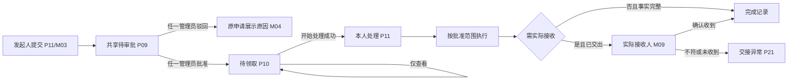
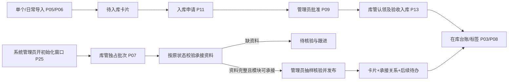
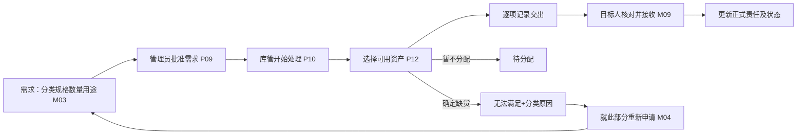
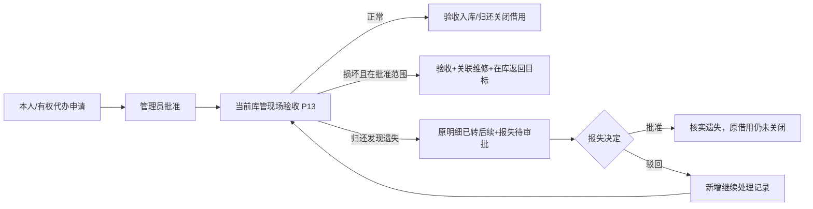
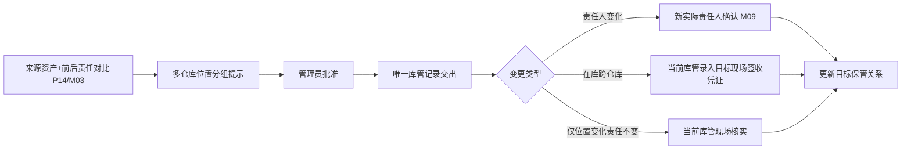
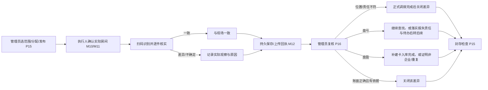
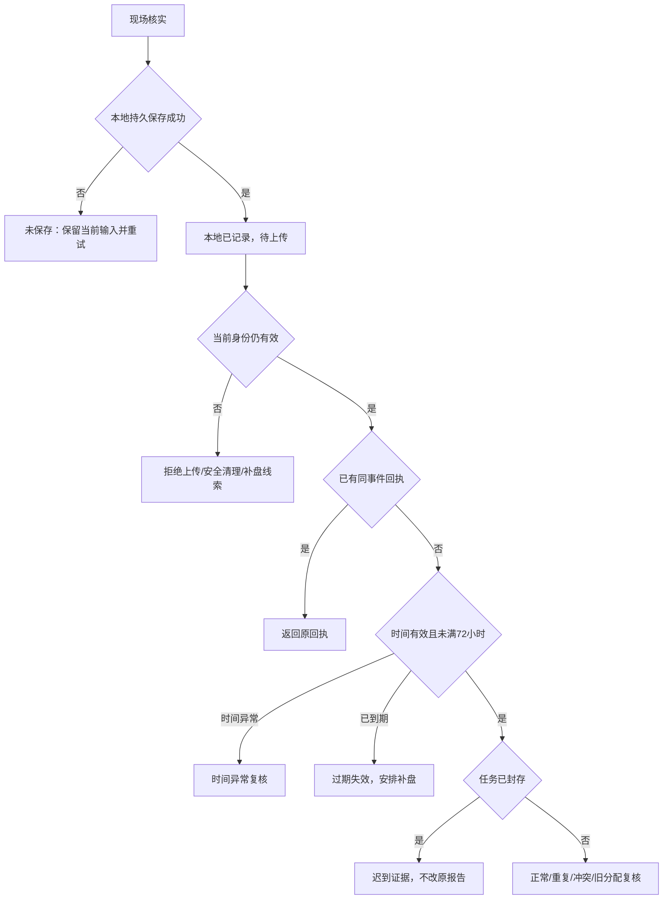
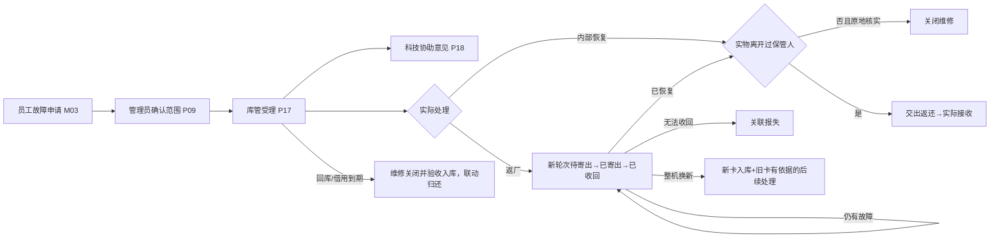
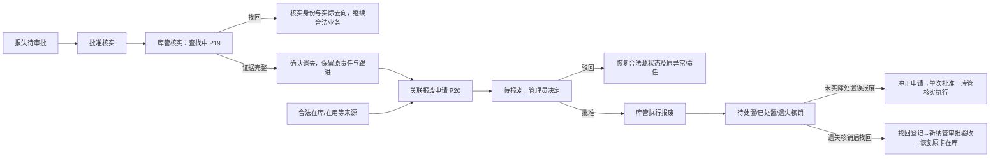

# 固定资产管理系统：信息架构与交互设计

> 设计版本：D0.2，吸收首轮审查后的评审稿 · 2026-09-06  
> 唯一需求基线：[PRD V1.5](2026-09-03-fixed-asset-product-design.md)  
> 交付：双端信息架构、业务流程、40 个页面/模板、低保真可点击草图、验收追溯。  
> [打开原型草图](../prototypes/2026-09-06-fixed-asset/index.html) · [原型说明与走查](../prototypes/2026-09-06-fixed-asset/README.md)

本稿将已确定的产品规则落实为页面与交互。页面编号是设计索引，尚未规定前端路由、框架或接口。原型全部使用虚构数据，只用于评审结构及操作顺序；示意角色切换不代表真实权限实现。PRD 原文保持不变。

D0.2 对审查意见 F1—F9 逐条核验：采纳成立的问题，纠正错误事实和建议算法。详见 [D0.1 审查裁决](../prototypes/2026-09-06-fixed-asset/REVIEW-D0.1-ADJUDICATION.md)。页面仍为 40 个，角色、审批层级和业务范围不增加。

## 1. 设计决策与边界

### 1.1 组织方式比较

| 方式 | 优点 | 代价 | 本稿处理 |
|---|---|---|---|
| 工作台处理待办 + 业务菜单查记录 + 资产详情追溯 | 符合多人审批、单库管续办、资产追溯三类任务，兼岗无需重复登录 | 同一单据可能有多个入口，须保留唯一详情 | **采用**；各入口是同一数据的筛选视图 |
| 完全按角色拆成独立后台 | 单角色页面简单 | 兼岗频繁切换，审批后执行割裂 | 不采用独立后台；工作台按已有权限合并工作区 |
| 完全按单据类型平铺 | 单据分类容易理解 | 审批、领取和异常分散，易漏待办 | 保留 PRD 业务目录，用统一详情和跨类型待办收敛操作 |

### 1.2 双端分工

- PC：企业共享审批、库管执行、台账、建卡导入、盘点组织与复核、科技协助、异常跟进、审计、配置。
- 小程序：员工与部门资产员现场申请、实物确认、本人借还、盘点、报修报失、部门代办、进度和消息。
- 小程序不因账号兼任管理员而出现整套审批后台；PC 兼岗不要求手动选择角色才能工作。
- 一名管理员作决定；一名当前处理库管执行整单；实际接收人只确认交接。三种动作的按钮分别命名。
- 资产状态、异常状态、申请进度、实物阶段分别展示；“待交接”不进入资产生命周期筛选。
- 本稿采用中性灰低保真，不确定品牌色、视觉主题或组件框架；不引入采购、财务金额、BPMN、物流追踪等功能。

### 1.3 设计依据的解释

PRD §8.2 的九个资产详情页签是业务记录的分类依据，§10.3 是页面分区。本稿合并为“常驻资产概要 + 九个页签 + 跨业务履历入口”，不生成两套重复详情。共享申请池和执行池在工作台高频进入，系统管理保留同一视图的入口及配置，不复制待办或改变全企业可见性。

## 2. 信息架构

### 2.1 PC 导航树

```text
全局栏：企业名称 / 当前员工 / 站内消息(P26) / 后台任务(P06) / 退出
├─ 工作台(P02)
│  ├─ 待审批(P09)：全部管理员共享
│  ├─ 待领取 / 我处理中 / 全部执行(P10)：库管
│  ├─ 我协助的报修(P18)：被邀请科技人员
│  ├─ 个人业务：按显式员工权限展示
│  └─ 异常跟进：超时、需转派、责任移交、期初待核验等
├─ 资产台账
│  ├─ 资产列表(P03) → 资产详情(P04)
│  ├─ 单个/复制/日常批量建卡(P05/P06)
│  ├─ 期初初始化(P07)：受控窗口及历史批次
│  └─ 标签打印(P08)
├─ 入库管理：待入库资产 / 入库单 → P11/P13
├─ 使用管理：领用与退库 / 借用与归还 / 调拨 / 报失与找回
│  └─ 类型筛选列表 → 统一详情(P11) → P12/P13/P14/P19
├─ 盘点管理：任务(P15) / 差异与迟到证据(P16)
├─ 报修与返厂：报修受理 / 内部处理 / 返厂轮次 / 维修记录(P17)
├─ 报废管理：申请 / 待确认 / 已报废 / 处置 / 冲正与找回(P20)
├─ 统计分析(P23)：报表目录、指标、明细与抽样记录
├─ 基础资料(P24)：组织人员 / 分类 / 仓库位置 / 品牌厂商
└─ 系统管理(P25)：角色成员 / 通知与参数 / 初始化窗口 / 系统日志
   └─ 共享池入口(P09/P10) / 受控转派(P22)
```

上图是全产品导航全集，不代表每个角色常驻显示全部菜单。菜单按角色隐藏无权限模块，详情页仍独立校验权限。P24 的组织人员配置和 P25 系统管理在系统管理员视角展示；资产管理员兼库管员不自动获得这些配置入口。其他基础资料的具体维护动作按显式功能授权，不用“看见台账”推导配置权限。无权访问、尚无任务、筛选无结果、被他人处理是四种不同页面状态。管理员“全部申请”包含执行中及历史，不限于待审批；库管企业列表仅含已批准申请，本人草稿单列。

### 2.2 小程序导航树

保留 PRD 四个主入口的顺序：首页、扫码、我的、消息。扫码作为独立导航入口，先进入识别场景，不将扫码图标等同于确认业务。

```text
未绑定 → 登录绑定(M01) → 首页(M02)
首页
├─ 待接收(M09) → 逐项核对 → 成功/异常
├─ 申请中心(M03) → 我的申请详情(M04)
├─ 我的资产(M05)：我在用的 / 我借用的
├─ 部门公用资产(M06)：独立统计与责任人操作
├─ 部门资产与代办(M07)：仅有效部门资产员
├─ 我的盘点(M10) → 现场盘点(M11) → 待上传(M12)
└─ 我的报修 → M04 的报修筛选
扫码(M08)：本任务盘点 / 资产概要 / 本人待接收 / 受限错误
我的(M14)：资产、申请、借用、报修、历史、绑定、退出
消息(M13)：结果 / 接收 / 到期 / 盘点 / 报修进度 → 当前可见业务
```

一级入口不超过上述边界，详情提供返回来源；从消息或扫码进入详情时保留“回首页”。我的申请保留来源单与最新后续摘要，用户不必跨菜单拼接业务结果。

### 2.3 角色与首页重点

| 角色 | 默认工作焦点 | 可见内容与操作边界 |
|---|---|---|
| 普通员工 | 待接收、借用临期、本人盘点 | 本人资产及参与业务；本部门公用概要；不浏览全企业库存 |
| 部门资产员 | 部门代办、交接及盘点 | 本部门个人/公用必要明细；代申请不等于代个人接收 |
| 资产管理员 | 共享待审批、超时、差异复核 | 全企业已提交申请；无库管角色不显示执行按钮 |
| 库管员 | 待领取、我处理中、交接异常 | 全部已批准申请可读，整单只有当前处理人可写 |
| 科技协助 | 我协助的报修 | 被邀请工单必要信息和本人意见，不改变维修目标或结案 |
| 审计只读 | 台账、业务履历、授权报表 | 无提交按钮；敏感字段与导出按单独授权 |
| 系统管理员 | 账号角色及配置异常 | 无自动业务权限；角色恢复后保留的原待办重新可见 |

## 3. 页面骨架与信息优先级

### 3.1 PC 统一布局

参考评审画布 1440 × 900；左侧导航约 208 px，内容区自适应。1280 宽仍保持清晰，密集表格允许区域内横向滚动，不把整页变成横向画布。

1. 面包屑、标题、当前状态、主要动作。
2. 一行说明“现在发生了什么、下一步由谁做”。
3. 筛选或数量摘要。
4. 核心表格/表单，必要时右侧显示审批范围或处理记录。
5. 原始单据、关联后续、履历及授权附件。

PC 表单采用就近字段错误提示；关键动作最后展示影响摘要。只确认一次业务动作，不用连续三层确认弹窗。审批按钮为“批准申请/驳回申请”，验收为“验收并入库”，接收为“确认收到所选资产”。

### 3.2 小程序统一布局

参考画布 390 × 844；信息按单列呈现。导航、返回、当前任务标题固定可找；主要操作置于内容末尾或底部安全区，按钮至少 44 × 44 逻辑像素。放大字体不截断状态、数量和错误提示。

- 列表卡：名称、编码、业务阶段、责任或日期、一个主动作。
- 详情：当前结果 → 需要本人做的事 → 明细 → 时间线。
- 扫码页：当前情境常驻。盘点时房间位置显著显示，换房间须显式确认。
- 不用颜色单独表示状态；错误后保留输入；请求结果未知时显示“正在核对处理结果”，不提前展示成功。

### 3.3 对象与显示口径

| 对象 | 主要信息 | 避免的误解 |
|---|---|---|
| 资产 | 生命周期、异常、正式保管、实物去向 | 已交出但未接收仍保留原正式责任，不能只显示“在库”让人误判可分配 |
| 申请 | 审批结果、执行人、数量/明细、当前后续 | 批准不等于履行，借用申请完成不等于归还 |
| 分配 | 资产编码、待交出/已交出待接收/收回待取消/已接收 | 只有已交出待接收项有员工确认按钮 |
| 盘点 | 应盘、已盘、未盘、差异、复核/上传结果 | 本地已记录、服务器已计入与已复核分别显示 |
| 维修 | 当前实物阶段、原责任、返厂轮次、最终去向 | 厂家收回不等于员工已收到 |
| 报废 | 报废申请结果、处置责任和处置记录 | 已执行报废不等于已实际处置 |

## 4. 流程梳理

图中每次箭头表示一次业务动作或页面跳转。人工等待以持久待办表示；图示不定义数据库事务跨越人工等待。

### F01 共享审批与整单执行



管理员竞争决定失败，展示实际处理人、时间、结果及“查看最新”。库管认领失败只读；退出、刷新不释放处理权。兼岗批准成功后显示“已批准，可开始处理”，不自动认领。资产管理员共享审批不设置“我的审批独占”。

领用样例的步进器按已发生事实定位当前步骤，不能把“刚完成的动作”误当作“当前待做动作”：

| 情境 | 已发生事实 | 当前步骤与提示 |
|---|---|---|
| 0 待管理员确认 | 已提交 | 管理员决定：待任一管理员确认 |
| 1 已批准待领取 | 提交、管理员决定已结束 | 库管分配：待库管领取 |
| 2 已领取待分配 | 已有当前处理库管 | 库管分配：库管正在分配 |
| 3 分配结束未交出 | 分配 2 件、1 件无法满足 | 实物交出：待交出 2 件 |
| 4 已交出未接收 | 实物交出已结束 | 本人接收：待接收 2 件 |
| 5 接收 1 件 | 已接收 1 件 | 本人接收：待接收 1 件 |
| 6 接收 2 件且缺货 1 件 | 全部处理阶段已结束 | 无进行中步骤；单头仍为部分完成，明确 2 件接收、1 件无法满足 |

本表是原型固定样例的显示规则，不能替代生产业务对混合明细的状态聚合。竞争失败文案的预览入口位于画布外；只有真实竞争失败时才在产品中展示该业务的最新实际结果。

### F02 建卡入库与期初发布



导入向导：模板 → 上传 → 映射 → 校验 → 结果；正确/错误行分开，错误包含批次、工作表、行号、字段、原值、原因。日常导入只建待入库；期初发布不伪造历史领用。未发布卡不打印正式标签、不进业务统计。期初发布以管理员确认的批次为单位；库管先补齐缺失资料或整理独立可发布批次，再核验发布。一次发布的卡片、承接、处理权和待办必须共同成功，不能留下部分关联结果。待报废期初发布另生成待审批报废，不能借批次发布完成报废审批。有真实下游动作时回滚入口展示阻断明细，转正式纠正。

### F03 领用/借用与部分履行



统一样例：申请 3 件，待分配 0、待交接 1（待交出 0、已交出 1）、已完成 1、无法满足 1、已取消 0。单头为待交接；再接收 1 件后才为部分完成。五类互斥数量和为 3，重新申请不回写原量。已有后续则“查看最新后续”，避免重复建单。借用额外有预计归还日，接收时过期须先延期获批或合法取消；正常借出不能直接转借。

### F04 退库/归还与关联继续处理



原单内固定“当前后续”面板，显示子单、驳回原因、继续处理入口和最终实际结果。归还尚未完成不得显示“已归还”。缺少附件须选择补交、接受缺项或关联处理；已完成历史不重开。延期无实物动作时管理员批准直接生效，不再要求库管验收。

### F05 调拨与人员组织交接



草稿及审批页显示分组资产数，建议需要多人负责时提交前按组分别申请；保留整单时仍一个库管写全部明细，不自动拆单。组织/人员变更不直接改资产，P24 生成责任清理清单，转正式调拨或退还；停用立即失去访问。有效目标失效时展示异常和变更/回库入口，不直接恢复旧快照。

### F06 盘点、差异与封存



正常项一件一次核实，复用当前房间，不强制照片。标签损坏用编码查找并记原因；离线查不到先存待核实线索，任务外已登记资产不算盘盈。一项资产多个差异分别关闭；选择转调拨先为处理中，实际完成才闭环。批量复核按项返回成功与冲突，跨差异联合动作任一过期整体不提交。

任务状态为草稿、待开始、进行中、待复核、已完成、已取消、已终止。无任何执行结果可取消；有结果只能终止；逾期仍进行中。正常封存前检查未盘原因、差异及同步确认；强制封存记录原因、未同步人员和待补证清单，不伪称未盘正常。终态不重开。

### F07 离线采集与迟到证据



72 小时从首次持久化起算，不从封存起算。首页和任务均有待上传入口；分别显示本地待上传、已上传待复核、重复、迟到、拒绝与过期。仅服务端明确计入的项增加完成数；最近盘点日期还需复核接受。已知任务封存停止采集；离线未知封存时的新观察只能作为补充线索。退出/解绑前提示本地未同步数量和清理结果，取消退出可回去同步；确认退出立即按 PRD 清理，不以未上传阻止账号停用。

### F08 报修、科技协助、多轮返厂



返厂轮次循环表示每次新建独立轮次，不覆盖旧轮次。科技邀请可在审批前由管理员发出、批准后由处理库管发出；意见不关闭维修。维修返回页展示原责任、借用有效日期和实物去向，返厂收回后仍维修中；超范围处理/变更目标另获一次管理决定。无运单和快递节点；换部件保留原卡，整机换新新卡新码。

### F09 报失、报废、处置和纠正



确认遗失不关闭原借用；最终执行遗失报废才终止借用。已报废待处置仍显示责任、位置和计划日期，超期在异常清单。已销毁或已实际移交处置不能普通冲正。核实单结束后遗失跟进仍保留，默认 30 自然日复核；UI 不显示赔偿或财务核销字段。

### F10 交接异常、代确认与转派

| 场景 | 当前库管入口 | 管理员决定 | 最终执行与通知 |
|---|---|---|---|
| 未交出取消 | 原分配行，原因 | 按现有合法取消范围 | 取消分配并释放资产；不改变历史已完成量 |
| 已交出未接收，拟取消 | 收回并验收，逐项凭证 | 不用超时替代实物事实 | 确认收回后取消；未收回持续待交接 |
| 实际签收但本人未操作 | P21 申请异常代确认，绑定明细、目标及证据 | 任一管理员批准/驳回 | 当前库管另点执行代确认，成功后通知实际生效责任人 |
| 接收人否认收到且凭证不足 | 保留异常，核查/收回/目标变更 | 不强行裁定收到 | 不出现可执行代确认，不自动结案 |
| 目标人员停用或需变更 | 原单发起目标变更 | 任一管理员批准新目标 | 新目标真实接收或回库；不能代确认给失效目标 |
| 处理库管无法继续 | P02 异常清单 / P22 | 管理员核对实物与凭证后受控转派 | 新人继续整单，旧页显示本次未保存，资产不解锁 |

代确认结果通知只用于知情，显示执行人、资产、执行时间、实际责任与依据来源；不要求再接收一次。维修返还表述“继续由你保管”。管理员仅批准、执行失败不产生已完成通知。异议使用既有管理员协助提醒，不新增客服工单。

## 5. 页面清单与原型范围

“模板”表示同一布局按业务类型变化字段，并非每种业务只剩一张泛化空白表。下列全部编号均在可点击草图中可选择；关键业务链可沿按钮跳转。原型中的未模拟提交会明确展示交互说明，不能当成真实执行。

### 5.1 PC：26 个页面/模板

| ID | 页面 | 入口与结构 | 主动作 / 关键分支 |
|---|---|---|---|
| P01 | PC 登录 | 账号、密码、登录、内部支持 | 登录；初次改密、连续失败锁定、停用；SSO 按部署选项 |
| P02 | 工作台 | 角色待办、异常、指标下钻、近期动态 | 打开待办；兼岗合并；无成员配置告警不能业务自批 |
| P03 | 资产列表 | 搜索、常用/高级筛选、分页表、批量工具 | 查看、建卡、标签、授权导出；逐项不可操作原因 |
| P04 | 资产详情 | 常驻身份/正式保管/实物去向、九页签、履历 | 按状态发起业务；受限占用提示；不可直接改责任 |
| P05 | 建卡与复制 | 基础身份、分类扩展、仓库位置、图片、校验 | 保存草稿/提交入库；复制排除编码序列号状态责任 |
| P06 | 导入与后台任务 | 模板、上传映射、逐行校验、结果、导出/标签任务 | 确认有效行导入、下载错误；离页任务继续 |
| P07 | 期初核验 | 窗口说明、批次处理人、状态分组、未结承接、待核验账龄 | 库管补资料；管理员核验发布；受限回滚与封板 |
| P08 | 标签打印 | 已发布资产选择、尺寸模板、预览、打印任务 | 单张/批量打印；重打保留同码；未发布不可打印 |
| P09 | 共享审批池 | 待确认/处理中/历史、类型筛选、申请范围与影响 | 批准/驳回；竞争结果；异常代确认/变更标识 |
| P10 | 库管执行池 | 待领取/我处理中/全部已批准、当前处理人、实物阶段 | 查看不认领；开始/继续处理；他人只读与求助 |
| P11 | 统一业务详情 | 申请概要、批准范围、数量/明细、执行区、后续、履历、附件 | 按当前身份阶段操作；终态只读，关联纠正 |
| P12 | 分配与交出 | 批准需求、可用资产选择、逐项分配、无法满足、交出凭据 | 提交分配/记录交出；范围变更另申请；批量逐项反馈 |
| P13 | 入库/退库/归还验收 | 资产核对、实物状态、仓库位置、附件、结果预览 | 正常入库、损坏转维修、归还遗失转报失；缺件闭环 |
| P14 | 调拨与目标变更 | 来源/目标对比、资产分组、责任模式、交接方式 | 提交申请/记录交出/现场核实；跨仓库整单单库管 |
| P15 | 盘点任务 | 创建范围、预估数、执行人、发布；任务进度与封存检查 | 发布/分配/复盘/封存；无结果取消、有结果终止 |
| P16 | 差异与证据复核 | 快照/观察/当前三栏、独立差异、后续、迟到分区 | 采信/调拨/报失/补建卡/补充复核；冲突按项显示 |
| P17 | 报修与返厂 | 批准范围、临时去向、原责任、内部意见、轮次、最终去向 | 受理/寄出/收回/返还/回库/关联异常；不覆盖旧轮次 |
| P18 | 科技协助 | 我协助的报修、被邀请资产/故障、处理意见 | 追加本人意见；撤销/终态只读；无验收结案按钮 |
| P19 | 报失与找回 | 原责任、查找记录、证据、下一跟进日、关联记录 | 核实查找/遗失/找回；结案仍保留遗失跟踪 |
| P20 | 报废与处置 | 申请、批准、执行事实、处置责任、凭证、冲正/找回 | 执行报废/记录处置/关联纠正；已销毁阻断普通冲正 |
| P21 | 交接异常/代确认 | 原明细、目标、实际签收、原因、证据、许可与执行 | 库管申请→管理员决定→库管执行；通知实际责任人 |
| P22 | 受控转派 | 原处理人、整单阶段、实物去向、未同步、接任人、凭证 | 管理员确认转派；不释放锁；旧页面未保存反馈 |
| P23 | 报表与抽样 | 标准报表目录、指标口径、分子分母、筛选及明细 | 下钻/授权导出；抽样来源、漏记与补录历史 |
| P24 | 基础资料/人员交接 | 树与列表、有效状态、人员角色摘要、责任清理 | 维护资料/生成交接；停用不自动重写资产责任 |
| P25 | 系统设置 | 角色成员、初始化窗口、参数、通道、配置异常/系统日志 | 显式授权、参数生效预览；无业务角色不能审批 |
| P26 | PC 消息中心 | 待办与结果、个人已读、渠道记录、业务入口 | 查看当前结果；已读不等于已处理，消息失败不回滚业务 |

### 5.2 小程序：14 个页面/模板

| ID | 页面 | 核心结构 | 主动作 / 关键分支 |
|---|---|---|---|
| M01 | 绑定与资料异常 | 工号、企业登记手机号、验证码、内部支持 | 短信校验后绑定；手机号异常可未登录求助；不能管理员代绑定 |
| M02 | 首页 | 待接收、借用到期、申请入口、本人/公用资产、盘点、待上传 | 进入下一步现场动作；不展示全企业指标 |
| M03 | 申请中心/业务表单 | 业务类型、本人/公用/代办、需求或资产、原因日期 | 提交/草稿/结果；借用日期校验；报废合法来源引导 |
| M04 | 我的申请/详情 | 状态说明、数量分布、逐项交出/接收、时间线、当前后续 | 查看/接收/无法满足重申/管理员协助；历史不改写 |
| M05 | 我的资产 | 我在用的/我借用的、状态、位置、到期、历史 | 退库/归还/延期/报修/报失/符合条件报废 |
| M06 | 部门公用资产 | 公用责任人、固定位置、状态、必要概要 | 普通员工报修；指定责任人接收；有权资产员代办 |
| M07 | 部门资产与代办 | 本部门个人/公用筛选、必要责任明细 | 代申请领用/退库/调拨/报修/报废；不可代个人接收 |
| M08 | 扫码与资产概要 | 识别结果、编码、状态、当前可操作业务 | 待接收/盘点/报修/报失；标签坏改编码查询；无权受限 |
| M09 | 待接收/核对结果 | 本人可接收清单、交出日期、截止日、逐件核对 | 确认收到/反馈不符；未交出不出现接收；无代他人确认 |
| M10 | 我的盘点任务 | 应盘/已盘/未盘/差异、当前任务、待上传、已同步确认 | 进入盘点/补传；已封存不继续采集原任务 |
| M11 | 连续盘点 | 常驻实际房间、识别区、账面责任、现场核实、最近结果 | 一致一次保存；差异/未知展开；重复/无效/任务外反馈 |
| M12 | 待上传与回执 | 分任务事件、首次保存/截止时间、状态与失败原因 | 上传/重试失败项/补盘求助；迟到不改报告；过期不重试 |
| M13 | 消息与责任告知 | 本人待办/结果、代确认责任、读取状态、原业务 | 查看/核查异议；不再次接收；零微信也能找到业务 |
| M14 | 我的与账号 | 本人身份、资产申请记录、绑定、缓存摘要、退出 | 换绑短信验证；退出前说明待上传清理；停用立即无访问 |

## 6. 关键页面字段与交互规格

### 6.1 统一申请表单变体（P11/M03）

| 类型 | 输入 | 提交前校验与后续入口 |
|---|---|---|
| 领用 | 分类、规格、数量、用途、期望日、个人/公用、合法目标及位置 | 数量正整数；模式与责任互斥；员工不用选库存编码 |
| 借用 | 分类、规格、数量、用途、借用人、位置、预计归还日 | 日期晚于当日；接收时重验；不在此录入累计持有上限 |
| 退库/归还 | 本人或有权代办资产、原因、状况 | 按在用/未结借用选择；占用说明及求助；验收由库管执行 |
| 延期 | 原借用、原/新到期日、原因 | 管理员批准直接生效；保留历史逾期 |
| 调拨 | 来源资产、目标所属/使用组织、使用模式、责任人/仓库及位置 | 至少一项变化；来源操作与目标选择分开授权；分组提示 |
| 报修 | 有权资产、故障、影响程度、发生时间、图片 | 本部门公用可选；已报废不可选；不支持视频 |
| 报失 | 资产、最后见到时间、最后位置、情况、图片 | 提交不提前变遗失；展示后续核实步骤 |
| 报废 | 合法来源资产、原因、现状、建议处置、依据 | 借出正常提示先归还；提交后待报废，执行后才已报废 |

### 6.2 分配与数量（P12/M04/M09）

顶部展示“申请 3 / 待分配 0 / 待交接 1 / 已完成 1 / 无法满足 1 / 已取消 0”；待交接细分为待交出与已交出。收回待取消在对应实物行明确标记，仍计入待交接，不能因展示分组提前扣除。可用库存选择器展示编码、分类规格、位置和可分配情况；提交时发生占用的行保留原因，成功行和失败行分别反馈。

待交接卡固定同时展示“待交出 X”和“已交出待接收 Y”，零值也显示；两者仅细分待交接，不重复计入申请总量。员工不必阅读守恒公式，设计和验收仍校验数量一致。

交出表单核对具体资产、实际时间、临时去向和签收依据；主按钮“记录交出”。接收侧勾选表示已核对该实物，扫码只帮助识别。成功页显示本次成功资产、未成功项及责任结果。拒收不自动取消；缺货不是审批驳回。

### 6.3 证据与附件（P13/P16/P20/P21）

证据区固定展示：关联单据和资产、实际签收/处置对象、业务发生时间、系统记录的提交人和接收时间、采集方式、所附依据及声明来源。采集方式为扫码识别后确认、编码查询后确认、手工记录、历史未知；签收单、代理依据、沟通记录、厂家凭证或本人陈述单独列示，不自动打可信等级。

上传控件就近显示 PRD 限额：图片 JPG/PNG/WEBP，每张 ≤10 MB、每业务 ≤9 张；PDF 每份 ≤20 MB、每业务 ≤5 份；总量 ≤50 MB。校验/安全扫描中不开放下载，失败可删除未提交附件重新选取；已完成凭证追加纠正版本，不能覆盖原记录。无权限不下发附件内容，不以模糊预览泄露信息。

### 6.4 复核竞争（P16）

左栏“任务快照”，中栏“现场证据”，右栏“当前资产”；差异行分别列位置、责任、使用模式、状况，每行有状态、后续业务及决定记录。提交时过期显示“该差异已由陈琳于 14:20 处理；本次未保存”，提供当前处理方式和只读入口。转调拨失败时不显示已建单或已修正；批量结果逐行列出，不用一个成功提示覆盖冲突。

### 6.5 受控转派（P22）

仅资产管理员看到可写区。先核对原处理人和整单资产阶段，再填写接任库管、原因、实际交接时间、去向和凭证。确认页明确未交出、已交出、待收回、待同步分别多少；成功后显示新处理人和时间。旧处理页冻结并解释“已转交，本次未保存”，不自动重放未提交内容。

### 6.6 报表、后台任务与抽样（P06/P23）

标准报表保留 PRD §14.2 的 20 类目录，使用同一筛选/明细模板。统计下钻保留条件和时间窗口，展示分子、分母、排除项，空数据与无法评价分开。审批批准、分配、交出、接收、报废、处置分别统计。

抽样记录先登记月度窗口和范围，再录现场核对或线下凭证来源；30 笔中 1 笔漏记显示 29/30 = 96.7%。模糊回忆单列待核实；样本不可得为无法评价；补录显示发现时结果和真实补录时间，跳既有业务/纠正入口，不倒签或重复实物动作。

导入最多 20,000 行/20 MB；超过要求拆分。导出统一提供任务中心，超过 10,000 行必为后台任务；标签大批量同样显示排队/处理中/成功/失败、结果和重试入口。离页后可从全局后台任务回到原批次。

## 7. 全局状态与反馈规范

| 状态 | 页面反馈 | 下一步 |
|---|---|---|
| 加载中 | 保留页头与骨架；提交按钮禁用并显示处理中 | 等待当前结果，避免重复触发 |
| 无数据 | 暂无申请/任务 | 按权限展示创建或返回首页 |
| 筛选无结果 | 保留筛选条件 | 清除筛选 |
| 无权限/关系失效 | 当前账号无法查看或操作，不展示受限详情 | 返回可见列表；本人受影响业务可求助 |
| 他人处理中 | 处理人、开始时间、只读说明 | 查看进度/通知管理员协助 |
| 版本已变化 | 什么已变化、本次是否保存、最新结果 | 查看最新后重新判断，不自动覆盖 |
| 批量部分成功 | 成功数、失败数、逐项原因 | 仅重试失败项 |
| 超时/弱网结果未知 | 正在核对处理结果，保留输入 | 查询/重试同一动作，不宣称失败后另建单 |
| 终态 | 原始事实和当前后续分开，原记录只读 | 合法关联纠正/复盘 |
| 外部通知失败 | 站内结果仍保留 | 可继续查看业务；不强迫授权微信 |
| 模板未核验/不可用 | 隐藏对应订阅入口 | 站内完成全流程 |
| 角色无人/处理人失效 | 原待办保留，业务/配置告警按角色显示 | 有效管理员转派；系统管理员修复角色配置 |

审批默认 2 工作日、领取 1 工作日、领取后首次交出/执行 2 工作日；员工接收每项从实际交出起算 3 自然日。页面显示具体截止时间及业务阶段，避免只写“已超时”。超时不自动取消、抢办或解锁。全体管理员未处理升级、5 分钟待办可见与角色恢复等继续按 PRD §9.5/§13 执行；已读不会结束异常。

## 8. 低保真草图使用与评审重点

原型左侧是设计目录，上方“PC/小程序”与情境选项是评审工具，不属于产品导航。画布内部才是产品页面。所有数字、人名、编码均为示意。

D0.2 补充的草图约定：

- P04 九页签在本页切换；领用/借还/调拨及操作日志提供有业务含义的本资产记录，无相关维修、报失、报废或盘点记录时展示真实空态，不链接其他资产的单据来填满页面。打开原始单据是显式点击，非切页签自动跳转。
- M11/M12 画布外提供正常、T+71h 封存后迟到、T+72h 过期、身份失效、已有回执跨截止重试、时间异常和旧分配证据情境。只演示单条证据裁决与对应计数，不建设真实离线存储或权限服务。已知封存时 M11 停止原任务新采集，仅提供既有证据入口；员工无封存按钮。
- 现场使用 301/302 两个房间足以演示确认切换。账面快照固定为发布时的 302，切换到 301 会形成位置差异；账面位置不得随现场选择改变。房间样例数不限制真实位置资料。
- P20 选遗失核销但当前资产无已确认遗失证据时，就近说明并禁止提交；不自动创建报失或把普通报废改为遗失。原生服务端证据验证仍属后续实施。
- P02/P23 的汇总和抽样数字明确为固定虚构样例，不随领用链情境联动；此轮不扩建全局统计模拟。

首轮建议按下列顺序看：

1. P02 → P09 → P10 → P11 → P12 → M09 → M04：审批、分配、交出、实际接收及部分履行。
2. M10 → M11 → M12 → P16 → P15：正常快盘、差异、离线及封存。
3. P17 → P18 → P17 → P19/P20：科技协助、多轮返厂、借用到期回库及关联异常。
4. P21 → P09 → P21 → M13：异常代确认的一次审批、独立执行与责任告知。
5. P22、P07、P24/P25：单库管转派、期初承接、角色失效与恢复。

评审问题集中在：任务是否找得到；状态与下一执行人是否清楚；交出与接收是否容易误认；部分履行是否可读；差异和后续是否能在原入口追踪；手机单手操作是否顺畅。视觉品牌、技术实现与真实运行验收在后续阶段完成。

## 9. PRD 验收追溯

下表表示设计覆盖，不表示业务实现或真实验收通过。页面模板承载完整规则，草图重点展示代表状态；后续开发验收必须执行 PRD §19 全部场景。

| 验收项 | 流程/页面 | 设计检查点 |
|---|---|---|
| AC-01 | F02，P05/P06/P13 | 逐行错误、入库审批执行、回滚阻断 |
| AC-02 | F03，P12/M09 | 实际接收后才改变责任 |
| AC-03 | F04，M05/P13 | 逾期、延期、停用代办、归还关闭 |
| AC-04 | F05，P14/M09 | 新责任人确认、跨仓库单库管 |
| AC-05 | F06，M11 | 逐件实盘、多重差异、任务外 |
| AC-06 | F07，M12/P16 | 旧分配与期间流转保留证据 |
| AC-07 | F08，P17/P18/M09 | 原地修复与离开后返还区别 |
| AC-08 | F08，P17 | 轮次收回不等于维修结束 |
| AC-09 | F09，P20 | 批准、执行报废、处置分离 |
| AC-10 | §2.3，P09/P10/P25/M08 | 角色、关系、敏感字段隔离 |
| AC-11 | F04/F10，P04/P11 | 占用提示与合法关联例外 |
| AC-12 | F10，P12/P21 | 未交出取消、已交出先收回 |
| AC-13 | F02，P07 | 未结承接和模块可用性 |
| AC-14 | F03，P12/M04 | 五类数量守恒、终态汇总 |
| AC-15 | M01/M14 | 短信验证、停用/换绑失效 |
| AC-16 | M06/M09 | 公用独立入口与指定接收人 |
| AC-17 | F09，P19/P20 | 报废驳回保留遗失和原借用 |
| AC-18 | F01，P09 | 全企业共享与首个合法决定 |
| AC-19 | P02/P10/M13 | 站内权威、未交出不催接收 |
| AC-20 | F06，P15 | 无结果取消、有结果终止、终态不重开 |
| AC-21 | F10，P21/M09 | 指定接收、单管理员代确认 |
| AC-22 | §6.6，P23 | 口径、分子分母、履行分阶段 |
| AC-23 | F04/F08/F09，P11 | 关联转换失败无半完成反馈 |
| AC-24 | F08，P17 | 借用到期回库、失效目标出口 |
| AC-25 | F07，M12/P16 | 迟到仅追加、不改封存报告 |
| AC-26 | F09，P20 | 处置、冲正、找回原卡纳管 |
| AC-27 | F08，P17 | 多轮独立、新旧卡分开 |
| AC-28 | F05/F10，P24/P22 | 身份变更触发正式责任交接 |
| AC-29 | F01，P10/P11 | 查看不占用、整单独占、终态只读 |
| AC-30 | F10，P22/P25 | 受控转派与兼岗动作分离 |
| AC-31 | M03/M05 | 本人报废及正常借出引导 |
| AC-32 | F06，P16 | 多差异闭环、盘亏与盘盈后续 |
| AC-33 | F02，P07 | 发布承接完整、下游回滚限制 |
| AC-34 | P02/P10/P11 | 兼岗合并、旧页未保存、去重求助 |
| AC-35 | P12/P18/P21/M04 | 数量一致、科技只写意见、代确认 |
| AC-36 | P02/P07/P19/P22 | 失效转派、待核验及遗失持续跟进 |
| AC-37 | F04，P11 | 后续驳回新增继续处理，不重开原终态 |
| AC-38 | F07，M11/M12 | 本地持久成功后提示、快盘、未知身份 |
| AC-39 | M01/M07/P24 | 绑定资料纠正与部门代办边界 |
| AC-40 | §3/§6.3/§6.6 | 凭证来源、29/30、键盘和触控、零微信 |
| AC-41 | F10，P21 | 非医疗原因可凭真实依据申请，不强认争议 |
| AC-42 | F04，P11/M04 | 原单嵌后续、继续处理标题与实际结果 |
| AC-43 | F07，M12 | 首次持久化72小时、旧回执、封存冲突 |
| AC-44 | M06/M07 | 本部门必要明细代办、不开放个人接收 |
| AC-45 | F05，P14/P09 | 多仓库分组提示，不自动拆单 |
| AC-46 | §7，P02/P25 | 已读仍升级、无管理员保留待办 |
| AC-47 | §7，M13/P25 | 无模板隐藏订阅，站内可完成 |
| AC-48 | §6.3，P13/P20/P21 | 采集方式与所附依据分开、不排名 |
| AC-49 | F03，M04/M03 | 无法满足行重申及最新后续入口 |
| AC-50 | §6.6，P23 | 抽样窗口来源、漏记原结果与补录 |
| AC-51 | §6.4，P16 | 差异版本竞争、按项反馈、调拨完成才闭环 |
| AC-52 | F10，P21/M13 | 代确认执行成功后通知实际责任人 |
| AC-53 | §2.3/§7，P25/P09 | 角色恢复后原待办重新可见且不重置时限 |

## 10. 交付状态

- 本次完成设计初稿与可点击低保真草图，覆盖 PC 和小程序的信息架构及关键流程。
- 原型为页面结构与情境演示；不调用真实接口、不验证微信能力，也不提供生产权限、离线队列或并发实现。
- 后续先评审这些页面和交互，再细化视觉及技术实施；当前未将草图标为已确认的最终 UI。
- 当前目录未初始化 Git，本次文件保存于现有 docs 目录，无提交或推送。
